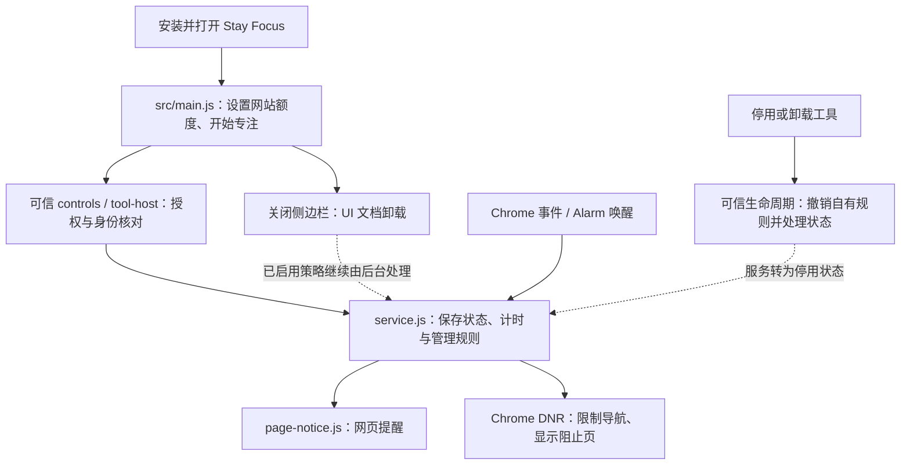

# 扩展开发怎么选：五种使用场景与一个项目多个 JS

> **普通开发者的第一入口**（2026-10-19；代码事实以最新 `main` 为准）。先问“要让用户完成什么”，再选项目和运行方式。本页解释产品选择、文件分工与生命周期；完整配置和授权合同沿用所链接的 API 文档与 Skills。

## 1. 先选需求：五种使用场景

| 我想做什么 | 默认选择 | 典型使用 | 从哪里开发 / 独立安装 |
| --- | --- | --- | --- |
| **1. 控制网页完成一系列操作** | **网页自动化（Controller）** | 自动填表、点击、等待元素、提取结果 | “开发”运行草稿；本地 `controller` 项目；正式任务由“我的”管理 |
| **2. 给网页直接增加功能** | **网页增强（Page USER_SCRIPT）** | 页面悬浮按钮、DOM 修改、思维导图、React/Vue 页面组件 | “开发”在当前网页试运行；本地 `page-userscript` 项目；正式安装后在“扩展→网页增强”管理 |
| **3. 做一个独立侧边栏管理工具** | **侧边栏应用（Sidebar Tool）** | 笔记、Cookie Editor、书签管理、配置表单 | 独立 `tool.config.json` 项目，按原打包流程生成可审阅 JSON，安装到“扩展→应用” |
| **4. 关闭界面后仍要监听事件或处理持久规则** | **后台服务（Background Service）** | Chrome 事件与 Alarm、云端任务通知、获批持久规则 | 当前复用已受审、固定编译的后台能力；**普通作者尚不能独立安装任意特权后台 JS** |
| **5. 在一个产品内组合上述职责** | **组合式应用（Combined Application）** | Stay Focus、Time Review、Prompt Shortcuts、AdBlock 的不同组合 | 明确 UI、网页、Controller 与后台入口，按各自现有授权与安装合同交付；**尚无跨职责原子组合安装包** |

文中的“扩展→应用 / 网页增强”表示在“扩展”列表定位对应类型；**应用、网页增强是类型标签/筛选，不是新增 Tab**。

Controller、Page、Sidebar Tool 各有执行和安装合同；后台服务有固定 Chrome SW 事件与受审能力，但目前**没有任意第三方后台 JS 安装器**。组合式应用是第五种用户场景，**不是第五套 JavaScript Runtime**。JavaScript、React、Vue 是编写技术，不决定代码的运行位置或权限。

已安装的成熟工具先保护其原类型与身份。例如 Prompt Shortcuts 是 Sidebar Tool v2 + 已审核网页适配器，不能仅凭“网页有按钮”就改成 Page Program。新建纯网页按钮通常优先考虑 Page。

### 场景、触发来源、开发技术分开

| 维度 | 可以是什么 | 边界 |
| --- | --- | --- |
| 使用场景 | 网页自动化、网页增强、应用界面、后台服务、组合式应用 | 五个产品场景，不是五套 Worker |
| 触发来源 | 手动、网页匹配、浏览器事件、定时、获批云端通知 | 同一 Controller 可以有多种触发方式，不改变执行授权 |
| 开发技术 | JavaScript、React JSX、Vue SFC；单文件或多文件 | 只影响源码与构建，不授予 DOM、Chrome 或特权后台权限 |

例如，云端通知可触发**已安装且获批的 Controller Task**，但不能携带新的 JS 直接在特权 Service Worker 执行。

### 每一类什么时候开始、什么时候停止？

| 类型 | 开始与权限 | 关闭、停止与恢复的实际边界 |
| --- | --- | --- |
| Controller | 用户明确 Run，或经批准的已安装任务/计划触发；只能操作获准目标，`page.automation` 等程序能力和网站授权分别核验 | 运行期间保持承载任务的运行页面打开；不把它作为关 UI 后持续工作的后台服务。Stop、任务取消或实际运行页面销毁时终止；切换 Tab/隐藏界面不等于销毁。已点击、提交、发送的结果不自动回滚，SW 不自动重放 |
| Page USER_SCRIPT | 当前文档试运行须用户脚本许可和目标网站授权；安装版还需验证、确认、启用及匹配 `pageRules` | 当前文档结束后，该文档运行结束；刷新/新导航只会按已安装且启用的规则重新启动，临时预览不会因此自动安装。停用/卸载撤销后续启动，并请求受管 UI 清理；清理回执未知时按状态提示处理，有未知清理栅栏则关闭原标签页后重新打开。任意脚本遗留的 DOM、监听器、定时器或请求不保证全部回滚，可能需要刷新；BFCache 恢复也需作者清理逻辑 |
| Sidebar Tool | 审阅安装包和能力后，用户打开工具才挂载 UI；`OpenDeskTool` / v2 `OpenDeskSDK` 的具体操作仍由宿主授权 | UI 文档卸载时，其 React Root、监听和计时器结束；重开创建新实例，从获准存储恢复。关闭 UI 不撤销已经提交的 Cookie 修改或后台规则；停用、更新、卸载由安装器和对应生命周期处理 |
| 后台服务 | 由 WXT/SW 的已审核固定入口注册 Chrome 事件与 Alarm，复用现有授权和持久状态；不是安装动态 `background.js` | 关闭 UI 不停用既有规则；SW 事件驱动、可休眠，业务需要恢复与明确撤权清理 |
| 组合式应用 | UI、Page、Controller 和固定后台分别遵守自己的入口与权限；共享模块只在实际消费者环境运行 | 关闭 UI、停止 Run、停用 Page、撤销后台、整体卸载是不同生命周期；不能用单份 UI JSON 假装统一安装和清理 |

### 第一个项目怎样开始？

- **网页自动化**：在“开发”直接编辑 Controller JS，明确点击“运行草稿”，核对真实结果；需要重复使用时再沿原任务流程保存、验证和安装。多文件时开启“本地项目”并选择已授权目录，源码里用 import 分工。运行期间保持运行页面打开。
- **网页增强**：在“开发”选择 Page JS 或相应组件，在当前网页明确试运行；满意后保存固定候选，验证同一版本，再确认安装。已选择的本地 Page 项目入口为“安装网页增强”→审阅→“确认安装固定版本”；安装后到“扩展→网页增强”启停和管理。正式验证可能再次执行源码，不能把预览回执直接当安装成功。详见 [操作步骤](sidebar-local-projects.zh-CN.md)。
- **侧边栏应用**：开发者维护 tool.config.json 与自己的 UI 文件，按唯一打包流程生成正式 JSON；使用者在“扩展”审阅并确认安装，打开后使用。已有官方应用也可从原目录入口安装，不要求使用者有 Node 或项目源码。需要持久后台的组合产品再核查固定服务是否已支持。
- **后台服务**：先检查已有 Cloud Control、Task 调度、Chrome Alarms 和固定可信规则。确需额外后台能力时由维护者设计可授权、可撤销的最小公共接口；当前不能上传一个动态 `background.js` 取得 SW 特权。
- **组合式应用**：先分别列出每个入口、文件、执行世界、权限、跨环境消息、Stop owner；各职责单独跑通后，再沿现有 Sidebar Tool、Page、Task 安装通路交付。暂不宣称统一组合式安装包已经实现。
- **开发前提**：直接编辑不需要本地开发服务；多文件本地项目按已有目录 CLI / Native 授权接入，MCP 是可选高级入口。新增 JSX/SFC 使用 Developer 编译入口，Standard 选择 Direct JS 或本地预构建。不要把这些不同路径的前提叠加给每位用户。

完整合同：[Controller](controller.zh-CN.md) · [Page USER_SCRIPT](page-userscript.zh-CN.md) · [Sidebar Tool](sidebar-tool-development.zh-CN.md)。

## 2. 什么控制“哪个 JS 在哪里运行”？

先分开六件事，就不会把多个文件误认为多个运行环境：

| 概念 | 回答的问题 | Stay Focus / 项目例子 |
| --- | --- | --- |
| 产品类型 | 用户要完成什么？ | 专注管理是组合式扩展应用 |
| 运行环境 | 代码在哪个隔离上下文执行、能接触什么？ | 工具 iframe、网页、可信 Side Panel、MV3 SW |
| 文件入口 | 谁被运行器或固定构建首先加载？ | `src/main.js`、固定入口导入的 `trusted/service.js` |
| 源码模块 | 哪些代码供入口复用？ | `model.js`、`policy.js`；不一定独立启动 |
| 语言 / UI 框架 | 用什么语法和组件编写？ | JS、React JSX、Vue SFC；需要时在构建阶段转换 |
| 触发时机 | 什么时候开始处理事情？ | 打开 UI、明确 Run、网页匹配、Chrome 事件或 Alarm |

### Controller / Page 项目怎样声明？

本地项目用 `package.json` 的 `opendesk` 元数据；**现有项目校验器的 `runtimeKind` 只有 `controller` 与 `page-userscript` 两个值**。下面是现有示例中的字段摘录，不是另一个完整包格式：

| 字段 | Controller 示例 | Page 示例 |
| --- | --- | --- |
| `format` / `sourceFormat` | `opendesk.project.v1` / `esm` | 同左 |
| `runtimeKind` | `"controller"` | `"page-userscript"` |
| `entry` | `"src/main.js"` | `"src/main.js"` |
| 范围与能力 | `siteOrigins`、`permissions: ["page.automation"]`、`paramsSchema` | `pageRules`：`matches`、`excludeMatches`、`runAt: "document_idle"`、`allFrames: false`、`world: "USER_SCRIPT"` |
| 完整可核查配置 | [local-controller/package.json](../../examples/programs/local-controller/package.json) | [local-page-ui/package.json](../../examples/programs/local-page-ui/package.json) |

作者按实际网站收窄范围；示例的宽匹配不代表应默认申请全站。入口中再 `import './model.js'` 等依赖；构建器从 `entry` 收集和编译允许的依赖。新 ESM Controller 推荐 `export default async function main()`；旧示例的参数兼容写法不改变 [零参数入口合同](runtime-globals-and-preinstalled-libraries.zh-CN.md)。声明资产的 Page 项目仍遵守自己的资产注入合同。

“开发”的本地项目界面经已有 `project.resolve` 获得并核验 `runtimeKind`、绑定身份、源码摘要和准备代际；实际 Run 再分发为 Controller 的 `run.start` 或 Page 的 `page.preview`。**编辑或保存只准备源码，不自动执行或安装。** 完整步骤见 [本地项目](local-projects.zh-CN.md) 与 [开发选项卡](sidebar-local-projects.zh-CN.md)。

### 单文件点击不同运行入口，会发生什么？

| 当前编辑方式 / 实际操作 | 执行链与限制 |
| --- | --- |
| Controller JS → 运行草稿 | `script-editor.js` 捕获当前代码、参数和目标 → `RunHost.start` → 受控 Worker。可用词法 `page`/Locator，无目标网页 `document` |
| Page JS → 在当前网页试运行 | 捕获当前文档和代码 → `previewPageScript` → `chrome.userScripts.execute` → 目标文档的 `USER_SCRIPT`。有 DOM，无 Controller `page` |
| React JSX / Vue SFC → Run | 按 Page 组件准备并进入同一受管网页 UI 路径；Developer 有浏览器内 JSX/SFC 编译，Standard 可用 Direct JS 或本地预构建项目 |
| 已明确类型的项目/源码选错入口 | 编辑器拒绝 Controller 与 Page 混投；不会按文件名或出现 `document`/`page` 关键字擅自提升权限 |
| Stop | 取消未完成的准备；Controller 停对应 `runId`；Page 请求退役对应预览的受管 UI，非受管脚本不支持该 Stop；未知清理结果按原状态处理。Stop 不停用已安装 Page，也不回滚任意 JS 副作用 |

正式 Page 自动启动也不只是“一次 register 用户源码”：安装服务先注册**固定 bootstrap**；网页命中后回到可信服务，核验安装代际、站点与真实文档，再执行固定版本源码。当前正式自动入口限制为**顶层文档、`document_idle`**；已批准的 `pageFrames` 是另一个受管子页面资源合同，不能据此宣传任意 `allFrames` 自动运行。

### 构建、Manifest、import、事件监听分别做什么？

- **工具配置 `files`**：选哪些 UI 和允许的依赖字节进入可安装工具包；不会注册 Chrome Background。
- **WXT 固定构建入口**：决定哪些受审源码编译进扩展。当前 WXT 从基础 Manifest 移除旧 Background 声明，再由 `src/entrypoints/background.js` 生成唯一 SW；不能只看根 `manifest.json` 猜最终入口。
- **Manifest**：向 Chrome 声明固定入口、网页匹配、执行世界和扩展级权限；目前 `page-relay` 是 `ISOLATED`，`sdk-main` 是 `MAIN`，两者权限不相同。
- **`import`**：让被导入模块进入该入口的执行图；模块不会因名为 `service.js` 或处在 `trusted/` 就自动进入后台。
- **事件监听**：入口加载后注册工作触发条件，例如 tab、window、idle、Alarm；Chrome 事件可唤醒已注册的 SW，导入本身不代表用户已授权或业务已启用。

各世界全局变量以 [运行变量与依赖合同](runtime-globals-and-preinstalled-libraries.zh-CN.md) 为准。普通作者无需修改这些固定入口。

## 3. 一个扩展项目有很多 JS，应该怎样拆？

每个文件保留一个清晰职责；纯模块由需要它的入口导入。**同一执行图内可以复用模块实例，不同运行环境不会自动共享内存、`window`、全局变量或 Chrome 权限。** 跨环境数据通过已有 SDK、消息桥和获准持久存储协作，并校验当前工具、版本、文档和权限。

### Stay Focus：从用户操作看多 JS 协作（R2 已提取）



停用保留数据、卸载删除范围见下表。网站提醒没有 DNR 权限，侧栏中的刷新计时器也不负责后台计时。

| 项目内文件 | 实际职责 | 谁加载、在哪里运行 |
| --- | --- | --- |
| `src/main.js` | 表单、额度与状态显示、发起 `focus.*` 请求；其 30 秒 interval 仅刷新显示 | `tool.config.json.files.js` 进入 UI 包，用户打开工具时在沙箱 iframe 执行 |
| `trusted/service.js` | 前台网站用量结算、专注状态、Alarms、DNR、恢复与撤权 | `src/sw.js` 静态导入，运行于 MV3 SW |
| `trusted/page-notice.js` | 当前网页提醒及清理，不决定配额和拦截规则 | `src/entrypoints/page-relay.js` 固定导入，在网页 `ISOLATED` 世界执行 |
| `trusted/host-controls.js`、`tool-host.js` | 可信权限点击、工具请求适配、版本/代际/当前宿主检查 | 固定 Side Panel 入口及 `sidebar-tool-host` 加载；动态 iframe 只提交受限请求 |
| `trusted/model.js`、`policy.js` | 数据模型、结算和网站策略等纯业务规则，供相应模块导入 | 随实际消费者分别编译，没有独立启动器 |
| `trusted/rule-host.js`、`blocked-*` | 自有 DNR 规则、规则回读与固定阻止页 | 固定后台依赖 / 扩展阻止页入口 |
| `tool.config.json` | 当前选择 `src/index.html`、`src/style.css`、`src/main.js` | 工具打包器；当前 Stay Focus 清单没有选择 `trusted/service.js` |

Stay Focus 的业务源位于 `examples/sidebar-tools/stay-focus/trusted/`；最新 main 已不再保留旧 `src/stay-focus/` 包装目录。固定 SW 仍静态编译可信后台代码，**源码归属独立不等于工具 JSON 可独立更新后台算法**。 [R2 记录](../framework/workstreams/stay-focus-extraction-r2-20261018.md) 与 [产品说明](../../examples/sidebar-tools/stay-focus/README.zh-CN.md) 是既有入口。

| 用户操作 | 当前代码的结果 / 限制 |
| --- | --- |
| 安装、打开、设置额度 | 安装器先探测固定服务是否存在；UI 可经已批准 `focus.*` 操作修改站点、分组、时间表等参数。`focus.*` 是受审产品协议，不能当成第三方通用 SDK |
| 开始专注 | 可信页面核验真实点击、包身份和网站授权；当前 Manifest 的 `declarativeNetRequestWithHostAccess` 为必需权限，`idle` 是可选权限。工具声明能力不替代它们 |
| 关闭侧栏 | UI 停止显示；后台监听与 Chrome DNR 按已批准状态继续。SW 休眠不保证 JS 常驻；恢复读取状态，只结算可信检查点，不把睡眠/断档直接补算成使用时长 |
| 网页切换、提醒或限制 | 用获准的活动网站和 idle 状态结算；提醒走固定网页模块，限制由 Chrome DNR 执行。新规则不会自动抹去已加载页面，服务另有尝试导航到阻止页的路径 |
| “停止本次专注” | `focus.session.stop` 结束当前专注时段；每日额度等其他已启用限制仍可能生效 |
| 停止全部限制 / 停用工具 | `focus.disable` 或安装器停用使业务停止并清理自有规则、Alarm、提醒；保留设置和使用数据供重开。关闭 UI 本身不等于这一步 |
| 卸载工具 | 先撤销安装身份，再由产品生命周期清理自有 DNR 并回读、删除业务 `FOCUS_STORE`；不撤销其他工具共用的 Chrome 扩展权限。卸载恢复事务还会核验删除自有 `FOCUS_SESSION` 会话键；失败保留卸载清理日志以便重试 |
| 更新、重开与浏览器恢复 | 新包 hash/epoch 使旧授权失效，按当前身份重新核验；恢复不重放不明副作用。安装升级、退出重开、后台恢复的本轮真实 Chrome 证据均为 `NOT_TESTED` |

**独立更新的准确边界：** 更新 UI 包能改变界面及其对已有批准操作的调用；用户也能通过这些操作修改服务已支持的参数。但 JSON 不能替换固定编译的计时算法、网页提醒、DNR 实现、权限适配器或阻止页 JS。修改这些代码仍需审核并更新 OpenDesk Browser 扩展。

截至本次核查，Stay Focus 项目未提交根目录正式 `stay-focus.opendesk-tool.json`；不能把源码存在说成用户已拿到本轮验收的安装包。独立后台升级的既有 [R4 需求](../../examples/sidebar-tools/stay-focus/REQUIREMENTS.zh-CN.md) 尚未实现/验收，本页不另建方案或运行器。

### 共享源码的真实例子：Prompt Shortcuts

[Prompt Shortcuts 配置](../../examples/sidebar-tools/prompt-shortcuts/tool.config.json) 的 v2 `files.dependencies: ["trusted/model.js"]` 把纯模型选入沙箱；其固定 [网页适配器](../../examples/sidebar-tools/prompt-shortcuts/trusted/page.js) 同时 `import './model.js'`。这两个消费者复用**同一份源码**，在各自环境建立独立实例，经原有存储/消息同步业务数据。`trusted/` 是源码组织约定，不能把选入沙箱的模型变成高权限代码。只更新工具 JSON 也不会更新浏览器中已固定编译的网页模型副本，应保持数据合同兼容。

下面摘录 Prompt Shortcuts 的真实配置；完整清单及其他必需字段以[原文件](../../examples/sidebar-tools/prompt-shortcuts/tool.config.json)为准，**不要把这个摘录当成完整安装包**：

```json
{
  "format": "opendesk.sidebar-tool.v2",
  "files": {
    "html": "src/index.html",
    "css": "src/style.css",
    "js": "src/main.js",
    "dependencies": ["trusted/model.js"]
  }
}
```

[model.js](../../examples/sidebar-tools/prompt-shortcuts/trusted/model.js) 是 Classic 自执行模块，在当前环境通过 `Object.defineProperty(globalThis, 'OpenDeskPromptShortcutsModel', ...)` 暴露纯模型；[工具 main.js](../../examples/sidebar-tools/prompt-shortcuts/src/main.js) 在依赖加载后读取该对象。网页入口的真实写法为：

```javascript
import './model.js';
```

随后网页代码读取自己环境中的 `globalThis.OpenDeskPromptShortcutsModel`。因此这份 Classic 模块既可作为沙箱固定脚本，也可作为 ESM 构建中的副作用导入；普通 ESM 模型仍应先按各自项目构建，不能直接写进 Classic dependencies。

### 其他例子：先识别现有身份，不重新分类

| 例子 | 实际分工与当前限制 |
| --- | --- |
| [Prompt Shortcuts](../../examples/sidebar-tools/prompt-shortcuts/README.zh-CN.md) | v2 侧边栏管理 + 固定网页适配器，支持获准目标网页按钮；不是每次插入都启动 Controller。不能把仅针对 ChatGPT 的某个菜单贡献误写成整个工具只支持 ChatGPT |
| [Time Review](../../examples/sidebar-tools/time-review/README.zh-CN.md) | UI 源在独立项目，必要统计在 `src/time-review/service.js`；关闭侧栏后仍按授权统计。已有可信 UI 准入只执行固定源码并核对准确包身份，用户改包不会因此变成可信 JS |
| [AdBlock](../../examples/sidebar-tools/adblock/README.zh-CN.md) | 最新源码与正式包已接入独立 React + Shared UI（`uiRuntime: "opendesk.react-ui.v1"`）；App 在工具自己的沙箱创建 Root，经真实 `adblock.*` 请求到可信服务和 Chrome DNR。关闭 React UI 不撤销 DNR；JSON 不替换后台 |
| [ChatGPT Mind Map](../../examples/programs/chatgpt-mindmap/README.zh-CN.md) | Page USER_SCRIPT 在 ChatGPT 网页渲染 UI，通过受管容器清理；界面复杂不改变程序类型 |
| Cookie Editor | 正式 v2 工具主要以自身侧栏 UI 调用 `OpenDeskSDK.browser.cookies.*`，通用授权服务再调用 Chrome。`src/ui/react/cookie-editor/` 的私有 React 视图仍是另外的试点；项目内同名 JSX 只是转发，不能宣称正式产品已迁完 React |

**React Root 的归属是文档边界：** 主工作台的单 Root 约束不禁止独立沙箱文档创建自己的 Root。不要把工具 App、算法或数据模型导入主工作台来完成 UI 升级。

### R1.3：云控 Task 怎样真正进入现有 Controller

1. 用户在「我的」审核并安装固定 Controller Task，再在「云控」批准具体版本、网站与结果回传范围。
2. [Cloud Connection](../../src/cloud-control/connection.js) 在 MV3 SW 完成认证及任务能力登记后通过 WebSocket 接收 `notify`，仅触发已授权任务的**对账与领取意向**；通知不携带可执行 JS。
3. [Cloud Service](../../src/cloud-control/service.js) 校验 Provider、Task 安装代际、来源和站点并持久记录。
4. **可见的 Side Panel** 才由 [cloud-hosting](../../src/ui/cloud-hosting.js) 执行 `cloudNext → cloudResolve → host.start`，交给原始 [RunHost](../../src/run-host.js) 的受控 Controller Worker。
5. 执行状态写入原有 Run/Result，恢复时先检查未知副作用和撤权，再按用户批准的范围回传状态或结果正文。

**不能误报的限制：** 关闭 Side Panel 后，后台 WebSocket 可能仍在线，但没有因此自动获得可执行 Controller 的可见 Host。`src/cloud-control/host-owner-lease.js` 目前未接线，只是未来可见 Runner 的租约基础。Playwright 风格 Locator 也不是原版完整 Playwright 浏览器远控协议。

**本轮已修的实际时序缺陷：** 云端通知在批准能力登记完成前不会触发首次对账；对账进行中收到多个通知，会安全合并成一次串行后续核对。Stop/换代后的旧工作不执行。对应 [代码](../../src/cloud-control/connection.js) 与 [回归测试](../../tests/cloud-control/connection.test.mjs) 已修改；原生 Chrome 与完整闭环仍须同候选实测。

## 4. 怎样判断独立源码与框架耦合？

**正常的可信接入：** 工具自己的业务源码，由明确、受审的 Background / Content / 可信页面固定入口加载；通用 Host 只处理安装身份、授权、通信、挂载和生命周期。这是执行权限的接入，不等于业务必须归框架维护。

**需要提取的业务耦合：** 通用 Host/安装器/React 工作台直接实现工具私有算法、数据模型、页面策略或存储清理。须找实际消费者，不按 `src/` 或 `examples/` 路径一概判断。

本次发现的具体后续项是 Time Review 的 `src/time-review/` 实现及通用 `src/ui/sidebar-tools.js` 中的 `time.*` 私有处理、安装器对 `TIME_REVIEW_KEY` 的直接清理；以及 Cookie Editor 尚在通用 React 目录的产品视图。这些分别交给已有工具任务，不在运行环境文档任务中重写。

现有公开 SDK 不能让任意 Sidebar Tool 安装可替换的高权限后台 JS。Stay Focus 的 R4 已选择先评估**有界、可授权的声明式后台策略**：只提供获准网站观察、持久预算/时段、应用自有访问规则及状态撤销的最小公共能力，复用原有 Registry / Schema / Host / Chrome Driver。它是未实现的需求方向，不是可调用 API；现有 scheduler 调度的是已安装 Task，不能冒充工具后台处理器。超出已支持策略的算法仍需固定宿主升级。详见既有 [R4 唯一需求](../../examples/sidebar-tools/stay-focus/REQUIREMENTS.zh-CN.md)。

## 5. 下次开发可直接套用的最短判断

先只回答以下顺序，不要先推理底层世界：

1. **用户要完成什么？** 从五种使用场景选择；已有工具保留身份。
2. **用户在哪里操作，关 UI 后还要做什么？** 决定是否确需后台。
3. **每个文件由谁加载、负责什么？** 入口、业务模块、语言与触发时机分开。
4. **已有公开能力够不够？** 普通作者先读 API 和相应示例；仅由维护者调查已证明的公共缺口。
5. **哪些东西能独立安装/更新？** 分清 UI JSON、Page、Controller Task 与浏览器固定可信代码。
6. **怎样停止与恢复、怎样证明？** 列明当前文档、后台、授权、数据保留与清理；未运行的原生场景标 `NOT_TESTED`。

**维护规则：** 本页保留稳定选型结论，各 API 维护完整合同，各工具维护自己的产品需求与使用说明。仅在真实运行/安装合同改变时更新对应结论，不为新对话复制分类、Skills 或 Host。

## 维护者附录：本轮实际源码核查入口

普通作者无需逐个阅读；需要核对机制时从下列真实链路开始。

| 核查项 | 实际源码 |
| --- | --- |
| 项目声明与构建 | [项目校验](../../scripts/validate-program-project.mjs)、[项目构建](../../scripts/build-program-project.mjs)、[本地项目 UI](../../src/ui/local-project.js) |
| 运行按钮、目标与停止 | [script-editor](../../src/ui/script-editor.js) → [RunHost](../../src/run-host.js) → [sandbox controller](../../src/scripting/sandbox/controller.js) / [Worker](../../src/scripting/sandbox/worker-runtime.js)；本地另经 [host-adapter](../../src/native-agent/host-adapter.js) |
| Page 预览、安装与卸载 | [preview](../../src/scripting/user-scripts/preview.js)、[installed-programs](../../src/scripting/user-scripts/installed-programs.js)、[managed-preview](../../src/native-agent/managed-preview.js) |
| 固定后台 / 网页 / 权限入口 | [WXT 配置](../../wxt.config.mjs)、[基础 Manifest](../../manifest.json)、[background entry](../../src/entrypoints/background.js)、[SW](../../src/sw.js)、[page-relay](../../src/entrypoints/page-relay.js)、[stay-focus-controls](../../src/entrypoints/stay-focus-controls.js) |
| 工具打包、安装与卸载 | [打包器](../../scripts/build-sidebar-tool.mjs)、[安装器](../../src/ui/sidebar-tools/installation.js)、[Stay Focus 生命周期](../../examples/sidebar-tools/stay-focus/trusted/lifecycle.js) |
| 核查基线、具体缺口与本轮验证 | [R1 工作记录](../framework/workstreams/extension-runtime-r1-20261018.md) |

AI/Codex 路由：[唯一创建工作流](../../.agents/workflows/extension-creation.md) · [Skill 路由](../../.agents/skills/README.md) · [脚本创作](../../.agents/skills/opendesk-script-authoring/SKILL.md) · [Sidebar Tool](../../.agents/skills/opendesk-sidebar-tool-dev/SKILL.md) · [第一方可信功能](../../.agents/skills/opendesk-trusted-sidebar-feature/SKILL.md) · [扩展运行时](../../.agents/skills/opendesk-extension-runtime/SKILL.md)。

> **证据边界：** R1.3 已修云控连接运行代码并补测试；源码核对不等于 Chrome 实测。五种场景完整实际安装、后台独立升级、Side Panel 关闭后的派发、跨职责组合安装与 Mac 原生验收未完成时必须标 `NOT_TESTED` 或 `NOT_IMPLEMENTED`，不能宣称 95+ 产品通过。
