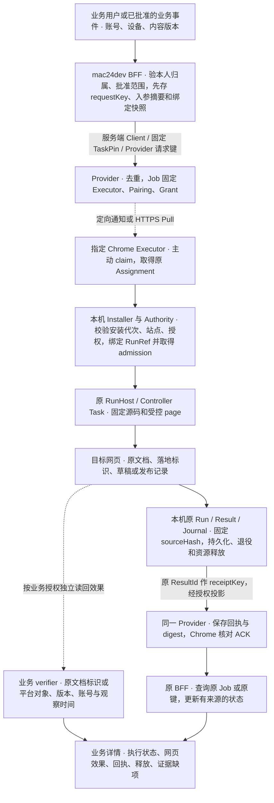

# 云控业务需求与执行设计

2026-11-19 · 首阶段设计 · 面向业务产品负责人、mac24dev 接入者、Browser 执行端与验收人员

**用户要办成的事。** 运营人员想知道“指定浏览器能否在两页内找到这篇指南”，编辑想知道“这版公告是否已经发到指定账号”。两人都需要选对设备、限定动作、看到可核验的结果，并在失联后找回原请求。表单 Demo 已证明一次提交的业务效果。把姓名换成另一个输入框，还解决不了任务选择、账号授权、多步判断或部分成功。

| 要决定什么 | 从哪里读 | 读完能交付什么 |
|---|---|---|
| 一项新业务值不值得接、接到哪一步 | 本页「需求如何提出与定稿」「已填写的需求样例」 | 一项有业务负责人、范围、反例和成功判据的需求 |
| 已答应用户哪些行为，哪些是假设 | 本页「需求与交付范围」「待业务方决定」 | 优先级、下一位负责人、需求与测试的对应关系 |
| 怎样做、在哪个模块改 | [设备托管与 #1288 实施单](cloud-control-device-custody-20261119.zh-CN.md)、[搜索、发布与手机旅程](cloud-control-business-journeys-20261119.zh-CN.md)、本文 §2–§5 | 精确到入口、数据、权限、状态及文件的实施单 |
| 怎样判断可以交付，现在哪些已有证据 | [分阶段测试用例与执行入口](../../framework/cloud-control-business-test-plan-20261119.zh-CN.md)、本文 §1 | 针对正常、异常及恢复场景的操作、预期、取证位置与当前缺口 |

## 需求如何提出与定稿

**首先分清两次用户操作。** 接入新业务时，业务负责人要和任务作者约定“什么算完成”；日常运行时，操作员只选择已有任务并填写这一次的参数。现在 mac24dev 能登记一次固定表单请求。通用需求录入、从多个任务中匹配、以及需求修订后追溯影响，属于后续接入设计。

| 环节 | 负责人和实际动作 | 产出与进入下一环节的条件 |
|---|---|---|
| 1. 提出业务需求 | 业务负责人写下原来由人如何做、在哪个页面操作、为何要远程执行、最后由谁查结果。各给一条成功例和一条看似成功却应拒收的例子 | 需求草案记录目的、触发者、目标设备/账号/站点、输入样例、允许副作用、完成/失败证据。用测试记录或既有流程举例，避免搜集真实密码和正文 |
| 2. 澄清并取舍 | 产品负责人和目标平台 owner 对照样例，确认范围、上限、结果受众与恢复人。记录现有人工成本或出错实例、预计频次及取舍理由；没有观察值时标待业务访谈。设备持有人说明 Profile、已授网站和可用任务。QA 先写一条能推翻“成功”的用例 | 形成有版本的需求说明，标记草案、待补、已确认或已撤回，记录决定人、时间、未决项。站点不明只影响该站点的适配；公开发布审批人未定，只推进已获准的草稿阶段 |
| 3. 选择复用途径 | 任务作者拿固定任务目录、参数 Schema、已安装版本与权限逐项比对。已覆盖则选现有版本；换定位或新增动作则冻结新 Task；业务格式差异交平台适配器，公共能力缺口交框架 owner | 需求修订关联 TaskPin 或明确缺口。作者在样例上说明哪些网页变化会让它停止。只有经过原安装、试运行和远程授权的版本才可进入该设备的业务目录 |
| 4. 实施与验收设计并行 | 开发接收本页需求编号、目标模块和最短操作；测试负责人拿一个正例、一个反例和原效果的独立观察方式。业务人员先看期望结果是否真能据此办事 | 代码、组件检查、已安装包、真实运行、业务签收各自留证。已覆盖哪个场景按该条需求判定，不能用相邻场景的回执补证 |
| 5. 一次调用与复盘 | 操作员在业务页选设备和任务，核对参数并明确发送；业务系统在发送前保存意图。故障时从原意图查 Job 和目标网站。业务 owner 依据结果决定签收、修订或结束 | 需求修订 → 固定任务版本 → 每次业务意图/平台子项 → Job → 原运行与实际效果可追溯。重新提需求保留旧版验收、历史请求和未知结果 |

**需求放在哪里。** 第一阶段直接把需求修订与验收样例保存在业务项目说明中。既有 mac24dev 的任务记录含 demandId，可作为业务侧关联点，具体表结构由该后端核实。若业务端增加「自动化需求」入口，列表按业务负责人/修订/阶段查询，详情展示目标、样例、匹配的已批准任务和历次运行入口。编辑保存草案、提交评估、要求修订、停止后续使用都不创建 Job。“需求已确认”只确认业务语义，设备托管授权和每次公开发布批准仍走各自 owner。简单复用已有需求时直接从任务目录运行，无须每次再填需求单。[现有 mac24dev 对象与触发设计](cloud-control-mac24dev-design-20261030.zh-CN.md)

## 已填写的需求样例

| 业务负责人回答的问题 | 搜索与匹配 | 单平台文章草稿 |
|---|---|---|
| 谁、何时、为什么做 | 运营在本地测试站更新后手动检查，读者能否在两页内找到指定指南 | 编辑在公开发布前，确认本版公告在目标账号的排版、分类与素材完整 |
| 输入与目标 | #1288 上获批的搜索 Task；关键词“云控”、精确标题“云控发布指南”、最多 2 页。目标限经授权的测试 Origin，单次预算 30 秒 | 一份有 revision 的测试稿，标题“11 月更新公告”，正文、分类、封面和附件的有序引用，指定一个获准测试账号。先用平台已有素材 |
| 被允许的动作 | 提交搜索一次、必要时翻页一次、只打开唯一精确命中。登录失效、越域或重复精确命中时停止 | 保存一份草稿并按返回的草稿 ID 重开。草稿 Task 及测试账号只有草稿权限。输入缺素材或网站登录成其他账号时拒绝写入 |
| 业务验收人看什么 | 第一页的“云控发布指南（旧版）”应跳过，第二页打开编号 202，标题、落地地址、原文档关联吻合。搜索同词但限 1 页应正常返回无匹配，详情打开数为零 | 读回稿件、账号、两级版本、标题、正文、分类及素材顺序与送审稿一致；公开列表增加 0。只有保存提示、无草稿 ID 或找不到原文时，编辑不能签收 |
| 结果交给谁，失败怎么处理 | 本机保留匹配与落地证据；业务端按回传授权查看。超时与已查完但无命中分别展示，运营可查最后已确认页 | 平台返回的 ID/链接仅给有权的编辑。保存应答丢失，平台 owner 查原账号草稿箱和原意图；在结果未核清时，不新建第二份 |
| 下一段变化怎样立项 | 换关键词属参数。换成另一域名、要求下载文件或更改匹配逻辑，先核对站点和任务能力，必要时新建修订 | “把草稿发出去”是新增有外部副作用的需求，须明确账号、内容版本、批准者、时间窗口及失联恢复；跨平台按目标分别记录 |

**这两份样例的决定。** 搜索的标题、页数和示例数据已具备编写 fixture 的条件；现有单页示例缺第二页，因此任务作者接收 R06。草稿的字段回读标准可据此写测试；具体平台与测试账号由发布项目 owner 补齐。在两位业务验收人实际走查前，这两项的业务确认状态均为待确认。走查时由运营判断旧版标题是否应被排除，由编辑判断格式或素材漂移是否应退稿；记录决定人、日期和需求修订。

**人工、API、事件与计划。** 首期由人明确触发。已有受限外部 Client 可经 BFF 调用已授权固定任务。若业务要“稿件审批通过后自动建草稿”或“每天定时查一次”，由业务方新增事件或计划需求，选一个触发 owner，把事件 ID 或计划发生时刻绑定唯一业务意图；重复事件取回原记录，错过的触发按明确策略处理。批准一次计划不会授予新的 Chrome 权限，也不替代某一稿件的发布批准。本期没有可证明的业务事件/计划原生执行。

## 需求与交付范围

R01–R12 是本次业务需求的索引。原功能树继续描述各模块能力。阶段顺序按用户指定；试点输入、页面数据和时间预算是可修订的设计选择。下表中的“签收”是该项将来的业务验收条件。

| 需求 / 交付顺序 | 用户要得到的结果与签收条件 | 交付负责人 · 已有依据 / 待补 | 对应用例 |
|---|---|---|---|
| R01 新业务接入 · 首期 | 提交一个搜索或草稿需求，能判断复用现有参数、交付新版本或暂缺能力。更改需求能找回旧版本及其原执行；草案与撤回修订均不能新派发。旧意图与旧请求仍按原修订可查 | 业务产品负责人 · 表单有固定入口，通用需求关联和多任务目录待实现 | [T01](../../framework/cloud-control-business-test-plan-20261119.zh-CN.md#t01)、[T02](../../framework/cloud-control-business-test-plan-20261119.zh-CN.md#t02)、[T26](../../framework/cloud-control-business-test-plan-20261119.zh-CN.md#t26) |
| R02 本人设备详情 · 首个实现 | 恢复原键后仍能从 #1288 行只读查看关联 Chrome、任务、站点和接单原因。刷新零新任务，其他账号看不到该设备 | mac24dev 设备接入负责人 · 原目录有 READY/WSS，详情与本机未知提示待补 | [T03](../../framework/cloud-control-business-test-plan-20261119.zh-CN.md#t03)、[T04](../../framework/cloud-control-business-test-plan-20261119.zh-CN.md#t04)、[T05](../../framework/cloud-control-business-test-plan-20261119.zh-CN.md#t05)、[T07](../../framework/cloud-control-business-test-plan-20261119.zh-CN.md#t07) |
| R03 托管生命周期 · 设备阶段 | 设备持有人能暂停、恢复、撤销及换机。旧授权停止新动作，原 Job 仍留原设备，远端未确认有可见状态 | Browser 托管负责人 · 原配对、Grant 与管理入口存在，业务端动作与可信回执需对应验收 | [T06](../../framework/cloud-control-business-test-plan-20261119.zh-CN.md#t06)、[T07](../../framework/cloud-control-business-test-plan-20261119.zh-CN.md#t07)、[T08](../../framework/cloud-control-business-test-plan-20261119.zh-CN.md#t08) |
| R04 任务与动态参数 · 多任务接入 | 普通调用只能使用本设备获委托版本。源码/站点更改经收件箱审阅、单次试运行、安装和授权才可投递；旧 pin 不得被替换 | Task 安装负责人 · 既有固定包与安装合同，新业务版本待验 | [T02](../../framework/cloud-control-business-test-plan-20261119.zh-CN.md#t02)、[T08](../../framework/cloud-control-business-test-plan-20261119.zh-CN.md#t08)、[T09](../../framework/cloud-control-business-test-plan-20261119.zh-CN.md#t09) |
| R05 定向派发与防重 · 多任务接入 | 只交给登录者选定并有权的 Executor。同键同输入找回原 Job，异输入拒绝。另一设备装同任务也接不到原单 | BFF 接入负责人 · 有 Provider 与 Client 归属检查，多业务选择及跨 Executor 实机待验 | [T04](../../framework/cloud-control-business-test-plan-20261119.zh-CN.md#t04)、[T10](../../framework/cloud-control-business-test-plan-20261119.zh-CN.md#t10)、[T16](../../framework/cloud-control-business-test-plan-20261119.zh-CN.md#t16) |
| R06 有界搜索 · 搜索阶段 | 在指定范围搜索，区分命中、到上限无匹配、登录失效、超时和越域；只有核准落地文档后才展示命中 | 搜索 Task 负责人 · 单页示例可用，两页命中与无匹配云任务待验 | [T11](../../framework/cloud-control-business-test-plan-20261119.zh-CN.md#t11)、[T12](../../framework/cloud-control-business-test-plan-20261119.zh-CN.md#t12) |
| R07 单平台草稿 · 发布第一步 | 编辑能重新打开同一草稿核对所有字段及目标账号，公开文章数不变；缺字段、账号错误、保存未知分别可见 | 平台草稿适配负责人 · 平台、账号、读回入口待落实 | [T13](../../framework/cloud-control-business-test-plan-20261119.zh-CN.md#t13)、[T14](../../framework/cloud-control-business-test-plan-20261119.zh-CN.md#t14) |
| R08 按批准项公开 · 草稿之后 | 指定账号只发布已批准的版本。到期或撤批后不公开，同一批准项从两处发起也只产生一次发布效果 | 发布项目负责人 · 需要平台最终校验和明确实测目标，当前未实测 | [T15](../../framework/cloud-control-business-test-plan-20261119.zh-CN.md#t15)、[T16](../../framework/cloud-control-business-test-plan-20261119.zh-CN.md#t16) |
| R09 多平台部分完成 · 单平台之后 | 每个平台有独立账号、格式、版本、状态和链接。一个成功、一个平台审核中或未知时，可查成功项，仅处理未结案目标 | 多平台编排负责人 · 需两个独立适配器、真实账号与各自的读回方法 | [T17](../../framework/cloud-control-business-test-plan-20261119.zh-CN.md#t17)、[T18](../../framework/cloud-control-business-test-plan-20261119.zh-CN.md#t18) |
| R10 结果权限与证据 · 各阶段 | 普通账号看其有权的状态。网页内容、URL 与原生身份按原权限提供。业务效果、可信原运行、回执、释放各有来源，缺关联则标未验证 | Browser 结果负责人 · 表单已有一次网页效果，精确 Run/文档关联仍缺 | [T19](../../framework/cloud-control-business-test-plan-20261119.zh-CN.md#t19)、[T20](../../framework/cloud-control-business-test-plan-20261119.zh-CN.md#t20) |
| R11 中断、撤权与对账 · 各阶段 | Stop 已接受、远端暂停确认和已发生写入分别可查。丢回执、重启、换机后无需重新做已知操作，未知写入由明确人员按原身份调查 | Provider 运维负责人 · 现有恢复组件与原账本，跨机、正式恢复待验 | [T18](../../framework/cloud-control-business-test-plan-20261119.zh-CN.md#t18)、[T21](../../framework/cloud-control-business-test-plan-20261119.zh-CN.md#t21)、[T22](../../framework/cloud-control-business-test-plan-20261119.zh-CN.md#t22)、[T25](../../framework/cloud-control-business-test-plan-20261119.zh-CN.md#t25)、[T27](../../framework/cloud-control-business-test-plan-20261119.zh-CN.md#t27) |
| R12 下载与手机 · 后续 | 从目标 App、发行方与条目开始，分别核实打开、合法下载、手机确认、实装版本及首次打开。用户取消安装时流程可如实结束 | 下载适配负责人交移动执行端负责人 · Chrome 下载权限只覆盖获准工具；手机管理权、设备端回执待取得 | [T23](../../framework/cloud-control-business-test-plan-20261119.zh-CN.md#t23)、[T24](../../framework/cloud-control-business-test-plan-20261119.zh-CN.md#t24) |

## 怎样读测试结果

| 验收人面前的情形 | 当场如何判定 | 当前证据 |
|---|---|---|
| 操作员从锁定的原请求查看 #1288 | 刷新和反复查看后，原键、目标、姓名不变；新增提交、Job、Run 都为零。缺本机槽证据就显示待确认 | 表单基线和旧键组件已有证据；本人设备详情与键盘操作在切片 2a 验 |
| 运营在两页里找指定标题 | 第二页命中要看到编号 202 的正确落地；不存在的标题搜完两页，要能说出最后已验页且详情点击为零。登录失效须单列 | 已有单页页面证据；两页 Chrome 云任务待验 |
| 两位编辑同时提交同一批准稿，平台又丢了应答 | 用两个不同业务键竞发，核对唯一批准项、唯一 Job、最多一次发布点击。仅能查回官网时保留官网链接，未知的社区项只读核对 | 下游幂等组件已有证据；业务批准项、目标平台最终写入及人工签收待验 |
| Client 被撤去结果正文权限 | 复查同一回执和迟到响应，受限调用者只读到状态，历史正文不会因重新授权而反向开放 | 已执行撤权与回执隐私组件；真实 Chrome 原文档关联待验 |

测试计划列有 27 条业务用例。另有两组已执行的组件及服务集成检查，共 66 项通过，并单独实测隔离 Provider 的新增提交上限。用例覆盖权限、异常、兼容性、键盘与读屏、并发、恢复、服务容量、备份及设备实装。每一条都注明取证层级、责任人和切片；执行记录和可复跑命令在[测试计划](../../framework/cloud-control-business-test-plan-20261119.zh-CN.md)。

## 待业务方决定

| 在哪个切片前决定 | 待决定的问题 / 决定人 | 当前可继续的工作 |
|---|---|---|
| 搜索接入真实站点前 | 运营与站点 owner 指定允许的站点、匹配方式、最大页数/时长、哪些结果字段可分享。域名、标题、记录 ID 是三种不同判据 | 先用单一受控站点、精确标题和两页样例；不得据此替真实站点开权限 |
| 单平台草稿开始前 | 发布项目 owner 提供实际仓库、测试平台与账号、角色、富文本/附件格式、最大内容规模、按 ID 读回方法 | 短稿与素材引用可在测试计划定稿。尚未选定对外平台，不能声称已集成 |
| 公开或定时发布前 | 内容负责人指定有权批准者、平台账号、版本及时间窗口；平台 owner 确认最后写入点能执行校验。基准走人工点击，真实公开必须有独立授权 | 单平台草稿、模拟撤批和幂等用例可先做。缺最终约束的平台只交草稿及人工复核入口 |
| 跨设备推广和生产运维前 | 运维负责人确认设备规模、并发与排队预期、可接受的恢复时间、历史保留期和获准环境；移动 owner 确认系统、托管模式及测试手机 | 先验指定设备隔离、可观察的队列上限及故障恢复。没有业务数据支持的吞吐或 SLA 数字保持待定 |

**需求如何验收。** QA 先从对应需求编号找到正例、反例与所需证据，再选本切片的最小测试集。产品负责人签收可见结果，Browser owner 核实原运行与权限，平台 owner 核实草稿或发布对象。三方发现需求歧义时，记录影响的需求修订、TaskPin、平台和用例，原测试结果按原修订保存。可用的表单基线与尚未运行的设计用例分别列在下节和[测试计划](../../framework/cloud-control-business-test-plan-20261119.zh-CN.md)。

沿用[R5.2 功能树](cloud-control-r5.2-complete-function-tree.zh-CN.md)、[接口安全合同](cloud-control-r5.2-interface-security-contract.zh-CN.md)、[G0–G6 实施手册](../../framework/cloud-control-r5.2-execution-manual.zh-CN.md)及[mac24dev 设计](cloud-control-mac24dev-design-20261030.zh-CN.md)。本文下半部保留原基线、架构与首项实施任务，便于从需求反查实现。

## 1. 接手时能复查的事实

| 观察对象 | 2026-11-19 本机只读复核（北京时间） | 能支持的结论 |
|---|---|---|
| 环境 | Browser 仓库 main，原表单基线核查时 HEAD 为 `cdff7e777d45c7b3d0867042f0483a2c72c0b629`。Demo README、页面、云控和开发工作台等有并行未提交修改。Google Chrome PID 44951 在运行，开发服务 PID 72436 在 43119/43120 监听；开发加载目标是本仓库 `dist/development` | 当前实例实际加载路径、扩展 ID、应用 revision、serve 客户端连接、本机槽及安装代次本次未实读。11 月 18 日的 Chrome 记录见演示 README |
| 服务 | 业务页 38001 经已有 SSH 转发；43121 请求管理与阅读页由原本机服务提供；43111 被动效果页。四个入口返回 HTTP 200 | 页面可取。后台连接由下行的实际记录验证 |
| 设备范围 | 14:25:17，43121 的业务绑定和 Provider 只读范围投影同指账号 569 / 设备 1288，Executor `460154c0…f686`，固定任务 `sample.form-fill@1.0.2`，站点 `http://127.0.0.1:43111`，READY / WSS，Client `allowResult=false` | 可显示当前通信和获委托的任务范围。历史昵称含「待配对」；实际接单还需本机授权、安装、槽和准入 |
| 原意图 | 请求键 `378df70d-0d16-47a6-a69a-c85df871da8f` 与 Job `05a6e7a2-a5b7-400b-a82a-4bab42d989d5`。14:24:50 的只读来源校验 BFF 原键经命名空间转换后的 Provider 索引、Client、Job、分配、准入引用 | 业务库当时仍显示 queued / 未确认，Provider 原始 received、结果状态 completed、回执确认、released；接收时刻 13:53:26。界面应分别注明来源与时刻 |
| 原网页 | 14:25:17，按同一原键取详情，以原输入核对被动文档 `399717cf-e4eb-4d2f-a567-b758cb03999d`，ready → submit → done 连续，总提交及匹配提交各 1 | 用户手测的效果与 Provider 完成均有记录。精确关联 Chrome 原 Run、Result、原生 document 与该观察文档仍为 NOT_TESTED。详情的 UI 观察项为空，本次没有新执行 |
| 收尾 | 当前 Grant 未回执数 0，另有在观察范围内的历史未回执 2 条；状态快照可能继续变化 | 原请求的 released 来源于回执，历史未决各按原身份查询。不得从计数推断当前本机槽空闲 |
| 搜索示例 | 本次在 ego(lite) 打开原 43111/workflow-search.html，输入并读回 OpenDesk，搜索一次，页面显示 2 条结果、提交次数 1。选择「OpenDesk Browser · 官方项目介绍」，落地同源 ?detail=opendesk，详情标题吻合 | 已实测浏览器页面搜索、匹配与跳转；没有创建云 Job。这条单页基线没有覆盖翻页、Chrome Executor 或 Worker |
| 旧目标 | 原对话「完善云控全链路展示与端到端验证」最后记录为 blocked，原因是旧请求缺原生关联。本对话 get_goal 返回空 | 单独保留历史目标与原请求；该状态不决定本设计的评分，也不将旧请求的证据挪给本次基线 |

只读复核入口为[业务页](http://127.0.0.1:38001/public/opendesk-cloud-demo/index.html)、[本 Job 详情](http://127.0.0.1:43121/?job=05a6e7a2-a5b7-400b-a82a-4bab42d989d5#detail)、[网页效果](http://127.0.0.1:43111/cloud-proof.html)、[阅读页](http://127.0.0.1:43121/review.html)。对照[固定表单包](../../../examples/cloud-control/mac24dev-demo/form-fill.v1.0.2.opendesk-task.json)及[演示 README](../../../examples/cloud-control/mac24dev-demo/README.zh-CN.md)。每次读回都保留观察时间，不用后续状态倒写当时事实。

## 2. 从用户操作到业务结果

业务账号只选其名下设备和已列出的任务；BFF 在服务端解析 Client 和授权后的目标，不接受表单自报 Provider、Grant 或执行脚本。执行期间 Chrome 限制受控目标和真实 Document。由发布适配器识别业务账号和平台响应。由验收者从原可信诊断读原身份，跨源关联失败就记录缺项。业务申请取消、Chrome 所有者暂停托管、维护者解除后端绑定是三种各自审计的操作。[当前身份合同](cloud-control-r5.2-interface-security-contract.zh-CN.md) · [现有设备与请求表归属](cloud-control-mac24dev-design-20261030.zh-CN.md)

## 3. 动态参数与任务交付

| 需求变化 | 谁能走哪个入口 | 要留下的证据与决定 |
|---|---|---|
| 每次换关键词、匹配项、页数或草稿字段 | 普通 Client 经 BFF 选一个固定安装版本，仅传闭合 Schema 内值。业务可缩小已批范围、设置更低上限 | BFF 与 Provider 校验类型、范围、目标与摘要。固定表单已有运行记录；新搜索与发布的参数、站点和运行均待各自验收 |
| 翻页规则、排序、站点模板变化 | 有限枚举和参数能表达的沿用旧 Task。需要改 Locator、平台逻辑、网站或权限时，作者发布新固定版本 | 调用方不能用参数指定额外执行入口。声明为正文的字符串可包含技术文章里的命令或链接，按数据原样处理，不能解释执行或据此转用其他目标。单站点收件箱审阅约束下先拆为站点专用任务；跨域落地另取合法导航证明 |
| 人工或 AI 生成新版 | 原作者冻结 `opendesk.task-package.v1`。Provider 本机受信维护者可用 `/admin/program-deliver` 指定 Executor，生成 deliveryId。普通业务 Client 无发布权限 | 源码与 manifest 摘要、目标配对、版本冲突校验。日常 `/v1/submit` 不接包；交付端可暂存经校验的候选包，接收 ACK 后清理交付副本。另有原静态包手动导入入口 |
| 审阅到安装 | 原 Chrome「云控 → 待审核程序」刷新 inbox，fetch 固定包，审阅源码/差异、站点与参数。可信点击单次试运行，接收为待验证任务，核实同一原 Run 和 sourceHash，验证与安装；也可到原任务目录完成 | 原 `/v1/program-received` 只确认接收。记录 deliveryId、Candidate、试运行 Run/Result/站点、安装 ID/Generation，各自可缺证。收件箱有源码和定向用例，当前新业务版本的真实链未验 |
| 新安装用于远程调用 | Chrome 所有者批准精确安装和站点。给目标 Client 委托固定 pin。BFF 维护者精确替换旧 binding，核对并发代次 | 保存旧请求和旧版本历史。新安装不续用旧 Grant 运行旧未知任务。平台变换、账号变换、内容修订分别重新核对 |
| 普通 Client 发 JS、Shell、CDP 或调管理口 | 超出现有合同，拒绝。若未来提供自助发布，需独立定义受信发布者、作用域、撤销与发布审计 | 负例要求无 Job、无 Candidate 安装、无 Worker。新远程发布 API 尚未实现；沿用本机维护者交付 |

源码入口见[Provider](../../../scripts/cloud-control/provider.mjs)、[原收件箱与试运行](../../../src/ui/cloud-hosting.js)、[可信 React 云控面板](../../../src/ui/react/tabs/cloud.tsx)、[程序交付用例](../../../tests/cloud-control/remote-program-delivery.test.mjs)。只有本次候选真实试运行、安装、远程准入且取得原回执后，才能记该版本 Chrome 已验。

## 4. 外部接口、状态、恢复与审计

| 边界 | 现有合同或拟议业务扩展 | 响应丢失、取消或撤权如何处理 |
|---|---|---|
| 同源业务页 → BFF | 现有 `/app/operate/cloudcontrol/{catalog,submit,status,cancel,history}`；submit 接收 requestKey、deviceId、taskId、version、params。本例只接受固定表单。拟议 2c 业务目录按登录主体、设备绑定、获委托 TaskPin 返回任务、Schema、业务需求 ID 与修订。新接入业务的 submit 必带所选 expectedDemandId、expectedDemandRevision，二者作为期望值在服务端校验；草稿正文、审批及内容修订由发布项目登记 | 请求表在对外调用前持久化业务键、规范入参摘要、操作及原绑定。对相同主体/键设置唯一约束，并发同内容获得原意图，异内容冲突。恢复后保持原 Provider 键与绑定快照 |
| BFF → Provider | 已认证 HTTPS `/v1/client-scope` 按需取 taskCatalog、availability；`/v1/submit` 按 pin / target / params 分配，幂等空间含 Client 和 Pairing；`/v1/job-status` 只传 jobId 或原 Provider requestKey 之一，可加 includeEvidence | 已知同键重复必须归同一 Job。提交结果未知先只读查询；E_JOB、超时、令牌失效各留原因，均不足以判未执行。换机、换 Client、换版本不可用新键补发旧意图 |
| Provider → Browser | queued → assigned → admitted 复用原绑定、租约和 RunRef。新建 Job 可显式选已支持的 controlProtocol:2，StartTicket 与逐副作用 ControlFence 按原合同核权；记录实际协议 | 过期按原协议记录 expired_before_admission 或 OUTCOME_UNKNOWN。原 Assignment 未安全结算则保留占用与对账；断线先恢复原记录。收到通知、队列计数或租约超时不能证明网页已操作或可重派 |
| 取消、暂停及解绑 | 业务按原身份 `/v1/job-cancel`，本机 Stop 立即拦住后续受控动作并记录 suspend ACK/pending；解绑使旧配对与委托失效 | 已完成的结果保留。取消被接受、Worker 退休、页面已写入各自取证。断线撤权只保留待确认状态；失效身份查询按原权限拒绝。业务负责人用获准的原平台只读回查，不转用管理员凭据向业务披露 |
| 结束与查询 | 本机持久原 Result，退役证据与原回执分别核对；Provider 存原 resultId 的回执和 digest；Chrome 检查 ACK。默认 status-only。Provider 接收 full 要有逐 Task 授权；Client 读取 full 还需该 Client 的 allowResult，当次原回执也须为 full | ACK 丢失只按原 Result/receiptKey/digest 对账；摘要冲突停在待核。业务状态、回执确认、released、平台效果及因果关联单列。无回执、过期凭据、过期读数均不得填成功 |
| 查询业务效果 | 搜索的页码/落地标识，发布的草稿 ID、文章 URL、附件等可能属于结果正文。本机可见性与业务端展示按账号、原任务授权和数据来源单列 | status-only 时业务端仅显示允许的状态；需要链接时走双重许可或由业务系统用本来有权的独立平台接口读回，标注来源。独立读回不能伪造成浏览器回执 |

对于文章发布，业务键另受每个平台批准项的持久唯一约束，异键并发合流及平台最终审批见[旅程 B](cloud-control-business-journeys-20261119.zh-CN.md)。

审计最小字段为业务主体及设备引用、操作、时间、原意图键、绑定版本、TaskPin、各段状态与来源；关联表在受限 owner 内记录原 Job/Assignment/Run/Result/receipt 与平台对象标识。审计区分批准人、发起人和实际执行账号。查阅按账号隔离，受限导出仅保留必要标识与摘要。密码、Cookie、配对码、Client/Admin Token、文章正文、原始错误及带秘密的 URL 不进入公共报告。稿件、附件和详细证据按业务的保存与删除策略管理，未决意图保留可对账的最小关联。

**验收记录模板。** 每次留一行「候选源码 SHA/包摘要｜已安装版本、installationId/generation、原授权｜账号/设备/配对/Grant｜业务键与 Provider 键的受限关联｜Job/assignment｜原 Run/Result 与 revision.sourceHash｜任务拥有的 target/document 与观察标记｜独立效果及时间｜receipt/digest｜retirement/释放｜可见范围｜结论、缺项」。字段保存于各自受限 owner，业务页仅展示允许的投影；读不到则逐格标未验证。正式候选另留包指纹、浏览器版本、复核人和 Gate。相同姓名、相近时间、页面重开、回执成功均不能单独证明原文档因果。

当前 Task 参数限闭合对象、至多 16 个字段，支持有限标量；字符串 Schema 上界为 4096。首个草稿使用短测试稿及平台内已批准的素材引用。长正文、附件二进制、多平台数组由发布项目保存；如需跨系统读取，以受权的内容版本引用交付，先证明读取范围、账号、摘要、过期处理和传输路径。没有合适入口时将该格式标为暂不支持，不截断文章、不把凭据放入参数。[参数校验源码](../../../src/platform/tasks/contract.js)

## 5. 实施与交接顺序

每行承办角色为一个交付 owner，可依赖其他模块的原 owner。下列名称是施工切片，功能编号沿用 R5.2。先做能证明该行用户行为的最小检查；一个切片通过只推进它的依赖项。

| 切片与 owner / 文件归属 | 前置与最短用户操作 | 功能与 Gate、最小通过证据、失败条件及交接 |
|---|---|---|
| 1 基线和设计 · 云控架构负责人；本页需求、两份专项设计、测试计划与 Demo README | 读原键 → 独立观察效果 → 记录来源和未验项 | EXEC-07/09/10、RESULT-01/06、G0-01/G2-03/G6-02。交付脱敏基线、角色与旅程、六项独立设计评分和修订记录给设备接入者。有缺项写实，关键设计阻断须修订 |
| 2a 设备详情 · mac24dev 设备接入负责人；原 BFF cloudcontrol 服务及 mac24dev-demo 页面 | 依赖 1。登录 test 恢复旧键 → 刷新本人目录 → 在 #1288 行打开只读详情 → 查看关联浏览器、获准任务/站点、接单原因和管理入口 | PAIR-01、CONSENT-01、CLIENT-04、UI-01，G1-02/G3-02/03。按设备实施单做本人只读与越权/旧响应负例；错误显示未知、刷新无 Job，才交给管理动作 owner |
| 2b 托管动作 · Browser 云控负责人；原云控 Tab / cloud-hosting / service | 依赖 2a。在专用已授权测试配对暂停、查看 ACK、再按当前安装恢复；撤销/换机用专用测试绑定 | CONSENT、CLIENT-08、RECOVER-01–05/10，G1-03/G3-05/G5-03/04。原权限链核准，旧身份拒绝，历史仍归原目标；pending 显示已成功即失败。交搜索接入者 |
| 2c 多任务业务接入 · mac24dev BFF 负责人；原 cloudcontrol.s.ts 与业务页目录/参数表单 | 依赖 2a。将固定单表单配置拓成每设备获委托 pin 列表，把表单和获批搜索分别列出；按选择构造闭合参数，保持旧表单原键可查 | TASK-04、CLIENT-04、DELIVERY-03/04/06/07，G1-02/G5-01。目录交集必须是业务允许项与当前 Client scope 的交集。选搜索不走旧 name 校验，篡改 pin/Origin 或触发旧 Socket 双派应拒绝。用两个独立 Schema 验一次目录/同键恢复，交搜索与文章接入者 |
| 3 Chrome 搜索 · 搜索 Controller Task 负责人；examples/tasks 的原搜索示例及专用测试页、固定包 | 依赖 2c 和固定搜索任务实际安装授权。用户输入条件，各执行一次第二页命中、到上限无匹配；在新请求上核对原运行与网页 | TASK-04/11、DELIVERY-04/05、EXEC-06/08/09/10，G1-02/G2-02/04。命中只打开一次并核对落地标识，无匹配打开次数为零、有界结束；越界或未知不得误报。交验收与发布适配者，表单基线继续用原记录 |
| 4a 单平台草稿 · 发布项目单平台适配负责人；项目自己的内容映射、Task 源与测试 fixture（项目路径待平台确定） | 接手时平台 owner 须提供实际项目路径、测试域名/账号、字段映射、草稿保存与按 ID 重新读回入口；依赖固定任务交付能力。保存一版草稿，再独立打开原草稿 | TASK-04、EXEC-06/09、RESULT-01–08、G2-02/04/G5-01/02。一个请求、一个持久草稿，核对账号/各字段/附件；写后未确认留未知。交发布审批 owner |
| 4b 受控公开发布 · 业务发布负责人；业务审批记录、原平台适配器 | 依赖 4a；平台 owner 须交接同源最终发布处理器与审批权威来源、可回查的原稿/平台 ID、明确批准的目标账号/内容/窗口。核验批准后提交一次，原平台查询公开状态与文章链接 | DELIVERY-06/07、RECOVER-06/11，G1-04/G5-01/02。审批不符拒绝，结果未知不得再点发布。真实目标未批时仅验草稿及测试替身，公开发布保持 NOT_TESTED。交多平台编排负责人 |
| 5a 多平台 · 发布编排负责人；业务批次、子意图及按平台查询视图 | 依赖 4 和第二个独立适配器/账号。一个内容版本选两个获准目标，逐目标审批派发，再查部分成功 | DELIVERY-05–08、RESULT-08/11、RECOVER-11，G1-01/04/G5-01。每平台保留原键、状态、原因、链接权限；其他平台失败后仍可查已成功对象。缺一个目标仍标整批成功即失败。交业务运维 |
| 5b 新版本交付 · Browser Task 安装负责人；原收件箱/Installer/Provider program-deliver | 可与 3、4 的既有手动装包路径并行。审阅一个新版本、单次试运行、验证安装、重新批准及绑定 | TASK-01–11、CONSENT、CLIENT-04，G1-02/G2-02/G5-04。留交付 ACK、同包原 Run/Result、安装及新授权；旧版未知任务不重跑，普通 Client 投递新包应拒绝。交设备维护者 |
| 6a 多 Executor 和运维 · Provider 运维负责人；scripts/cloud-control、Browser 历史与隔离用例 | 依赖前序代表性固定包。两套独立配对安装同 Task，只投 A，核查 B 拒绝；在隔离环境中核对断线、撤权、恢复后的原收据 | DELIVERY-05/08/11、RECOVER-05/07/08/12、OPS-01–05/10，G1-01/G2-05/G4/G5。保存双方身份、健康/队列/未决数、TLS/备份及恢复代次。另一端能领或未知被重派即失败，交正式验收负责人 |
| 6b 浏览器下载 · 已安装工具的下载适配负责人；原下载 SDK 与测试资产 | 依赖 3。仅直链下载分支核对获准来源、文件类型和同一 downloadRef 的完成状态 | TASK-11、EXEC-06、RESULT-03/04、G1-02/G2-04 仅覆盖 Chrome 部分；来源、文件类型或终态无法核匹则保留缺项。交移动执行端项目 |
| 6b 手机商店分支 · 移动设备管理负责人；独立执行端、系统与商店回执 | 依赖 C 的目标条目和已获准手机。商店内下载/安装可合并呈现；无须先在桌面下载。直链分支如沿用桌面成品，另验证受权传递及系统支持 | Chrome G2 仅覆盖搜索与跳转。记录设备确认、实际版本和首次启动；未独立观察到的下载终态单列。审批或实机证据不足则关闭相应写入入口，交移动验收 owner |
| 6c 正式验收 · 独立验收负责人；原 workstreams 证据账本 | 依赖适用功能验收、冻结候选和获准环境。验原双 Task、双 Executor、原生权限/故障及跨网 Gate | OPS-06–12、G0/G2/G3/G4/G5/G6。归档同候选 Source/Build/Install/Run 与受限原始证据。核心证据缺项保持未通过；本轮设计分只用于本轮。交产品负责人 |

**2c 怎样拿到第一份合法的双任务配置。** BFF 接入负责人负责版本化配置与读兼容；设备绑定维护者在专用测试设备准备表单、搜索两个已安装且获远程委托的完整 TaskPin。2c 首个搜索 pin 选用仓库已有的 [sample.modern-search@1.0.0](../../../examples/tasks/modern-search.v1.opendesk-task.json)，由持有人先在专用设备审阅、安装及授权，以 keyword 单字段与表单的 name 区分两个 Schema。切片 3 再独立冻结、安装、委托能接受 query/targetTitle/maxPages/testSession 的两页任务，单页包不能签收第二页行为。现行维护脚本只允许指定表单摘要、配置顶层只有一个 taskPin。拟议新版按本人设备及 bindingId 保存显式 pin 清单，核对每项 manifestHash/sourceHash、精确站点和该 Client 当次 scope；两者无交集即隐藏并拒绝派发。在独立测试绑定上按 expectedBindingId 做条件替换和写后只读验证。旧单 pin 配置按原表单还原为一项，保持原检查；无法确认来源的旧记录保留未知。不得借新增搜索覆盖其他设备。旧请求始终从其原 demandId/修订（若有）、原 pin、原请求键及绑定快照查询；历史无修订字段显示“未记录”，不可用新修订或新 Client 补写。[原绑定工具](../../../examples/cloud-control/mac24dev-demo/bind-provider.mjs) · [现行单 pin 写入约束](../../../examples/cloud-control/mac24dev-demo/update-binding.py)

**需求修订何时影响派发。** 在 2c，业务产品负责人记录每个修订的批准或撤回。BFF 创建新意图时检查该主体和业务需求的当前已确认修订，并在持久化意图时固定修订与 pin；BFF 在事务中按登录主体、设备及所选 expectedDemandId/expectedDemandRevision 读权威记录，与当前生效修订、任务 pin、绑定和参数相符才接收；即使两版使用相同 pin 与参数，旧页用新键仍拒绝。相同原键和同一不可变输入优先按原主体和原记录查询，不要求历史修订再次生效；同键换修订视作意图冲突。修订字段只在 BFF 业务边界使用，不传进 Task 参数。兼容路径由 BFF 的旧固定表单配置与登录主体限定；原历史只读查询沿原键。普通调用方不能通过省略修订字段选择兼容路径。新目录的提交缺任一期望字段须退回刷新目录，不能默选最新修订。撤回与新增意图的判定须串行。外呼前再查派发资格，未领取的旧意图可标停止；已外呼的旧意图按原键查询、按需要申请取消并核对效果。旧浏览器授权仍有效时，对已撤回修订发新键也须在 BFF 拒绝。业务验收对照“草案拒绝 → 甲版已确认发送一次 → 乙版替代、甲版撤回 → 甲版拒新单、甲版原单仍可查”；不从业务需求状态推断浏览器授权。

**先接哪一项。** 下一位实现者从「业务页 → 刷新设备 → #1288 行的查看托管详情」开始。其第一份可演示改动是由本人账号看到一张只读设备详情，能解释 READY 的依据、哪些本机事实尚未知，以及去哪个可信入口管理。在搜索、发布或手机上建立新的业务请求之前，先按[设备实施单](cloud-control-device-custody-20261119.zh-CN.md)完成这条操作。

## 6. 可复用的公开系统设计

| 一手资料 | 对 OpenDesk 的具体取舍 |
|---|---|
| AWS IoT Jobs 的设备上线工作流把恢复中的执行与新领取区分，并以每台设备的 Job execution 报状态。[在线工作流](https://docs.aws.amazon.com/iot/latest/developerguide/jobs-workflow-device-online.html) · [设备端 API](https://docs.aws.amazon.com/iot/latest/developerguide/jobs-mqtt-api.html) | #1288 断线重连先按原 Assignment/Result 对账；多平台、多设备保留各自结果。批次中止只影响允许停止的步骤，已经发给网页的写请求仍须回查 |
| GitHub Actions 根据 runner group、标签、在线和空闲条件路由，区分排队与已领取。[Self-hosted runners](https://docs.github.com/en/actions/reference/runners/self-hosted-runners#routing-precedence-for-self-hosted-runners) | 设备详情分开显示能力、连接、占用和授权。Chrome 持有原 Profile 的网站会话，因此同标签设备不能接手已有绑定意图，CI 的重新入队规则不适用于未知发布 |
| Android Management API 的 Device 记录期望及已生效策略版本，异步命令返回可查询的 Operation。[Device](https://developers.google.com/android/management/reference/rest/v1/enterprises.devices) · [issueCommand](https://developers.google.com/android/management/reference/rest/v1/enterprises.devices/issueCommand) · [使用条件](https://developers.google.com/android/management/permissible-usage) | 手机阶段拆开「已要求安装」「系统安装成功」「首次打开成功」，每步有独立证据。需先确认目标设备管理方式、产品资格和用户许可。当前 Chrome 授权只覆盖其已批准网页任务 |
