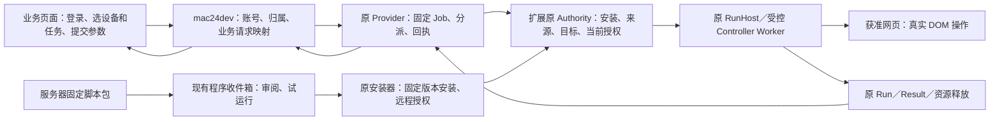

# mac24dev 运控接入与浏览器云控产品设计

日期：2026-10-30。阶段：**设计交付与源码核查**。本文是现有云控合同的产品接入补充，不创建另一套 Provider、Scheduler、RunHost、权限库或安装器。方案选择与分期为本次设计建议，尚未表示用户批准实施或生产验收通过。

执行与权限仍归[唯一接口合同](cloud-control-r5.2-interface-security-contract.zh-CN.md)和[执行手册](../../framework/cloud-control-r5.2-execution-manual.zh-CN.md)；界面归[React 五 Tab 合同](../react-ui-shared-components-r33.zh-CN.md)。旧文档与当前源码冲突的具体条目见下文，不据旧描述删掉已实现能力。

## 1. 用户会得到什么

用户在业务网页选择自己的浏览器设备、自动化任务和参数，点击一次运行。后端记录这次请求并交给已配对的浏览器；扩展用现有脚本执行器操作获准网站，业务网页显示真实结果、取消进度和是否已经释放资源。

脚本作者可以在「开发」编写或由 AI 生成代码，也可以由服务器交付固定脚本包。用户审阅、试运行、安装并批准远程调用后，同一个固定版本能够被后续业务请求重复调用。每次只传业务参数；不要求每次重新审批同一脚本及依赖。

第一条操作链：**业务演示网页登录 → 选本人设备 → 输入姓名 → 提交一次 → 浏览器标准测试页出现对应姓名 → 原请求收到结果与回执**。当前资料尚未证明这条 mac24dev 链已经执行完成。

| 界面 | 用户操作 | 本轮设计重点 |
| --- | --- | --- |
| 业务网站／后台「自动化」页面 | 选择设备、任务、参数；运行、查询、请求取消 | 真实账号归属、一次请求、结果可解释 |
| 扩展「开发」 | 编写、预览、Run、Stop、保存脚本 | 沿用原编辑器与执行世界 |
| 扩展现有任务目录 | 查看源码、验证、安装、升级、停用 | 固定版本、网站和能力审阅 |
| 扩展「云控」 | 配对、远程调用授权、待审程序、运行记录、暂停 | 日常状态清晰，遇到阻塞给出下一步 |
| 大页面云控控制台 | 查看运行、历史和脱敏诊断 | 现有只读能力不因布局变大获得审批权 |

## 2. 核查基线与不可覆盖的工作

- Browser：`/Users/mac/Documents/workspace/opendesk-browser`，`main`，调查时 HEAD `faef552d4`；已有其他未提交修改，包括云控接口文档、Provider、测试和 `examples/cloud-control/mac24dev-demo/`。本文单独新增，不修改这些文件，不提交、切分支或覆盖其他工作。
- 后端：SSH `mac24dev`，`/Users/a0000/Documents/workspace-old/todo-admin-midway-cool8-operate`，`upgrade/cool8-operate`，调查时 HEAD `90e0fd2`；保留全部已修改／未跟踪文件。本次仅 SSH 读取源码与状态，不写入、切换分支、启动服务、部署或修改数据库。
- 日常运行合同仍为 `dist/development` + 原 `npm run dev` watcher。本文未接管 watcher、Chrome/Profile 或演示服务；当前加载扩展身份、dev 连接和 Native 配对 **NOT_TESTED**，不能用 README 记载代替当时实测。
- 现有演示 README 报告：业务登录和本人设备显示已经验证，设备仍未连接，尚无主 demo Job/Run/Result。此为**已有记录**，本轮未重新执行或把它升级为当前原生证据。

### 2.1 当前源码已有的能力

| 事实 | 定位 | 证据边界 |
| --- | --- | --- |
| 旧脚本表保存正文、参数、应用及用户归属 | 远端 `src/modules/operate/entity/script.e.ts` | SOURCE_REVIEWED |
| 旧任务表保存 scriptId/deviceId/demandId/status/result；cron 为 Date 字段 | 远端 `entity/task.e.ts` | 不能据字段名推断已有完整定时执行 |
| 旧设备任务表是 deviceId↔appId 关联；设备脚本表是 deviceId↔scriptId | 远端 `entity/devicetask.e.ts`、`devicescript.e.ts` | 关联不等于新的 Cloud Grant |
| 旧脚本服务把参数拼入源码、包装完成回调并经 Socket 派发 | 远端 `service/script.s.ts:44–160`，`service/execution.s.ts` | 适用于原客户端；不可直接作为 Browser 特权执行合同 |
| 新 demo 已有 catalog/submit/status/cancel/history | 远端 `controller/app/cloudcontrol.ts`、`service/cloudcontrol.s.ts` | 当前固定单任务、单 Provider、固定目标；不是通用平台完成 |
| 新请求表按用户和 requestKey 持久化并保存 Provider 请求键、绑定快照 | 远端 `service/cloudcontrol.s.ts`、`scripts/upgrade-v8-operate/cloud-demo/001-requests.sql` | 业务请求映射，不是第二份执行账本 |
| React 云控包含连接、授权、程序收件箱与请求历史 | [cloud.tsx](../../../src/ui/react/tabs/cloud.tsx)、[cloud-hosting.js](../../../src/ui/cloud-hosting.js) | SOURCE_REVIEWED；本轮未验交互 |
| 程序投递、列表、取包及接收回执已经有源码 | [provider.mjs](../../../scripts/cloud-control/provider.mjs)、[service.js](../../../src/cloud-control/service.js) | 交付固定候选，不直接安装或执行 |
| 已有 Offscreen 文档复用原 RunHost，SW 负责创建／恢复／释放 | [runner-lifecycle.js](../../../src/cloud-control/runner-lifecycle.js)、[cloud-runner.js](../../../src/entrypoints/cloud-runner.js)、[sw.js](../../../src/sw.js) | SOURCE_WIRED；当前候选关闭侧栏续跑 NOT_TESTED |

两处文档漂移须由对应 owner 后续同步：旧合同中“Provider 绝不存储／下发源码”应限定为 **Job 提交与 register 描述符接口**，已有 `/admin/program-deliver` 接收待审包；旧“尚无长期宿主／必须保持 Side Panel 打开”不能覆盖已接入的 Offscreen 源码。两者均不能反向解释为无需用户审阅或已经原生验收。

后续 [R19.4/R19.5 交接](../../framework/workstreams/cloud-control-r19-4-architecture-r19-5-handoff.zh-CN.md)已经记录 Offscreen、HTTPS Pull 和原执行链；应复用其实现事实，但不自动恢复该文档中超出当前阶段的全量验收。

## 3. 方案选择与所有权

| 方案 | 收益与代价 | 结论 |
| --- | --- | --- |
| 后端下发已安装任务身份与参数 | 最快复用原授权、幂等和结果链；初次需安装任务 | 第一阶段采用 |
| 服务器交付固定脚本包，用户审阅后安装，再按上一行调用 | 支持集中维护和 AI 生成；增加候选、版本差异与安装流程 | 复用已有程序收件箱，第二条核心链 |
| 将旧 Socket 的任意 script 字符串直接送入扩展后台执行 | 表面改动少，但绕过执行世界、固定版本和授权 | 不采用；不迁移该执行方式 |

Extension Type & Ownership Gate：自动化业务是 **Controller Task**，由既有 Task 项目／包持有；云控是通用 Browser Framework 的固定平台能力；后台业务页面归 mac24dev。Page USER_SCRIPT 仅用于用户另行选择的到站增强，Sidebar Tool 仅用于沙箱应用界面。本轮不把后台页面改成可信扩展，也不把脚本业务硬编码进通用 Host。



执行电路：业务页面的普通 JS 只调用同源后端；后端持有受限 Client 凭据；Provider 负责送达；SW/Broker 检查真实 Sender 与 Authority；固定 Offscreen 宿主／原 RunHost 拥有 Worker；`page` 通过原 Chrome Driver 操作获准文档；原 RunHost/Controller 收尾并生成原 Result。普通网页、服务器和脚本均不能签发本地 Chrome 权限。

## 4. 页面与任务如何对应

**一个页面可使用多个任务，一个任务可用于批准范围内的多个页面实例。** 网址相同不代表页面可信，也不代表脚本适用；登录后的账号、页面结构及操作目标仍需检查。

每个可交付任务至少关联：固定 TaskId/version、源码和清单摘要、运行类型、站点范围、参数 Schema、目标选择规则、前置条件、成功判据、取消语义、对应测试页面及证据。大部分字段已在原 Manifest 中；缺少的产品说明先放项目 README／测试说明，不擅自在包 Schema 中添加未经实现的字段。

| 页面类型 | 应用方式 | 触发条件 |
| --- | --- | --- |
| 业务提交页 | 通过后端选择固定 Task 和参数 | 用户点击运行／已批准的后端事件 |
| 被操作的业务页面 | Controller 在受控目标上执行 | 当前任务获准且目标身份有效 |
| 到站即显示的辅助 UI | Installed Page Program | 原安装许可下命中固定 pageRules；不自动升级为云任务 |
| 自动化测试页 | 同一真实 Controller Task + 独立读回 | 测试者明确启动一次，比较实际页面效果 |

后端从服务端可信配置确定目标 URL，P0 使用现有 `target:{mode:'owned',url:'http://127.0.0.1:43111/demo-form.html'}`。不接受前端任意 JS、任意 URL 或自报 executorId/grantId；不借用用户当前正在编辑的任意标签页。未来如支持其他目标模式，沿用原目标合同并单独验证导航、Origin、Document、登录态及撤权。

## 5. 五类触发与执行语义

| 触发 | 当前／建议路径 | 本轮顺序与限制 |
| --- | --- | --- |
| 本机 Run | 原「开发」或已安装 Task Run | 已有；一次明确用户动作 |
| 业务网页按钮 | 同源后端 → `/v1/submit` → 原执行链 | P0；现有 demo 接口 |
| 后端 API／业务事件 | 后端校验账号、事件、目标与授权后走同一 submit | P1；不得把任意 webhook 当执行许可 |
| 定时 | 选择后端计划或现有本地 Scheduler 作为**唯一触发 owner** | P1；同一计划不两端同时计时 |
| 到站自动运行 | 现有 Page Program 固定匹配规则 | 独立场景；P0 不启用 Controller 的无许可到站执行 |

后端计划建议：使用现有后端调度设施，把 `scheduleId + scheduleRevision + occurrenceUTC + deviceBinding` 固定成一次业务 requestKey；明确 IANA 时区、有效期、暂停和错过处理。第一版错过即跳过，不补发历史执行；夏令时重复本地时刻只选择一次并保存对应 UTC，缺失时刻跳过。计划修改生成新 revision，只影响未来 occurrence，旧记录和正在执行的请求不重写。计划审批与 Cloud Grant 分开，不以业务登录替代设备授权。

P0 提交时设备未连接／未授权即明确阻止。排队后离线保持原请求状态；不得改发到别的浏览器。尚未获得 Assignment 且超时可按既有期限结束；已领取或可能发生效果时只能查询原身份、等待收尾或保留 UNKNOWN。`READY` 是最近连接提示，不能保证下一个瞬间仍可执行。

当前 mac24dev demo 的 Provider submit 没有传 `controlProtocol:2`，因此保留其原协议，不宣称已有 v2 逐次副作用 ControlFence 证据。后续若采用更严格的实时控制，须以新 Job 显式选择 v2，核对 Executor 协议能力并定向验证 StartTicket／ControlFence；不得静默升级历史 Job。任何协议的 Stop 都只约束后续受控提交与运行收尾，已发给网站的异步请求可能继续完成，不能承诺撤销已经发出的效果。

## 6. 服务器传递脚本

### 6.1 已有 Task 调用

业务网页只发送目前真实实现的请求结构：

```json
{
  "requestKey": "<本次新建并保存的 UUID>",
  "deviceId": 1288,
  "taskId": "sample.form-fill",
  "version": "1.0.0",
  "params": { "name": "Cloud-唯一测试标记" }
}
```

发送至 `POST /app/operate/cloudcontrol/submit`。deviceId 仅示例，后端必须重新确认其属于当前登录用户；Provider 身份、Task 摘要、目标 URL 和 ClientScope 由服务端配置与实时授权确定。状态查询使用 `POST /app/operate/cloudcontrol/status` 的 `{requestKey}`；不重新 submit。

### 6.2 新脚本／新版本交付

原流程：作者／AI 生成源码 → 形成原 `opendesk.task-package.v1` 固定包 → Provider 本机受信维护入口 `/admin/program-deliver` → `/v1/program-inbox` → 用户查看源码、网站、参数、版本差异 → `/v1/program-fetch` 校验 → 原 Candidate 导入／显式试运行 → 原验证与安装 → 远程调用范围审阅 → 后续只传 TaskPin + params。

- 投递、接收回执、试运行、安装、远程调用授权是不同事实。接收包不启动 Job；试运行只执行一次，不能自动开启长期云控。
- 当前投递是 Provider 本机管理员能力；mac24dev 的普通业务 Client 无此权。P0 通过原静态下载包安装；管理下发演示使用 Provider 所在机的原维护 CLI。不得公开代理 `/admin/*`，不得把管理员密钥放进后台页面。
- 后续后台发布 UI 若要自助投递，先补服务端发布者的最小授权合同：账号、固定目标、包身份、发布审计与撤销。现有公开 API 缺口记为 **未实现**；不虚构可直接调用的发布 API。
- 新版本创建新固定身份；同 version 不同摘要拒绝。升级或重装后旧 InstallationId/Generation/Cloud Grant 不继承；旧执行记录保留，旧未知效果不自动用新版本重跑。
- 依赖锁由既有编译／依赖模块自动校验，不能给普通用户增加逐库 SHA 勾选。新增权限或站点仍要真实审阅；已批准版本正常重复调用不重复弹窗。

Chrome 商店允许的远程逻辑例外有明确边界；用户点击或保存成本地包本身不保证符合商店政策。Page USER_SCRIPT 必须符合该 API 用途；Controller Worker／沙箱桥仍须对真实打包方式和特权交互单独审查，不能把 userScripts 例外套到 SW 或所有 Worker。当前只记 **CWS_COMPLIANCE_NOT_TESTED**，不承诺商店通过。[Manifest V3 官方政策](https://developer.chrome.com/docs/webstore/program-policies/mv3-requirements)、[userScripts 官方文档](https://developer.chrome.com/docs/extensions/reference/api/userScripts)。

## 7. 云控界面设计

保持正式五 Tab。只在现有 `src/ui/react/` 根及原 CloudHosting 状态 owner 内演进，复用设计 tokens、共享组件、可见焦点和文本状态；不新建第二状态库或复制 UI 包。实现参考[跨界面布局规范](../ui-layout-conventions-r27.zh-CN.md)，本轮不要求宽度／缩放矩阵。

首屏从上到下：

```text
云控                       刷新   更多
本机设备 · 提供者名称 · 连接状态
当前可远程运行 2 项   正在运行 1 项
需要你处理：未安装任务／缺网站权限／授权已变化（只显示实际阻塞）

当前执行
任务名称 · 开始时间 · 参数摘要        请求停止
执行状态 / 结果已保存 / 资源已释放 / 回执确认

可远程调用的任务
任务名 · 版本 · 网站 · 结果回传范围   管理

待审核程序（有新包时显示）            查看并审阅
最近请求                             查看历史
连接与外部应用                       展开
```

状态与动作：未配对→连接；已配对未安装→原任务目录；安装有效但未委托云调用→审阅远程范围；正常→运行记录与暂停；撤权→停止新执行并显示原因；UNKNOWN→查询原请求和查看证据，不提供“自动重试”。安装后的本机功能不增加通用“启用”第二步，远程委托是附加能力审阅。

详情展示“做了什么、在哪个网站、哪些参数、为何暂停、接下来能做什么”。Task hash、Pairing/Grant、Run/Result 等技术字段折叠。正文默认不回传；只有 Browser Task 和外部 Client 两层同意才展示允许的结果。撤销正文许可后不能从历史缓存继续泄露旧正文。

业务大页面分为“任务目录、设备、发起执行、请求历史、程序版本”五个页面职责，P0 复用已有演示单页分区即可，不要求立即重构后台导航。表单根据受限 paramsSchema 生成普通控件；拒绝额外字段，错误与字段关联。提交后锁定该请求参数；刷新／重新登录恢复原 requestKey；未知状态保持原始事实并解释，不包装成成功。

“请求取消”“取消已送达”“执行已停止”“资源已释放”分别展示；取消不能回滚已经发生的网页行为。刷新按钮及进入详情永远只读。键盘可提交／取消确认，焦点返回发起控件；处理中防双击，状态使用 aria-live，不只依赖颜色。当前控制台只读；从其进入授权应跳到原可信入口，不由 URL query 或 postMessage 触发审批。

Provider 的原始 `state` 与这些展示阶段分开保留：`queued/assigned/admitted` 不显示为已完成；`completed` 仍分别展示回执与释放事实；`OUTCOME_UNKNOWN/UNKNOWN` 只允许原键核对。若有确切证据表明取消发生在 Run 之前，显示“已取消，未启动执行”，本地 Run/Result/释放为“不适用”，不能伪造 receipt 或 released。新状态／证据不足一律不推断已执行或未执行。

## 8. 后端复用与数据映射

| 原对象 | 新接入职责 | 保留／新增边界 |
| --- | --- | --- |
| `operate_script` | 作者可编辑草稿、来源和业务归属 | 发布时冻结为 Task 包；不能在每次 Run 动态拼接源码 |
| `operate_task` | 业务需求及执行摘要 | 原旧任务语义保留；新链先通过现有 cloudcontrol 接入，不强制改写旧状态整数 |
| `operate_device` | 当前业务账号名下的设备 | deviceId 不等于 ExecutorId，需服务器校验的绑定 |
| `operate_device_script/task` | 业务端可见关联 | 不能用关联表授予 Chrome 权限或 Cloud Grant |
| `operate_cloud_request`（新 demo 已有） | requestKey↔Provider Job、绑定快照、最小状态投影 | 复用，不增第二张 Run/Result 真相表 |
| 原 Provider ledger | Job、Assignment、许可、回执与幂等 | 执行调度事实 owner |
| Browser 原 IDB | 安装、Authority、Run、Result、释放 | 浏览器执行事实 owner |

旧 Socket 客户端继续走原链；Browser 设备仅走云控链。推广时需要明确的执行类型／绑定映射，禁止同一个业务意图同时进入旧 Socket 和新 Provider。不能复用旧回调把新 Job 标成成功。

绑定至少覆盖业务账号、deviceId、ProviderId、ExecutorId、ClientId、Pairing/Grant 及绑定版本；凭据只存在服务端私有存储，浏览器 UI 不持有 Provider 管理员或外部 Client 密钥。现 demo 保存的绑定字段与 Provider scope 联合校验；通用化时补齐持久投影并经显式数据库迁移，禁止自动 schema sync 或从旧 deviceId 推断授权。

业务请求是持久“发送意图”：网络调用前保存原键和规范化入参摘要；重复点击同键同数据返回原记录；同键异数据拒绝。跨进程重启、提交超时或响应丢失按原键查询 Provider，查不到也不等于未执行。执行可能有外部副作用，不承诺跨网页 exactly-once；目标是已知身份的去重和不对未知效果盲目重放。

结果投影单调保留已确认事实；旧凭据、旧配对或旧 Grant 不复活。用户重新绑定设备时旧请求保留归属，不转给新浏览器；无权读取时显示历史受限原因，不扩大权限换取完整状态。未知及未收尾请求不能因 TTL 被清理成“可重试”。日志、导出和错误采用字段白名单；不记录密码、Cookie、JWT、完整网页正文或 Provider token。

## 9. 测试页面、脚本与当前最短验收

对应源码和包已经存在，**本轮不复制／改写已冻结脚本**：

- [业务发起演示源码](../../../examples/cloud-control/mac24dev-demo/index.html)及[运行说明](../../../examples/cloud-control/mac24dev-demo/README.zh-CN.md)。现有地址：[mac24dev 云控演示](http://127.0.0.1:38001/public/opendesk-cloud-demo/index.html)，需要当前转发服务；地址不是公网交付承诺。
- [标准被操作页面](../../../examples/tasks/demo-form.html)：[本机标准测试页](http://127.0.0.1:43111/demo-form.html)。沿用唯一页面合同，不另起一个类似页面替代。
- [固定表单任务包](../../../examples/tasks/form-fill.v1.opendesk-task.json)：`sample.form-fill@1.0.0`，仅允许 `http://127.0.0.1:43111`、`page.automation`，name 1–40 个 UTF-16 code units。

包中现有脚本原文：

```js
async function main() {
  await page.type('#name', params.name);
  await page.click('#submit');
  await page.waitForSelector('#done');
  return {ok: true, url: await page.url()};
}
```

此脚本由受控 Worker 提供词法 `page/params`，不在业务网站前端直接运行。它等待 `#done` 出现；测试还须独立检查 `#name` 等于本次唯一标记、`#done` 文本为“已提交：该标记”，不能仅凭 `{ok:true}` 宣称正确。用全新 owned 目标避免旧完成提示；脚本不包含任意服务器下载执行。

### owned 页面关闭前的独立观察

原 `controller-methods.js` 的正常 owned 退休路径会关闭任务创建的标签页，然后确认 released；云端回执在其后。因此**不能等待任务完成后才打开或读回原页面**，也不能重新打开同一 URL 当成原操作证据。

选定方法：复用 [native-double-task.mjs](../../../tests/cloud-control/native-double-task.mjs) 中 `fixture(effects)` 已有的 MutationObserver＋同源 `sendBeacon('/__opendesk_cloud_proof', ...)` 被动观察方式。仅提取／复用其标准测试页观察支持，**不运行整个驱动**，因为整个驱动会自行向 Provider submit，不能证明 mac24dev 业务页面链。最小测试支持归 `tests/cloud-control/`；冻结 Task、业务后端与生产执行器均不因留证改变。

实施时由当前 43111 测试页服务 owner 接入同一 `demo-form.html` 的观察支持，仍使用原标准 URL。不能另启服务器抢占端口，也不能擅自停止其服务。准备动作发生在提交任务之前，观察支持未就绪时不提交。此准备是当前核心链的必要证据条件，不扩成全量测试环境建设。

留证顺序及限定：

1. 开始一个独立证据会话；记录原测试页 SHA、测试观察代码 SHA、实际发送的 HTML SHA、固定 Task 两摘要和测试窗口。追加观察代码的页面须明确标为“带测试观察器”，不沿用 §12 原静态页面字节相等结论。
2. 页面加载时观察器生成文档实例标记并发送 ready；监听姓名表单的每次 submit 及 `#done` 变化，只读 `#name.value`、`#done.textContent`、URL、文档标记、事件序号和时间。不得填表、点击、删除节点、写业务状态或签发 Job/Run/receipt。既有 helper 的一次 `a` 标记不能证明无重复提交，测试支持需保存真实 submit 次数，不能只保留第一个成功观察。
3. 测试 harness 在用户提交前注册原生目标／文档生命周期的**只读**观察，关联原 Run 创建目标的记录、实际 target/tab/document 身份与上述文档标记；不暂停执行或延迟退休。采集端只接受本次本机标准页、固定字段和有界数据，持久记录接收时间及观察序号。每次应用 submit 独立计数，不能按相同 name 去重掩盖二次效果。
4. 业务页面生成一次原 requestKey，使用与该键建立一对一测试记录的无个人信息唯一 name。先保存 expected，再真实点击业务页面提交。观察器在原网页仍存活时记录效果；owned 页照常关闭。证据会话只允许这一条测试请求，避免并行测试混淆。
5. released／receipt 后，只读核对已持久的观察：正确目标／文档、恰好一次 submit、正确 name／done 文本，以及同一原 Job/Run/Result/sourceHash。同键重复请求也要覆盖相同观察窗口，确认没有额外 submit／目标创建。没有观测到不能推断未执行。
6. 缺 ready、身份关联、事件序列或关闭前效果记录时，执行状态仍保留原事实，独立页面验证记 **INCONCLUSIVE（EVIDENCE_INCOMPLETE）**。先诊断观察通道；不更改成功回执、不虚构 DOM、不把已执行请求重新 Run。修好观察器后若需要新执行，作为明确的新测试请求，原未知／不完整记录保留。

`sendBeacon` 是被动传输方式，不是送达保证。采集端保存成功及事件完整性才构成证据；页面自报的文档标记不能独自证明 Chrome 原生身份。该机制验证受控 demo 中的效果与执行关联，不宣称对任意恶意网页建立不可伪造的业务因果证明。

### 第一条未完成操作与最小验证

当前接入记录的下一步是核对真实扩展 ID、加载路径和 dev 连接，然后在产品入口完成该固定 Task 的安装、配对、Cloud Grant 和业务设备绑定。复用原服务、Profile 与 watcher；已有 owner 继续持有这些资源，本设计不接管它们。Native 仅在当前原安装／本地工具流程确实要求时核对；不把 Native 配对设成所有远程 Controller 的新通用前提。

1. 在 owner 协调后的原标准测试页准备上述独立观察支持。从业务页下载原包，在真实原任务入口审阅、必要试运行／验证并安装；确认网站许可有效。试运行与云请求使用不同证据会话及唯一标记，不混用记录。
2. 云控连接当前 demo 同一 Provider，批准该固定版本及最小结果范围，使用原维护绑定方式关联本人设备。页面应从未连接转为可提交；状态刷新不得派发任务。
3. 业务页面新建原 requestKey，填入无个人信息的唯一标记，点击一次提交；Provider 接受事实与浏览器执行分别记录。
4. 读回该页面关闭前已经持久保存的独立观察，关联同一 requestKey→jobId→assignmentId→runId/resultId→receiptId 及源码 hash，确认原 Result 已持久化、资源 released、回执 confirmed。status-only UI 不要求展示受限 trace；证据从获授权本地原记录核对。
5. 同键重复提交只能返回原请求，不产生第二次执行；刷新恢复只查原键。前四步失败时先定位实际阻塞，再选择直接相关检查，不先跑全组回归。

### 受影响场景与后续检查

| 用户行为／保护 | 对应检查入口 | 通过条件及优先级 |
| --- | --- | --- |
| 本人设备提交、后端重启后查原键 | 远端 `scripts/upgrade-v8-operate/cloud-demo/component.test.cjs`；本地 [request-key-status.test.mjs](../../../tests/cloud-control/request-key-status.test.mjs) | 一次 Job、异内容冲突、超时不重发；P0 |
| 云控按钮与真实目标执行 | 上述真实 Chrome 核心链 | 独立页面效果＋同一 Run/Result/receipt；P0 |
| 外部 Client／设备／配对隔离 | [executor-isolation-r52.test.mjs](../../../tests/cloud-control/executor-isolation-r52.test.mjs)、[remote-https-r52.test.mjs](../../../tests/cloud-control/remote-https-r52.test.mjs) | 越权及失效授权拒绝；按相关改动选用 |
| 服务器投递新程序 | [remote-program-delivery.test.mjs](../../../tests/cloud-control/remote-program-delivery.test.mjs)＋真实收件箱流程 | 取包不 Run、hash 篡改拒绝、旧配对隔离；脚本分发阶段 |
| Stop／撤权／结果隐私 | 原云控取消、撤权和 status-only 定向检查 | 阻止后续受控提交；不否认已发网页请求的异步效果；晚回包不覆盖已知终态；不泄露正文 |
| 关闭 Side Panel 后继续执行 | 原 background-runner 定向检查＋同候选真实 Chrome | 实际 Offscreen 身份、唯一槽、不重复执行、Stop 收尾；不能由源码替代 |
| 升级、重装、网站撤权 | 原 Task 安装／Authority 定向检查 | pin、Generation、Origin 任一失效即拒绝旧请求 |
| 定时／事件 | 现有调度设施的 occurrence/事件去重及真实触发 | 单 owner、单 occurrence、错过不补发；P1 |

当前文件仅做设计，因此不运行产品构建、浏览器操作、数据库迁移、故障注入或全量测试。后续证据分别记录 SOURCE_WIRED、NODE_PASS、CHROME_NATIVE_PASS，缺项标 NOT_TESTED。上述表是按实现阶段选用的检查，不是要求当前一次性跑完整矩阵。

## 10. 实施顺序与完成条件

```text
云控核心闭环
  本人账号与浏览器绑定
    复用现有 demo，先解决实际安装／授权／连接阻塞
  网页提交并执行一次
    固定任务与参数 → 页面效果 → 原结果和回执
  用户能识别失败并停止
    取消、原键恢复、撤权、UNKNOWN，不自动重试
程序交付
  复用已有码包投递和收件箱
    新源码审阅 → 原验证安装 → 远程授权 → 固定版本重复调用
通用后台接入
  从单任务 demo 推广为受限 Task 目录和可信设备绑定
  经批准的事件与定时只使用唯一触发 owner
正式验收（本轮未执行）
  同候选真实 Chrome／跨设备与受信 TLS／商店边界／正式评分
```

第一阶段完成定义只覆盖“业务网页经 mac24dev 驱动浏览器一次真实操作，并能可靠查询、取消与恢复原请求”。界面新设计、服务器脚本交付、定时和正式验收分别报告，不用一项成功替代全部交付。未知效果、安全边界或真实核心操作失败不得为了凑分而删除。

## 11. 专家评审标准与诚实评分

本次要求的 ≥95 用作**设计质量目标**；产品质量须有当前候选实测。独立评审逐维判断需求完整性、旧后端复用、执行／授权边界、幂等与恢复、界面可用性、测试可判定性及可实施性。任何关键维度 <95 或存在阻断性问题，先修设计；不能以加权平均掩盖安全缺口。

评分证据分开：设计文档可获独立桌面评审分；源码核查不折算 Chrome 分；当前 mac24dev 原生闭环、服务器脚本交付原生验收、正式运行可靠性与 CWS 均 **NOT_TESTED**，产品正式专家评分 **NOT_SCORED**。不承诺由自评保证上线后 ≥95。

评审结果另随本文件修订记录，须指明所评版本、问题与限制；不复用旧候选的高分。最低通过检查包括：新源码不静默执行、未知不重放、真实目标与用户归属不能伪造、正常已安装功能无重复启用步骤、源码与原生证据不混淆。

Chrome 生命周期依据：SW 可能结束，内存变量不构成可靠任务账本，连接与恢复不能承担未知任务自动重跑。[官方 Service Worker 生命周期](https://developer.chrome.com/docs/extensions/develop/concepts/service-workers/lifecycle)。Offscreen 的当前源码接线只证明实现位置，不是永久在线、睡眠期间执行或 Chrome 退出后执行保证。

## 12. 本轮文档核验记录

2026-10-30，只读 GET 核查业务演示页、其原 Task 下载地址及标准测试页，均返回 HTTP 200，响应字节分别与当前仓库对应 HTML／原包一致。文档内脚本逐字等于原包 `sourceUtf8`，计算 SHA-256 等于其已声明 `program.sourceHash`；本地相对链接存在，代码围栏成对，差异格式检查无错误。

这些结果只证明引用、脚本摘录与当前可访问静态资源一致，不证明登录、安装、浏览器任务执行、云控结果或正式验收成功。没有提交 Job、执行产品测试、打开浏览器或更改两端现有代码。远端最终只读核对仍为 `upgrade/cool8-operate`，工作区改动保留。
