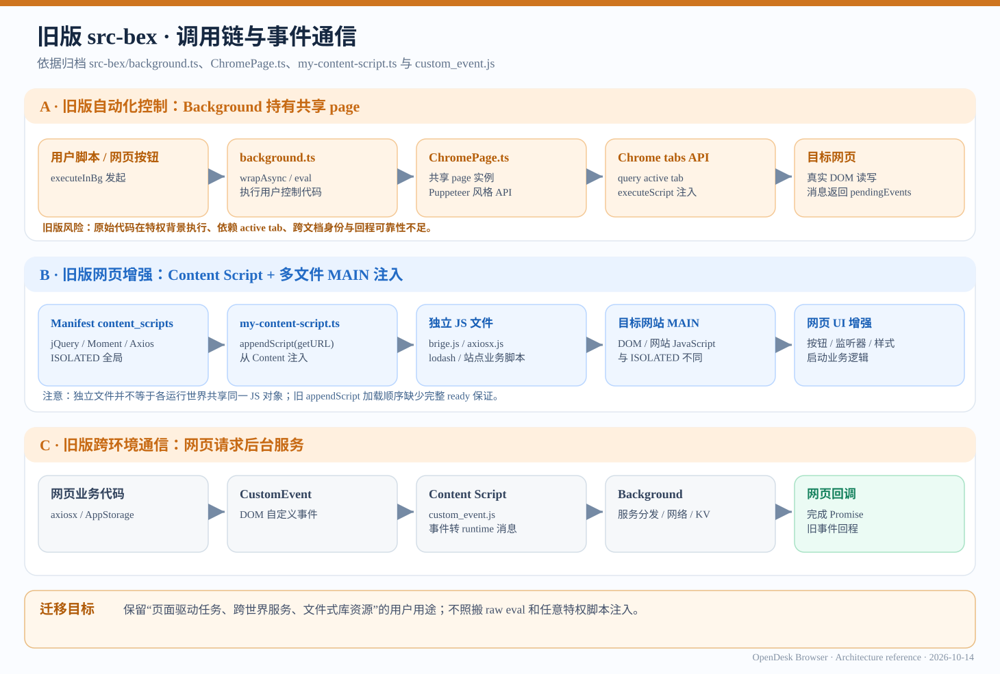
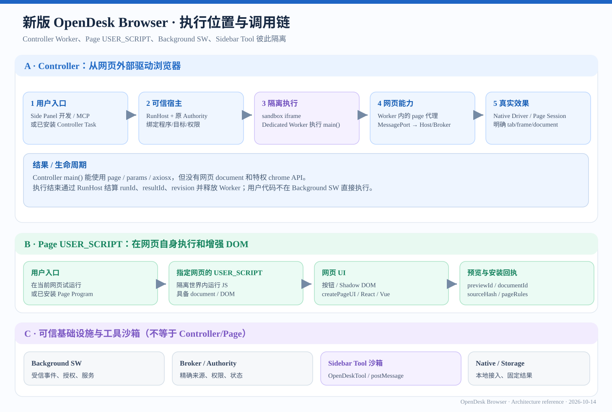
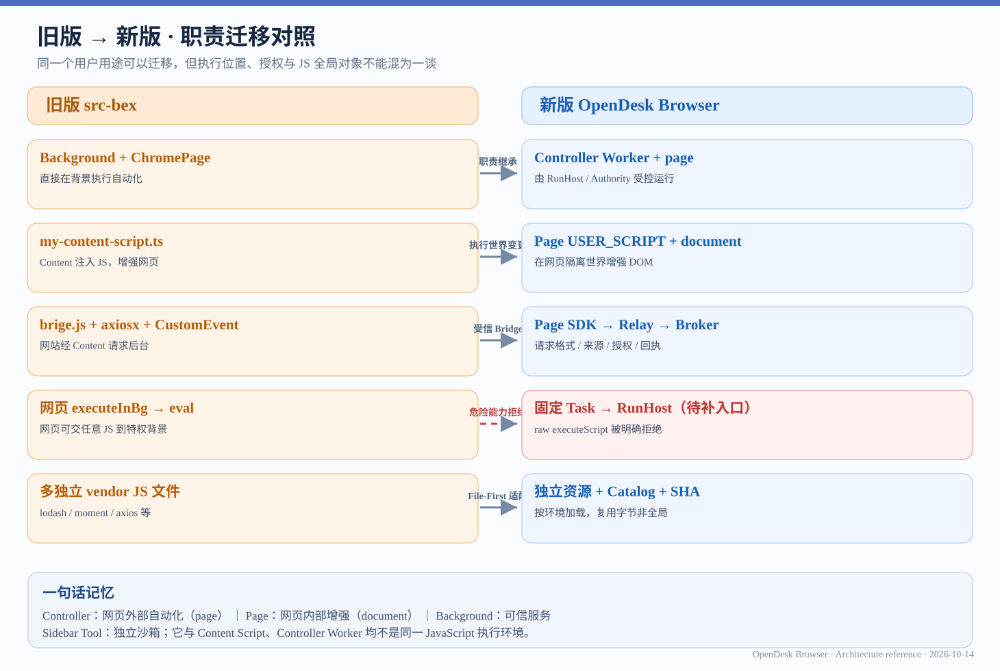
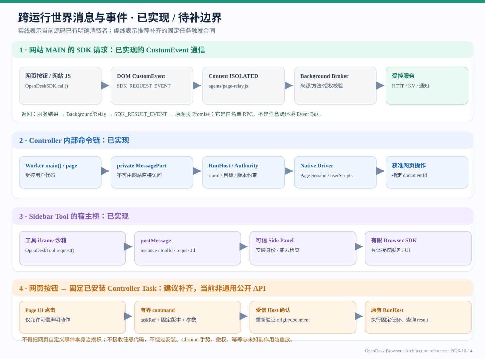

# OpenDesk Browser：旧新调用链与跨环境通信图解

> 更新：2026-10-14。以下为**阅读和设计用途**的 SVG 矢量架构图，不是运行结果截图，也不能代替与相同 SHA 绑定的真实 Chrome 验收。SVG 根据此前三张架构图的主题重新绘制为更适合 GitHub 文档检索与放大的版本，**不是此前 PNG 的逐字节副本**。

## 图一：旧版 src-bex 调用链

旧版主要有三条链：Background 中执行控制代码并使用 ChromePage；Content Script 向页面 MAIN 注入业务脚本；网页通过 CustomEvent 与 Content 转发到 Background 服务。旧 `eval` / `executeInBg` 不是可直接照搬的安全合同。

## 图二：新版多运行世界

Controller 代码在 sandbox iframe 创建的 Dedicated Worker 中运行，`page` 是受控代理；Page USER_SCRIPT 在目标网页拥有 `document`；Background SW 是受信服务；Sidebar Tool 在独立 sandbox iframe 中运行。

## 图三：Legacy → Current 职责映射

迁移表示**用户用途与责任归属**，不宣称相同变量作用域、完整 API 兼容或原生测试已经全部完成。网页 raw `executeScript` 在当前 SDK 中明确拒绝；不能把“可在 Side Panel 运行 Controller”视为“网页按钮已能直接启动已安装 Controller”。

## 图四：当前桥接与待补任务触发

绿色/蓝色/紫色区域是现有实现机制，最后一行**虚线**是产品建议，**尚非当前通用公开 API**：

- 网站 MAIN SDK 使用 CustomEvent → Content Relay → Background Broker → 已批准的 HTTP/存储/通知等服务。
- Controller Worker 通过私有 MessagePort、RunHost、Authority 调用网页执行器。
- Sidebar Tool 使用 postMessage 与可信 Side Panel 的受限 Bridge 通信。
- 网站按钮启动固定 Controller Task 尚应独立验证与实施。不得将任意自定义事件视为可信用户手势或允许网页提交任意 JS 给特权 Background。

**容易遗漏的差别：**网页 `MAIN` 的固定 `OpenDeskSDK` 与用户 `Page USER_SCRIPT` 属于不同执行世界。当前 `browser.events.read` 主要属于工具自己的有界观察会话，不是任意应用跨环境发布订阅总线；`tasks.open` 打开已安装任务 UI，不直接执行任务。

## 权威源码与文档

- [旧框架事实](../legacy-src-bex-framework.md)
- [新框架执行关系](../current-and-target-framework.md)
- [迁移责任/14 个用户场景](../legacy-to-target-map.md)
- [完整框架 F01–F18 功能树](../framework-feature-progress-tree-20261013.zh-CN.md)
- [Controller API](../../../api/controller.zh-CN.md)
- [Page USER_SCRIPT API](../../../api/page-userscript.zh-CN.md)
- [Side Panel Tool API](../../../api/sidebar-tools.zh-CN.md)
- [Browser SDK 当前注册表](../../../../src/framework/sdk/browser-contract.js)
- [网页 SDK 的事件传输](../../../../src/framework/sdk/transport.js)
- [ISOLATED Relay](../../../../src/agents/page-relay.js)
- [工具 iframe Bridge](../../../../src/sidebar-tools/bridge.js)

## 更新原则

实线/虚线仅表示当前源码能否确认对应**机制/接口**，不是 Chrome PASS。若增加“页面 UI → 固定任务”能力，应复用原 RunHost/Authority、精确 origin/document、程序/Revision、用户手势、受控参数和 Durable Result；禁止新建第二套高权限事件分发/RunHost。

暂不在此文档复制完整 Browser SDK API 数量和完成百分比；具体接口与验收以当前注册表、测试证据及构建候选为准。

## 跨环境消息与旧版功能缺口审计

详细的逐场景状态、当前已有 API 与最小补齐方案，请参阅 [网页 UI、跨运行世界通信与旧版迁移核查](../page-ui-cross-world-communication.zh-CN.md)。该文件只描述现状和建议，未为网页新增任意任务执行权限。
