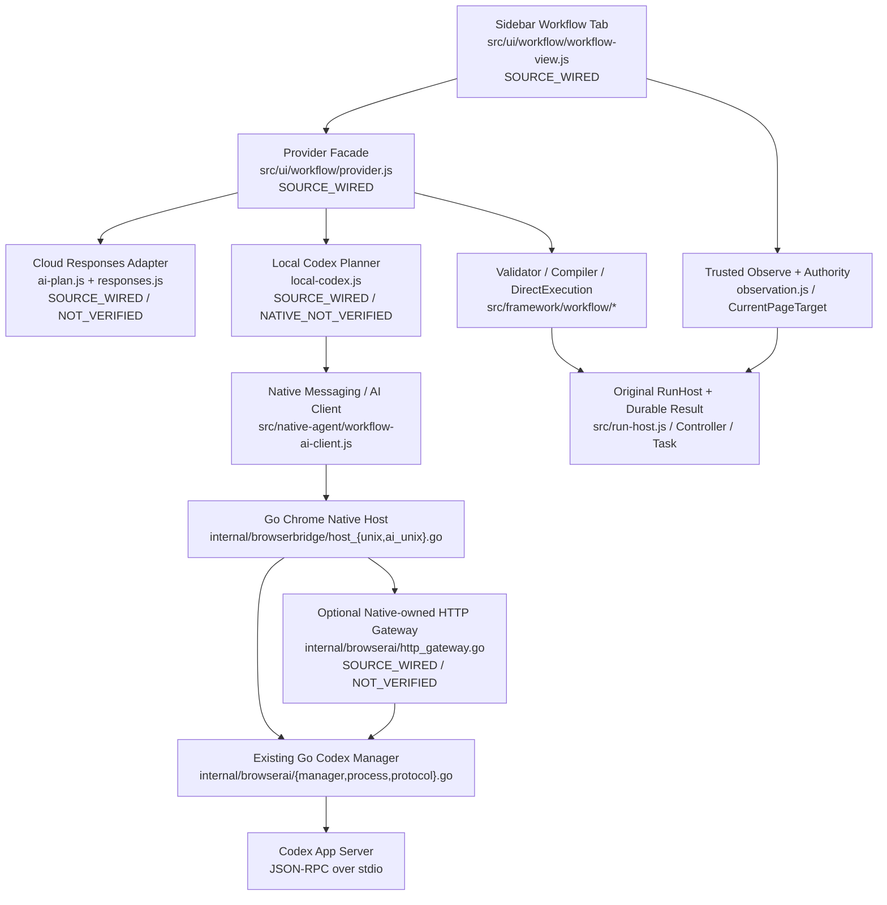
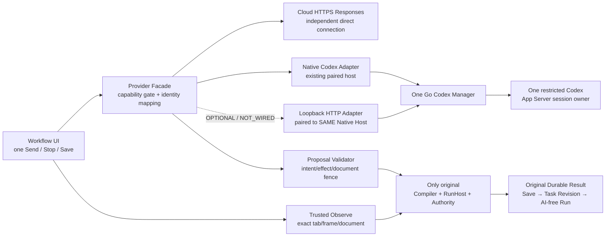
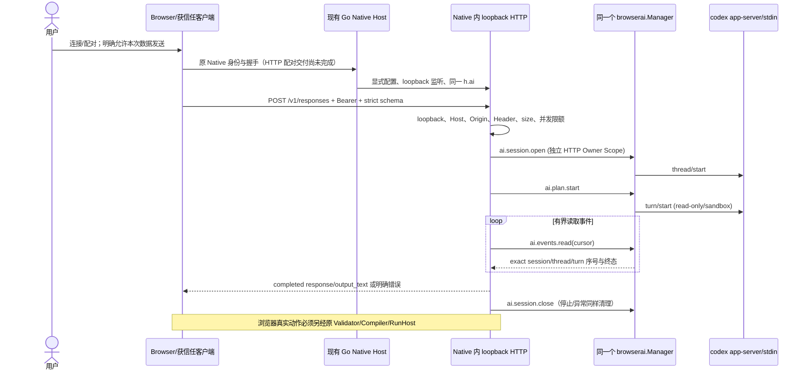
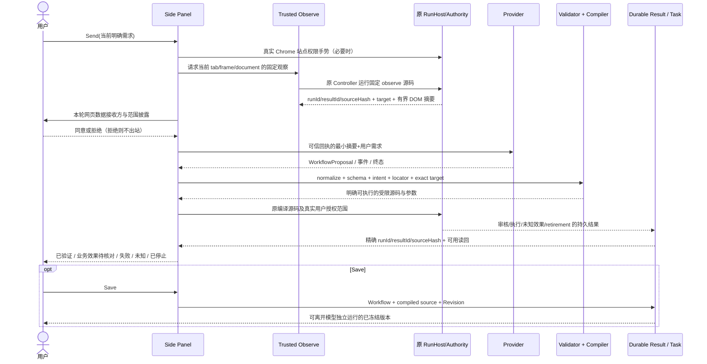

# OpenDesk Browser Workflow R2：文档驱动的 Provider 路由、可信网页执行与本机 HTTP Gateway 正式设计合同

> **版本**：R2.1 / 2026-10-15。**状态**：DESIGN_CONTRACT / SOURCE_PARTIAL / INTEGRATION_PARTIAL / NATIVE_NOT_VERIFIED / PRODUCT_NOT_ACCEPTED。**唯一当前架构入口**：本文件；实施账本沿用 [对话式任务执行记录](../../framework/workstreams/conversation-direct-r1-20261013.md)，历史 [R16 方案](workflow-ai-provider-routing-r16.zh-CN.md) 保留。  
> **源码核对锚点**：Browser `main@a7246887f5d09015b6244a1b2c5da5e232a2d015`；Go `master@310a24a726a6d218ae585df2dbe449b86f13ea62`。这只是编写本设计时的读取基线，不代表冻结或构建身份；后续提交需以最新 Git HEAD、目标文件 blob SHA 和实际源内容复核。  
> **阅读顺序**：本文件 → 相关源码/接口 → 实施账本 → 对应候选的测试与真实回执。旧 R16 的“生成→采用建议→再运行”是**历史设计**，不覆盖本文件的“发送后经授权安全执行”。
> **当前产品执行入口（2026-10-15）**：本文件**第 13 节**是最新的用户目标、功能任务树、风险加权估算与 P0 优先级决策；旧第 9/10.3 节的 HTTP F4 优先顺序只是历史快照，不覆盖第 13 节。

## 0. 文档驱动与验收语义（规范性）

工作方式：**真实源码核对 → 技术方案评审 → 本合同 → 分阶段核心实现 → 同步源码/状态 → 独立分阶段测试**。公共协议/跨 Browser-Go 字段先改本合同，再改两个消费者；无争议的独立切片可继续编码。若源码与本文不一致，优先判定是源码演进还是实现缺陷，再作最小调整；不能为“对齐”覆盖其他 Agent 正在修改的文件。

状态只有以下可信含义：

| 状态 | 说明 | 不得冒充 |
|---|---|---|
| `DESIGN_ONLY` | 合同成立但没有对应实际代码 | SOURCE |
| `SOURCE_IMPLEMENTED` | 真实仓库已存在实现，标明文件、SHA | INTEGRATED |
| `SOURCE_WIRED` | 生产调用路径已经连通且可静态追踪 | RUNTIME_VERIFIED |
| `INTEGRATED_NOT_VERIFIED` | 消费端接线存在，缺同候选真实请求/回执 | VERIFIED |
| `COMPONENT_VERIFIED` | 同一源码输入的定向测试或隔离实验有证据 | NATIVE_VERIFIED |
| `NATIVE_VERIFIED` | 同候选实际 Chrome/Native/Codex 或 HTTP 真端点验证 | PRODUCT_ACCEPTED |
| `NOT_VERIFIED`/`OPEN` | 没有证据/决策未解决，不得填 PASS | 所有 PASS |

**三层不同成功**：（1）模型生成合法 JSON 仅是 `PROPOSAL_VALID`；（2）原 Compiler/RunHost 终态与持久 Result 匹配是 `EXECUTION_RECEIPT_VERIFIED`；（3）目标网站实际业务效果由原页面读回或业务 Oracle 证明才是 `BUSINESS_EFFECT_VERIFIED`。一次点击完成而无业务 Oracle 应标为“已执行、业务结果待核对”；绝不把生成/点击/HTTP 200 直接称为业务成功。

## 1. 产品目标与正式旅程

**目标**：用户在当前网页用自然语言描述任务，AI 观察用户允许的页面并规划，经现有信任边界直接完成安全、明确、可核对的动作；必要时存为固定 Revision，后续关闭 AI 可独立执行。简洁的一次 Send 是任务请求和允许申请网站权限的真实手势，但**不是**无限权限、不代表同意向外部模型传整页资料、更不是模型自授的执行权。

正式主流程：

1. 用户在 Workflow Tab 选择本机 Codex 或已配置云端 Provider，针对精确当前页 Send；网站授权仅缺失时按真实 Chrome 手势申请。
2. 固定的 Browser `browser.observe` Controller 通过原 RunHost 读取有限语义节点，绑定当前 `windowId/tabId/frameId/documentId/origin/url`，保留 `runId/resultId/sourceHash` 及独立披露授权；云端每次向配置服务发送网页摘要前明确批准，本机按原会话短期授权合同与本轮目标检查。
3. Provider 仅产出 `WorkflowProposal`；Schema、意图、可见 Locator、目标、权限及副作用约束必须由本地 Validator/DirectExecution 判定。网页文本永远是 `UNTRUSTED_DATA`，不能更改系统/工具/权限策略。
4. 无需新增“采用建议”按钮：已明确授权且安全的操作由**原 Workflow Compiler → RunHost** 立即执行；有歧义/敏感/跨站/无授权操作一律拒绝或返回要求明确授权的状态。
5. 原 Controller 结果与 RunHost `runId/resultId/sourceHash/document/retirement` 栅栏成立后，读取实际目标效果并生成持久回执；状态区分“任务运行终态”和“网页业务验证”。
6. 同窗口下继续下一轮：本机仅在真实可用时续接 Codex thread；云端只传有限的、**已验证的业务摘要**，不默默复用原生 thread 或原始网页文本。
7. 用户可选 Save，冻结已核对的 Workflow/Compiler 源码、hash、参数、Revision 和原 Task 约束；关闭 Provider/Native 后在已有权限下独立 Run。Save 不代表安装、网站业务已验证或发布。

**行为边界**：导航、敏感按钮、跨原点、写入未被用户明确给出的值等不能在 AI 猜测下自动放行；真实撤权/页面换代/Stop/重复 request/未知副作用均停止且不盲重试。已有业务操作要走 Task、Controller、CurrentPageTarget、Authority、RunHost，绝无第二条 AI DOM 副作用路径。

## 2. AS-IS、TO-BE 与源码归属

### 2.1 AS-IS（逐源码核对，部分接线、未原生验收）



现状：`workflow-view.js` 已导入 `createWorkflowProviderFacade`，对 `cloud_responses`、`local_codex`、`custom_https` 接线，已通过本轮观察审批向 Facade 传 `observationReceipt`。`responses.js` 是严格非流式官方 HTTPS 子集（`store:false/background:false`、型别终态验证）；`local-codex.js` 通过 Native 事件游标使用本机 `browserai.Manager`，仅借原 RunHost 观察。客户端统一 Facade **已在代码中存在**，旧账本的 `UI_NOT_WIRED` 只能作为旧候选历史事实。

Go `internal/browserai/http_gateway.go` 与 `internal/browserbridge/host_ai_unix.go` 已新增**显式可选的 Native Host 内 loopback HTTP 源码**，使用相同 `h.ai` Manager，提供 `GET /opendesk/v1/capabilities` 与 `POST /v1/responses` 严格有限子集；它不是原 `-http` 服务里的路由，也不是第二个 Codex 管理器。**本轮尚无 HTTP 与 Native 同实例实际运行、Browser HTTP UI 连接、配对或真实结果证据。**

### 2.2 TO-BE（目标，不表示已交付）



**不变性（必须能用源码证明）**：

- Browser 执行器只有原 `src/run-host.js`、Controller/Compiler；AI 不调用 shell/文件操作/另一 Browser Agent Executor 执行网页动作。
- 权限 owner 仍是 Chrome 授权与 CurrentPageTarget/Authority；新增 HTTP 仅限生成文本提议，不增加网页能力。
- 保存与 Revision 由既有 Task/Controller 数据结构负责；HTTP 不建工作流数据库。
- Codex 进程仍由 Go `internal/browserai.Manager` + `process.go` 创建和取消；HTTP 只调用 `Manager.Handle`，不得另建 `exec.Command("codex")` 或守护进程。
- `cmd/opendesk -http` 的现有 HTTP Execution Container 与 Workflow Browser RunHost 不是同一执行器，不得混为一谈。

| 组件 | 代码所有者/路径 | 角色与范围 | 截止设计时状态 |
|---|---|---|---|
| Sidebar/UI | `src/ui/workflow/workflow-view.js`, `view-state.js`, `src/ui/tool.html` | 一次 Send、设置、授权、结果、Stop/Save；不拥有模型协议 | `SOURCE_WIRED`，状态颗粒度仍待收敛 |
| Provider Facade | `src/ui/workflow/provider.js` | 统一生成、探测、取消、恢复入口，不能执行网页 | `SOURCE_WIRED` |
| 官方 Responses | `src/ui/workflow/{ai-plan,responses,data-sharing}.js` | HTTPS 协议、文本 JSON、强制状态/限额/终态解析 | `SOURCE_WIRED / NOT_VERIFIED` |
| Native Codex | `src/ui/workflow/local-codex.js`, `src/native-agent/workflow-ai-{client,protocol,service}.js` | 浏览器→可信 Go Native RPC，事件/审批/停止 | `SOURCE_WIRED / NATIVE_NOT_VERIFIED` |
| 页面观察 | `src/ui/workflow/observation.js`, `src/native-agent/protocol.js` | 固定代码读取有限 DOM 摘要，持久观察证明 | `SOURCE_WIRED` |
| Workflow | `src/framework/workflow/{contract,compiler}.js`, `direct-execution.js` | Proposal 归一化、静态校验、安全直接执行门禁 | `SOURCE_WIRED` |
| 权限/执行/任务 | `src/run-host.js`、既有 CurrentPageTarget/Authority、`src/platform/tasks/` | 用户授权、原 RunHost、Durable Result、Task Revision | 已存在，R2 原生闭环 `NOT_VERIFIED` |
| Go Native/Codex | `internal/browserbridge/host_ai_unix.go`, `internal/browserai/{manager,process,protocol}.go` | 可信 Owner、受限 App Server 子进程和 JSON-RPC 转换 | `SOURCE_WIRED`；审计版 Codex 0.159.2 历史有局部组件证据 |
| Go HTTP Gateway | `internal/browserai/http_gateway.go`, `internal/browserbridge/host_{ai_unix,unix}.go` | 同 Native Host 自持 loopback 监听和同 Manager 调用 | `SOURCE_WIRED / NOT_VERIFIED` |
| 旧 Go `-http` | `cmd/opendesk/main.go`, `runtime_endpoint.go`, `pkg/http/handler.go` | 通用脚本 HTTP/调度等，独立生命周期 | 已存在；**不自动承载 AI 子集** |
| Desktop App Mode | `cmd/opendesk/app_mode.go` | `-app` 运行应用；当前与 `-http` 互斥 | 已存在；**不因 AI 网关被暗中启用** |

## 3. 最小 Provider 业务 Facade 合同

以已实现的 `createWorkflowProviderFacade({localPlanner})` 为入口；未来 HTTP 只增加独立 transport adapter，不重建 Facade。业务接口（逻辑签名，命名遵循当前 JS 实现）：

```ts
type Source = 'local_codex' | 'cloud_responses' | 'custom_https' | 'local_http'; // local_http 是目标，未在 UI 中接线
type WorkflowRequest = {
  source: Source;
  request: string;                    // 用户当前这轮明示意图
  workflow: WorkflowDefinition;        // 冻结输入，仅可生成 proposal
  target: {windowId:number;tabId:number;frameId:0;documentId:string;url:string;origin:string};
  observationReceipt?: TrustedObservationReceipt | null;
  settings?: {endpoint?:string;model?:string;apiKey?:string};
  consent?: {model:boolean;workflow:boolean;observation:boolean};
  history?: VerifiedBusinessTurn[];    // 仅必要事实；不得保存网页正文、Secrets、未经验证步骤
  signal?: AbortSignal;
  onEvent?: (event:SafeProgressEvent)=>void;
  onApproval?: (event:SafeToolRequest, context:TrustedContext)=>Promise<Decision>;
  jsonSchema?: StrictWorkflowSchema | null;
};
type ProviderResult = {
  proposal: WorkflowProposal;
  metadata: {
    provider: Source; responseId?:string; sessionId?:string;threadId?:string;
    turnId?:string;upstreamRequestId?:string;usage?:object|null;termination?:string;
  };
};
probeCapabilities(source, localCapability?) : AdapterCapabilities;
generateWorkflow(input:WorkflowRequest) : Promise<ProviderResult>;
cancel(source) : Promise<StopOutcome>|null;
resume(source, args) : Promise<Session>|never;
```

**状态与拒绝**：能力声明至少 `structuredOutput,streaming,observation,toolCalls,activeConversation,coldResume,cancel,localAbort,usage,store,background,readyForTurn`，区分“该适配器支持”与“该账户/模型已真实可用”。`local_codex` 的冷恢复必须以真实能力探测为准；`cloud_responses` 的 `cancel` 当前仅本地 Abort，不能声称服务端停止；`local_http` 初期没有 Streaming、tools、server-side resume/cancel、usage，均显式不支持。未知参数、协议、schema、事件必须 `E_AI_UNSUPPORTED/E_AI_PROTOCOL`，不能沉默降级。

**身份分层**：`conversationId` 是 Browser 产品会话身份，`workflowId/revision/sourceHash` 是受控业务资产；Responses `response.id` 是云端某次响应；Go `sessionId` 是已认证 Native/HTTP Owner 的作用域，`threadId` 是 Codex 内部上下文，`turnId` 是一次执行尝试，`requestId` 是传输幂等键；`runId/resultId` 是 Browser **真正网页执行**结果，互不替代。切 Provider 必须断开不能兼容的服务器 session/thread/response ID，只保留最小经验证业务摘要，并重新取得目标及发送授权；绝不把原 Provider raw ID 当下一个 Provider resume 参数。

**Schema**：所有来源的 `proposal` 均由 `normalizeAiProposal`、`validateWorkflow`、可见 Locator/来源 Document 校验和 `prepareDirectExecution`、Compiler 共同把关。JSON 合法不代表 Locator 存在或权限成立。应使用受信 schema 的 exact version 与 hash；模型自报权限、网页中的“请执行系统命令”、未知 `op` 无效。

**错误等级**：配置/不支持/拒绝/未授权属于 `NOT_DISPATCHED`；网络断开、客户端 timeout 或 cancel 导致上游真实终态未知时为 `OUTCOME_UNKNOWN`，不自动重发；Browser `RUN_EFFECT_UNKNOWN` 更不得基于模型自然语言重演任何网页副作用。实际执行 Stop 由 RunHost 控制，不能拿 Provider Abort 冒充浏览器 Stop。

## 4. 三种协议的映射（不得混称完全兼容）

| 语义 | A. 官方 OpenAI Responses HTTPS | B. Codex App Server stdio JSON-RPC | C. OpenDesk Go HTTP 子集（当前源码） |
|---|---|---|---|
| transport | `POST https://.../v1/responses` | stdio 上逐行 JSON-RPC 请求/事件 | Native Host 内 loopback `POST /v1/responses`，独立 bearer |
| 创建请求 | `model,instructions,input,text.format,stream,store,background` 等官方字段 | `initialize → thread/start → turn/start`；`threadId`, `input`, `outputSchema` 属 Codex 协议 | **仅** `model,instructions,input`（字符串或单条 typed user/input_text）, `text.format=json_object` 或严格 `json_schema`,`stream:false/store:false/background:false`；未知 JSON key 拒绝 |
| 响应结构 | `response.id/object/status/output[]/usage`；以类型化 output 为准 | `thread.id`,`turn.id`、事件通知，不能假装 Response object | 完成后合成 `object:"response"` 和单一 `message/output_text`；`id` 为本地新建，**不是** Codex turn/thread ID |
| 终态 | `completed/failed/incomplete`，拒绝 incomplete/refusal | `turn/completed` 等官方事件及终态，核验精确 turn | 仅 Codex completed、verified 和 JSON object 时回 200；未知终态报错 |
| structured output | 官方 `text.format` 的 json_object 或可用 strict json_schema；取决于模型能力 | Codex `turn/start.outputSchema`（版本审核） | 支持 `json_object` 或由可信调用方提供闭合 `json_schema`；严格 schema 必须显式开启 |
| input | 官方 `input` 可为多种项/role/content array | Codex 特定 `input` items | 非空 **字符串**或**单条 user/input_text typed array**；更多 roles、parts、媒体内容一律不支持 |
| 流式 | `stream:true` SSE 类型化事件（本 Browser cloud adapter 尚未实现） | Codex 事件按原生成/拉取 Event ledger 返回 Browser | 仅 `stream:false`，`stream:true` 显式拒绝 |
| tool calling | 官方 function/tool/approval 等按正式结构；现 JS adapter 遇未知 output 显式拒绝 | 受限工具仅 `browser.observe` 回现有 Controller，shell/文件禁用 | HTTP 子集 `toolCalls:false`，遇工具/approval 请求即失败 |
| 会话 | 官方 previous_response_id / conversation 语义按实际服务；本 Browser cloud 不使用 | thread/start、thread/resume、turn/start/interrupt；是否可冷恢复按版本/证据 | 每个 HTTP POST 一次短命 session+turn；不支持 previous_response_id、无 HTTP resume |
| cancel | Browser 本地 Abort 不等于官方服务 cancel ACK；未来实现须区分 background cancel | `turn/interrupt` ACK 后仍等真实 turn terminal，否则 unknown | HTTP 断开只请求 Manager cancel/close，**不等于**已确认 Codex 终态 |
| usage | 官方响应可能包含 `usage`；严格校验后展示 | 当期 Go event 未承诺标准 token usage | 当前不返回 usage；不得估算为 0 |
| store / background | 官方支持范围与服务默认值按文档，Browser 强制 `false` | Codex 本机历史/缓存另有策略，不等价于 Responses store | 必须显式 `store:false`，`background:false`；true/未知拒绝 |
| errors | 官方类型化 error/HTTP status/request ID | 版本/策略/额度/网络/事件游标/未知结果 | `error:{type,code,message}` 为 **OpenDesk 子集行为**，不保证完整官方 error schema |

**字段命名规则**：A 的 `previous_response_id`、`text.format`、`usage` 是官方 Responses；B 的 `threadId/turnId/dynamicTools/outputSchema` 仅 Codex；C 的 `/opendesk/v1/capabilities`、`E_GATEWAY_*`、`SourceKey/Scope`、`observationReceipt` 等是 OpenDesk 私有合同。C 的 JSON 外形相似不等于 A 的会话、工具、用量、stream 或认证兼容。Codex 的 stdio JSON-RPC 版本细节必须对已审计可用 CLI 再核对；Go `process.go` 当前明确审核 `codex-cli 0.159.2`，未审核版本 fail closed。

规范性参考：[Responses Create](https://developers.openai.com/api/reference/resources/responses/methods/create)、[Responses migration](https://developers.openai.com/api/docs/guides/migrate-to-responses)、[Codex App Server](https://developers.openai.com/codex/app-server)。官方页面会演进；新增字段不能靠字段名猜语义。

## 5. HTTP Gateway：唯一 Owner、生命周期与安全边界

### 5.1 已选择的最小架构与原因

**HTTP 是可选适配，不是 Browser 成功的前提**。Chrome/Browser 既有最可信的路是配对 Native Messaging；Cloud 直接 HTTPS；HTTP 仅为经合法配对的本机其他客户端提供标准化受限“生成 Workflow JSON”的入口。与其另开 Node daemon/第二个 Go HTTP 服务并尝试共享 Codex 状态，当前 Go 选择在**既有 Browser Native Host 进程中**按配置打开一个 loopback listener，复用 `h.ai`。HTTP Gateway 不具备 Browser Authority，不能携带 `browser.observe` 工具执行或产生网页副作用。

真实源码：

- `internal/browserbridge/host_ai_unix.go` 的 `startAIHTTP()` 读取 `OPENDESK_CODEX_HTTP_ADDR` 与 `OPENDESK_CODEX_HTTP_TOKEN`；必须同时配置、为合法 loopback IP/端口，否则拒绝配置；`Host.Run()` 中显式启动；`Host.Close()` 负责关闭 HTTP 与 Codex Manager。当前不是 `-http` 模式路由，也不会因 Desktop App Mode 自动开启。
- `internal/browserai/http_gateway.go` 的 `NewHTTPGateway(h.ai,...)`、`ServeHTTP` 校验 `RemoteAddr/Host/Origin/Referer/Bearer`；只允许 GET 能力与 POST Responses；每次通过 `Manager.Handle` 的独立 scope 调受限 Codex 操作。
- `cmd/opendesk/runtime_endpoint.go` 的显式 `-http` 路线绑定 `0.0.0.0`，是原产品 HTTP 功能，**不得直接开放新的带登录态 AI route**；`cmd/opendesk/app_mode.go` 当前拒绝 `-app` 与 `-http` 同用。禁止通过改动通用端口监听范围或改写 AppMode 互斥项走捷径。

### 5.2 请求/实例时序



### 5.3 威胁模型、凭证与错误

**硬性要求**：

1. **监听**：只许 OS loopback IP（`127.0.0.1` 或 `::1`）及明确端口；无配置不监听。防 DNS rebinding 必须双重核对 socket 实际本地地址、`Host` 字面 IP:port 与来源 IP；拒绝 `localhost`/伪别名/非 loopback / 重定向 / 代理穿透，不能仅凭 HTTP Origin 信任。
2. **鉴权**：至少高熵独立 bearer token，常量时间比较，不能打印/存入网页、工作流、LocalStorage、URL query、日志、错误响应；Native 原配对 Owner 验证仍不能省去。当前源码通过 env 注入 token；**安全配对分发、轮换、注销、随用户撤权立即失效的方案是 OPEN，不得宣称已完整实现**。
3. **浏览器 Origin 与 CORS**：当前实现对带 `Origin`/`Referer` 的跨源 HTTP 请求一律拒绝且不提供 CORS；因此普通 Browser fetch 的 HTTP 直接调用**尚无合法已验证路径**。不能为了“接通”一律放开 CORS；若未来允许受信 Chrome extension origin，必须先设计绑定准确 extensionId、令牌颁发/撤销、预检/CORS 矩阵和真实 Chrome 来源证据。未经批准保持 fail closed。
4. **配对所有权**：HTTP 的 token 不等于 Chrome Native registrationId。未来 pairing 需由受认证 Native 连接拥有并能撤销，再绑定客户端 generation、一次 requestId、独立 scope/模型允许范围；当前 HTTP scope 为独立 `http-loopback`，不能把 Native sessionId 传给 HTTP 恢复。
5. **预算**：当前 Go HTTP 两个并发 slot、请求 60KiB 以内、模型 120s 上限、事件序号/结果 45KiB 防护；大于限制报明示错误，不能无限排队或日志化原网页内容。请求超时、断线、用户停止只请求 cancel/close，未知终态**不重试**。
6. **受限 Codex**：`process.go` 对审计版 CLI、固定 workspace、子进程环境/只读 sandbox、MCP/shell/file/web 限制，不能信任 HTTP 来的任意 `instructions` 获得系统级优先权。当前 Gateway 将调用方 `instructions` 合并入输入字符串，必须仍视为普通用户数据，不覆盖服务器的固定规划策略。
7. **能力声明**：`/opendesk/v1/capabilities` 仅为 adapter 静态支持矩阵，`modelAvailability:NOT_PROBED` 不表示账户/模型 READY。不要用这个 GET 作为账户试扣费或登录成功的证据。
8. **协议版本与拒绝**：`stream:true`、`store:true`、`background:true`、`previous_response_id`、除已审查的 `json_object` 和单条 typed `user/input_text` 外，其他格式、多项 input、未知参数必须明确 4xx/unsupported；不得默默忽略。输入仅限 JSON object Workflow，业务 schema 最终必须经 Browser Validator。

**失败处理**：`E_UNSUPPORTED` 是能力契约拒绝；`E_GATEWAY_AUTH` 不触发自动切换云端；`E_OUTCOME_UNKNOWN` 需要用户检查，禁止自动第二次提交；进程退出/切换 Extension ID/撤权关闭绑定会话，后到事件不能恢复旧 Owner。日志默认仅技术状态、时长、匿名 ID 和有界错误码，不保留 Prompt、DOM、API Key、Bearer、Codex 凭证或原系统 stderr。

## 6. 真实网页观察、权限和受控执行时序



**目标身份**：观察和副作用必须绑定同一 `windowId,tabId,frameId(当前仅 0),documentId,origin,url`；发送后刷新、导航、窗口切换或撤权即使模型随后返回“成功”，也拒绝使用过期 proposal。来自网页正文、ARIA、站点提示的语句只是参考数据，永不提升为系统指令；模型不拥有 `chrome.*`、localhost token、MCP/Playwright 执行入口。

**停止次序**：先提升 UI generation/标记已停止，撤销待审批，取消当前 observation，停止 RunHost 当前 run，取消 Provider turn/HTTP 等待并追踪清理。Provider Abort 不撤销已发生的网页副作用；Native `turn/interrupt` ACK 不代表终态完成；RunHost 可信回执或人工检查之前任何未知结果保持 unknown。后到事件按 request/session/generation 与 document fence 丢弃，避免误绑定新一轮 Send。

## 7. UI 交互合同与状态投影

**主要入口**只保留工作流 Tab 的输入区、来源选择（设置中）、发送、Stop、创建新会话/新工作流、历史/保存/再运行。模型配置失败才展开诊断；已配置且当前页获准时不再增加“采用 AI 建议”确认步骤。新会话清空旧 Provider 原生线程身份与待审批；新工作流重建空 Workflow，但不删除用户已保存 Task；Stop 是当前真正运行 owner 的 stop，不能借另一个 Tab 的运行 ID。Save 是固定 Revision，不是发布/安装。保存后的 Run 无论 Provider 是否可用均要走原 Controller。

| 用户可见状态 | 意义/触发 | 失败保护 |
|---|---|---|
| 连接中 | Native/HTTP Provider 真实健康检查，HTTPS 配置检查 | 不把 configured 当 READY |
| 观察中 | RunHost 固定观察且在本轮目标/披露授权内 | 过期 document 或拒绝分享即停止 |
| 生成中 | Provider 回合/响应未取得合法终态 | 超时/断连不重试 |
| 执行中 | 原 Compiler/RunHost 已接手；有唯一 run owner | Stop 只发送给此 run |
| 结果待核对 | 有执行终态，网站业务效果缺独立证明（尤其 click） | 不展示“业务已成功” |
| 已验证 | 原持久回执与必要业务 Oracle 已匹配 | 证据与源码/目标同一候选 |
| 失败 | 明确验证失败或协议拒绝 | 显示可操作错误码 |
| 已停止 | 用户 Stop/撤权/中断、完成清理或标记 unknown | 不把 pending cancel ACK 当 stop 完成 |

现有 `view-state.js` 等前端 UI 状态尚未完整具备上述每一级的独立投影，标为 `DESIGN_ONLY` 的细化目标；UI 当前展示已接线的“规划/运行/结果”等不等于完整效果 Oracle 已证实。

## 8. ADR：技术取舍和后续迁移成本

| 决策 | 候选与优缺点 | 风险/失败模式与选择依据 | 被否决路线与未来迁移 |
|---|---|---|---|
| **ADR-01 Native / HTTP** | Native 继承 Chrome 真实安装与 Owner/授权（强），依赖浏览器连接（弱）；HTTP 适合配对本机客户端（强），新增本地网络面（弱） | 采用 **Native 默认 + HTTP 显式可选**。若 HTTP 未配对/Origin 复杂则 fail closed；未来允许 HTTP 客户端要补 token rotation 与特定 Origin，而非替换 Native |
| **ADR-02 Go HTTP / Node 守护进程** | Go 既有 Process/Manager 生命周期可复用；Node 新 daemon 开发似快但双进程/凭据/退出清理代价高 | **选同一 Go Native Host Manager 上 HTTP 薄层**；不让 `-http` 通用服务直接暴露带登录态的 route。否决第二 Codex spawn manager；未来需独立产品服务时先做 Owner 的明示迁移合同 |
| **ADR-03 Facade / UI 分叉** | 业务 Facade 小而可替换且复用 Validator；UI 直接分别调用短期省文件却生成分叉审批/身份逻辑 | **选已经存在的 `provider.js`**，协议适配器仅处理本源特殊性。失败模式是错误的能力夸大；新增 Provider 必须有正/负声明和同一规范化链 |
| **ADR-04 server session / bounded history** | Codex 原 thread 对已审计版本连续体验好但不可跨 Provider 移植、冷恢复受限；VerifiedBusinessTurn 可跨 Provider 但丢细节 | **同 Provider 有证据才 server resume；跨 Provider 仅已验证受限事实**。否决重放整页/原始回应 ID；未来持久业务摘要可升级独立加密状态而不迁移 raw thread |
| **ADR-05 原 RunHost / Agent Browser Executor** | 原 RunHost 具身份、权限、回执、源码 SHA（强），受限动作范围（弱）；新 Agent executor 扩展动作快但两套信任边界 | **拒绝第二 executor**。复杂任务以后增加受控 Workflow schema/编译支持，而不让 Codex shell/CDP/桌面鼠标直写网页，保持既有 Task/Revision 向前兼容 |
| **ADR-06 一次生成 / Agent tool loop** | 一次式 Cloud Responses 易限额、低成本但无在线修正；Codex tool loop 能受控观察/继续，但事件/审批与版本复杂 | **同一业务 Facade 下允许不同能力**：云端先 non-stream single proposal，本机 Codex 可真实多轮及只读观察；禁止无审阅地假扮云端同样有 agent loop。未来新增 streaming/tools 需独立版本化能力，不破坏旧端点 |
| **ADR-07 严格协议子集 / 假兼容** | 严格子集调用者需 adapter，但安全及升级清晰；忽略未知字段让早期演示容易却可能误执行带 `store:true` 等请求 | **strict decoder + unsupported fail closed**。迁移成本落在明确的新能力协商上，而不是以后排查静默协议漂移 |

ADR 风险升级触发条件：Codex CLI 版本改变、Chrome Origin/Host 处理需要改变、Gateway token 分发、Go Native Host 退出策略变化、R2 workflow schema 扩展、想允许模型自动跨页操作。遇任一触发先更新对应 ADR 与适配器兼容矩阵。

## 9. 核心开发任务树（F0–F5）与后置验收（T1–T6）

本次继续**功能开发**；下表基于代码与历史账本，未以仓库源码存在推断运行已完成。

> **2026-10-15 产品优先级更新**：F0–F5 保留 R2.1 技术历史；当前下一步应按本文件**第 13 节 P0-C/P0-D**实现真实业务效果与 AI-free Run×2，而不是将 F4 HTTP 接线作为前置条件。

| 阶段/依赖 | 最小可交付范围与代码 | 已知状态 | 当前阻塞与通过定义 |
|---|---|---|---|
| **F0** 源码差异核对 | Browser `workflow-view/provider/ai-plan/responses`；Go `browserai/host_ai/http_gateway`；R16/现有账本 | **SOURCE_RECONCILED**（本文件读取基线） | 完成事实表、无第二引擎；未来每次只增量复核变更 |
| **F1** Cloud Responses UI 接线 / F0 | `responses.js`,`ai-plan.js`,`provider.js`,`workflow-view.js` | **SOURCE_WIRED / NATIVE_NOT_VERIFIED** | 已有 Send→Cloud observation→Facade→Compiler/RunHost 源码；通过需真实同候选云端响应、DOM 业务读回 |
| **F2** 最小 Provider 合同 / F1 | `provider.js`,`local-codex.js`,`src/native-agent/workflow-ai-*.js` | **SOURCE_WIRED / CAPABILITY_PARTIAL** | 路由与能力表已存在；需错误一致性、provider ID/业务会话边界、HTTP 入口能力拒绝 |
| **F3** Go Local HTTP Gateway / F2 契约 | `internal/browserai/http_gateway.go`,`internal/browserbridge/host_ai_unix.go`,`host_unix.go` | **SOURCE_WIRED / NOT_VERIFIED**（并行 Go 实施已存在） | 需明确合法配对、Origin/Host/CORS；同一 Manager 进程运行验证与必要 Go 定向测试；**不得重复创建** |
| **F4** Native/Cloud/HTTP 配置整合 / F1–F3 | Browser 现有 provider/UI 配置与未来独立 `local_http` adapter，Native token 获信交付 | **Native/Cloud 源码已接线；HTTP transport SOURCE_IMPLEMENTED_NOT_WIRED；Browser HTTP UI NOT_IMPLEMENTED** | 网关目前拒绝带 Origin 的浏览器 fetch、没有受信 token 配对渠道；修完安全契约前不启用 UI |
| **F5** 最小清理/状态交接 / F4 | 本正式 R2 合同、现有账本、源码路径/当前 SHA、独立定向检查 | **IN_PROGRESS** | 无冲突修改提交、必要 smoke、每级 NOT_VERIFIED 保留；不得挤占全套验收资源 |

**下一次核心开发的最小动作**：优先由 Go HTTP 所有者与 Browser Provider 所有者约定 `POST /v1/responses` 的可信客户端身份、token 获取/撤权/Origin 行为和严格 `input/schema` 形状；然后独立实现 Browser `local-http.js` 受限 transport 的可信配对接入与 Facade 能力路由。未解决时 HTTP 只允许由明确获信任的非浏览器 loopback 客户端使用，Browser UI 不可假装“可用”。

**T1–T6 为 F5 后独立执行的测试阶段（本轮不运行）**：T1 定向 Node/Go/协议拒绝；T2 同进程真实 Native 连接/HTTP pairing；T3 真实 Chrome 单轮安全填写、点击与读回；T4 撤权/刷新/Stop/未知效果/晚到事件；T5 Save 后禁用 AI 的 Run×2；T6 production 同候选、正式身份与发布验收。历史 98/98 Node CI 和 R16 Linux Codex 实验仅属原候选证据，不能抵扣本轮 T1–T6。

## 10. 风险、OPEN、设计评审与版本追踪

### 10.1 OPEN / NOT_VERIFIED

- `HIGH/OPEN`：HTTP bearer 如何经过**原 Native 配对**安全交付 Browser/本机客户端并支持撤权、进程重启和令牌轮换；环境变量传入本身不是完整配对能力。
- `HIGH/OPEN`：当前网关禁一切 `Origin`，扩展 fetch 可能发送 Origin；切勿为接线放开通用 CORS。
- `HIGH/OPEN`：Go 网关后续并行提交已支持 `input:string` 或单条 `user/input_text` array、`json_object` 或严格 `json_schema`；但完整官方 Responses 会话/tool/stream/usage/错误语义不兼容；独立适配器必须拒绝其他格式和未知字段。
- `HIGH/NOT_VERIFIED`：真实 Codex CLI 审计版本、nativeMessaging handshake、Go 相同 Manager 是否真的只建一套 Codex 进程、Host 退出后的 HTTP 清理。
- `HIGH/NOT_VERIFIED`：真实 Chrome 当前目标授权/网页摘要/Origin/cancel/readback/Durable Result、Save→无 AI Run×2。
- `MEDIUM/OPEN`：业务“click 后成功”的可声明 Oracle 与现有 `view-state.js` 视觉投影缺口；不把点击成功当业务成功。
- `MEDIUM/OPEN`：Codex CLI 版本升级（`0.159.2` 以外按当前 `process.go` 拒绝）、官方 Responses schema/stream/usage 变化；不做隐式兼容。
- `MEDIUM/NOT_VERIFIED`：当前源码编译/CI、Mac `dist/development` 的真实加载目录和安装 ID。远端 HEAD 不是本机加载包。

### 10.2 七维设计自评（专家审阅维度，不冒充独立评分）

| 维度 | 已满足的可检验依据 | 未解决风险/改进动作 | 评分状态 |
|---|---|---|---|
| 产品旅程 | 一次 Send→RunHost→保存/复跑、授权分层 | click 业务 Oracle/Native 闭环 | `TARGET_95+ / NOT_SCORED` |
| Provider 抽象 | 实际 `provider.js` 和统一 Proposal/Compiler | HTTP 接线与跨源上下文拒绝 | `TARGET_95+ / NOT_SCORED` |
| 官方协议 | Responses typed output、Codex stdio、严格 HTTP 子集区分 | 真模型/API 版本互通 | `TARGET_95+ / NOT_SCORED` |
| HTTP/凭据安全 | loopback Host、bearer、no CORS、受限 Manager | token pairing/Origin 兼容高风险 | `TARGET_95+ / NOT_SCORED` |
| 既有模块复用 | 同一 Go h.ai、原 Compiler/RunHost/Task | 真单实例运行验证 | `TARGET_95+ / NOT_SCORED` |
| 错误/Stop/未知 | request ledger、event sequence、cancel/unknown 语义 | HTTP 断线终态、真实 Stop | `TARGET_95+ / NOT_SCORED` |
| 维护/迁移成本 | 唯一合同、薄 adapter、ADR 决策 | 版本漂移/Token 生命周期 | `TARGET_95+ / NOT_SCORED` |

**设计评分不是验收**。没有独立专家和匹配候选证据时，逐维均 `NOT_SCORED`；高风险安全项未闭合不可称 95 分已实现。

### 10.3 版本与继续开发约定

- 设计来源：2026-10-15 的 Browser `main@a7246887f5d09015b6244a1b2c5da5e232a2d015`；Go `master@310a24a726a6d218ae585df2dbe449b86f13ea62`。新增 HTTP 属该次 Go 基线的并行提交，非本设计文档作者发明。
- 既有历史：2026-10-10 [R16](workflow-ai-provider-routing-r16.zh-CN.md)、2026-10-13 [Direct R1](../../framework/workstreams/conversation-direct-r1-20261013.md)、2026-10-14 [Minimal UI R17](../../framework/workstreams/workflow-ui-r17-minimal-20261014.md)。绝不清空其历史失败与旧测试记录。
- 每完成 F1–F5 任一源码切片，更新本文 **模块状态、协议/ADR、真实 SHA** 和既有账本 **负责人/本次写入范围/未测/阻塞/下一步**；保留旧版本事实，不改写老日志冒充新证据。
- 并行协议遵守 `AGENTS.md` 和 [parallel-development](../../framework/parallel-development.md)：Browser 仅 `main`，各 Agent 同文件单写入，跨 Browser/Go 契约需要明确 owner，冲突只暂停受影响范围。
- 下一次对话不从 Phase 0 重新设计。读取本文件、现有账本、最新 AGENTS 与 Git 源码 SHA，**从 F4 的安全配对/HTTP Browser 消费者接线的最小缺口继续**；任何未解决安全矛盾按 `OPEN` 处理，不能用宽松 CORS/隐式 token/第二 Manager 绕过。


## 11. R2.2 并行源码增量与防漂移（2026-10-15）

> 此节是增量状态更新，**不是**创建另一份正式架构文档；仍需按最新 Git SHA 逐项核实。原第 0 节的 R2.1 读基线保留作为快照，本节记录后来发生的并行代码演进。

- **Go 协议增量**：Go `internal/browserai/http_gateway.go` 后续增量 `db2387feb76e9f635ca9528ec9ba6d333c46167c` 增加了非流式 `json_object`、单个标准 `user/input_text` 消息 array，仍保持未知字段、多个 typed 项、`store:true`、`stream:true`、`background:true`、历史 response ID 的拒绝。Go `internal/browserai/http_gateway_test.go` 的后续提交 `2c003149d534ce2bd47629d1d046d88be39ef4f2` 增加 Host、Origin、认证、unsupported 相关定向测试；**源码+测试存在不自动等于该新候选 CI PASS**。
- **Browser 隔离切片**：新增 `src/ui/workflow/local-http.js`（commit `01919da0676768f134286bc636270cc5ff79b7f4`），仅提供 loopback endpoint/token 的参数门禁、受限非流式 Responses 请求、受限 body 读取、型别化 `parseWorkflowResponse` 复用和 unknown outcome 不重发。其 `localHTTPAdapterCapabilities().pairingReady=false`；**未导入 `provider.js` / `workflow-view.js`，不自称可从 Chrome 直接联网**。
- **定向测试源码**：新增 `tests/environment/workflow-local-http.test.mjs`（Browser `72cd92c030782f8466832555fc0a850fcf19a78c`），包含 loopback、Bearer、strict Schema、typed input 请求、json_object、伪造 usage/incomplete、断连不重试等局部断言；**本记录未执行该新测试，标为 `TEST_SOURCE_ADDED / NOT_RUN`**，不能拿其他候选 109/109 替代。
- **协议正确性**：前文映射矩阵 C 的“字符串 + strict schema only”现已修订为精确的扩展子集。Browser `local-http.js` 的提交不生成 Native token、不突破 Origin/CORS、不处理用户浏览器执行、不提供任意网络目标或已登录 Codex 凭据。Go 环回路由仍必须由同一 Native Host 实例的 `h.ai` 管理。
- **持续阻塞**：受信 Origin 行为与 HTTP token 颁发/撤权/存储方式尚无跨仓共同完成合同，不能把 `localhost` 任意端口设为允许；真实 HTTP 端点、Codex 模型、同构建 Chrome 目标和业务效果未验证；T2–T6 后置。
- **既有并行账本**：`docs/framework/workstreams/conversation-direct-r1-20261013.md` 已由另一 Agent 追加 R2.2 实现与 CI 候选记录。该文件应由其当前 owner 管理；本设计文档不覆盖、撤销或声称为本轮执行其 CI。

### 11.1 CI 证据与跨平台阻塞（现有远端运行，只读核对）

- Go `master@2c003149d534ce2bd47629d1d046d88be39ef4f2` 的 [Native Messaging CI #38713903230](https://github.com/shopable-ai/opendesk/actions/runs/38713903230) **整体 FAIL**：该候选 `transport (macos-latest)` 与模拟 Chrome 可执行任务 SUCCESS；Ubuntu 的 `internal/browserai` 包（含 gateway 定向测试）PASS，但 `internal/browsercli/admission_unix_test.go:32` 使用 Linux 不存在的 `/private/tmp` 致任务失败。不得将该工作流汇总为 PASS。
- 同一 Go 候选的 [Windows Core #38713903198](https://github.com/shopable-ai/opendesk/actions/runs/38713903198) **FAIL**：`internal/browsercli/command.go:187` 编译时调用 `Host.Close`，非 Unix 平台的 `*browserbridge.Host` 无该方法。这是 Go 跨平台编译阻塞，交给 Go Native/Windows 代码所有者协调；不可为修复它另造 Codex Manager。
- Browser 其他 Agent 的 [Workflow 数据 CI](https://github.com/shopable-ai/opendesk-browser/actions/workflows/workflow-ai-data-r16.yml) 与正在跑的工作流仍随 main 快速演进。以前的 109/109 定向 PASS 仅按其当时 commit 范围承认；不声称覆盖本轮新 `local-http.js` / 测试文件的 Node 执行。最新构建若被并行 AdBlock provenance 修改挡住，也必须依 owner/具体 SHA 独立报告。

## 12. R2.3 源码闭环修复与 HTTP 安全禁用决策（2026-10-15）

> 这是唯一 R2 正式设计合同的增量实施记录；上方 R2.1/R2.2 为历史基线，不修改其当时事实。本节以 GitHub 本轮提交为准，**代码存在不等于真实业务验收**。

### 12.1 实际生产路径与增量修复

- **本轮 Browser 源码修复（`main`）**：`0e9bb6c3` (`provider.js`)、`eb4372d9` (`ai-plan.js`)、`d43fb996` (`workflow-view.js`)、`9997dbb2` (`direct-execution.js`)。回归测试增量：`9c500003` (`workflow-provider-facade.test.mjs`)、`f0f50e69` (`workflow-ui-states.test.mjs`)、`11ea3e70` (`workflow-direct-execution.test.mjs`)。原 Compiler/RunHost/Authority/Task/Controller journal 未改动。
- **Native Codex 核对**：`provider.js` **原本已经传递 `target`** 给 `localPlanner.plan`；未发现缺少目标参数的问题，本轮没有凭误判修改其调用。真实本机 Codex 推理仍 `NOT_TESTED`。
- **HTTPS 模型收敛（P0）**：正式 UI 的 `cloud_responses` 与 `custom_https` 都需先经同一真实网站授权、独立本次数据分享确认、原 RunHost 固定观察；经 `provider.js` 统一入口调用 `ai-plan.js`。旧版 `custom_https` 在缺少本轮观察时于发网络请求前拒绝；收到观察后只传有界 `authorizedObservation`，将模型 JSON 规范化并逐个核对 Locator 是否出现在可信观察中，随后才能走原 `prepareDirectExecution`、Compiler、RunHost。旧版独立 Chat Completions 调用方仍可只生成未授权执行的提议，不得到直接网页执行授权。
- **Save/Revision（P0）**：AI 在同一 `workflowId` 内更新工作流后保留上次 Controller 已提交 `revision`，供 `save()` 的 `expectedRevision` 乐观锁继续提交下一版；`matchesRevision()` 比较完整 Definition 和源码哈希，因此新草稿仍显示未保存，且 `run()` 继续使用 draft 而非旧 saved bytes。版本不匹配时仍由原 Controller journal 拒绝，不强行覆盖。保存的 Definition、验证模式、源码与固定 Revision 仍按原合同加载并核对；无 AI 运行仍使用原 RunHost。
- **不虚报业务效果（P0）**：任意后续 `assert` 不再自动证明前一 `click` 的业务效果；`hasUnprovenClick` 对所有 click 保守为真。在缺少与用户实际目标独立绑定的读回 Oracle 时，仅可声明 `EXECUTION_RECEIPT_VERIFIED`，不可声明 `BUSINESS_EFFECT_VERIFIED`，也不可把点击经历放进后续 Provider 的“已验证业务历史”。原 `verifyFill` 的 `inputValue()` 读回保持有效，但不能外推出服务端业务提交成功。

### 12.2 Go 受限 HTTP / 编译阻塞

- **Go `master` 本轮修复**：`d892a5b6` 在 `internal/browserbridge/unsupported.go` 为不支持的平台提供无资源持有的 `Host.Close()`，与 CLI 关闭调用保持编译期一致；`7225ac72` 在 `internal/browsercli/admission_unix_test.go` 把仅 Darwin 存在的 `/private/tmp` 测试根路径改为已有其他测试使用的跨 Unix `/tmp`。这些是源码修改，Windows/Linux 定向 CI 仍需以新候选结果单独核对；没有声明目标机器原生验证通过。
- **HTTP/Owner 决策未变**：Native Messaging 是 Browser 本机默认可信路径；Go 的显式 HTTP 环回入口复用同一 Native Host 的 `h.ai` Manager。独立已配对本机客户端可以按严格 `stream:false`/受限 JSON Responses 使用；Browser `local-http.js` 仍保持 `pairingReady:false`、未导入 Facade/UI。当前 `Origin`/CORS 默认禁止跨源浏览器调用，不允许以放开 CORS 或向页面公开 token 完成 F4。
- **F4 仍为 OPEN / SAFE_DISABLED**：没有经真实 Native 所有者颁发、限定客户端身份、轮换/撤权的 Browser HTTP Bearer 交付机制；环境变量 `OPENDESK_CODEX_HTTP_ADDR/TOKEN` 不是自动配对。未交付配对前既不启用 Browser HTTP Provider，也不声称 Chrome 可以直接使用此端口。Go Gateway 不新建 Codex Manager；原响应子集的 unsupported 仍 fail closed。

### 12.3 实施与证据分级

| 范围 | 本轮实际状态 | 证据与限制 |
| --- | --- | --- |
| Native / Cloud Facade | `SOURCE_WIRED` | 原路径保留；目标身份、会话 ID 不跨 Provider 使用；用户 Mac Native / Cloud 真模型 `NOT_TESTED` |
| Custom HTTPS 可信执行 | `SOURCE_WIRED / NOT_VERIFIED` | 新观察门禁、逐一 Locator 校验与测试源码已提交；CI/真实 Chrome 待新 SHA 验证 |
| 同工作流 Save 新 Revision | `SOURCE_IMPLEMENTED / NOT_VERIFIED` | 移除自动规划时丢弃修订基线，保留乐观锁；真实保存/复跑证据待测 |
| Click 业务效果 | `SAFE_UNVERIFIED` | 严禁把不相关后置断言提升业务效果；独立业务 Oracle 尚未完成 |
| Go 平台编译/测试修复 | `SOURCE_IMPLEMENTED / CI_PENDING` | Go `d892a5b6`、`7225ac72`，等待同候选 Windows/Linux 实际 CI |
| Go HTTP Gateway | `SOURCE_WIRED / PAIRING_OPEN` | 未修改网关授权及 Native Owner；不能对普通跨源网页开放 |
| Browser Local HTTP | `SOURCE_IMPLEMENTED_NOT_WIRED` | 安全禁用；Browser 使用 HTTP 必须先解决 Native 配对/来源绑定 |
| Chrome 真实 Send → 效果 → Save → Run×2 | `NOT_TESTED` | 本轮无用户 Mac/真实 Chrome，可先继续无冲突的源码开发 |

### 12.4 下一最小工作及验收边界

1. 先以更新后的 Browser/Go 候选 CI 核实定向测试及 Windows/Linux 编译；失败只修复归本轮改动的部分，旧候选 PASS 不迁移。
2. P0 后续：在原 `direct-execution.js` / `workflow-view.js` 和原 Durable Result 合同中定义**可审计的独立业务效果 Oracle**，只对确实能读取到结果的场景报告 `BUSINESS_EFFECT_VERIFIED`；未有 Oracle 的 click 保持效果未验证。
3. P1 后续：由 Go Native Owner 先完成已绑定客户端身份、可撤销的 HTTP token 颁发/生命周期；Browser 端完成安全 Origin 适配合同之前禁止接入 HTTP Facade/UI。若产品暂不需要 Browser HTTP，继续保持 Native 默认与 HTTP 仅用于受信本机客户端。
4. 后置 T1–T6 按用户批准的独立阶段执行；本轮没有 Windows/macOS 真机、Codex 已登录状态、生产安装候选或真实 Chrome 页面副作用证据，不能宣称正式验收与逐维 95+。

### 12.5 R2.3-P0：真实观察回执从局部校验收敛为统一 Durable Result 身份（2026-10-15）

**本切片独立提交：** Browser `f3f776fbcb96f1d39149b84a5836b0d154322722`（本轮 GitHub 直接写入 `main`）；改动 `src/ui/workflow/observation.js` 和 `tests/environment/workflow-ai-observation.test.mjs`。与上文其他 Agent 已提交的 Provider、Click 和 Save 修复并存，不覆盖其源码或据此认领其提交。

- **问题和修复**：旧观察结果仅在局部核对 `claim` / `result` 的源码 SHA、正文 Document 和 Worker 收尾，尚未在发给模型前与完整运行身份闭环。现在固定观察直接调用原 `verifyDirectExecutionReceipt({claim,completed,view,sourceHash,target})`，要求同一 RunHost 的 `runId/resultId`、完整 `window/tab/frame/document/url/origin`、`sourceHash`、完整终态、持久 Result、Worker `released` 共同成立；不一致即拒绝网页摘要外送、不自动重试。返回 receipt 的可信身份也由该 proof 派生。模型仍无新网页 Executor 或额外权限。
- **回归范围**：更新原观察 fixture 至完整真实 RunHost 回执形状，新增 claim result 不一致、run document 不一致、sourceHash 不一致、Worker 退出不完整、completed result 不一致等五个 fail-closed 用例。没有放宽 `browser.observe` 的网站、数据分享、Document 或 Stop 安全门禁。
- **同提交定向 CI 证据**：Browser `main@f3f776fb` 的 [Workflow AI data CI #38720844213](https://github.com/shopable-ai/opendesk-browser/actions/runs/38720844213) 明确执行 Node **121/121 PASS**、`npm run check` **PASS（738 files）**；但其 development build 因并行 `examples/sidebar-tools/adblock/trusted/host-controls.js` 的 Trusted source pin 不一致 **FAIL**。该 Workflow 总结论仍是 **FAIL**，绝不把组件通过写成全构建通过。真实 Chrome 与用户 Mac Codex/业务效果仍 `NOT_TESTED`。
- **状态边界**：观察回执修复为 `SOURCE_IMPLEMENTED / COMPONENT_VERIFIED (Node+source check)`；本轮没有声称 `BUSINESS_EFFECT_VERIFIED`、Native/Chrome PASS 或 T2–T6。Cloud/Native 规划和执行仍需原始目标、网站权限和 Provider 特有授权；Click 业务效果没有独立 Oracle 时仅能展示可信执行回执而非业务成功。
- **后续 P2 并行情况**：Go 其他 Agent 已在 `d892a5b6`、`7225ac72` 修复非 Unix `Host.Close` 和 Linux `/private/tmp`。该 Go 候选 [Windows Core CI #38720342941](https://github.com/shopable-ai/opendesk/actions/runs/38720342941) 仍因 `cmd/opendesk/app_browser.go` 调用缺失的 `SetupAutomaticContext` stub 而失败；本轮**另行**在 Go `master` 提交 `5dca85d8ea056f449cbd290438c70c97b8216ef5`，新增单独 `internal/browserbridge/setup_context_unsupported.go`，非 Darwin/Linux 明确返回 `E_PLATFORM` 而不模拟安装/配对。该新提交的 Windows CI 尚需单独读取，`CI_PENDING`，不能沿用之前失败候选的证据宣布通过。
- **F4 不变**：Browser→Native→Go Codex 保持默认；Go HTTP Gateway 仍绑定同一 Native Host/`h.ai`、仅显式本机凭据及 loopback 服务；Browser HTTP 适配器保持 `pairingReady:false` 且不可从 UI 选择。令牌颁发/轮换/撤权、可信客户端/Origin 合同未闭合，`SAFE_DISABLED / PAIRING_OPEN`。不得为了“HTTP 接通”开放 CORS、使用页面 token、建立第二套 Manager。

**下一最小开发动作**：如果 P0 的 Click 真业务读回有可独立证明的 Oracle，使用原 RunHost／Durable Result 增加有限且可审计的读回及效果分级；否则继续呈现 `EXECUTION_RECEIPT_VERIFIED`，并为 Save→无 AI 的 Run×2 做独立 Chrome 准备。HTTP 等本机可信配对合同成熟后再接入 UI；不能让 F4 阻塞已接线的 Native/Cloud 用户旅程。

### 12.6 R2.3 后续：执行证据等级落地、定向 CI 与跨 Agent Go 符号冲突收敛（2026-10-15）

此为在 12.1–12.5 基础上的**增量事实**，不将早先候选的 CI 结果重写为新候选结果，也不覆盖另一位 Agent 的观察回执切片。各记录以其具体 commit SHA 与运行 ID 为准。

**本轮 Browser 新提交**（只修改已有 UI/执行边界，没有第二 Executor）：

- `cff1036f833bb33af1780168324e4f16038a020d`：`src/ui/workflow/direct-execution.js` 新增纯状态分类 `directExecutionEvidenceLevel`，明确区分 `PROPOSAL_VALID`、`EXECUTION_RECEIPT_VERIFIED` 和 `BUSINESS_EFFECT_VERIFIED`。无可信持久回执不能声称执行；执行回执但无受控页面输入读回，只是执行确认；已核对 `inputValue()` 且无未验证 click，才可以把“页面输入值实际匹配”作为有限业务效果。网页字段读回**不代表后台数据库、业务提交或支付成功**。
- `4541b99ea589596cc0202f9f6e99a8a4c7810d0e`：`src/ui/workflow/workflow-view.js` 在原 `verifyDirectExecutionReceipt` 与持久结果核对后实际计算证据等级并返回；正式 UI 区分“RunHost 执行回执已核对”与“页面填写值读回匹配 / 业务效果待核对”，并只把已完成页面输入读回且无不确定 click 的事实加入后续 Provider 的受限业务历史。无回执或未知结果保持失败/未知，绝不自动重放。
- `3f160f8e95e9d76f16a9345203bb5a684d7caea1`：`tests/environment/workflow-direct-execution.test.mjs` 为三个证据等级及 click 未证明场景添加局部测试。这些新增证明级别不增加任何浏览器权限或模型执行能力。
- 已有其他 Agent 的 `f3f776fbcb96f1d39149b84a5836b0d154322722` 是独立的可信观察回执身份收敛切片，已由 12.5 节登记，**不是上述本次提交**。

**最新匹配候选的定向 CI**：Browser `main@3f160f8e` 的 [Workflow AI #38721045226](https://github.com/shopable-ai/opendesk-browser/actions/runs/38721045226)：`Verify changed JavaScript parses`、`Direct-send provider, payload minimization and workflow regressions`、`Real source verification` 三个步骤为 **SUCCESS**，同次 Node **122/122 PASS、0 FAIL**。`Real development build` 因独立 AdBlock Owner 的 `examples/sidebar-tools/adblock/trusted/host-controls.js` Trusted SHA pin 不匹配 **FAIL**，所以该 Workflow 的总体结果仍为 **FAIL**；本任务没有修改外部 AdBlock 源或重新 pin。上述证据只覆盖该候选测试和源代码，不代表真实 Chrome/用户 Mac。

**Go Windows 跨 Agent 协作与新阻塞**：本轮 Windows `master@7225ac72` [Windows Core #38720342941](https://github.com/shopable-ai/opendesk/actions/runs/38720342941) 整体 **FAIL**；`Host.Close` 缺失已消失，随后暴露 `cmd/opendesk/app_browser.go` 所需的 `browserbridge.SetupAutomaticContext` 缺失，另有 **test-architecture ledger 356 vs reviewed 297** 的独立分类审计 FAIL。另一位 Agent 在 `5dca85d8ea056f449cbd290438c70c97b8216ef5` 通过新增 `internal/browserbridge/setup_context_unsupported.go` 提供了该 Context API 的 Windows `E_PLATFORM` stub；本轮并行时，我也曾在原 `unsupported.go` 以 `3fc9486a` 补入同名 stub，发现重复后立即通过 **`27765894058885ce497f60d52d32582a4e53f82a`** 仅修改自己已有的 `unsupported.go`，移除重复的 `SetupAutomaticContext`，保留自己的 `SetupContext`，完整保留对方独立文件。该最新 Go `master@27765894` [Windows Core #38721532772](https://github.com/shopable-ai/opendesk/actions/runs/38721532772) 新候选当时仍待完成，状态 **CI_PENDING**。不得把原 FAIL 或 Go Ubuntu transport PASS 外推成 Windows 通过。

**Go Native Gateway**：Go 新旧这些跨平台 stub 改动均不触碰 `internal/browserai/http_gateway.go`、同进程 `h.ai` 或安全配对边界。Go `master@7225ac72` 的 [Native Messaging Go bridge #38720342867](https://github.com/shopable-ai/opendesk/actions/runs/38720342867) Ubuntu transport job **SUCCESS**，其余 jobs 等新候选判断；Browser `local-http.js` 不接入，`pairingReady:false`，HTTP F4 仍 `SAFE_DISABLED / PAIRING_OPEN`。

**下一最小实现**：先核实新增 Go Windows 最新候选在编译步骤是否已过，若仍是跨平台接口不一致，仅修复最小接口；`test-architecture` 的几十项未分类历史账本由其 Owner 单独处理。P0 下一切片应针对已授权且可独立读取的特定网页业务效果定义真实 Oracle；未证明的 click 继续停在 `EXECUTION_RECEIPT_VERIFIED`。后续 T2 真实 Chrome 与 T4 Save→关 AI 固定 Revision Run×2 明确 `NOT_TESTED`，不得以 122/122 Node PASS 宣称生产闭环验收。

### 12.7 P0 Native Codex Locator 来源统一：读、等待与断言也必须有可信观察（2026-10-15）

**新增 Browser `main` 提交**：`3219e7deda2a6a72e3cb24b3367bc83d5390e16e` 修改 `src/ui/workflow/local-codex.js`；`274d963ba9a1012b27ef8b87e01678a91d5e8069` 修改现有 `tests/environment/workflow-local-codex.test.mjs`。属于本轮最小 P0 增量，不新建 Browser Executor、权限系统、Codex 管理器或替代 Store。

**实际收敛**：原 Native Planner 在 `scope.observation` 时强制有本轮 Codex 工具 `browser.observe` 批准的 RunHost 摘要，但最终只对 `fill/click` 核对 Locator 是否属于 `observedNodes`；`wait/extract/assert` 的任意猜测定位未受同样约束。现直接复用 Cloud 已有的纯 `assertResponseLocators(normalized,{nodes:observedNodes})`，覆盖 **`fill/click/wait/extract/assert`** 五种带定位器的操作；fill/click 继续要求可见、非复合父定位且不是 index 位置。缺失定位器时统一 `E_AI_LOCATOR_UNOBSERVED`，不执行浏览器网页代码；原 `observe` 不需要定位器。受限观察节点仍来自 Native 授权、准确 Document、原 RunHost，不向 Native 之外的 Provider 跨会话复用。

**定向回归**：新增 Native `wait/extract/assert` 正确观察定位可规划、凭空编造名称拒绝的六种 fixture 分支；不扩展模型工具能力或真实网页读写权限。新增提交 `274d963ba9` 的 [Workflow AI CI #38722002409](https://github.com/shopable-ai/opendesk-browser/actions/runs/38722002409) 在本节写入时 **CI_PENDING**，与此前 `3f160f8e` 的 Node 122/122 PASS 不混用。无用户 Mac/真实 Chrome，业务效果及 Save 后无 AI Run×2 均 `NOT_TESTED`。

**Go 补充已完成的具体作业**：Go `master@7225ac72` [Native Messaging Bridge #38720342867](https://github.com/shopable-ai/opendesk/actions/runs/38720342867) 的 Ubuntu transport、macOS transport 和模拟 Chrome 的真实 Go 可执行文件三个 job 已分别 **SUCCESS**，属于各自 Go 功能/平台证据；未覆盖更新后的 `27765894` Windows 桩修复或本地 HTTP 用户配对。Go `master@27765894` Windows [#38721532772](https://github.com/shopable-ai/opendesk/actions/runs/38721532772) 仍按其最终结果独立判定，不能宣称 PASS。

## 13. R2.3 产品优先执行总纲：核心功能树、完成度口径与下一阶段闸门（2026-10-15）

> **本节是当前最新的产品优先级与进度表达合同。** 第 9 节的 F0–F5 是 R2.1 技术切片历史计划，第 10.3 节“下一次从 F4 HTTP 继续”是彼时快照，**不能覆盖此处的 P0 用户业务闭环优先决策**。不改变既有 Provider、Workflow Engine、Compiler、RunHost、Authority、Controller、Task/Revision 和 Go Codex Manager 的唯一 Owner。进度估算不等于原生验收或专家评分。

### 13.1 一句话目标、用户场景和明确边界

**用户产品目标（P0）**：不懂编程的用户在 Workflow Tab 描述当前网页任务 → 一次 Send → 原 CurrentPageTarget 及网站/数据分享授权 → 固定有界 DOM 观察及可信持久回执 → 选定 Provider 生成受限 WorkflowProposal → 本地 Schema/意图/Locator/副作用校验 → 原 Compiler/RunHost 执行 → 可信 Durable Result 与必要的网页实际读回 → 可选保存 Workflow + 固定 Revision → 关闭 AI 后在有效权限下独立执行两次。安全已明示的操作不恢复历史“采用建议→再次运行”确认。

验收示例：**A** 当前 demo-form 输入框写入用户指定的“ai自动化第一选择”，同次读回精确匹配；**B** 同会话安全搜索/点击后在有独立、受信业务 Oracle 的场景证明结果，不允许模型自行追加一个 assert 就声称业务成功；**C** Save 固定版本并在关闭 AI、不可再调用 Provider 的条件下 Run×2；**N** Stop、撤权、文档换代、Native 断连、晚到回复、未知副作用均拒绝越权或盲目重发。

首期限于用户明确授权的当前 HTTP(S) 网站、安全填写、只读观察/提取、受控等待、受限点击及可信断言。跨站自主导航、删除/购买/支付/发信/发布、高影响未知副作用、任意 Agent shell/CDP 及开放式跨站自主执行**不是为了提高百分比而自动纳入的目标**；不恢复采集/语音/任务树产品 UI。

### 13.2 以实际用户行为为轴的功能任务树（状态是证据等级，不是勾选代替验收）

```text
OpenDesk Browser Workflow：自然语言 → 真实执行 → 结果验证 → 保存 → 无 AI 复跑
├── P0 核心用户产品闭环【不得被 HTTP/F4 阻塞】
│   ├── A 任务输入与 AI 规划【SOURCE_WIRED / REAL_CHROME_NOT_TESTED】
│   │   ├── 已有：一次 Send、Cloud Responses/Native Codex/旧 HTTPS Facade
│   │   ├── 已有：WorkflowProposal 规范化、意图/参数/Locator 门禁
│   │   └── 待证：真实模型基于当前页产生符合本轮意图的合法方案
│   ├── B 当前网页授权和观察【SOURCE_WIRED / COMPONENT_VERIFIED】
│   │   ├── 已有：CurrentPageTarget，独立网站与数据分享权限
│   │   ├── 已有：固定 RunHost 观察、限额 DOM、完整持久回执身份
│   │   └── 待证：真实 Chrome permission/document/revoke/出站范围
│   ├── C 受控执行与业务效果【SOURCE_WIRED / EFFECT_PARTIAL】
│   │   ├── 已有：原 Compiler/RunHost、确切定位与执行回执
│   │   ├── 已有：填写 inputValue() 读回、三层证据状态显示
│   │   ├── 未闭合：独立定义并验证安全搜索/点击后业务 Oracle
│   │   └── 待证：真实 Chrome 的一次 Send → 页面实际读回
│   ├── D 保存和脱离 AI 复跑【SOURCE_IMPLEMENTED / RUNx2_NOT_TESTED】
│   │   ├── 已有：WorkflowDefinition、源码哈希、乐观 Revision、加载核验
│   │   ├── 待证：固定 Revision 在 Provider 不可用时真实独立 Run×2
│   │   └── 待证：两个 Run 的 target/receipt/sourceHash/页面效果一致
│   ├── E 连续操作及异常安全【SOURCE_PARTIAL / NATIVE_NOT_TESTED】
│   │   ├── 已有：Provider 业务上下文与 Stop、撤权/文档身份栅栏
│   │   └── 待证：连续对话、未知结果不重试、断连/晚到/恢复
│   └── F 真实 UI 体验【SOURCE_WIRED / PRODUCT_NOT_ACCEPTED】
│       ├── 已有：单 Send、运行状态、结果证据分级、Save/历史入口
│       └── 待证：真实操作/错误恢复/焦点/状态可解释及可发现性
├── P1 可选本机 HTTP 扩展【GATE=PAIRING_OPEN / SAFE_DISABLED】
│   ├── 已有：Go 同一 Native Host/h.ai 的受限 loopback Gateway
│   ├── 已有：Browser local-http.js 受限传输适配器（未接 Facade/UI）
│   └── 待完成：可信 pairing、短期 Bearer、轮换/撤权、Host/Origin/CORS
│       └── 仅证明确实需要 Browser HTTP 且安全合同闭合后才接入
├── P2 工程与构建【PARTIAL】
│   ├── Browser Workflow 定向 Node/源码检查已有绑定候选的成功证据
│   ├── Go Native transport/模拟 Chrome 有成功的同候选 CI
│   ├── Go Windows 主要编译可通过，测试分类账本审计仍失败
│   └── Browser 完整 build 受并行 AdBlock Trusted source SHA 漂移阻塞
└── T1–T6 分级验收【非重复开发任务】
    ├── T1 同候选 Provider/Compiler/Go 协议定向检查及必要构建
    ├── T2 真实 Mac Chrome：一次 Send → 填写 → 精确读回
    ├── T3 同会话安全搜索/点击 → 独立业务效果证明
    ├── T4 Save → 停用 AI/断开 Provider → 固定 Revision Run×2
    ├── T5 Stop/撤权/Document 变更/断连/unknown/晚到回执
    └── T6 同一 production 候选、安装身份、F3、ZIP、独立逐维评审
```

**每个任务的 Done 定义**：真实用户动作 + 预期可见效果 + 适用权限与失败条件 + 修改的最小源文件 + 同源候选 SHA/可复现测试 + 独立实际回执；只存在源码称 SOURCE_IMPLEMENTED，生产 UI 可达才 SOURCE_WIRED，真实 Chrome/Codex/业务结果必须单独举证。三种成功级别仅在证据成立时为 `PROPOSAL_VALID`、`EXECUTION_RECEIPT_VERIFIED` 和 `BUSINESS_EFFECT_VERIFIED`，未验证 click 最多为执行回执。

### 13.3 冻结的阶段性进度估算口径（非质量评分、非生产百分比）

**规划快照：约 52%（51.5/100），置信度有限。** 这是 2026-10-15 对用户旅程重要性、源码连接状态和剩余原生证据缺口的**主观风险加权估计**，不是代码行数/单测数量/等权模块平均值，更不是当前已实现“52%业务成功率”。后续只能在**相同任务边界、权重、证据与估算规则**下比较；未取得实际证据的分项不得因文档、测试数量或 UI 原型涨分。

| 领域 | 权重 | 规划估算 | 加权点数 | 主要阻塞 |
| --- | ---: | ---: | ---: | --- |
| A 自然语言与 Provider 入口 | 10 | 85% | 8.50 | 真实推理/Chrome 未实证 |
| B 真实网页授权和可信观察 | 15 | 85% | 12.75 | 实际 Chrome 授权与读回未实证 |
| C Compiler/RunHost 执行路径 | 15 | 70% | 10.50 | 原生执行未实证 |
| C2 独立业务效果证明 | 15 | 35% | 5.25 | click/search Oracle 有缺口 |
| D Save/Revision/AI-free Run×2 | 15 | 50% | 7.50 | 两次独立运行未实证 |
| E Stop/撤权/未知结果安全 | 5 | 70% | 3.50 | 原生负路径未实证 |
| P1 可选 HTTP pairing 与 Browser 接线 | 5 | 25% | 1.25 | 安全配对未完成、保守禁用 |
| P2 CI/构建/工程质量 | 5 | 45% | 2.25 | 跨项目 build/audit 仍 FAIL |
| T2–T6 真实 Chrome/production 验收 | 15 | 0% | 0.00 | 缺同候选原生验收证据 |
| **总计** | **100** | — | **51.50** | **仅管理估算，PRODUCT_NOT_ACCEPTED** |

权重分配刻意优先用户核心操作、可独立验证的效果和保存复跑，而不是按 Provider 文件数或测试条数分配；权重选择仍含判断性。**更重要的发布闸门**：T2、T4、T5 与 T6 的必要真机/候选证据未通过前，不允许宣称产品完成度或逐维专家评分达到 95+。可同时报告“源码路径较完整”，但不能把它写成“用户产品验收通过”。

### 13.4 后续执行顺序、源码 owner 和精确完成条件

| 顺序/最小任务 | 最小责任源文件与既有 Owner | 通过条件与失败保护 |
| --- | --- | --- |
| **M0 增量恢复** | `workflow-view.js`,`direct-execution.js`,`observation.js`；R2 本文、既有 workstream、Browser/Go AGENTS；各现有测试 CI | 先找最新源码/并行 Agent 已修复的缺口；**不重复开发**、不拿旧候选成功冒充 HEAD |
| **M1 C 真实效果** | Browser 原 `direct-execution.js`、`workflow-view.js`、`src/framework/workflow/compiler.js` 与 RunHost/Task Durable Result；按实际缺口最小写入 | 明确可独立读回的用户期望，受信 readback 证明才报 BUSINESS_EFFECT_VERIFIED；无法独立证明的 click 保持 EXECUTION_RECEIPT_VERIFIED；不得用模型自写 assert 伪造 Oracle |
| **M2 D 固定版本复跑** | `workflow-view.js`、现有 Controller Revision journal/Task API 和现存针对性测试 | 保证 Definition/sourceUtf8/sourceHash/Revision 一致，Provider 关闭时 `run()` 仅用冻结源码、不调用模型；无真实 Chrome 则记可运行源码/NOT_TESTED，不制造结果 |
| **M3 T2/T3 实测** | 固定 `dist/development`（原 `npm run dev` watcher 所有）、真实 Chrome/已配对 Native、`examples/tasks/demo-form.html` | 准确记录扩展 ID/路径、目标 document、运行及持久结果、实际输入值；没有 Mac/Chrome 权限则只登记 NOT_TESTED，其他编码可继续 |
| **M4 T5 安全负路径** | 原 Stop、Authority、CurrentPageTarget、Native RPC、RunHost | 撤权、刷新、cancel、disconnect、unknown、副作用已可能发生时无越权、无自动重放、无虚假业务成功 |
| **M5 P2/T6 产品收尾** | Browser AdBlock Trusted SHA 问题交其 Owner；Go test-architecture 分类账本交 Go Owner；再固定候选 | 浏览器/Go 定向 CI 分别真实 PASS，构建指纹和 installed ID 与 F3/ZIP 同一候选，无跨任务偷改他人可信源 |
| **H 可选 HTTP** | Go `internal/browserai/{http_gateway,manager}.go` / `internal/browserbridge/host_ai_unix.go`；Browser `local-http.js` | 独立 Native pairing Owner / bearer rotation & revocation / closed Origin/Host/CORS 合同完全闭合前 `SAFE_DISABLED`；Native 默认路径优先，不阻塞 M1–M5 |

**推进约束**：M1 → M2 优先实施与定向验证；M3/M4 需要真实 Mac/Chrome 时才做对应正式验收，不假装网页对话具有用户本地资源。M5 的其他 Agent 构建问题可平行协调，H 可延后甚至不接 Browser。任何公共协议变更先更新本合同并协调单写入 Owner。每完成一个可运行切片，将实际源路径、提交 SHA、所跑测试与结果、仍未测项和下一步写入唯一既有工作账本。**只提交范围内文件，Browser 仅 main、Go 仅实际批准的现有分支；禁止新分支/Worktree/PR/强推、第二执行器或第二 Codex Manager。**

### 13.5 2026-10-15 可追溯的候选 CI/真实未测事实

- Browser Workflow 候选 [#38731748525](https://github.com/shopable-ai/opendesk-browser/actions/runs/38731748525)（其自身 SHA 为 `cd51517e67d08f37389d946a6491fe9e55ed34d2`）：Node **123/123 PASS**，`npm run check` **PASS（742 files）**，`build:dev` 被 `examples/sidebar-tools/adblock/trusted/host-controls.js` Trusted source pin 不一致阻挡，**整条 workflow FAIL**；不外推为随后不断更新的 Browser main CI。
- Go `master@27765894058885ce497f60d52d32582a4e53f82a` 的 [Native Messaging #38721532953](https://github.com/shopable-ai/opendesk/actions/runs/38721532953) **整体 SUCCESS**（macOS/Ubuntu transport + 模拟 Chrome 可执行文件）；[Windows Core #38721532772](https://github.com/shopable-ai/opendesk/actions/runs/38721532772) **整体 FAIL**，源码编译/Windows 构建相关步骤通过，失败出在测试架构分类审计（当时 current Go tests 356、reviewed rows 297，包括未登记项）。
- 浏览器真正加载的 `dist/development` 路径/扩展身份、当前用户登录态 Codex/Cloud 真实规划、真实网页效果、AI 停用后同 Revision Run×2 与 production F3/ZIP：**NOT_TESTED**。GitHub HEAD、Node 模拟、headless Chrome UI/trace 检查不能充当这些证据。

**本轮优先级最终决定：先以 P0 C/D 和真实业务证据完成核心产品，再决定 HTTP 是否需要由 Browser 消费。** 旧 F4 技术切片继续作为参考，不再是推进主线的前置条件。


### 13.6 Workflow R2.4：真实业务效果、连续任务、Save 中断恢复与 AI-Off 复跑（2026-10-15）

**R2.4 是第 13 节的增量实施，不是新的架构。** 原 Provider、Authority、Compiler、RunHost、Controller Revision、Task/Durable Result 保持唯一 Owner。以下源码已接线不等于真实 Chrome、真实模型或正式安装已验收。

**用户行为和安全收敛合同**

1. **填写实际值**：Compiler 仍在原 RunHost 内用 `inputValue()` 精确读回；新增对 Durable Result 解码后的每个 `input-readback` 的期望值、`matched` 和步骤身份再次核对。纯填写要保留同一 Document；不能将执行成功当作服务器数据已提交。
2. **安全搜索**：一轮最多一次点击且点击必须是该固定 Controller 的最后一步。只有用户明确请求搜索、唯一已提供的关键词、可信观察匹配搜索按钮时才设置 `search-results-v1` 预期。先证明原执行 claim/completion/Result/retirement，再使用**原 RunHost 的固定只读观察器**和当前新鲜 Target/网站权限读取点击后页面（同窗口、同 Tab、同 Origin）。只有查询 URL 或结果语义标记关联关键词，且独立观察显示新增可见结果链接或明确无结果标记，才能把点击效果提升为 `BUSINESS_EFFECT_VERIFIED`。新增链接数只是有界 DOM 观察的下限，**不是服务器总结果数/相关性证明**。通用按钮、异步未落地页面、页面变化/撤权/读回失败均留在 `EXECUTION_RECEIPT_VERIFIED`（待核对），不能自动重复点击。
3. **安全换页**：已授权的最后一次点击可能正常换 Document；旧计划不会继续在新 Document 执行其他步骤。下一次读是重新捕获、重新检查权限和可信回执的独立只读动作。规划期其它 Document 换代仍废弃旧计划；晚到结果不能更新已取消的规划历史。
4. **连续自然语言**：Cloud Responses 与 Native Codex 只继承最多 4 项已验证的用户任务事实，包括请求、已验证状态、输入读回、步骤数及可选的 `input-readback`/`search-results`/`search-empty` 效果种类和有界可见结果数。`data-sharing.js` 的统一校验不允许原始 DOM/网页敏感文本、凭据、原生 Provider threadId 或未经验证的点击混入；Provider 的原生会话身份仍独立，跨 Tab/Origin 清理有限业务摘要。历史事实只提供语义，不授权重放副作用。**连续只读意图**：明确区分“查看搜索结果”（读取当前网页）和“搜索 OpenDesk”（发起搜索）。不得因名词“搜索结果”触发再次点击，不能在只读后续任务里重复旧副作用（Browser `899a06ed` / 单测 `b14bf765`）。
5. **Save → AI-Off**：保存前核对原 Controller 最新 head；若最新已提交的 bytes/hash 与本次冻结源码完全相同，复用该 Revision 恢复“Controller 已提交但 chrome.storage.local 写入失败”的中断；不同内容则仅在 CAS 期望版本相符时提交，否则报冲突，绝不覆盖他人修改。加载仍重新编译并检查固定源码。关闭 AI 后的手动 `saved` Run 不调用 Provider，额外核对 claim/completion/run/result 四处一致的 `scriptId + revision + sourceHash`。同一冻结版本真实 Run×2 仍需现场证明。
6. **验收分级**：Browser `9447aeff` 的真实 Workflow AI CI `38736377385`：Node **127/127 PASS**、JS 解析及源码检查 PASS、`build:dev` 因并行 AdBlock Trusted pin 漂移 FAIL。新 R2.4 追加提交不能借旧 SHA 的 127 PASS 冒充自己通过；真实 Mac/Chrome、真 Codex/Cloud、AI-Off Run×2、production F3/ZIP 均 `NOT_TESTED`。

**语义化产品功能树（文档追踪，不开发树 UI）**

```text
OpenDesk Browser Workflow — 自然语言完成网页任务并保存独立复跑
├── 理解用户需求：一次 Send → Provider 规划 → Proposal 与意图校验
├── 认识当前网页：Target 身份 → 网站/摘要披露授权 → 原 RunHost 观察与可信 Locator
├── 真正执行任务：Compiler 固定代码 → 原 RunHost → Durable Result 核对
├── 确认业务效果：填写值读回 → 独立安全搜索 Oracle → 其他点击待核对
├── 连续完成任务：已验证事实 → 当前页重观察 → 不重放旧操作
├── 保存并重复运行：Definition → CAS Revision/断点恢复 → AI-Off 同版 Run×2
└── 安全交付：Stop/撤权/unknown → HTTP 安全禁用 → CI、Chrome、production 验收
```

**功能树执行矩阵**。每个叶节点包括状态、Owner、源码、依赖、缺口、通过条件、SHA 和证据；SHA 为对应实现提交，不表示原生验收。

| 语义化功能节点 | 状态 | Owner / 源码 | 依赖 | 剩余缺口 | 通过条件 | 提交 SHA | 证据 |
| --- | --- | --- | --- | --- | --- | --- | --- |
| 需求／一次 Send | SOURCE_WIRED | Workflow UI / `workflow-view.js` | Provider / Target | 真实模型未测 | 一次明确需求直接进入受控执行 | `9447aeff` | 生产链路、Node |
| 需求／Cloud 与 Native 规划 | SOURCE_WIRED | Provider / `provider.js`,`local-codex.js`,`ai-plan.js` | 可信观察 | 真模型响应未测 | 同一语义和提议边界 | `49752f4f` | 定向测试，原生 NOT_TESTED |
| 认识／精确网页身份与授权 | COMPONENT_VERIFIED | Existing Authority / `workflow-view.js` | Chrome Permission、CurrentPageTarget | 真实撤权/换页未测 | 不带授权或旧 Document 不执行 | `f3f776fb` | 历史 Node |
| 认识／可信语义 DOM 观察 | COMPONENT_VERIFIED | `observation.js` | 原 RunHost | 真 Chrome DOM 未测 | 源码/Run/Result/Target/retirement 一致 | `f3f776fb` | 原定向 CI |
| 执行／Proposal 与 Locator 约束 | COMPONENT_VERIFIED | `direct-execution.js`/`responses.js` | 本轮受控观察 | 真模型误判未采样 | 未要求写操作及第二次点击拒绝 | `d1be7315` | 127 Node PASS 对应旧候选 |
| 执行／原 Compiler 和 Durable Result | SOURCE_WIRED | `compiler.js`/`workflow-view.js` | RunHost Authority | 真 Chrome 未测 | 完整 run/result/sourceHash 可信回执 | `9447aeff` | Node 127 PASS，Chrome NOT_TESTED |
| 效果／实际输入值读回 | COMPONENT_VERIFIED | `direct-execution.js`/`workflow-view.js` | 编译 verifyFill | 真 DOM 输入待测 | 每一步实际值精确匹配 | `9447aeff` | Node，真机 NOT_TESTED |
| 效果／安全搜索结果 Oracle | SOURCE_WIRED | `direct-execution.js`/`workflow-view.js` | 已核对执行 + 新只读观察 | 结构识别有限；真机未测 | 查询关联及新增结果/空结果独立证明 | `9447aeff` | 纯函数测试，真实业务 NOT_TESTED |
| 效果／一般点击实际效果 | NOT_TESTED | Direct Execution / `direct-execution.js` | 业务特定 Oracle | 无通用独立证明 | 不把点击回执伪称业务成功 | `d1be7315` | 保守待核对 |
| 连续／跨 Provider 事实继承 | SOURCE_WIRED | `data-sharing.js`/`provider.js`/`ai-plan.js`/`local-codex.js` | 已核对上轮效果 | 真多轮未测 | 最多 4 项 allowlist、无未经核实历史 | `683f7c18` | 新测试待同 SHA CI |
| 连续／页面换代与无副作用重放 | SOURCE_WIRED | `workflow-view.js`/`direct-execution.js` | Document、权限、Stop | 实际导航/晚到未测 | 点击后不在旧计划上继续操作 | `2b6b6f6b` | Node，真机 NOT_TESTED |
| 保存／冻结定义、源码及 CAS | SOURCE_WIRED | `workflow-view.js`/原 Controller | 原 Revision journal | 中断故障注入未测 | 保存/加载源码与 Revision 相同 | `c1d595b1` | 源码 |
| 保存／Commit 后记录中断恢复 | SOURCE_IMPLEMENTED | `workflow-view.js` | Controller head | 注入 storage 失败未测 | 相同源码复用 Revision，冲突拒绝 | `c1d595b1` | 源码，场景 NOT_TESTED |
| 保存／AI-Off 固定 Run×2 | NOT_TESTED | `workflow-view.js`/原 RunHost | `saved` revision + Source Hash | **无真实 Chrome/AI Off Run×2** | 关闭 AI 后同一 Revision 独立成功两次 | `c1d595b1` | 身份单测不等于真实复跑 |
| 安全／Stop、撤权、unknown | SOURCE_WIRED | Existing RunHost/Authority/Workflow UI | 精确 owner/Target | 真实负路径未测 | 不越权、不重放、晚到不污染 | `9447aeff` | 历史组件测试 |
| 安全／本机 HTTP 配对 | BLOCKED | Go Gateway/Browser `local-http.js` | Token 配对、撤权、Origin/CORS | PAIRING_OPEN | 安全闭合前不接 Browser | Go `27765894` | SAFE_DISABLED |
| 产品／production/Chrome 验收 | NOT_TESTED | Existing Build/Installer | AdBlock Trusted、Chrome 身份 | build FAIL、无用户 Mac | 同候选 build/F3/ZIP/真实任务独立 95+ | Browser `9447aeff` | Node PASS，build FAIL |

**管理估算**：维持 13.3 的相同权重；新增 P0 生产实现可暂估 **约 54%（低置信、非产品验收）**，原基线 51.5/100。对真实 Chrome、AI-Off Run×2、生产安装等没有证据的评分维度仍为 `NOT_SCORED`，不得声称 95+。下一最小任务为同安装身份的真实 Chrome T2 填写读回、T3 安全搜索，再关闭 Provider 验证同 Revision Run×2；不可访问 Mac 则均标 `NOT_TESTED`，并继续 CI/源码切片。Go HTTP 继续安全禁用。

#### 13.6.1 R2.3 NEXT：AI-Free 保存版本复跑的逐次源码读回与证据补强（2026-10-15）

**本节是对 13.6 已实施能力的增量验收记账，不建立第二套架构。** 并行 Agent 新增的 search-results-v1 前后可信观察 Oracle、Controller CAS 保存中断恢复和 verifySavedWorkflowRevision 四处身份一致性均直接继承，未重复开发。

- **复跑前再验字节**：在 src/ui/workflow/workflow-view.js 中，每次识别为 saved 的 RunHost start 前，按 scriptId+revision 从原 Controller journal 重新读取字节；sourceUtf8/contentHash 与重新编译的冻结 Definition 不一致，即 E_WORKFLOW_HASH 且拒绝启动。未引入 Provider、HTTP/CDP 或新数据库。
- **无 AI 页面填写的业务等级**：保留原 verifyDirectExecutionReceipt 及 saved 版本身份校验。只有冻结 fill-readback、所有填写逐字段 inputValue 精确匹配、原 Document 重新验证、网站权限仍有效且没有未验证点击，才将结果报告为 BUSINESS_EFFECT_VERIFIED；仅代表 DOM 值，不代表远端提交。普通点击/搜索的 AI-off 手动复跑没有独立 Oracle 时仍只报告 EXECUTION_RECEIPT_VERIFIED，未知副作用不自动重试。
- **原组件测试**：扩展 tests/environment/workflow-focus.test.mjs，驱动真实 workflow-view 组件配合测试专用 Host/Controller 完成固定 Revision 两次不同 runId/resultId 的 saved 执行；第三次在 journal 字节变化时验证 RunHost.start 不再被调用。修补跨 VM fixture 的参数对象 Realm 差异，保留严格 schema 校验。上述是组件测试，不等于用户真实 Chrome。
- **本切片源码提交**：4202985f8c3042bb6faa7f2c4fe4a28694f8bca5；测试及夹具提交 403e6014ad041dc63ed2c4162c772d9a0507e53b / 58851434318709bc6703c95300a2be577256f93d / 7ed633d4fabc5de3dbcfc38878904d5d4278ac6e / 1e126028f49d69f82cad09536ca7a3f75e45810b。
- **CI 闸门**：58851434 对应 Workflow AI #38738021493 的定向 Node FAILED（跨 VM 参数夹具，整条 FAIL）；新 1e126028 候选 [Workflow AI #38739012994](https://github.com/shopable-ai/opendesk-browser/actions/runs/38739012994) 实际 CI 为定向 Node **130/130 PASS**、`npm run check` **750 文件 PASS**；`npm run build:dev` 因 AdBlock Trusted 源 `examples/sidebar-tools/adblock/trusted/host-controls.js` 的 SHA pin 漂移 **FAIL**，故**整条 Workflow CI FAIL**（不把 Node 子测试当作整条 CI PASS）。Go 本切片无源码修改，Browser HTTP SAFE_DISABLED；真实 Mac Chrome、真 Provider、关闭 AI 原生 Run×2 与生产安装均 NATIVE_NOT_TESTED。
