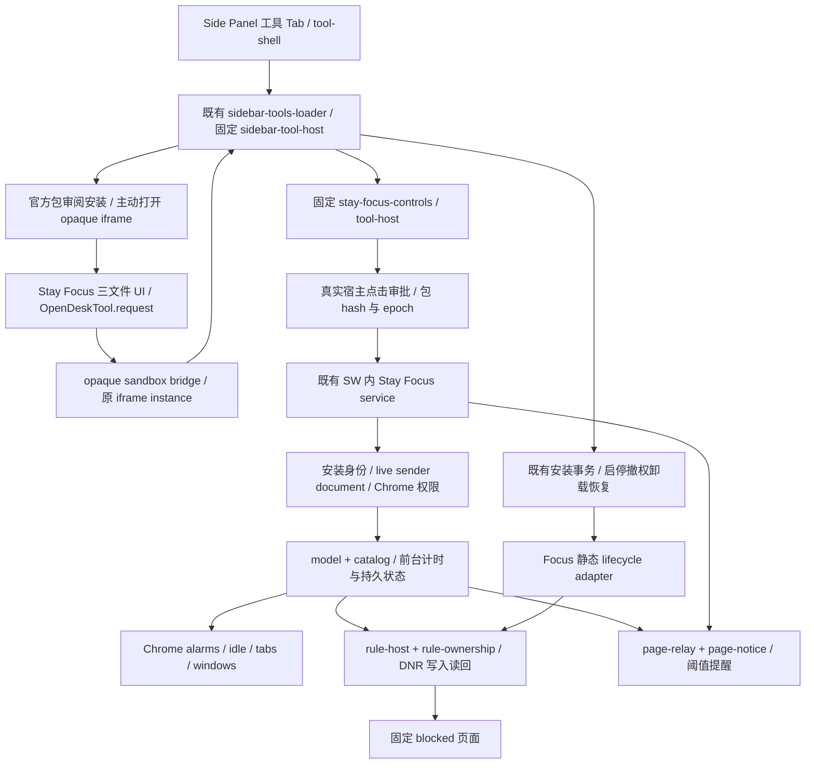

# Stay Focus 业务边界最小整理 R1

日期：2026-10-14（Asia/Shanghai）。负责人：本对话 `01a13967-10bb-7d62-b97c-2b06c08817c0`。状态：DELIVERED / PRODUCT_NOT_ACCEPTED。分支：main；起始 HEAD：`5c959712`。只读子 Agent 负责构建发现、生命周期证据与计划评审；本对话独占落盘及 Git 事务。

## 一屏方案与通过条件

| 项目 | 已核查事实 / 整理决定 |
| --- | --- |
| 当前结构 | `examples/sidebar-tools/stay-focus` 是官方可选发行包的正式 UI 源；`src/stay-focus` 是构建期扩展拥有的业务模型、后台、权限控件、提醒和拦截资源。动态 UI 仍在 opaque-origin iframe。 |
| 真问题 | Stay Focus/Time Review/Page Clip/Knowledge 引用了 Reading TOC 的 sender helper；通用 UI 编排 focus 业务审批；安装代码认识 Focus 私有存储与 DNR 实现。 |
| 建议边界 | sender helper 归平台；Focus 审批/后台消息归已有固定 sidecar；业务清理归 Focus 静态适配器。平台继续管理安装、锁、session、撤权、清理日志与恢复。 |
| 必须保留 | 真实 sender/document、固定包 hash/epoch、真实点击、可选 Chrome 权限、DNR 自有 ID 及读回、计时保守栅栏、提醒去重、卸载失败可重试。 |
| 目录决定 | 不为命名整齐迁移官方 project；通过产品 README 明确正式源身份。不存在把动态包 JS 装入 SW/Host 的方案。 |
| 通过条件 | 旧行为定向回归通过；sender 行为不变；通用 UI 不再拥有 focus 操作文案/消息流程；安装代码不再访问 Focus 私有键或 DNR；check、双模式构建及 Verify；真实 Chrome 定向生命周期验证单独记录。 |
| 风险与口径 | 真实 quota/DNR/撤权/跨工具隔离旧缺口保留；无本候选证据不得 PRODUCT_ACCEPTED。真实输入漂移只影响对应结果，不覆盖历史 receipt。 |

## 写入范围与公共契约

已核对下列现有文件没有本轮开始前的 diff：

- `src/sidebar-tools/sender.js`（新增），`src/reading-toc/page.js`、`src/time-review/service.js`、`src/stay-focus/service.js`、`src/page-clip/page.js`、`src/knowledge/service.js`（仅 sender 引用迁移）。
- `src/stay-focus/tool-host.js`、`src/stay-focus/lifecycle.js`、`src/stay-focus/README.zh-CN.md`（新增）。
- `src/entrypoints/stay-focus-controls.js`、`src/ui/sidebar-tools.js`、`src/ui/sidebar-tools/installation.js`。
- `tests/environment/stay-focus-boundary-r1.test.mjs`（新增）、`tests/environment/reading-toc-auth-r41.test.mjs`。
- `tests/environment/sidebar-tools-host.test.mjs`（范围扩展：已复核无既有 diff；追加真实通用宿主→固定 adapter 的组件接线回归）。
- `examples/sidebar-tools/stay-focus/README.zh-CN.md`。
- `docs/api/official-tools-catalog.zh-CN.md`（范围扩展：无既有 diff；纠正漏列 Stay Focus 的官方源清单，并说明 examples 目录身份）。
- 本工作流及专属证据目录 `docs/framework/workstreams/evidence/stay-focus-boundary-r1-20261014/`。

公共合同负责人是本对话：只新增扩展构建期私有 adapter 方法和重命名内部 sender helper；不改变包格式、toolId、focus 协议/能力/存储、Browser SDK 或动态 sandbox 信任边界。不修改已有 dirty 的 `tool.html`、`tool-shell.js`、公共 token、其他工作流及历史 receipt。

## 清理计划（编辑前）

1. 先新增停用/卸载恢复、跨业务数据与规则保护的有意义组件回归，在旧安装实现上执行；复用已有 sender、模型、服务回归作为行为基线。
2. 将通用 sender helper 原样迁至平台并同步全部消费者/测试，无兼容别名；继续由服务实施 document/context 和包身份检查。
3. 提取 Focus 请求审批与消息逻辑到产品自己的静态 Tool Host adapter，在移除通用 UI 业务块前补真实事件要求、epoch 漂移、session 变化、错误/未知结果回归；现有 sidecar 暴露固定方法，宿主只提供会话上下文。
4. 将 Focus 停用/卸载的私有规则及状态清理封装为静态产品适配；保留安装事务的锁、先停用、撤权、读回及失败日志。错误不得被吞掉；权限缺失时不调用不可用 DNR 属于原合同的安全路径。
5. 补调用链、六类归属、必要接线与剩余业务分支说明；每轮定向验证，最终独立 snapshot 双构建/Verify 和受影响原生生命周期验证。

计划作者与评审分离：只读 architect 审查，编辑者为本对话。损坏数据/不可用权限/失配 sender 的保守拒绝路径保留；不将其作为“冗余 fallback”删除。

## 资源与证据复用

- 既有 `node scripts/dev.mjs` PID 46026 负责 `dist/development`；不启动另一 watcher 或向其输出构建。
- 不占日常 Chrome/profile/Native 配对；使用专属无 Git 构建输入快照及独立输出/profile（登记具体身份后执行）。快照不是 branch/worktree，不承载代码编辑。
- 旧源码修复 `f831f5d3`、交付 `c82ee31d`、62 PASS/0 FAIL 和 CI 38461289169 的原始失败保持原等级；相关源码变动标 AFFECTED_INPUTS。原生 idle/设置按钮超时不能由本轮组件 PASS 抵消。
- 原始测试日志、输入 SHA、构建 manifest/receipt 和新截图写入本任务专属路径。正式原生项结果与组件/构建分开。
- 当前 Git 索引无既有暂存（正式暂存前再次核对）；提交只指定本任务文件，串行提交与正常 push main。

续接点：先执行编辑前组件行为基线；之后按上述顺序整理。

### 验证窗口与新增资源（执行前登记）

- 产品源已收敛：134/134 受影响组件回归、190/190 sender 消费者及官方目录回归通过。评审指出的 busy 阶段漂移已修复，并增加真实宿主 callback 回归；一次测试观察时未等待 microtask 的失败日志保留。
- 构建 snapshot：`artifacts/stay-focus-boundary-r1-20261014/snapshot/`，无 `.git`；复制当前实际源码、传递 Native 前端输入与已有固定依赖，独立 `.wxt` 和 `dist`。生产/开发构建通过；不覆盖原仓库输出。两次快照环境前置失败（外部 node_modules 符号链接、未复制 Native 前端输入）保留原日志和诊断。
- 原生计划：使用现有 `tests/framework/stay-focus-r1-native.test.mjs` 和 `OPENDESK_FOCUS_NATIVE_LIFECYCLE_ONLY=1`，加载 snapshot 的 `dist/production`；独立临时 `opendesk-stay-focus-r1-*` profile、随机 CDP/HTTP 端口，输出本工作流 `native-lifecycle/`。CFT 固定可执行文件：`tests/.cache/m5-browsers/155.0.8059.39/chrome-mac-arm64/Google Chrome for Testing.app/Contents/MacOS/Google Chrome for Testing`。
- 已有 CFT PID 36753（Cookie Editor profile）及 45301（独立历史 CFT）保留；执行前未发现活跃 `tests/framework/*` 驱动进程。测试只连接新实例的随机端口，不关闭其他浏览器。不使用日常 profile，不申请 Native 配对。
- 原驱动最终要求真实 quota PASS，即使 lifecycle-only 仍会以 quota 未测退出失败；本轮仅补受影响可信宿主/生命周期证据，整体退出码和各子项如实保留，不将限定项或跳过项升级为完整原生 PASS。

## 已核查的真实调用链

调用证据（源码结论置信度高；产品可用程度仅以相应实测结果判断）：

- `src/ui/tool-shell.js` 的 `createSidebarTools` 调用 loader；`src/ui/sidebar-tools-loader.js#createSidebarTools` 只使用固定 `__opendeskCreateSidebarTools`，缺失则拒绝。`src/ui/tool.html` 固定脚本加载现有 host 与 Focus sidecar，未将安装包 JS 放入可信页。
- `src/ui/sidebar-tools.js#createSidebarTools` 负责发现、review/install、主动打开 iframe、请求 source/token 校验与能力检查。Focus 的 request 分支现在只传原 `assertSession(source,token)` 和通用审批控件，不再生成 Focus 文案和后台消息。
- `examples/sidebar-tools/stay-focus/src/main.js` 使用 `OpenDeskTool.root/request`；`src/sidebar-tools/bridge.js#initSidebarToolSandbox` 将请求放入现有 instance/toolId/requestId 协议。修改操作还需固定 sidecar 中 `requestStayFocusOperation` 等待真实可信点击；授权/停用/清空请求只能引导用户到可信设置。
- `src/entrypoints/stay-focus-controls.js` 只静态导入 Focus 产品模块，将固定方法置入不可写/不可配置的冻结对象；动态包不能提供 adapter。`host-controls.js#createStayFocusPermissionControls` 保留真实 click 内同步发起的 Chrome permission request。
- `src/sw.js` 固定调用 `installStayFocusService`；`service.js#dispatch/hostDocument/authority` 独立复查真实扩展 sender、SIDEBAR/TAB context、documentId、安装启停、包摘要、epoch、可选权限。URL helper 不是 authority。
- `service.js#observe/reconcileLocked` → `model.js#settleFocus/focusReason/focusDueReminder` → `rule-host.js#wantedFocusRules` → `rule-ownership.js#reconcileFocusRules`。Alarm、tab/window/idle、permissions、registry/enable/epoch 事件触发重新对账，generation 避免将不能证明的后台时间结算。
- 页面提醒从 service 的 `tabs.sendMessage` 送至固定 page-relay 加载的 `installFocusPageNotice`；DNR 固定路径指向 `blocked-{quota,schedule,session,always}.html`，脚本由 `src/entrypoints/blocked.js` 安装。更新、撤权和卸载仍清理提醒/Alarm/自有规则。
- `installation.js#setInstalledSidebarToolEnabled` 持锁，先停用，再调用静态 Focus 清理，更新 epoch，最后允许重开；`recordToolUninstall/cleanupUninstalledToolLocked/retryUninstalledToolCleanup` 保留卸载意图、原实例撤销、确认未重装、删除读回和失败可恢复日志。产品 adapter 不拥有 registry 或安装授权。

## 六类代码归属与问题判定

| 类别 | 文件 / 符号证据 | 判定 |
| --- | --- | --- |
| 1 工具界面/交互 | examples 下 `tool.config.json`、`src/index.html/style.css/main.js`；`OpenDeskTool.root/request` | 正式发行 UI 源，独立包只含声明的 UI 字节。目录名称不清，但职责正确；不搬路径、不改 UI。 |
| 2 业务规则/状态/计算 | `src/stay-focus/catalog.js` 默认组/分类；`model.js` 网站、共享额度、时段、白名单、结算/提醒；`policy.js` 产品常量/hash/域名 | 必须有明确业务归属，现有产品目录正确。不是动态工具必须自行实现的持久后台。 |
| 3 受控后台/宿主适配 | `service.js`、`rule-host.js`、`rule-ownership.js`、`host-controls.js`、`tool-host.js`、`lifecycle.js`、页面提醒/blocked 资源 | 必要权限边界，预编译进入现有 SW/Host/page-relay。保留单一平台，不把动态包送入特权页。 |
| 4 多工具复用平台能力 | `sidebar-tools/sender.js`；`ui/sidebar-tools/{package,lifecycle,storage-state,installation}.js`；通用宿主 session、requestBrowserClick；现有 Browser SDK | sender 原挂在 Reading TOC 的职责错误/真正跨工具依赖已消除。epoch、锁、安装、存储读回等平台职责保留。 |
| 5 构建/安装/发现 | `official-tools/catalog.json`；`official-catalog.js#validateOfficialSourceCatalog/project` 精确校验；`build-official-tools.mjs#projectPath/officialToolInputs/createOfficialToolResources`；`build-sidebar-tool.mjs#createSidebarToolPackage/encodeSidebarToolPackage` | 正式 source→包→hash→官方审阅身份链，不能按同名 ID 或 official 标签提权。固定入口和资源闭包维持原路径。 |
| 6 测试/验收 | `stay-focus-r1/service-r1/boundary-r1`、`sidebar-tools-host`、sender 消费者测试、现有 native driver；旧 `stay-focus-r1.md` 与 CI/attempt receipt | 组件和独立 snapshot 构建通过；本轮真实输入的限定原生记录见下。历史 62 PASS、f831f5d3/c82ee31d、CI 38461289169 及候选原始记录不修改。 |

### 实际消除与明确保留

- **真正跨工具耦合**：Focus、Time Review、Page Clip、Knowledge 的安全入口原来导入 `reading-toc/page.js#isReadingTocToolSender`，因此通用 gate 随目录工具页面实现变化。现在五个调用端直接依赖平台 `isSidebarToolHostSender`，原 helper 与内部别名删除，行为不变。
- **职责放错**：通用 UI 原来拥有 `runTrustedFocusOperation`、focus 操作审批文案、hash/epoch 读写及 SW 消息。现在归 `src/stay-focus/tool-host.js`；通用 UI 只接固定 adapter 并提供平台会话上下文。没有新增 Registry、Manager、动态 hook 或重复执行器。
- **内部实现穿透**：安装事务原来认识 `FOCUS_STORE` 和 `clearFocusRules`。现在只调用静态产品 lifecycle 适配，算法/私有键归产品；锁、失败/unknown-outcome、读回、重装保护继续在平台。不是完全删除产品接线，而是平台不再编写私有清理算法。
- **必要接入点，保留**：SW 安装产品服务、固定 HTML/sidecar/entrypoints、平台 `focus.control` 能力封闭清单和可读说明、规则资源白名单。它们是静态组合及权限合同，不是“所有工具共用 Focus 状态”。
- **局部业务特判，保留并明示**：`bridge.js#sidebarToolRequestTimeout` 按 `stay-focus` + 非 status `focus.*` 等待最长 120s，与 Time Review 的可信审批等待类似；普通 RPC 8s。仅控制 UX 超时，不提供 authority。为删除这一个分支新增协议/业务 Registry 不符合本轮最小范围。
- **不扩展整改**：Time Review 在通用 UI 中仍有自身可信 UI/审批逻辑，安装代码仍有 Time Review/Knowledge/TOC 的专用接线；Cookie Editor 有 Browser SDK/站点授权及固定可信 UI 准入。本轮只读对照，不把 Focus 的整理自动推广到所有工具。
- **重复逻辑判定**：URL sender gate 只有一个实现，抽出后没有复制第二份；包摘要、安装读回和会话检查来自已有平台工具。发送前后重复检查用于异步时序/撤权保护，不作冗余删除。DNR/损坏状态保守路径不是需要清理的 masking fallback。

## 旧路径 → 新路径 / 稳定身份

| 旧位置 | 整理后位置 | 语义 |
| --- | --- | --- |
| `reading-toc/page.js#isReadingTocToolSender` | `sidebar-tools/sender.js#isSidebarToolHostSender` | 通用安全 gate 归平台；全部现有消费者同步，没有旧别名。 |
| `ui/sidebar-tools.js#runTrustedFocusOperation` / focus 请求流程 | `stay-focus/tool-host.js#runTrustedStayFocusOperation/requestStayFocusOperation` | 已有第一方 sidecar 暴露固定方法；原 iframe/source/token 仍由平台检查。 |
| `ui/sidebar-tools/installation.js` 中 Focus 规则/私有状态细节 | `stay-focus/lifecycle.js#stopStayFocusForTool/cleanupUninstalledStayFocus` | 产品静态清理；原平台事务/恢复仍是唯一入口。 |
| `examples/sidebar-tools/stay-focus/*` | **原路径保留** | 官方 project、配置入口、相对资源、preview/stage/pack、测试及发行路径不迁移。README 明确正式源身份。 |
| `src/stay-focus` 已有业务/页面文件 | **原路径保留** | 预编译业务所有权合理，新增职责 README；不改 Chrome 加载/ID/Native 配对。 |

对目录迁移风险的核查：catalog 的 project 不是自由前缀；`projectPath` 还要求 realpath 与声明路径一致。开发监听 `scripts/wxt-development.mjs`、官方资源准备 `prepare-public.mjs`、market/snapshot、Verify 及 Focus 静态测试均消费该入口；本轮未改变它们。工具输出仍为 `official-tools/stay-focus/stay-focus.opendesk-tool.json`，id/version/capabilities、包字节/摘要保持原值。

## 验证、候选身份与剩余缺口

原始文件统一位于 `evidence/stay-focus-boundary-r1-20261014/`；`candidate-binding.json` 记录源码/测试文件 SHA、snapshot 输入、Node 版本、构建和真实浏览器关联。只有 exact snapshot 得到构建/原生证明，不把并行 main 上无关变更自动升级为同包原生 PASS。

| 验证 | 结果 | 原始入口 |
| --- | --- | --- |
| 编辑前停用/卸载及模型/service/sender 基线 | 42 PASS / 0 FAIL | `baseline-tests.log` |
| sender/lifecycle 迁移第一轮 | 42 PASS / 0 FAIL | `sender-lifecycle-tests.log` |
| adapter 在通用 UI 删除前 | 12 PASS / 0 FAIL | `adapter-before-ui-tests.log` |
| 最终受影响组件（含真实通用宿主 callback、缺 sidecar、过期 frame/epoch、busy、unknown outcome） | 134 PASS / 0 FAIL | `affected-tests-final2.log` |
| sender 消费者、Time Review、TOC、Clip、Knowledge、官方目录 | 190 PASS / 0 FAIL | `consumer-tests.log` |
| check / 静态安全、构建入口、语法/CSP/MIT | PASS，主工作目录与稳定 snapshot 均执行 | `check.log` / `check-snapshot.log` |
| 独立工具打包 | PASS，33024 B，未安装 | `tool-build.log` |
| WXT production/development | PASS，同 snapshot 两种模式，sourceDriftDuringBuild 为空 | `build-production-attempt3.log` / `build-development.log` 与 `build/*.json` |
| 双 Verify | PASS；固定资源/CSP/官方包/模块闭包/字节上限通过 | `verify.log` |
| 当前整理独立只读评审 | CLEAR；busy 阶段风险修复，新增最终接线回归通过 | architect 原生子 Agent；结论范围仅本次整理 |
| 原生生命周期定向 | 限定分项证据；总退出 1 / FAIL（驱动要求 quota PASS） | `native-lifecycle.log`、`native-lifecycle/native-report.json` 及真实截图 |

本工程是 JS，没有独立 typecheck/lint npm 命令；`check` 承担现有语法/静态安全约束，Node 定向回归证明行为。没有为形式新增依赖、验证框架或测试分母。

同 snapshot 产物身份：

- production packageHash：`e0f8485af650a2d9b2c9f871af2ab563fa104dca305b9ddd14a1af0b7725dac3`；development：`9096ecc85220c11228e1d02d357398ef65c41304a6fc4f2de43fa131833d3af1`。
- production SW：592202 B / SHA `9aa206dccfb07623a949b8ff8487d7dfd9e9c5f632f4451e126b04c38910fe78`；native-report 中 SW SHA 完全相同。
- production 固定 Sidebar Tools Host：188150 B；Focus sidecar：37316 B；Tool Shell：497388 B（上限 524288 B，未放宽）。开发 Tool Shell：497628 B。SW 仍触发现有 soft review（hard gate 1048576 B），不是新警告或豁免。
- Stay Focus UI 包 SHA：`afb91cfb1fecf65544ed2864c08e7eb678e864b2b6b5d2cd0e65ce7fb31413af`，与历史此 UI 字节相同；包内容/版本/已安装 Revision 不变。新 SW/Host 身份不能因此冒用旧原生 receipt。
- 真实 CFT `155.0.8059.39`；本次实际 ID `jfdlhpilkhjigljmcanlhbgjgkhkdhch`，加载本任务 snapshot production；独立临时 profile 完成后已删除，其他 CFT 与日常 Chrome 保留。

原生的精确结果：`approval=PASS`、`zeroConfig=PASS`、`background=PASS`、`sitePause=PASS_UI_STATE_ONLY`；`workerRestart=PASS_DATA_ONLY_DNR_NOT_TESTED`；`disabled=PASS_STATE_ONLY_NO_ACTIVE_DNR`；`reenabled=PASS_STATE_ONLY_QUOTA_NOT_TESTED`；`restart=PASS_DATA_ONLY_EXHAUSTED_DNR_NOT_TESTED`；`unregister=PASS`；`uninstall=PASS_DATA_ONLY_ACTIVE_DNR_NOTICE_NOT_TESTED`。quota 为 `NOT_TESTED_LIFECYCLE_ONLY`，pageReminder、permissionRevocation、otherTools 为 `NOT_TESTED`，报告 `passed=false`。总失败断言就是 quota 未测不等于 PASS，不伪造总绿色。

失败记录均保留：构建 attempt1 因外部依赖 symlink 违反 provenance；attempt2 因 snapshot 缺 Native 前端输入；最终 component 首次 busy 用例因测试未等 click handler microtask 失败，修正观察后 final2 通过。这些失败都没有通过放宽产品门槛、合成 Chrome 权限/状态或覆盖旧 receipt 消除。

验证期间并行 main 新增了 owned-download cancellation fencing 提交 `5da04474`，变化是下载取消 API 的 Origin/撤权复查及对应测试，未修改本任务 sender/Focus/安装/UI 文件。tested snapshot 保持原字节；本任务 14 个产品/测试文件与 snapshot hash 全部相等。README 的说明变化不在工具包构建输入中。完整 main 的新 SW 包、F3/ZIP 不从本次固定 snapshot 推导。

仍未关闭：真实共享额度耗尽/提醒、活跃 DNR 的暂停/撤权/卸载、完整跨工具原生隔离、跨日/DST/长期计时、完整候选 F3/ZIP 与产品八维签收。**状态保持 NOT_ACCEPTED，不改历史账本和 PRODUCT_ACCEPTED。** 本次最小源代码整理完成，不等于工具完整产品验收完成。

## 交付与资源收尾

本任务源码、测试、当前职责文档与专属证据将只按明确路径暂存，遵守 Lore commit；不纳入其他 Agent 的未提交改动。现有 `.gitignore` 会忽略新工作流和证据，本轮不修改它，只对本任务明确路径使用 force-add 保留所需证据。Git 索引/HEAD 事务执行前复核并串行；正常 push main，无分支/worktree/PR/release。

构建、Verify、原生驱动均已退出；本轮 CFT/profile/随机端口释放。独立构建输入和 dist 留在本任务 artifacts 作为可复核候选；不表示 ZIP 交付或日常扩展安装。开始时记录 dev watcher PID 46026；本任务未启停，收尾检查时该 PID 已不存在（外部状态变化，未推断其归属或自行重启）。不改加载目录/扩展 ID/Native 配对。

### 提交前远端核对

远端 main 当前为 `50827de6`，本机为 `5da04474`，远端领先两项 Browser SDK 文档/检查器提交（`ea92aef0`、`50827de6`）。四个 incoming 路径均不属于本任务；其中 `docs/api/browser-sdk-interface-matrix.json` 有其他负责人的未提交改动，工作字节又与远端不同。为不 stash/覆盖或擅自合并他人的矩阵，先完成本任务独立 main 提交；正常 push 如受非 fast-forward 拒绝则如实记录，由该矩阵负责人先协调主干集成，不为推送绕过 main/不创建分支。源码整理和证据不受这一 Git 集成冲突影响。

### 主干集成与实际推送（后续交接）

源码提交为 `71963711e52c90f1cc644aa1e9fbedd85b6dfc36`。首次正常 push 被 non-fast-forward 拒绝，随后 merge 因会覆盖其他 Agent 的矩阵修改而中止；失败记录仍保留在本任务 artifacts。用户续接要求由本任务合理判断时，main 已存在其他 Agent 完成的集成提交 `91c39d725a065ad54440b6721637c308e0684314`，其父提交为本任务源码提交与远端 `5b82e3fd`。本任务没有 stash、重置或覆写矩阵。

推送前逐一核对本任务 50 个已提交文件，工作字节均与 `71963711` 一致；集成只引入远端原有的八个其他任务路径。复用该集成记录中矩阵检查及六项定向测试的证据，不重新实施 Browser SDK。正常 `git push origin main` 成功，远端从 `5b82e3fd` 前进至 `91c39d72`；推送前后矩阵工作字节 SHA-256 均为 `d4ee9e36dd6fe9acf6e50c73d26350fa6c2d84ffd73e21b88e991a083746f10c`，仍为未提交状态。

本次续接仅补充本任务交付记录，不更改运行源码。已有组件、构建、Verify 和原生记录仍绑定原冻结输入与产物；不将它们升级为新 main 的全量原生/F3/ZIP 验收。新增推送 receipt 和原始日志见同名证据目录中的 `delivery-main-push.json`、`push-after-integration.log`；旧 receipt、截图、失败日志和候选身份不变。
