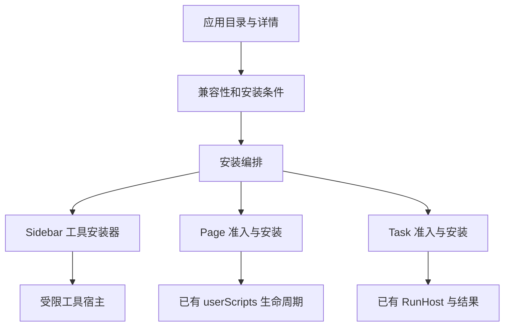

# OpenDesk 应用市场 R1：能力盘点、产品方案与实施需求

日期：2026-10-11。范围：基于既有 OpenDesk Browser 的应用市场规划、功能树、需求及可交互原型。

**本文件是待实施的市场方案。现有工具源码、市场设计、原型演示、正式安装验收分别记录；原型中的“安装”不会安装真实工具。**

审计基线：`shopable-ai/opendesk-browser` 的 `main@f5550d608d3cc512d5620c0d1d32f03ec9d63c61`。该版本之后的并行改动须在实施前复核。关联文件：

- [目录数据示例](app-market-r1.catalog-example.json)：仅为新目录元数据的提案，不是现有安装包，不可直接导入。
- [市场交互原型](../../prototypes/marketplace/app-market-r1.html)：搜索、分类、网站筛选、详情、安装/网站授权、打开、停用、卸载的本地演示。
- [本轮工作记录](../framework/workstreams/app-market-planning-r1-20261011.md)：源码身份、交付范围、验证等级及后续工作。

## 一、产品决策

### 1. 定位

对外名称采用 **OpenDesk 应用市场**；单个安装项目称为“应用”，具体名称仍使用“网页目录”“网页笔记”等用户能理解的名称。它是安装在 OpenDesk 内的可选应用，不要求每个应用再成为一个独立 Chrome 扩展。

第一期围绕“阅读网页、记录想法、剪藏内容、整理 Markdown”形成一条完整使用路径。用户先按要完成的事情选择应用，再按网站及运行条件筛选。底层执行类型主要出现在详情和开发者说明中。

先完成四个已有工具的市场安装闭环，再接入 ChatGPT 精选收藏和内容归档；更广的网页脚本、自动化、企业连接器逐类准入。优先级来自本项目需求及实现成熟度，是产品判断，尚不是用户规模、市场份额或高频使用的统计结论。

### 2. 保留现有导航

Side Panel 既有“我的任务 / 发现 / 开发 / 工作流 / 工具”职责保留。“发现”继续用于查找本机已安装任务，不能直接改成在线商店。

在“工具”列表顶部提供“应用市场”入口，打开扩展自身的独立完整页面。主工具栏可放同一入口的快捷方式；不增加第六个常驻一级 Tab。市场内部有“推荐应用 / 按网站 / 我的应用”。“我的应用”是现有安装记录的聚合视图，不另建一份安装事实数据库。

首版不要求新账号即可浏览和安装本机已包含的官方工具。网站功能授权在首次实际使用时展示；无需网页权限的 Markdown 工作台直接打开。

### 3. “通用网页”与“全平台”分别定义

| 维度 | 含义 | 首版承诺 |
| --- | --- | --- |
| 网站范围 | 不依赖网站 / 通用 HTTP(S) 网页 / 指定网站 | 匹配范围与实际适配证据分别记录；“通用”不表示任意页面都已测试 |
| 使用位置 | 侧边栏、网页浮层、网页按钮、独立工具页 | 只展示该应用实际具备的入口；页面按钮服务作为后续能力 |
| 执行环境 | Sidebar 工具、Page Program、Task、Native 依赖 | 使用既有各自的运行和授权合同 |
| 浏览器/操作系统 | Chrome、其他浏览器、macOS/Windows/Linux/手机 | 首版面向项目支持的桌面 Chrome；其余按实际测试填写，不能笼统写“全平台” |

当前宿主 manifest 的最低 Chrome 版本为 138，且不允许无痕模式。受限页面、无相应内容的页面、被关闭的 API、未安装的 Native Host 均应给出具体不可用原因。浏览器已有广泛 host permissions 不等于每个应用都获得所有网站和所有数据权限。

## 二、当前框架已经支持什么

### 1. 四个现成应用候选

| 应用 | 包版本 / 现有能力 | 当前实际提供 | 市场化需要补充 |
| --- | --- | --- | --- |
| 阅读目录 | `reading-toc@1.0.1`；`page.toc` | Side Panel 与网页目录、定位、拖动、站点位置记忆、智能章节概览；有内置安装入口 | 市场卡片、来源说明、兼容状态；真实站点覆盖继续验收 |
| 网页笔记 | `quick-notes@1.1.1`；`storage.local`、`currentPage.read`、`tasks.open` | 离线多条笔记、可选标题/URL 关联、更新与冲突处理；已有本地安装包 | 内置目录接入；说明容量与卸载删除数据；不宣称完整知识库 |
| 网页剪藏 | `web-markdown-clipper@1.0.0`；`page.clip`、`user.export` | 授权页面文章、选区、链接转 Markdown；有内置安装入口 | 真实网站抽取质量；下载完成与文件落盘证据；清晰显示来源页 |
| Markdown 工作台 | `markdown-workbench@1.0.0`；`user.export` | 无需网站权限的编辑、导入、常用 GFM 子集预览与导出；已有本地包 | 内置目录接入；未保存内容离开提醒/持久草稿另立需求 |

源码依据为四个 `examples/sidebar-tools/<id>/tool.config.json` 及其源码/生成包；TOC 与剪藏内置副本位于 `src/sidebar-tools/`。详细边界见 [R22 实现说明](markdown-tools-r22.zh-CN.md) 和 [工具 R1 合同](sidebar-custom-tools-r1.zh-CN.md)。旧 R1 文档的“三项能力”是历史描述，当前白名单以源码为准。

目前完整 ChatGPT 对话语义导出仍未实现。通用文章剪藏不能保证正确保留对话角色、分叉、多个回答版本、引用和流式内容，不能把它作为 ChatGPT 专用导出的完成证据。

### 2. 三类执行合同各有职责

| 执行类型 | 已有准入与安装 | 市场按钮的真实含义 |
| --- | --- | --- |
| Sidebar 工具 | `opendesk.sidebar-tool.v1` → 校验 → 审核 → 明确安装 → 主动打开 sandbox | 首版可提供“安装”；安装本身不运行 |
| Page Program | 源码/依赖冻结 → 本机 USER_SCRIPT 预览回执 → Verified → Available → 安装/站点授权 | 当前只能“导入并验证”，通过后才安装；页面匹配自动运行须遵守已有授权 |
| 自动化 Task | Task package → 本机真实效果验证 → Verified → Available → 安装 → 用户 Run/Stop | 不能用市场签名替代本机回执；保留参数、运行结果、停止与权限合同 |

工作流沿用已有 compiler 和执行机制。市场增加目录与安装编排，不重新建立运行器、权限引擎或后台任务系统。

### 3. 不可忽略的现有限制

- 工具包仅接受 `format/id/version/title/description/capabilities/html/css/js`。新增发行者、截图、分类等市场字段应放在包外，不能直接塞进 v1 包。
- 当前六项能力是 `storage.local`、`currentPage.read`、`tasks.open`、`page.toc`、`page.clip`、`user.export`；不是任意 DOM、HTTP、Chrome、Native 权限。
- 当前最多安装 12 个工具，单包校验上限 320000 字节。单项工具存储上限 8192 字节，单工具 32 KB、最多 32 个键。市场页必须显示实际容量不足，而不是擅自提高预算。
- Markdown 工作台关闭 iframe 后可能丢失未导出的编辑内容；首版不能宣传自动保存。草稿保护应作为现有工作台的定向完善。
- 独立工具 Tab 当前不能安全继承 Side Panel 的来源网页身份；剪藏须在 Side Panel 进行。未来需要显式选择来源 Tab 的合同，不能偷用“最后活动标签页”。
- Task v1 当前绑定一个精确 HTTP(S) Origin，不具备天然多网站任务授权。
- Page Program 现有 API 有停用、撤权与对账，未发现通用 `uninstallPageProgram`；清理仅能保证受管 UI 资源，不能撤销已经提交的网页表单或其他业务效果。
- Sidebar v1 当前也没有所有工具通用的持久“全局暂停”状态。TOC/剪藏已有的是各自的网站授权控制；原型的全局暂停/恢复属于本方案新增管理需求，须在原宿主服务补合同，不能只改卡片。
- `user.export` 宿主目前检查会话、能力、大小、文件名等，未见逐次可信用户手势票据。官方应用可按已审阅按钮流程提供导出；开放第三方工具前必须确认宿主能约束逐次外发/导出，不能信任包传来的 `isTrusted`。

## 三、应用分类和首批规划

### 1. 用户按用途选择

| 主分类 | 首批或后续应用 | 典型用户任务 |
| --- | --- | --- |
| 阅读与摘录 | 阅读目录、网页剪藏 | 找到长文中的章节，留下选中的内容和来源 |
| 笔记与知识 | 网页笔记、后续知识收件箱 | 暂存想法或草稿，后续检索整理 |
| Markdown | Markdown 工作台 | 编辑、预览、复制或导出已获得的内容 |
| AI 对话 | ChatGPT 精选收藏、提示词片段 | 保存指定回答，复用常用输入 |
| 效率与自动化 | 已验证网页任务、页面增强脚本 | 在授权站点执行明确步骤，查看结果或停止 |
| 导出与连接 | 本地知识归档、博客/企业知识库连接器 | 把内容送到已配置的目标位置 |

网站标签是第二维：通用网页、ChatGPT、GitHub、其他指定网站。一个应用可以适用于多类网站，但只保留一个包身份和一份安装记录。例如通用 TOC 不需要为每个网站复制一款应用。

首版主要展示前四个已具备工具；后续应用的详情可用于评审，不以不存在的安装包或虚构评分吸引安装。生产版首页默认展示已发布且兼容的应用，规划内容留在路线图入口。

### 2. 实施优先级

| 阶段 | 应用或能力 | 为什么按此顺序 |
| --- | --- | --- |
| P0 | 四个现有工具统一上架候选 + 市场安装闭环 | 复用最多，能最快证明市场真实有用 |
| P1-A | ChatGPT 精选收藏 | 直接回应当前项目需求；先一条回答/选中内容，再多轮导出 |
| P1-B | 提示词片段 | 先搜索/复制；自动填入输入框需专项适配，不默认自动发送 |
| P1-C | 本地知识归档与草稿保护 | 复用既有 Native 工作区，补窄导出接口与落盘回执；形成内容积累闭环 |
| P2 | 网页增强脚本与自动化任务目录接入 | 先补各自准入/管理差异，不能绕开本机验证 |
| P2 | 单一目标连接器、企业私有目录 | 每次只实现一个经过验证的目标服务，授权、失败恢复与去重可复用 |
| 后续 | 作者投稿、团队治理、付费与推荐体系 | 等安装可靠性和真实使用数据成立后再扩大 |

思维导图、复杂 HTML/Next.js 预览、全部 AI 网站导出、自动批量同步可列为后续需求，首版不同时开展。连接器宜作为共享目标配置；不要制造“ChatGPT 到博客”“文章到博客”“笔记到博客”三套重复认证与上传代码。

## 四、功能树

以下是需求的层级组织，不新增可视化任务树产品。

- 应用市场
  - 查找应用：推荐、关键词搜索、用途分类、网站筛选、兼容性提示。
  - 了解应用：用途、示例、使用位置、适用范围、版本/来源、权限、依赖。
  - 获取应用：内置官方安装、本地导入；后续网页脚本/Task 导入验证。
  - 使用应用：打开工具、授权当前网站、跳转既有运行入口。
  - 管理应用：已安装聚合、启停、更新变化、卸载、容量及数据处理。
- 网站增强
  - 通用能力：已有目录、正文剪藏、来源识别。
  - 专站适配：先 ChatGPT，明确页面结构、内容版本和使用位置。
  - 页面操作入口：后续受控按钮位置、冲突收纳、停用清理。
- 内容积累
  - 现有能力：网页笔记、Markdown 导出。
  - 后续能力：精选收藏、草稿收件箱、检索、去重、归档目标。
  - 同步：选择目标、确认内容、记录结果、失败恢复。
- 发行与维护
  - 首版：仓库内元数据、固定工具包、版本/兼容校验、人工审核。
  - 后续：远程数据目录、来源验证、签名/吊销、作者投稿、企业私有源。
- 开发与验收
  - 复用现有打包、安装、权限、运行、证据体系。
  - 逐类测实际安装、权限变化、升级、停用卸载、离线和恢复。

## 五、用户流程与具体需求

### 1. 一键安装的定义

卡片上的“安装”启动一条完整流程，不要求用户先下载 JSON 再寻找导入入口。首次涉及能力审查时保留一次清晰确认；批准过且没有变化的授权按现有合同复用。一键安装不表示静默扩权。

以 TOC 为例：市场卡片 → 查看能力与安装 → 安装成功 → 用户点“使用” → 返回目标网页的 Side Panel → 为当前网站批准目录能力 → 目录出现。首版独立市场页负责安装并指引回到来源网页；它不能自行继承或读取另一个 Tab。后续在已批准的站点按既有 TOC 生命周期自动显示，关闭侧栏不等于关闭网页目录。

TOC 与剪藏的现有授权均按精确 Origin 持久保存，用户可撤销；首版不提供未经实现的“一次性 / 记住授权”复选框。目录授权允许该站点持续显示目录；正文授权允许用户打开剪藏工具使用相应能力，两者不能互相替代。

以 Markdown 工作台为例：市场卡片 → 安装 → 打开工作台；不要求正文读取授权，也不要求安装 Native。以 Task 为例：查看详情 → 导入并验证 → 沿已有 Available/安装/Run 流程执行。

### 2. 状态不要混成一个 enabled

目录发布状态、机器安装状态、当前页适用性、运行依赖分别建模；展示层只显示当前最有行动价值的原因。

| 实际状态 | 用户看到的主操作 | 约束 |
| --- | --- | --- |
| 发布且宿主具备包 | 安装 | 走既有审核与安装，不自动运行 |
| 正在校验/安装 | 安装中 | 防重复；重开后从真实记录恢复 |
| 已安装且具备运行条件 | 使用 | 进入实际工具/任务入口 |
| 应用已暂停（新增） | 恢复应用 | 由宿主服务控制；恢复不自动执行外部业务动作 |
| 缺网页能力授权 | 授权此网站 | 说明目录/正文的差异，不能互相代替 |
| 当前网页不适用 | 查看适用网站 | 不把应用整体标成坏了 |
| 当前宿主未包含所需版本 | 更新 OpenDesk | 不悄悄改成下载远程 JS |
| 缺 Native/工作区 | 连接 OpenDesk / 选择工作区 | 已安装应用与依赖就绪分别表示 |
| Page/Task 尚无本机验证 | 导入并验证 | 不构造假的本机回执 |
| 安装超额、失败或被撤销 | 管理已装应用 / 重试 / 查看原因 | 不删除其他应用腾位置，不假报完成 |

市场 Web 页面若将来独立对外提供，只负责浏览和将应用 ID 交给扩展进行确认，不接受网页传来的原始代码、任意包地址或直接执行请求。首版先使用扩展自己的页面，减少跨站安装桥的复杂度。

### 3. 需求与可验收结果

| 需求 | 可验收结果 | 阶段 |
| --- | --- | --- |
| 入口保持一致 | 工具页能进入市场；原五个 Tab 的原职责可继续使用 | P0 |
| 搜索与筛选 | 名称/描述/网站关键词可查；网站与用途可组合；无结果可撤销筛选 | P0 |
| 准确详情 | 可看到用途、入口、版本、来源、权限与依赖；不出现虚构评分/安装量 | P0 |
| 统一工具安装 | 四个候选经现有校验/审核入同一安装记录；重复点击不重复安装 | P0 |
| 安装不运行 | 安装后未创建工具运行 iframe、未执行网页业务动作 | P0 |
| 网站授权 | TOC 与正文分别授权；切换文档/站点后不误用旧目标 | P0 |
| 已安装聚合 | 市场与工具列表读到同一版本/状态；不直接修改存储绕过安装器 | P0 |
| 失败可解释 | 超额、旧宿主、包缺失、校验失败、权限拒绝都有具体下一步 | P0 |
| 暂停与卸载 | 补全局暂停的宿主合同；既有卸载撤销能力、清理自身 UI，并明确告知删除数据范围 | P0 |
| 更新保护 | 新权限、同版本变更、来源变化可见；失败保持旧安装，不能半更新 | P0 |
| 离线可用 | 已装工具不依赖市场连接；内置目录仍可浏览 | P0 |
| 草稿保护 | Markdown 工作台关闭/切换不静默丢未导出内容；持久化范围另行明确 | P1 |
| ChatGPT 收藏 | 先保存一条明确选择的稳定回答，保留来源、角色与代码块 | P1 |
| 页面按钮 | 同一位置只挂一个受管入口，能收纳多个动作，停用/卸载后消失 | P1 |
| 内容归档 | 文件结果绑定目标、内容 hash 和完成回执；失败/未知状态不显示成功 | P1 |
| Task/Page 入市 | 沿真实 Verified/Available 准入，不能被市场标签绕过 | P2 |
| 第三方发布 | 来源绑定、审核、权限升级、吊销、撤销、存储/外发控制均有证据 | P2 |

## 六、技术结构：增加市场层，复用执行层

### 1. 元数据、包、安装事实分开

- **目录元数据**：名称、简介、分类、网站标签、截图、来源、所需宿主版本、发布状态。搜索和推荐读它。
- **可执行包**：继续是现有包格式。能力以包和宿主白名单为准，目录描述不能授予权限。
- **本机安装记录**：工具/任务已有服务拥有它。市场聚合读取，不直接复制或自建 enabled/version 数据库。
- **来源身份**：发行者与原始字节哈希等按现有 R4.1 预留的包外 descriptor 继续完善。

目录 `appKey` 可采用 `publisher/packageId` 作为市场唯一键，但 v1 工具 `id` 的既有限制不能被直接替换成带斜杠的值。宿主目前按简单 toolId 存储，首版仅官方源并检测冲突；后续需要明确 publisher→toolId 绑定。遇到同 ID 的本地安装或其他发行者，先处理来源冲突，不能静默接管其数据和权限。

目录示例中的新字段均是市场设计字段，当前没有对应运行 API。`hostCapabilityRequirements` 等不应重复声明为第二份权限事实；展示权限优先读取固定包的 manifest。

### 2. 首版发行路线

先提供**扩展包内的官方目录与四个固定工具包**。安装时按包 ID 读取该扩展版本内的资源，再走当前验证/审核/安装。现有 TOC、剪藏有内置入口；网页笔记和工作台已有包，仍需接入正式资源复制/验包清单，不能假定已预置。

后续允许远程 HTTPS JSON 更新纯展示元数据、已知应用的排序和状态，并缓存最后一个合法版本。远程数据只引用宿主允许的已知应用 ID；不能提供随意的脚本路径、可执行表达式、任意 selector 程序或复杂远端命令。新实现随宿主正常更新交付。目录要求的版本超出当前宿主时显示“更新 OpenDesk”。

远程目录刷新使用有界超时、ETag/版本号及可配置的缓存期限；打开市场时按需刷新，不由每个工具启动定时器。目录不可用不影响已经安装的工具。服务器仅提供数据目录时不需要完整账号、计费、推荐算法或数据库平台。

Chrome MV3 允许加载外部数据，但对远端执行逻辑有专门限制，且将“解释远程复杂命令，即使命令表现为数据”列为违规例子。sandbox 与 userScripts 存在各自限定的例外，不能被扩大为通用远程代码许可。因此此处选择内置代码的路线作为首版方案，后续第三方运行方式须按具体执行链审阅。[官方 MV3 要求](https://developer.chrome.com/docs/webstore/program-policies/mv3-requirements)。

Chrome Web Store 同时要求易理解的单一用途。首批围绕网页内容工作；扩大到大量互不相关应用前，应核对产品定位与实际功能，不能仅用“可选安装”证明满足该要求。[官方质量要求](https://developer.chrome.com/docs/webstore/program-policies/quality-guidelines)。

### 3. 分发信任与生命周期

**应用级暂停/恢复是本方案新增项。** 将控制状态交给现有安装/宿主服务管理，在其当前记录结构旁按统一身份和锁处理，市场只调用该服务；不要向严格 v1 包添加 `enabled`，也不要创建一份只让卡片变灰的“市场安装数据库”。暂停关闭当前工具会话、拒绝旧会话和迟到桥请求、清理该工具受管 UI，并阻止已授权页面继续运行该工具。

推荐语义是：暂停保留本地数据和原站点许可，由宿主暂停状态阻断使用；恢复时重新读取真实包与许可，无变化则复用，不重复弹授权。撤销某站许可是独立操作，卸载则删除本工具数据并撤销其许可。在途笔记保存必须完成或明确失败后才报告暂停完成，不能静默丢失；权限变化后的迟到正文返回仍须拒绝。暂停状态需要在浏览器重启后恢复。未完成这些之前，正式 UI 只能提供现有的关闭工具、撤销网站授权与卸载。

首版内置包的可信来源绑定扩展发行版本和已审核资源表。签名不能代替沙箱、权限或真正的验证。后续远程第三方分发复用 R4.1 提出的 SourceResolver/SourceVerifier/Installer/Revocation 职责，保持为一套系统。

发布身份至少绑定发行者、包 ID、版本、原始字节 SHA-256、所需宿主版本和审核记录；密钥/吊销/离线失效按明确策略处理。禁止更新时静默扩大能力，禁止同版本不同字节无提示替换。安装写入在现有锁下完成；升级数据迁移与回滚需要分别设计，不能简单回退脚本却遗留不可兼容的数据。

下架仅意味着目录不再提供新安装；安全撤销是另一种明确操作。安全撤销应有经验证的规则、适用版本、理由、提示和运行阻断，不能根据一次目录请求失败就删除用户应用或笔记。已导出的用户文件不属于卸载删除范围。

一组工具的“全部安装”留到逐个安装可靠之后；采用逐项结果与明确失败保留，不宣称不存在的跨多包原子事务，不因其中一个失败卸载用户原已安装的其他工具。

### 4. 构建体积与容量

沿用当前资源预算及 `src/libs` 加载方式。市场元数据、截图、各工具包按需读取；不要把所有应用实现静态 import 到 Service Worker。工具代码随发行包交付仍然计入整个扩展包预算，不能把“没有进入 SW”当作零体积。

来源目录有条目数、文字、图片和总字节上限；安装前检查 12 个工具限制和空间。需要扩大时单独核对宿主消息、存储、加载时间及总包体积，不能只修改一个常量。

## 七、ChatGPT 与内容归档怎样接入

### 1. 页面按钮共用受控位置

后续新增小范围、预置实现的页面动作能力：应用声明已知动作 ID，由可信宿主在经过适配的 ChatGPT 回答操作区挂入口；多个动作收纳在一个 OpenDesk 菜单下，允许用户固定少量常用动作。

最初动作可以是“收藏这条回答”“复制 Markdown”“保存到已配置目标”。页面动作只采集用户选择的可见内容，并交给现有窄接口处理。不让任意远程包获得网页执行、任意 DOM、网络或 Native 直通权限。

适配器需要识别 SPA 切换、流式未完成、重新生成/编辑、不可见的旧版本、虚拟化消息和结构漂移。无法确认回答边界时明确失败或降级为用户选中文本，不能悄悄采错内容。ChatGPT 页面结构不匹配时只停用该适配器，通用工具仍可继续使用。

按钮的挂载、更新、移除复用现有受管 UI/页面身份机制；先核查 TOC 与剪藏共同能力，避免重新创建第三套全文索引。`page.action` 若采用此名称，仍只是新能力提案，当前 allowlist 不包含它。

### 2. 暂存、草稿、归档分层

收藏项建议保留稳定 ID、来源 URL、捕获时间、内容类型、用户选中范围/消息角色、内容 hash、适配器版本、标题、标签和处理状态。来源中无稳定消息 ID 时保持未知，不能合成并宣称与平台原始 ID 一致。

草稿收件箱允许先保存、稍后整理；去重时区分“同一回答重复保存”和“回答更新产生新版本”。先支持简单检索/标签与归档状态，不引入完整知识图谱或自动分类系统。

现有笔记 32 KB 不是无限内容库；原图、大量 Markdown 和附件不能硬塞进该空间。应先复用获授权的本地工作区，或另行明确共享草稿存储的容量、应用隔离、迁移与导出合同。

### 3. 三种保存能力分别交付

| 保存需求 | 路线 | 必须显示的真实结果 |
| --- | --- | --- |
| 导出一个 `.md` | 现有 `user.export` / Chrome Downloads | 完成、取消或失败；不能把 download ID 当磁盘文件成功 |
| 固定用户选定目录 | 优先复用 Native 工作区；也可专项验证 File System Access 目录句柄 | 目录已授权、实际目标路径、写入完成或重新授权 |
| 博客/公司网盘/知识库 | 独立目标连接器及用户凭据授权 | 目标资源标识、内容版本、创建/更新结果和可重试失败 |

Downloads 的文件名参数是下载目录内的相对路径，不提供任意系统目录写入。File System Access 在支持的环境下可由用户选择目录并授权，持久句柄不表示授权永不过期。本项目已经有 Native 工作区，因此优先复用；仍需新增受限工具导出桥，不能声称现有 Sidebar 工具已经拥有 Native 读写。[Downloads](https://developer.chrome.com/docs/extensions/reference/api/downloads)、[File System Access](https://developer.chrome.com/docs/capabilities/web-apis/file-system-access)、[Native Messaging](https://developer.chrome.com/docs/extensions/develop/concepts/native-messaging)。

每个连接器需要明确目标、最少权限、成功回执、幂等键与失败/未知状态。网络超时后的未知发布结果不能盲目重试；先查询目标或让用户选择下一步。发布到公开博客与保存私有草稿是不同动作。

在 ChatGPT 网页增加按钮，只提供浏览器侧能力；它不会自动让云端模型拥有本机文件读写或工具调用通道。模型自动读写仍需独立可调用且已授权的通路，不能再次用 DOM 注入当作该通路的证明。

## 八、实施顺序与修改边界

### 阶段 A：复用四工具，完成真正市场闭环

1. 复核最新 main 和本文件四个包版本，保留所有并行修改。
2. 增加官方目录数据与解析/兼容视图；安装事实继续读取现有服务。
3. 将网页笔记和 Markdown 工作台补入内置发行资源表；检查包大小和来源，保留本地导入。
4. 从现有 `reviewCandidate()` / `install()` 路径提取可复用的有限入口，供工具页和市场调用；不复制两份安装代码。
5. 按原型实现正式市场页，复用 `src/ui/design-system.css`，从工具页连接市场。
6. 完成四个真实包的安装、打开、授权、卸载，以及失败和旧版本宿主提示；全局暂停/恢复按新增宿主合同验收，未完成前不暴露无效按钮。

建议新增 `src/marketplace/` 下的目录/兼容模块以及独立市场 UI 文件；路径需服从当前构建机制。仅因文件越来越大才按现有职责拆分，不借市场重构全部 Sidebar。

必须复用：`src/ui/sidebar-tools/package.js`、`src/ui/sidebar-tools.js`、`src/sidebar-tools/bridge.js`、`src/sidebar-tools/sandbox.html`、`src/ui/current-page-target.js`、`src/reading-toc/`、`src/page-clip/`、`scripts/build-sidebar-tool.mjs`、`scripts/prepare-public.mjs`、`scripts/verify-package.mjs`。

### 阶段 B：两个高价值增量

ChatGPT 单条精选收藏与本地归档分别闭环；先补页面动作、稳定内容选择和限定导出，不同时开发所有 AI 平台和全部网盘。Markdown 未保存内容保护可独立交给现有工具维护任务。

### 阶段 C：开放更多类型

先补 Page Program 卸载/资源清理语义、Task/Page 准入用户体验、明确分发路线，再进入统一目录。企业源、作者投稿与第三方签名依次开放。若将来调整官方应用准入合同，单独记录设计、验证及迁移，不能伪造现有本机回执。

## 九、验收与成功判断

本轮只验证方案和静态原型。正式实施需要同一候选身份下的以下证据：

| 维度 | 最小真实验收 |
| --- | --- |
| 安装闭环 | 从正式扩展市场页完成四个包的审核安装；同记录出现在工具列表；安装前后无自动业务执行 |
| 网站安全 | TOC/正文独立授权；拒绝、撤权、页面导航和来源 Tab 关闭后无误读或迟到写入 |
| 生命周期 | 打开/关闭/停用/卸载清理；重开与整浏览器重启分别验证；旧 iframe 消息失效 |
| 内容结果 | 笔记中文保存恢复；Markdown 导出可在用户磁盘打开，大小/hash 与内容相符 |
| 异常处理 | 缺包、旧宿主、12工具满额、并发点击、坏目录、断网、来源冲突、更新扩权均有可理解结果 |
| 可用性 | 320/390/736/1024 等原型视口；正式 Chrome 宿主最小尺寸按实际可达到值记录；键盘、长文本、暗色、200%缩放 |
| 性能 | 市场关闭时无额外网页扫描；目录按需加载；SW/总包/工具包预算仍通过 |
| 第三方准入 | 在开放投稿前验证权限与逐次外发控制、publisher冲突、恶意消息、吊销和更新失败恢复 |

上线首期建议观察“从看到应用到第一次成功使用的时间”“安装后首次使用成功率”“7天内重复使用”“每类失败原因”。实际收集前应确定告知与数据最小化，不上传浏览历史、对话原文、笔记或文件内容。没有真实数据时不在商店展示安装人数和评分。

每个维度单独记录源码、组件、受控 Chrome、真实站点、用户 Mac/其他 OS 的证据；有一个通过不能代替其他层。95分可作为后续评审目标，当前不凭方案或截图宣称达标。

## 十、审计来源索引

所有代码事实基于固定 SHA；相对链接方便阅读当前版本，核对历史事实时使用上述基线。

- [当前工具包校验器](../../src/ui/sidebar-tools/package.js)
- [当前工具宿主](../../src/ui/sidebar-tools.js)
- [市场兼容合同 R4.1](sidebar-tool-market-compat-r41.zh-CN.md)
- [Markdown R22 的实现与限制](markdown-tools-r22.zh-CN.md)
- [工具 R1 及历史证据](sidebar-custom-tools-r1.zh-CN.md)
- [Task 服务](../../src/platform/tasks/service.js)与[Task 合同](../../src/platform/tasks/contract.js)
- [Page 安装服务](../../src/scripting/user-scripts/installed-programs.js)
- [现有任务目录与发现](../../src/ui/task-workbench.js)
- [R20 设计变量](../../src/ui/design-system.css)
- [测试指南与跨对话证据复用](../framework/testing-guide.md)
- [官方 userScripts API](https://developer.chrome.com/docs/extensions/reference/api/userScripts)：Chrome 138及以后需专门的 Allow User Scripts 开关；可用性还需实际探测。

本方案不将历史文档中的预留接口、旧候选通过结果或模型自述当作市场已经上线的证据。
