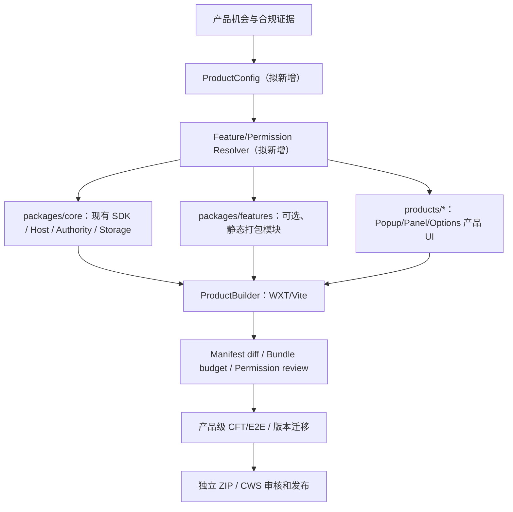

# Extension Factory：技术复用审计与增量架构

> **R3 续接入口（2026-10-12）**：完整分阶段任务树参见 [Product Ecosystem R3 Roadmap](product-ecosystem-r3-roadmap.zh-CN.md)，可执行 GOAL 参见 [R3 工程实施](../../framework/prompts/goal-product-ecosystem-r3.zh-CN.md)。本文件保留 R1/R2 设计及历史 Page QA 示例，下面新增第八节明确什么时候才建设通用工厂。

> **2026-10-12 最新状态：Page QA = `DEPRECATED / NO_RELEASE / SOURCE_REMOVED_FROM_MAIN`。** 下文产品目录、配置和构建示例仅保留 R1/R2 历史设计，不再存在于当前 `main`。原 R2 CLI/Resolver/Feature Catalog 只支持 Page QA，已与其专用产品代码一起清理，**不能继续宣称现有仓库实现了任意多产品构建工厂**；保留最少权限/Manifest/ZIP 设计理念，先验证电商等真实需求，再决定新一代通用实现。参见 [商业决策](commercial-decision-ecommerce-20261012.zh-CN.md)。

> R1 为**设计研究**，没有创建产品打包器或运行第二套执行框架。本文件所称“现有”仅指在 2026-10-12 远端 `main` 抽样读取的代码，CI/原生证据另见对应 workstream。

## 一、现有源码真实能力与缺口

| 真实文件 | 可观察现状 | 可复用性判断 | 缺口 / 验证 |
| --- | --- | --- | --- |
| manifest.json | 单产品名称/ID语义；host_permissions 包含 <all_urls>，permissions 已含 cookies/alarms 等 | 不能照搬到每一款独立扩展 | 按产品推导最少权限，明确站点 |
| wxt.config.mjs | 从唯一 manifest.json 读取；固定批准 WXT entries 与输出目录；未知入口直接拒绝 | WXT/Vite 可复用 | 缺 ProductConfig/动态独立入口集合 |
| scripts/build-contract.mjs | PACKAGE_ENTRIES、FIXED_OUTPUTS、预算约束 | 复用校验风格 | 需为各产品生成有限专属目标图；不得削弱上限 |
| scripts/build.mjs / pack.mjs | 生产包检查、构建输入哈希、确定性 ZIP | 复用确定性构建理念 | 缺 --product 参数与产物命名空间 |
| src/framework/sdk/browser-contract.js | 32 项 Browser SDK 操作合同；部分 IMPLEMENTED/PLANNED | 结构可用，不能宣布 32 项可调用 | 以 browser-sdk-status.md 同候选核验；禁止复制虚假接口 |
| src/platform/host/ 与 chrome/ | 唯一 Broker/Authority、Chrome API adapter | 共享代码但每产品各自 host 授权 | 工具 SDK 与独立扩展的 capability profile 拆分 |
| src/scripting/user-scripts/installed-programs.js | 实际包含 native getScripts/register/unregister/reconcile 与 Boot 检查 | C 与少数需 UserScript 的 B 可复用 | 必须逐产品验证 Toggle、启动、回滚、撤权 |
| src/ui/page-component-preparer.js | 可信 Worker 自动准备入口；React/Vue 固定编译资源 | 可复用到需要网页 UI 的产品 | 当前非所有 JSX/SFC 组合已最终 CFT 验收 |
| src/ui/sidebar-tools/package.js | 工具包格式 v1/v2、capability 白名单、MAX_INSTALLED_TOOLS=12 | 适合 A 的工具包，不是多个独立 B Manifest | 需避免直接把 iframe 工具当扩展特权 |
| src/marketplace/ 和 market-site/ | 网站发现、受限安装 Intent、可信宿主二次确认 | A/C 可复用发行模型 | 不等于已经有第三方作者审核 SaaS |
| src/ui/tool.html | 当前五个常显 Tab；云控与调试条件显示 | 设计 Token/可访问性规范可复用 | 行业产品 UI 不应复制所有 Tab |
| examples/programs/ 和 examples/sidebar-tools/ | 零参数、React/Vue、阅读 TOC、Cookie 编辑器等 Demo | 原型和 Fixture 可复用 | 不能把有目录当发布级 PASS |

**特别纠错**：R8 旧材料将 USER_SCRIPT 原生自动注册标成缺失，而当前 `installed-programs.js` 已实现 register/unregister/reconcile 入口；R8 GM 逐方法对照仍不能自动升级为兼容已验收。见[Browser SDK 进度](../../framework/workstreams/browser-sdk-status.md)与[Page R24.4](../../framework/workstreams/page-framework-r244-final-20261012.md)。

## 二、推荐分层（不产生第二内核）



以下为 **R1 历史目标架构示例，不是当前仓库源码清单**。曾新增的 `packages/extension-factory/`、`packages/features/page-qa/`、`products/page-qa-inspector/` 均已从当前 `main` 移除；其他列出的目标目录并不一定存在：

```text
packages/
  core/                    # 通过受控迁移复用现有 src/framework + src/platform
  ui-tokens/               # Design Token 基础，不跨产品共享全部 UI Shell
  features/
    page-qa/               # 静态打包的功能模块 + 自带权限声明
    notes/
    seo-audit/
    seller-listing-qa/
products/
  opendesk/                # 保留现有 OpenDesk manifest/build，迁移期无差异
  page-qa-inspector/
    product.config.mjs     # 稳定产品身份/启用模块/Manifest/作用域/预算
    brand/                 # 自身品牌资产
    entrypoints/           # 独立 UI，非复制 tool.html
scripts/
  product-build.mjs       # 显式 --product；严格验证源和 Manifest
  product-test.mjs        # 产品测试及 release manifest 映射
```

## 三、历史 Page QA 配置示意（DEPRECATED，非当前业务产品）

> 以下示例仅解释产品独立 Manifest 和权限裁剪。来源为已经从 `main` 移除的历史 `products/page-qa-inspector/product.config.mjs`，可通过旧 Git commit 查看；不得当作当前已实现配置或新产品需求。

```js
export default {
  schema: 'opendesk.extension-product.v1',
  productId: 'page-qa-inspector', // 不等于 Chrome extension ID
  displayName: 'Page QA Inspector',
  purpose: '检查当前网页的 DOM 与可访问性质量',
  version: '0.1.0',
  channels: ['development', 'production'],
  ui: {popup: true, sidePanel: false, options: true},
  features: ['dom-inspector', 'a11y-check'],
  hostPatterns: [], // 默认使用 activeTab；当前仅用户点击执行
  optionalHostPatterns: [],
  requiredPermissions: ['activeTab', 'scripting', 'storage'],
  optionalPermissions: [],
  runtimeModules: {controller: false, userscript: false, native: false},
  storageSchemaVersion: 1,
  budgets: {serviceWorkerBytes: 160000, totalZipBytes: 1200000},
  releasePolicy: {manualReviewRequired: true}
};
```

解析器必须验证：schema 无未知字段、闭合 feature 依赖图、产品目的归属、模块 permissions 为子集、每个 Chrome API 对应声明、拒绝 `<all_urls>` 默认继承、入口输出白名单、`external_connectable` 没有跨产品隐式接线。上例预算只是**产品的拟议起始限制**，不能修改现有项目的正式预算来凑过线。

## 四、不同扩展的安全与身份

- 每个独立扩展拥有自己的 **Chrome Web Store ID** 和发布身份，manifest `key`/签名及商店配置按正式渠道管理；`productId` 是源代码身份，不可误当安装 ID。
- `chrome.storage.local` 原生按扩展隔离；原有程序 `namespace` 仍在**一个扩展内部**隔离不同作者/工具。不同独立扩展不能通过简单命名空间神奇共享数据。
- 多产品的权限独立：同一 SDK 方法源文件可编译进两个产品，但不意味着自动获得同一 `cookies`/`tabs`/`all_urls` 权限。运行时仍由其自身 Host/Authority 实时准入。
- 不提供扩展间“共享 Chrome 权限代理”来绕过各产品声明。需要跨产品交换，只能经显式用户同意、安全协议、严格 allowlist 的接口，并重审 CWS 隐私限制。
- 高权限模块按产品功能证明、仅在用户动作时请求 `optional_permissions` / `optional_host_permissions`。见[官方权限文档](https://developer.chrome.com/docs/extensions/develop/concepts/declare-permissions)。
- 发行更新路径是“本产品 Store → 本产品的新 ZIP → Store 审核 → 受控滚动发布”，内部 A 工具版本更新与 B 发行 ZIP **不是同一个版本号**。

## 五、构建与测试完整闭环

`product.config` → 校验依赖/许可/权限 → 产物只含启用模块 → `manifest.json` 最小授权/目的 → 产物 hash + SPDX/SBOM + license → Product CFT 新 profile 安装 → 当前网页点按及功能效果 → 启停/授权撤销 → 升级/回滚及存储迁移 → macOS Chrome 真实 UI → 发行 ZIP 字节比对 → CWS 人工发布审核。

关键测试：
- two products 并行安装，扩展 ID 和本地数据完全分离；删除 A 不影响 B。
- A 不申请 cookies、nativeMessaging、<all_urls>；B 真有专用需求时才明确申请；不存在权限穿透。
- 产品自己无功能的入口不出现在 Manifest、构建目录或界面中；不能将整套 OpenDesk 核心无条件打入各产品。
- 卸载、更新、数据迁移和业务失败具有回滚/恢复方案；CWS 审核失败不认为已上架。
- 不依赖远程 JS 赋予扩展权限：MV3 禁止通常的远程代码执行，`userScripts` 例外仅限其文档允许的 API 使用场景，不能将在线 `import(url.js)` 当成 Side Panel/Background 通用加载器。见[MV3 政策](https://developer.chrome.com/docs/webstore/program-policies/mv3-requirements)。

## 六、最小实施节奏

历史 R2 源码曾实现一款 Page QA 产品的隔离打包，但其 ProductConfig/Feature Resolver、`scripts/product-build.mjs`、`scripts/product-pack.mjs` 和专属 CI 均已从当前 `main` 移除，避免留下只支持一款废弃产品的死代码；原 OpenDesk 默认构建保持独立。新的行业扩展须先有真实需求、合法数据、可持续维护和购买者证据，再决定是否建设通用 Factory 与申请 CWS 审查。CWS API 只能辅助上传和提交审核，不承诺自动批准，见[官方发布 API](https://developer.chrome.com/docs/webstore/using-api)。

## 七、如何避免维护成本失控？

每产品必须有 `owner / purpose / userStories / featureModules / permissions / supportedSites / tests / SLO / updatePolicy / sunsetPlan`。同类功能走内部模块或 C Script，不单独发行；没有真实用户、长期适配预算与责任人不能进入 CWS 扩展队列。


## 八、R3：通用化决策、真实消费者与测试门

> **状态：`CONDITIONAL / NOT_STARTED`。** R3 未通过本次文档提交恢复任何 `product-build` / `product-pack` npm 命令，也未创建产品注册中心；Page QA 代码继续保持 `SOURCE_REMOVED_FROM_MAIN`。

### 8.1 先验证产品形态，再建设构建器

- A OpenDesk 工具、C UserScript 能直接解决且无单独 CWS 品牌诉求时，优先复用现有安装与页面能力，不要为了打包创建 B 产品。
- D 外部服务需要合法、持续的数据源与用户授权；不能通过新扩展的浏览器权限代替商家官方 API 授权。
- **真正要启动 B 的门槛**：单一用途、真实目标用户的任务、独立安装/分发必要性、比通用工具更合理的权限范围、可承担的版本和平台维护、可用的真实验收入口。商业收入是可研究的假设，不因产品 ZIP 可编译就算 `PAID_VALIDATED`。
- 主业务先看 EXP-005 卖家 Listing/SKU 和 EXP-007 到手价；它们均属 `HYPOTHESIS`，不能自动宣布适合独立插件。

### 8.2 条件成立后的最小技术接口

~~~text
Reviewed Product Registry
  → ProductConfig（ID、目的、UI、模块、授权、存储、版本、预算）
  → Static Feature Catalog / Dependency + Permission Resolver
  → Product Build Plan（选择静态入口/依赖、拒绝未声明资源）
  → WXT/Manifest（每产品最少权限，不复制整套 OpenDesk）
  → Independent Build / Pack / Verify（独立缓存、资源哈希与包签收）
  → Node/CFT/原生 Chrome/升级撤销验证
  → 手工发布和合规审查（CWS_APPROVED 另有证据）
~~~

只有通用解析器 + 两种配置有实际差异的**非商业 Fixture**完成负面测试后，才重新注册按产品选择的构建命令，避免重造 R2 只接受 `page-qa-inspector` 的伪通用接口。Fixture 放在 `tests/fixtures` 等受控测试目录，不作为新的商业扩展或 Page QA 继承者。

### 8.3 最小且不可省略的安全拒绝

未知/重复 ID；缺依赖/循环；未授权站点与超出目的的 API 权限；未选模块混入；跨产品共享敏感存储；远程特权 JS；Manifest 权限/CSP 变更；构建包与来源哈希不符；版本升级和权限撤销后继续执行。每项须有代码级断言和对应的原生证据适用边界。

本文件仅持有独立工厂的架构说明；**权威任务树**统一维护在 [R3 Roadmap](product-ecosystem-r3-roadmap.zh-CN.md)，真实开发过程写 [R3 Workstream](../../framework/workstreams/product-ecosystem-r3.md)，不得自建第二份 R8/OPP/EXP 编号。
