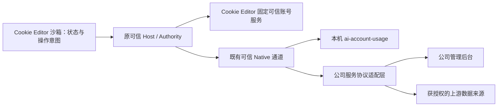

# Cookie Editor 与公司管理服务绑定方案

日期：2026-10-31。状态：**设计提案，未实施**。本文是本次服务绑定方案的唯一正文；不覆盖两个 README 中的现有能力和历史证据。

## 1. 结论与用户目标

采用 **通用服务连接协议 + 各公司服务端适配器**。Cookie Editor 提供统一连接、账号关联、授权状态和跳转入口；不同公司的管理程序实现同一小协议，可以使用不同语言、数据库和管理页面。额度唯一实现继续在 `ai-account-usage/`，不复制到扩展、通用 Host 或另一服务目录。

用户已确认“管理员页面”指**公司服务端管理后台**。因此后台新增「Cookie 同步设置」；扩展负责展示本设备实际接受的范围、暂停/撤销与执行回执。公司后台保存策略，不能替本机用户批准传输 Cookie。

下一条目标操作：**Cookie Editor → 企业 → 服务连接 → 添加服务 → 公司登录授权 → 选择账号关联 → 打开对应管理页**。第一阶段只打通绑定与查看；原始 Cookie 上传属于后续独立能力，不隐含在连接服务中。

## 2. 现状、发现与复用

| 已核实事实 | 设计影响 |
| --- | --- |
| [项目 README](README.zh-CN.md) 指定 Cookie Editor 为唯一 owner，`ai-account-usage/` 保留独立 Node 执行边界 | 延用现有目录，不恢复 `services/ai-account-usage/`，不新建扩展产品 |
| [正式入口缺口](evidence/usage-entry-gap-20261030.md)：Cookie 账号 RPC 没有额度、管理页打开或可信来源映射操作 | 不能只加一个按钮就宣称完成；可信映射和受控打开必须实际接线 |
| [账号合同](trusted/account-contract.js) 当前仅含账号保存、切换等操作；[服务](trusted/account-service.js) 脱敏元数据使用 `origin + alias` 标识账号，另有 `version` | 不按 displayName、邮箱、列表顺序自动配对，不破坏现有 alias |
| [本机管理服务](ai-account-usage/web-server.mjs) 使用随机 localhost 主机、一次性配对与 HttpOnly 同源会话 | 保留该安全模型；随机端口不是稳定服务身份，服务停止后会话失效 |
| [额度服务](ai-account-usage/account-service.mjs) 目前只支持 `CODEX_OAUTH / COOKIE_ONLY`；没有公司租户和角色隔离 | 不把本机服务改为 `0.0.0.0` 就作为公司版；先补服务端身份隔离 |
| [Cookie-only 与真实验证边界](ai-account-usage/README.zh-CN.md)：Cookie-only 曾遇 403/challenge；正式秘密桥接、双真实账号隔离仍未完成 | OAuth 查询成功不等于 Cookie-only 可用，任何方案都不得隐藏这一点 |
| [企业 UI](app/components/CookieBusinessPanels.jsx) 当前为演示，现有六个产品 Tab 由 [App](app/CookieEditorApp.jsx) 持有 | 在企业页增设服务连接区域，不向 Browser 的五个顶级 Tab 添加业务页 |

Extension Type & Ownership Gate：这是**现有沙箱工具 UI + 经审计第一方可信账号服务 + 独立 Node/公司服务端**的组合。沙箱不导入可信业务 JS，不获得任意 Native、文件读取或网络代理能力。当前属于文档设计，不启动产品环境、测试、构建或安装。

## 3. 选型

| 选择 | 优点 | 代价与判断 |
| --- | --- | --- |
| 扩展写死 ai-account-usage 地址和业务 | 初次接入最快 | 公司差异导致扩展反复发版；随机端口、账号映射和权限问题仍存在。不选 |
| **统一小协议，各公司后端适配** | 一份扩展适配多家公司；权限和数据格式可检验；后台自由设计 | 各公司要实现协议或部署轻量适配层。推荐 |
| 让公司下发扩展插件 JS、任意 RPC 或远程 iframe 控制 Cookie | 表面上最灵活 | 无法保持固定可信代码与最小授权；后台可变相扩大权限。不选 |

通用的是**连接、身份、能力、最小账号/额度数据与回执**。公司特有报表、流程、页面继续留后台；暂不支持的新业务只提供经核准的后台入口，不扩成无限制脚本平台。

## 4. 页面与操作

```text
Cookie Editor（保留原六 Tab）
└─ 企业
   ├─ 服务连接        [+ 添加服务]
   │  ├─ 本机额度服务 · 未连接/已连接/服务未启动
   │  └─ 公司 A       · 域名 · 当前组织 · 已授权范围
   │                    [管理后台] [账号关联] [断开]
   └─ 原企业介绍与其他入口

账号 → 账号详情
└─ 已关联服务：公司 A / 指定资源 / 身份核验状态
   [打开管理页] [查看额度（服务支持且已授权时）]

公司服务端管理后台（独立页面；自有 Node 版沿用现有 React，其他公司保留自己的后台）
├─ 账号与额度（已有列表、详情、缓存和手动刷新）
├─ Cookie 同步设置（新增）
└─ 连接设备与操作记录（最小管理视图；组织成员管理复用公司系统）
```

不增加第七个同级产品 Tab；「服务连接」作为企业页明确可见区域/子视图，首屏有添加入口。管理后台用独立标签页打开，不将远程网页嵌入特权 Side Panel。

添加服务只要求用户输入**服务地址**并登录公司账号；服务类型、协议版本与支持功能自动发现。普通用户不用配置 API 路由、Cookie 字段、文件路径或 Token。多个连接可并存，账号可关联不同服务；默认管理入口可选，实际上传目标始终显式显示，切换默认入口不迁移数据或授权。

连接卡片显示：公司名、完整可信域名、当前组织、连接人、连接状态、能力范围、最近成功时间及必要错误。账号和 Cookie 内容不进入服务列表。断开、换组织、切换服务前保护未保存输入；返回恢复原账号和焦点。

**账号选择的首版范围**：复用当前网页 origin 的原「账号」列表，不新建全部网站账号目录。企业页「账号关联」只携带非秘密 pending connectionId 导航到原账号页，重新获取当前站点的脱敏列表；用户从中选定已保存账号，再选择远端资源。无账号时显示「请在目标网站保存账号后关联」，受限/未授权页面保持原拒绝。确认页并列展示本地站点/账号、公司域名/组织/远端资源和核验状态。不能依赖切 Tab 前的 React 账号缓存；站点、账号版本或授权变化会取消待确认操作。

**同步的具体入口**：公司后台「Cookie 同步设置」保存期望策略 → 扩展企业页连接详情显示「待本机审阅」 → 用户回到对应源网站，点击「审阅同步范围」 → 原可信 Host 展示接收方、账号、域/Path/Store/Partition、加密备份用途与留存 → 批准后回传接受版本 → 在该详情点击「手动备份」 → 显示已确认回执。详情同时提供「暂停备份」「撤销同步授权」；unknown 时主操作改为「查询结果」，不显示可导致重复发送的重试按钮。后台只能提示待设备操作，不能替用户触发本机 Cookie 读取。

## 5. 三层绑定，分别授权

### 5.1 服务连接

`connectionId` 是本地随机标识，隔离所有配置、凭据和任务；远端身份为经过认证确认的 `serviceInstanceId + tenantId`，精确 `origin` 固定在连接记录中。名称只是标签。

公司模式：用户输入 HTTPS origin → 获取受限描述 → 在可信本地确认域名 → 系统浏览器公司网页登录授权 → 可信端确认组织/用户与最小 scope → 连接成功。采用标准 **Authorization Code + PKCE（S256）**，Native 持有 verifier、state 和公司访问令牌，作为 public client 不内置共享 client secret。授权服务配置接入公司 SSO；不支持约定的安全流程时明确提示未兼容，不猜测端点或降级为粘贴长期 Token。

公司首次部署须预注册 public client `opendesk-cookie-editor-v1`（协议配置值，不是秘密），强制 S256、禁止 implicit/password grant，允许数字 loopback 的动态端口，其余回调 URI 部分精确匹配。描述中的 issuer 必须等于 `origin + /opendesk/oauth`；authorization、token、revocation 端点分别固定为该 issuer 下的 `/authorize`、`/token`、`/revoke`。公司内部 SSO 由同源适配网关衔接；不支持该 client/端点/回调合同就拒绝连接，不动态注册或猜测其他认证域。

Native 仅在此次登录期间监听 `127.0.0.1` 或 `::1` 的随机空闲端口，路径固定为 `/opendesk/oauth/callback`；不绑定全网卡、不使用 localhost 名称。每次授权独立生成高熵单次 state/verifier，事务绑定原 connectionId、origin、预期 issuer、实际 redirect URI、challenge 和 5 分钟有效期。服务端必须支持授权响应 `iss`；缺失/不匹配、state/路径/期限不符均拒绝交换 code，不使用回调输入选择 Token 端点。收到有效单次授权响应即关闭监听，再由可信端交换；取消/到期也关闭并销毁事务。回调的短期单次 code 可以按标准通过该本机 URL 交付，但不写日志、历史存储或进入沙箱；这不是放行其他 URL 传秘密。临时 OAuth 回调不承担 Cookie API 或常驻服务功能。

公司授权凭据仅访问该公司协议，**不是** ChatGPT/Codex 凭据。上游 Token 默认仍留在原本机授权来源；公司登录不授予读取 `~/.codex/auth.json` 或上传其内容的权限。

本机模式：继续使用现有终端一次性配对入口；正式一键打开须补齐可信 Native 会话发现与受控打开。Node 通过同用户已认证的既有 Native 通道交付当次 origin、实例和短期打开上下文，Native 验证并持有；沙箱只收到成功状态。随机端口和文件描述不是身份凭证，不扫描端口、不从账号名猜地址。通道未实现时显示「本机服务尚未连接」，保留终端入口，不假装自动发现。

每次启动的本机实例与会话重新建立；不能因为磁盘保存过地址而复用旧端口。此可信接线属于缺失能力设计，当前为 `NOT_IMPLEMENTED`；不虚构公开 SDK 方法名。

### 5.2 账号关联

本地引用使用现有 `installation identity + origin + alias`，并由可信服务保存 Store/Partition 边界和当前账号版本。远端引用使用 `connectionId + tenantId + providerKey + remoteAccountId`；`providerKey` 区分上游，`remoteAccountId` 是公司资源稳定 ID，不使用显示名称。

关联记录另存 `bindingId / revision / authEpoch / sourceMode / verificationState / verifiedAt`；秘密不在记录内。账号内容更新改变 version；删除再创建的同名账号不会继承旧关联。安装身份变化、撤权或组织变化先失效，重新核验后才恢复。

必须区分：

- **手动关联**：用户明确选定公司资源，只允许跳转和展示“所选公司资源”的数据；标注「手动关联，尚未验证同一登录身份」。不能称为当前浏览器账号额度。
- **身份已核验**：只由固定审计的上游适配器取得可信身份证据，核对 `userId + accountId/workspaceId`。邮箱仅辅助。对于 Codex，沿用已授权来源和上游响应的双 ID 检查；本机缓存 JWT 声明不单独充当签名验证结果。
- **身份不一致/无法核验**：拒绝升级为已核验，不自动换号或改历史。通用 Cookie 账号本身不带可靠网站 userId，Cookie 快照相同也不证明对应 Codex 来源。

同一连接、同一远端资源最多一个有效本地关联；跨连接允许有意关联同一资源，权限、历史和同步任务分别隔离。公司服务端在提交事务内检查归属及唯一性，客户端显示别名不作为授权依据。

额度关联与备份归档分开：`purpose=usage` 的手动关联仍只允许跳转和展示，不具备上传资格。C 阶段另建 `purpose=backup` 的**备份目标关联**，由用户明确创建私有 archiveId 并审阅接收位置；它可以是人工指定归档，不声称与上游账号身份相同，不向该档案提供“当前登录账号额度”。服务端为该设备和本地账号引用分配独立归档，禁止将 usage 关联隐式升级或把 Cookie 归档挂到他人资源。后文 C 的远端目标为 archiveId，额度路径仍使用 remoteAccountId。

### 5.3 Cookie 同步授权

连接服务、读取额度、上传 Cookie 是三个独立 scope。默认没有原始 Cookie 上传权限。同步设置可在公司后台维护，但本机生效范围为：

**后台期望策略 ∩ 本机明确批准范围 ∩ 当前安装/Authority/Chrome 有效权限。**

本地缩小或撤销范围立即阻止本地新操作。后台收紧在服务端提交时立即约束其后准入；设备只有收到有效策略响应后才能更新本地状态，不能承诺离线设备同时获知。每次新上传须先取得该设备的当前策略/角色/绑定代际，5 秒内发起并携带其 revision，超过或获取失败即停止；服务端在写入事务中再次按当前策略、角色、绑定与撤权代际原子准入，发生变化返回冲突，不按旧策略存储或处理。已发出的网络字节无法收回，已提交数据单独走删除/留存合同。

新增域名、账号、接收方、解密用途或持续运行等扩权，回到可信本机明确审阅，原批准范围之外不执行。不对每次正常同步重复授权。第一版只手动上传，不将 GET 策略伪装成持续推送或实时设备撤权通知。

## 6. 公司后台的「Cookie 同步设置」

页面按服务与设备展示设置，避免一个全局开关误影响其他公司。表单只处理策略及脱敏状态：

| 设置 | 默认与约束 |
| --- | --- |
| 目标公司/组织/服务端 | 固定为当前连接；修改接收方需新授权 |
| 账号范围 | 用户明确选中的已保存账号；禁止“所有浏览器网站”隐式全选 |
| 域、Path、Store、Partition、字段 | 继承精确 Cookie 身份；共享父域需原权限，不猜域名或迁移分区 |
| 数据类别 | 默认仅账号元数据/额度摘要；Cookie 内容是独立可选能力 |
| 传输目的 | 加密备份，或明确授权的服务端处理；不能混称 |
| 触发方式 | 第一版只手动；持续同步须后续单独实现和批准 |
| 保存期限、设备/人员访问范围 | 明确展示；按公司策略且不超过本机已批准范围 |
| 冲突处理 | 版本冲突停止，显示两端版本；不按客户端时间“最后写入覆盖” |
| 最近结果 | 已确认成功 / 失败 / 结果未知 / 等待本机确认；显示时间和非秘密回执 ID |

后台显示「期望策略」与「设备已接受策略」，不能把服务端保存成功写成设备已生效。设备离线显示待应用；本地可暂停上传或彻底撤销授权，后台不能替它恢复。暂停停止后续执行；撤销还使旧代际凭据与待执行操作失效。

**两种 Cookie 模式不可混淆：**

1. **阶段 C 选定加密备份**：可信本地使用现有经过审计的加密库，逐快照生成独立随机 256-bit 数据密钥，使用 AES-256-GCM、96-bit nonce、128-bit tag；密钥仅存本机原可信秘密设施，密文不含明文 Cookie 值。封装固定 `formatVersion / keyId / nonce / ciphertext / tag`；AAD 为精确 UTF-8 编码的固定有序数组 `[formatVersion, serviceInstanceId, tenantId, deviceId, bindingId, archiveId, snapshotVersion, operationId]`，用于防跨公司/账号/版本替换。禁止重用 key/nonce 对，读取先验 tag/AAD；缺少密钥显示不可恢复，不降级明文。另一个设备的密钥分发/恢复延期，服务器不能用这些密文查询额度。
2. **服务端处理仅保留后续候选**：服务器需要在内存解密使用 Cookie，必须单独明确展示接收公司、用途和可解密事实。开始该阶段前另行冻结解密执行进程、密钥管理、角色与留存上限合同；未冻结前描述中不得声明此能力，不能复用 C 的密文或备份授权。这不是端到端加密。Cookie-only 探针失败不能自动切为上传 OAuth Token。

第一版不提供 Cookie 下载后自动写回浏览器、远程切换账号或远程下发执行脚本。未来恢复功能仍经现有本机写入审阅和回读，不把备份能力变成远控。

## 7. 最小服务协议（全部为拟议合同）

以下不是现有 API，不得直接在当前工具调用。版本以 `protocolVersion: 1` 协商；未知必需能力拒绝，未知可选能力忽略。描述必须通过大小、字段、类型和路径校验，不接受 HTML/JS、任意 URL 模板或自报特权。

| 操作 | 目的与边界 |
| --- | --- |
| `GET /.well-known/opendesk-service` | 无认证的最小描述：productName、protocolVersion、候选 serviceInstanceId、capabilities、固定 issuer/clientId、回调 iss 支持、snapshotLimit、operationRetentionDays；不返回账号和秘密。值须满足本文固定合同，不能用其覆盖路径/信任范围 |
| 标准 authorization/token | 公司连接采用系统浏览器 Code + PKCE；Native 直接交换，校验 issuer/state/redirect URI，取消/拒绝/过期即停止 |
| `GET /opendesk/v1/self` | 认证后确认服务 instance、用户、tenant、角色与实际 scopes |
| `POST /opendesk/v1/devices` | 在当前已认证用户/tenant 下注册设备；服务器产生 deviceId 并绑定本次 OAuth grant family，后续请求不能用载荷切换 device/tenant |
| `POST /opendesk/v1/bindings`、`DELETE /opendesk/v1/bindings/:id` | 按下表原子建立/解除 usage 或 backup 关联；backup 同事务创建仅属于当前设备的 archiveId |
| `POST /opendesk/v1/policy-acceptances` | 仅报告可信本机已接受的精确策略 revision/hash 和授权代际；服务器不得将未接受或过期策略显示为已生效 |
| `DELETE /opendesk/v1/devices/:id` | 断开设备并使该设备授权、关联、接受状态及后续请求失效；不会删除浏览器本地账号 |
| `GET /opendesk/v1/accounts` | 按认证 tenant/角色过滤账号，稳定 ID、脱敏标签、providerKey、可核验身份状态；游标分页 |
| `GET /opendesk/v1/accounts/:id/usage` | 按需返回缓存归一化结果、来源模式、观测时间、时窗与错误；没有数据即未知 |
| `GET /opendesk/v1/sync-policy` | 获取本设备范围的策略与 revision；不能借响应扩大本机授权 |
| `POST /opendesk/v1/snapshots` | 仅在上传能力已交付并授权后使用；带客户端预存 operationId、绑定、策略/快照版本、幂等键与密文封装 |
| `GET /opendesk/v1/operations/:id` | 对账确切操作回执；不触发再次采集或上传 |
| 后台固定入口 | `/opendesk/admin/accounts/:remoteAccountId` 与 `/opendesk/admin/sync?device=:deviceId`，ID 必须符合受限 schema 且编码为路径段/Query 值；后台自己检查登录、tenant/角色/资源权限，不接受任意 URL 模板 |

固定字段包含 `connection/tenant context、remoteAccountId、providerKey、sourceMode、observedAt、status`；额度值沿用 `ai-account-usage` 的桶/窗口模型，不假定所有公司都返回“剩余百分比”。有新增支持模式时，服务端适配器负责转换；现有探针不会自动变成通用供应商插件。

所有公司 API、授权与管理入口固定为同一精确 HTTPS origin 下的协议路径。SSO 跳转可以发生在浏览器公司登录页面，不能让 Native 携带秘密跨 origin 跟随 API 重定向。不兼容既有后台可在公司同源网关加适配层，扩展不支持随意配置任意路径和 JS。

适配接口只定义上述数据和语义，Java/Go/Python 等公司后台均可实现。自有 Node 部署复用当前模块，不复制额度业务。新供应商在服务端实现受审适配器，不把公司业务规则放进 Browser 通用模块。

### 7.1 双方状态变更合同

所有变更由 Native 使用绑定 device/tenant 的公司 OAuth 凭据调用；普通后台页面会话只能改后台策略，不能冒用此通道。变更默认拒绝未知字段；服务端依据认证上下文核对记录 owner，不采信自报 tenant/device。缺失 scope 返回 403，版本/代际不符返回 409，均不自动重试。

| 变更 / 发起方 | 记录 owner 与提交 | 版本/冲突/撤销 |
| --- | --- | --- |
| 连接后注册 / 可信端 | `devices` 属于已认证 tenant/user；服务器生成 ID，将当前 OAuth grant family 绑定唯一设备。客户端 label 仅展示 | 同一 grant family 重复登记返回原 ID；完整重新登录产生新设备 ID，旧设备撤销须显式对账，不能凭相同名称接管 |
| 关联确认 / 本机用户→可信端 | 本地保存原账号引用；服务端 `bindings` 归当前设备。提交 purpose、本地不含秘密的引用、期望远端资源和预期 revision；服务端事务检查资源归属/唯一性，返回 bindingId/revision | 同一请求键重放仅返回原回执；版本冲突不覆盖。备份归档只在当前设备名下创建；删除关联提升 epoch 并取消其接受状态 |
| 后台保存策略 / 公司策略管理员 | 后台私有事务，owner 为 tenant 中被授权的设备/绑定；保存 desiredRevision/hash、scope 与留存 | 只能产生期望状态。收紧即时作用于服务端准入；扩权不改变设备已接受范围 |
| 审阅并接受 / 真实本机点击→原 Host | 本地先持久化接受范围与 authEpoch，再 POST 精确 desiredRevision/hash、本机接受子集；服务端只接受仍为当前版本且不超期望范围的结果 | 409 表示后台已变更，显示待重新审阅；回传丢失时显示“本机已批准、后台未确认”，未核实前禁止上传。用同一键查询/幂等确认，不触发读取 Cookie |
| 手动备份 / 真实本机点击→原 Host | 两端都确认的 backup 关联和接受版本才可用；当前源站点/文档与原授权仍须通过原可信检查，再使用已保存快照 | 发前重查策略，提交原子准入；账号快照版本变化要求重新查看备份范围，不自动捕获新登录账号 |
| 暂停/恢复 / 本机用户 | 暂停是本地立即停止新备份，后台可见状态异步回传；恢复必须是本机动作并重新检查当前策略和权限 | 暂停不等于撤权；后台不能恢复。离线回传显示待确认，不影响本地已停止事实 |
| 撤销关联/设备 / 本机或公司已授权管理员 | 本地先停止、提升 epoch；服务端删除/撤销事务提升自己的 epoch，失效设备 grant family、绑定及接受状态（按撤销范围） | 远端失联保留待确认和必要的受限撤销事务上下文；UI 不再提供业务操作。不能把本地删除凭据当成已完成远端撤销 |

完整重新登录、服务重启、Native 重启分别处理：公司网页登录会话与 Native grant family 独立；同一有效 refresh family 可恢复原设备，过期则重新登录/明确重新关联。Node 本机重启则原一次性会话全部失效，必须按 5.1 重新发现配对。以上状态均有明确标签，不以“已保存连接”代表在线或已授权。

## 8. 信任、租户与失效



- Cookie 值、上游 Token、PKCE verifier、公司 API 凭据、配对秘密不传沙箱、React 状态、普通网页消息、Query、日志或遥测。公司授权回调 code 只遵循 5.1 的短期一次性例外。现有终端配对链接的短期 fragment 合同保留，不复制到账号按钮。
- Cookie 内容只在审计固定可信服务与被明确授权的可信进程之间传输；沙箱只能提交已保存账号引用，不提交任意 Cookie/路径/命令。可信端重新解析、核验安装身份、账号/快照版本、权限和撤权代际。
- 公司凭据按连接、设备与 tenant 隔离，存于原可信秘密设施；不使用 `storage.sync` 或沙箱 localStorage。安全存储/通道不支持时显示阻塞，不退化为明文。访问令牌短期、最小 scope、限定 audience；若使用 Refresh Token，public client 必须满足发送者约束或轮换，并绑定原 scope/资源。显式对接授权服务撤销接口；停止登录、关闭网页、删除本地凭据不等于远端撤权。离线撤销显示待确认，不能自动扩大权限。
- 当前本机 read API 不具备租户隔离。公司部署优先每公司独立进程、存储与凭据；若多租户共用，所有账号/历史/列表/聚合/缓存/操作及后台页面查询必须从已验证登录上下文派生 tenant，不采信请求自报 tenant。组织角色至少区分查看者、策略管理员与凭据处理服务；策略管理员不能导出明文 Cookie。
- 动态地址由可信端校验：HTTPS、无用户名密码、无 fragment/敏感 query；请求有界且禁重定向。拒绝公网服务地址解析到 loopback、link-local、云元数据等范围，重新解析时再次检查，连接固定到核准解析结果并保持 TLS 主机校验，防 DNS 重绑定。内网公司服务是明确选项，审阅精确 origin/地址范围，仍禁止云元数据地址、非授权子网与任意代理。
- 公网模式将所有 A/AAAA 结果统一规范化（含 IPv4-mapped IPv6），任一结果不是全球可路由单播地址即拒绝整个解析结果；明确拒绝 RFC1918、CGNAT、IPv6 ULA、loopback、link-local、multicast、unspecified、保留/特殊用途地址。内网模式只额外允许本机已审阅的精确企业 CIDR 与 origin；loopback/链路本地/云元数据仍拒绝。本机服务只走本机模式，所有重试/IPv4-IPv6 回退连接继续应用相同校验。
- 本机连接走独立受认证通道与精确实例，不借“内网”例外绕过 Host/Origin；公司后台不通过 CORS 通配符、`externally_connectable` 万能命令或 window.postMessage 获取 Cookie 权限。
- 断开连接、停用/卸载工具、公司撤销设备、角色收紧、权限撤销或安装身份变化：本地立即停止受影响新操作并失效旧 epoch。远端离线则标记撤销/删除待确认；不能声称已经收回已上传内容。上传前及提交结果前检查代际，迟到旧结果不能恢复 UI 的成功/已授权状态。
- 已经发出的上传可能在撤销前已获准提交，必须显示真实已发出/未知状态；服务器在原子提交点按当前策略、角色、绑定代际与条件版本重新准入，不承诺收回先前收到的网络字节。请求超时显示“结果未知”，只查状态，不自动重复发送。
- **可恢复操作账本**：上传前由可信客户端生成随机 operationId 并持久化于原可信事务存储；幂等键即该 ID。记录连接/tenant/设备/绑定/资源/快照与策略版本，以及准确密文封装的 SHA-256 摘要，不保存明文 Cookie 摘要。服务端以认证上下文派生 tenant，与全部字段共同校验；相同 ID 不同内容拒绝。`GET /operations/:id` 的 ID 上传前已知，按当前角色和设备隔离，不能凭 ID 读取他人操作。
- 服务端操作记录与快照提交原子落盘；客户端重启把所有未收尾记录恢复为 unknown，只按原 ID 对账。查无记录、回执过期或远端离线仍保持 unknown，禁止换新 ID 自动重传。服务端至少保留回执 30 天并公开过期语义；客户端不能因超过该期限假定上传未发生。用户发起新上传前必须明确处理旧 unknown，不能把重传藏在刷新按钮中。
- 所有账号改名、服务改名均不改变稳定身份。换地址、tenant、接收方或 provider 身份视为重新审阅；失效凭据、401/403、429 和上游 schema 变化停止相关操作。额度页面保留上次样本和过期标记，不把失败改成 0 或“仍实时”。

## 9. 落地顺序与所有权

| 阶段 | 可见结果 | 主要范围与停止条件 |
| --- | --- | --- |
| A：本机绑定 | 企业页能查看本机连接状态；手动关联已授权额度来源，受控打开现有 React 管理页 | `app/`、`trusted/`、`ai-account-usage/`；补已有 Native 的窄会话接线。没有可靠身份则清楚标记手动关联，不声称同一账号 |
| B：公司连接 | 添加公司地址、登录、选择组织、关联远端资源、打开对应后台；两家公司隔离 | 同一连接合同与服务端适配器；先只读，不上传 Cookie |
| C：同步设置 | 公司后台可保存策略；设备显示是否接受；仅对明确批准账号进行一次加密备份上传并核对回执 | 在已有后台增加设置视图；可信端处理秘密；固定采用第 6 节备份封装与第 8 节操作账本 |
| 延期 | 服务端解密处理、持续同步、双向恢复、跨设备密钥恢复、新供应商适配、production 全量验收 | 独立需求，不因为本提案评分达标就自动开工 |

A、B 可在共有安全接线确定后独立推进，本机 Node 不是公司适配的无条件前置；C 只依赖其所选目标模式已有可靠连接。A 的退出条件是正确资源受控打开、重启旧会话失效与身份标签真实；B 是两家公司协议互操作、注册/关联/解除闭环和认证失效后的明确重连；C 是期望→本机接受→后台确认→单次备份→回执对账的完整操作及受影响安全验证。

`app/` 负责连接列表/账号展示；`trusted/` 负责本工具身份、策略交集与授权检查；`ai-account-usage/` 负责唯一额度逻辑、公司适配与管理页。业务测试留 `tests/ai-account-usage/` 和现有工具测试目录；公共 Native/Host 接线只覆盖实际改变的跨工具合同。不复制管理 React 到 Side Panel，不另建 Registry/Host/安装器或 npm 依赖。

已证明缺口限于[现有证据](evidence/usage-entry-gap-20261030.md)中的可信映射和管理会话发现。公司连接的公共能力边界尚未验证：实施前按 Runtime owner 核对最小请求/打开/秘密通道，新增部分先标 `SDK_GAP_NOT_PROVEN`；不得据本设计直接放开任意网络或 Native RPC。

开始实施仍在 `main`，先核对并保留并行改动；现有 README 和迁移正有未提交变更，本提案不代其提交。本轮只保存本方案及独立评审结果，不改正式包、不构建、不启动 watcher/Chrome/服务。

## 10. 设计评分与未来最小验收

本轮评审的是**方案完整性和可执行性**，不是 Chrome、Native 或上线结果。两位独立评审分别检查安全与实施/体验，不预设分数；有阻断问题必须修订。目标为两份设计评分均 **>95/100**，任何身份串号、秘密进沙箱、后台扩权、不可对账重试、跨公司泄露都直接不通过，不用总分抵消。

| 设计维度 | 分值 | 达标证据要求 |
| --- | --- | --- |
| 通用性与唯一 owner | 20 | 不同公司后端实现同一合同，额度无副本，无任意代码插件 |
| 身份与租户隔离 | 20 | 三层绑定，稳定 ID，手动关联不冒充身份核验，租户在可信上下文落实 |
| 秘密与授权安全 | 25 | 最小权限、数据模式明确、本机最终控制、地址限制、撤权与未知结果 |
| 用户流程与管理页 | 15 | 添加→登录→关联→管理→同步状态可理解，错误/离线/焦点路径明确 |
| 实施与生命周期 | 15 | 复用现有入口，分阶段可交付，重新连接/冲突/断开有定义 |
| 证据与诚实边界 | 5 | 现状与拟议接口清晰，评分和原生验证分开 |

未来按阶段执行的最小验证（本轮不运行）：

1. A：两个不同名称/同名账号的关联、身份冲突拒绝、管理页正确资源、服务重启旧会话失效、秘密不进入沙箱。
2. B：两家不同实现的服务使用同一扩展候选完成固定发现、PKCE/iss 认证、设备注册、关联/解除和过期重连；跨 tenant/角色/账号 ID 的拒绝覆盖列表、详情、历史、聚合与缓存；恶意服务描述/地址/重定向拒绝。
3. C：后台保存策略≠设备批准；扩权不生效、撤权停止、版本冲突拒绝；本机接受回传丢失安全停止；从备份入口到确认回执完整可操作；上传超时和进程重启按原 ID 对账、不重放，验证仅密文且更改 AAD/tag 必拒绝；域/Path/Store/Partition 身份不被简化。
4. 原有账号保存/切换及其他连接不受影响；真实 Chrome/Native 只在对应实现后做最短核心链和受影响安全验证。未执行项一律 `NOT_TESTED`，不默认全量构建、尺寸矩阵或正式发布验收。

标准依据：[RFC 8252 原生应用 OAuth](https://www.rfc-editor.org/rfc/rfc8252.html)、[RFC 9700 OAuth 安全最佳实践](https://www.rfc-editor.org/rfc/rfc9700.html)、[OWASP SSRF 防护](https://cheatsheetseries.owasp.org/cheatsheets/Server_Side_Request_Forgery_Prevention_Cheat_Sheet.html)。同源固定路径是本产品为缩小信任面作的选择，不是 OAuth 对所有系统的限制；SSO 可由公司网关内部衔接。

当前阶段：仅设计；独立评分以[评审记录](evidence/service-binding-design-review-20261031.json)为准。A/B/C 均未实施；真实 Cookie 传输、公司连接和原生安装均 **NOT_TESTED**。
