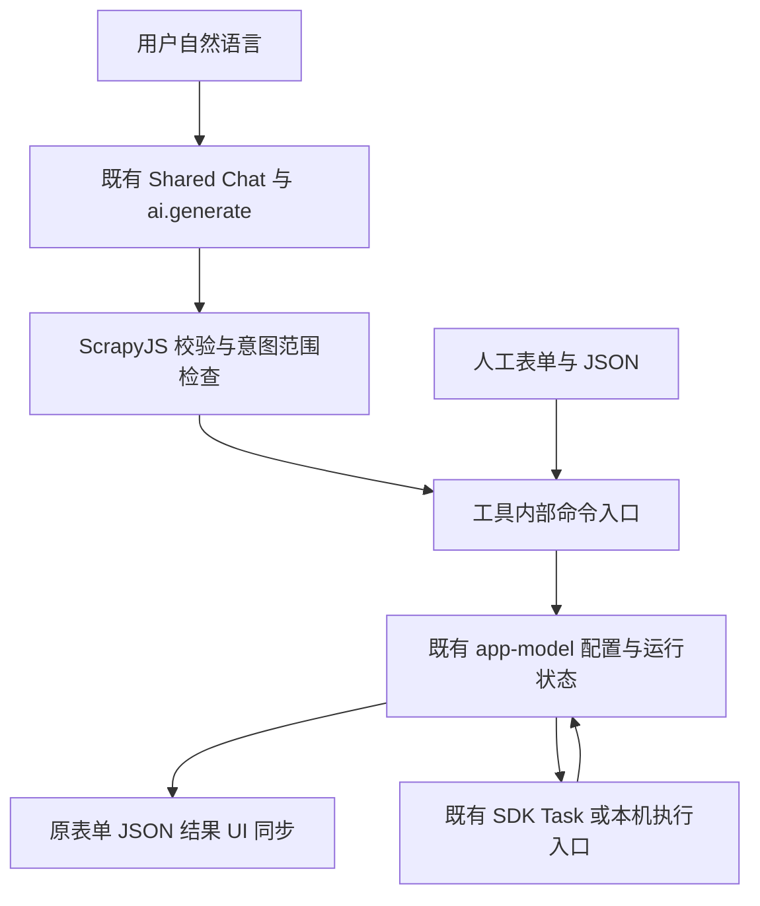

# ScrapyJS：AI 爬虫、代理与云运行技术架构（设计草案）

> 记录日期：2026-10-30；AI Chat / 业务接口方案修订：2026-11-02｜状态：DESIGN_ONLY / NOT_IMPLEMENTED
>
> 目的：在不重建 OpenDesk Runtime、不改现有权限模型的前提下，将 ScrapyJS 接入可选 AI、代理与云端爬虫服务。下面的接口、数据结构、组件名称除明确指出已有者外均为**建议合同**，并非现存 API。

**跨端统一权威：** [统一采集与多执行环境架构](UNIFIED-EXECUTION-ARCHITECTURE.zh-CN.md) 已明确 Browser、Desktop HTTP、Desktop Browser、Android Cellular 的执行能力分工与 Header 边界。本文件仍负责 AI/代理/云专题；所列远端 Adapter、Broker、Worker 只是规划，不能据此声称已实施。

## 0. 当前增量：AI Chat 直接操作采集配置与原业务（2026-11-02）

本节对应用户本轮要求：继续完善 ScrapyJS 的 AI Chat 和原采集功能；补充让 AI 高效写配置并同步界面的配套能力；给出可实施方案并独立评审。**最新纠偏优先：普通用户不必审阅技术差异，尽量减少操作与复杂度。** 本节已取代本轮初稿中的“审阅→点击应用”；原第 1–8 节保留 2026-10-30 的设计背景，其中旧版本号与逐次审阅设想不是本轮现状或要求。**本轮交付是方案，不宣称功能已实施或真实产品达到 95 分。** 以下“新增”均为建议；既有 API 与源码事实单独标出。后文云端、代理、商业服务不成为本轮前置。

### 0.1 用户看到的结果与补齐的需求

用户在原采集界面打开共享 AI Chat，说“保留现有规则，把标题表头改成书名，增加评分表头，顺序先书名再评分”。系统校验 AI 的整批变更后，**自动写入当前草稿，原规则表单与配置 JSON 同时更新**；对话只显示“已调整表头和顺序”及“撤销”，技术详情按需展开。没有“待审阅/确认应用”步骤，也不要求复制 JSON。保存、开始采集和下载在用户明确提出时直接调用原业务并返回真实状态，系统权限缺失时才进入必要授权。

另一条闭环是“采集当前列表的标题、链接和评分”：读取允许发送的当前配置及必要结构 → 生成并自动填写有记录边界的规则 → 按本次明确采集意图执行单页试采 → 显示真实记录和诊断。用户说“保存这份配置”或“导出 CSV”即可继续；若说“采集并导出 CSV”，按同一次意图顺序执行，采集失败或结果未知时停止，不导出旧结果。以后关闭 AI 仍能用原按钮重复采集与导出。选择器没有实际结构依据时只问必要资料，不能编造成功。

本方案的默认取舍（由设计补齐，尚非用户逐项确认）：

- 优先服务扩展内部 Chat；外部 Codex/MCP 是后续适配，不作为完成内部能力的前置。
- 用户发送修改需求即表达当前草稿的编辑意图，系统严格校验后自动填入并可撤销；不逐字段、逐提案审阅。用户没有要求保存/运行/导出时不附带这些动作。
- 用户明确的保存、试采、导出意图不再要求重复确认同一操作；首次必要的数据/网站/能力授权、新增敏感范围与破坏性删除仍走现有可信边界。实际 bridge 的逐次确认限制单列解决，不能在沙箱伪造授权。
- 人工编辑、原高级 JSON、字段/列表/分页/详情/处理规则、配置库、Stop、完整导出持续可用；AI 服务不可用时这些原功能仍独立工作。
- 继续使用公共 Chat 外观、开合与会话；离线预览保留最新要求的简单 AI 占位，不把它扩成另一个完整 Chat。
- 先恢复本地采集主流程；不借本轮增加代理池、云服务、模型配置、第三方依赖或新安装体系。

### 0.2 当前证据与真实缺口

| 已核对对象 | 当前事实 | 对方案的影响 |
| --- | --- | --- |
| 唯一 owner | `examples/sidebar-tools/scrapyjs/`；Sidebar Tool v2，React 沙箱 UI | 原目录渐进修改；不新建 ScrapyJS 副本或修改共享 Host 的业务策略 |
| `src/ai-actions.js` | 已有六类配置动作：字段增删、列表、分页、详情、CSV；有配置校验、差异与四类采集/结果动作 | 复用并补齐业务接口，避免重写解析器与执行层 |
| `src/AiPanel.jsx`、`src/App.jsx` | 现有代码经审阅后调用 `app.edit(config)`；表单/JSON 已共享配置；业务动作调用原模型 | 保留写入基础，改为校验后自动应用；补统一接口、修订身份、撤销和贯通回执 |
| `src/app-model.js` | 已有内部 `revision`、profileEpoch、ETag 保存/读回、start/stop/refresh/download | 只投影必要状态；复用现有内部 revision，不能仅靠配置值相等判断提案仍有效 |
| 公共 AI bridge | 公开 `ai.info/generate/cancel`；返回 proposal 数据，当前每次 generate 仍经可信发送确认，未承诺原生工具调用循环 | 自动填配置可在工具内完成；免逐次发送审阅涉及平台同意链，必须由原 owner 最小修复，不能伪造可用能力 |
| `tool.config.json` | 工具 1.8.10；固定 `scrapyjs.capture` 0.6.2 及原哈希、能力范围 | 不能通过删 pin、放宽来源或扩大站点来掩盖运行错误 |
| [最近业务记录](../evidence/ai-business-20261102.md) | 上次已安装 1.8.10，原配置保留；1.8.9 有真实 AI 提案但未应用；普通采集提示固定任务与运行时不匹配 | 这是历史观察，实施开始时重查；不能把旧版本推理或更早采集成功外推到当前候选 |
| 同一业务记录 | 上次 dev 端口未监听，Browser 路径仍是 `dist/development` | 本轮仅方案，不启动环境；实施时先核对现有连接，不能写成持续开发服务当前在线 |

当前工作区已有 AI、原业务、预览和正式包等未提交改动。设计只更新本文件、README 入口和本轮文件归属记录；不覆盖这些文件、不重建共享输出、不碰其他 Profile/watcher。独立 `scrapyJs` / `scrapyJsChrome` 是上游与其他消费者，不因名称相同扩大本轮业务 owner。最近提示对应 adapter 对 `E_BUILTIN_VERSION_UNAVAILABLE` 的映射，但该轮没有独立原始 RPC 记录；具体运行时差异仍待实施时核实。

### 0.3 方案比较与决定

| 方案 | 收益 | 代价与适用性 | 决定 |
| --- | --- | --- | --- |
| 以 UI 自动化填写控件 | 初期无需新接口 | 字段越多往返越多；焦点、隐藏页、重排都会影响稳定性，难实现整批校验 | 保留为人工使用与真实交互验收；不作为 AI 配置主通道 |
| **工具内部业务 JS API + 结构化 AI 结果** | 一批变更自动校验/应用；界面订阅同一配置；可复用原业务与权限 | 需要明确命令 Schema、并发身份和回执；局限于工具自身实例 | **推荐，先实施** |
| 直接建设完整外部 MCP 服务 | 外部 Agent 可发现和调用工具 | 新增身份、传输、外部授权、生命周期与部署面；现有公开 bridge 不提供此合同 | 后续真实外部消费者需要时再做薄适配 |

“类似 MCP”在这里指工具可发现、参数有 Schema、结果有回执的调用方式。**内部 JS API 不是已经实现的 MCP server。** 不开放任意 JS/eval、全局 window 控制器、浏览器调试端口或网页可访问的 postMessage 后门。

### 0.4 最小架构与源码边界



业务接口是在现有 `ai-actions.js` / `app-model.js` 边界内补齐的小模块与 Schema，不增加 Manager、Host、Runner 或第二套状态存储。`AiPanel` 负责对话、上下文和简短变更反馈；`App` 继续持有导航、命名与用户回调；`app-model` 是配置和原运行的唯一状态来源。若需要独立 `business-api.js`，它只包原模型方法和身份校验，不另起状态机。自动应用策略归 ScrapyJS 的 adapter，公共 Chat 仍不直接写业务。

公共 Frame/Dock/session 不加入采集字段、选择器、执行策略或配置存储。沙箱仍只通过已有 `OpenDeskTool.request` 发起批准的请求，真实安装身份、Chrome 权限、Provider 与 Native 生命周期继续由原平台处理。界面中的业务审阅不冒充 Chrome 原生用户手势。

### 0.5 建议接口与模型的实际调用方式

以下名称是**待实现的工具内部接口**，不是现存 Browser SDK 操作名，不能直接传给 `OpenDeskTool.request`：

| 内部命令 | 输入/结果 | 模型与用户边界 |
| --- | --- | --- |
| `tools.list`、`state.read` | 版本化命令 Schema；当前配置、可用操作、锁定原因、必要修订与运行摘要的只读副本 | 只投影本实例业务数据，无凭据/全量正文/表单值 |
| `config.propose` | 1–16 项类型化增量 → 完整校验后的候选、差异、警告、适用身份 | 内部计算步骤，不要求用户打开差异面板 |
| `config.apply`、`config.undo` | 校验通过且仍属本次修改意图的候选 → 单次草稿事务或当前事务撤销 | 自动应用；只读提问/明确“先别修改”不产生写入，意图不清只问一句普通问题 |
| `config.saveCopy` | 明确保存意图、名称、候选身份 → 原配置库写入与读回结果 | 默认另存副本；可自动给出不重名的名称并允许改名，不强制填写弹窗；沿用容量/ETag |
| `capture.start`、`capture.stop` | 本次明确的采集意图/范围或原运行身份 → 原 start/stop 回执 | 不重复确认同一意图；开始受原授权约束，Stop 必须能停止原运行 |
| `results.read`、`results.export` | 原运行/结果快照身份、格式 → 状态/结果或下载受理回执 | 本次明确导出指令即意图；不把受理写成文件已落盘 |

保留现有 `field.upsert/remove`、`list/pagination/detail/csv.configure` 语义与高级配置无损传递。字段重命名/规则排序若纳入本轮，由原编辑器语义实现专用动作并校验所有引用；不使用字符串替换，也不拿临时表格排序改写采集或 CSV 顺序。未支持的动作明确拒绝，不做近似替代。

第一阶段，模型仍返回当前已支持的数据，例如：

```json
{
  "type": "actions",
  "actions": [
    {"kind": "csv.configure", "fieldNames": {"title": "书名", "rating": "评分"}, "fieldOrder": ["title", "rating"]}
  ]
}
```

本地 adapter 把它转成 `config.propose`。调用者从当前实例附加 `protocolVersion`、唯一 `commandId`、profileId/profileEpoch、配置修订及目标身份；这些身份不由模型猜测或选择。校验通过且本次意图允许修改时，`config.apply` 自动在一次 `app.edit` 中提交，React 重新渲染规则和 JSON；本例只有原字段确实存在时才接受。结果表格的临时列顺序、每次自定义 CSV 顺序和已保存规则顺序继续按原各自语义处理。

用户意图范围由本轮输入及应用策略限定，网页样本/模型生成文字不能扩大它；修改不自动附带保存/运行，用户明确请求多步时仅按已请求步骤串行调用原方法。普通解释、否定修改、目标不清的输入不得因为模型误返回 actions 就写入；相应行为必须有定向用例。系统无法可靠区分意图时只问必要的一句，不展示技术审批表。

具体意图判定先走工具内的小型、保守规则，不增加一轮模型调用：只分析用户本轮直接输入，样本、代码块、引用段和历史/网页内容不作为命令；“只解释/先别改/不要修改”等只读或否定约束优先，含糊或相互冲突的句子不授予写入。仅明确的“把…改成…”“增加/删除字段…”“保存这份配置”“采集当前页”“导出 CSV”等受支持直接句式生成 `intentPermit`，记录允许的动作集合、已识别字段/目标和原输入快照；不能只看到“改/运行”关键词就放行。自由表述无法可靠匹配时问“要我直接修改，还是先解释？”，不让用户判断 JSON。参数仍经原业务 Schema 校验；模型返回类型不参与授予意图，输出超出 permit 一律不执行。该策略只覆盖本轮支持的语言/句式，不宣称通用自然语言权限识别已解决。

`tools.list` 只是一份本地静态描述数组，与已有校验器共用字段定义；不实现 JSON-RPC 服务、动态发现、插件 Registry 或新 Schema 框架。

**多步输出也是待实现的工具本地协议**：现有单回复只能 actions 或一个 operation，不能直接完成混合流程。为明确请求的多步新增版本化 `workflow` 数据形状，最多四步：一次配置增量、一次另存、一次试采、一次导出；可省略、不得循环或并行启动。每步只用上表白名单与独立 Schema，不能嵌任意代码、网址或步骤表达式。旧 actions/operation 继续按原解析并接新的自动应用策略。来源仍是同一次 `ai.generate` 的 proposal，不新增模型原生 tools 参数。

工具在本实例内存保留 `{flowId,requestId,intentScope,expectedIdentity,steps,cursor,phase}`；它只是既有方法的续接记录，不创建 Runner、轮询器或持久执行队列。流程 ID、步骤 ID 与下一步参数由 adapter 分配/绑定，模型不能指定运行身份。具体推进规则：

- 每步派发前检查原意图、锁、撤权、实例及 expectedIdentity。只由该步真实回执，把本流程造成的 revision/profileEpoch 变化推进为下一步 expectedIdentity；外部编辑、配置切换或身份漂移立即终止剩余步骤，不能拿最新状态偷偷继续。
- start 返回 accepted 只进入 waiting；沿用 App 已有刷新/状态通知，等**同一** clientRequestId/runId 的宿主成功终态、`retirementState=released`、引擎成功及有效结果快照均成立，才允许绑定该快照并导出。failed/stopped/partial/unknown 不自动继续；保留真实部分结果供用户另行选择。
- 另存只在原写入及读回成功后推进；导出 accepted 即结束本轮自动步骤，不能宣称文件已落盘或重复下载。任一步失败/未知停在原身份，查询/停止不重放。
- “取消后续操作”、直接 Stop、新需求取代流程、卸载/销毁或撤权，先使 flow 失效，再按原方法处理已有运行；迟到成功不能触发下一次保存/采集/导出。已有副作用不回滚成“未发生”。关闭 Chat 的展示本身不销毁流程；关闭工具则不跨实例自动续跑。

完整建议载荷示例（“采集当前页并导出原始 CSV”；省略未请求的配置/另存步骤）：

```json
{"type":"workflow","protocolVersion":1,"steps":[{"kind":"capture.preview","maxPages":1},{"kind":"results.export","format":"csv","mode":"raw"}]}
```

`config.update` 步骤只携带原 actions，映射为内部 propose/apply；`config.saveCopy` 步骤只携带可选名称；`capture.preview` 映射为收紧的原 start；`results.export` 的 mode 为 raw/custom。步骤按本轮明确意图排序，依赖不成立时拒绝，不擅自重排用户要求。最少一步、每种最多一次、未知字段/版本拒绝。若第一步失败，本地回执形如 `{"flowId":"由应用生成","step":0,"status":"failed","nextStepExecuted":false,"diagnostics":[{"code":"CAPTURE_FAILED","message":"本次采集失败，未导出"}]}`；这是建议的领域回执，不冒称公共 SDK 已有该错误码。

接口 Schema 必须逐命令定义 input/output、required、大小/枚举限制与 `additionalProperties:false`，拒绝原型键、未知动作、非法字段、网址偷换和任意可执行内容。`tools.list` 是本地发现，不是一次新的模型请求。原六类动作限额和配置大小先保持现值；读到不支持的协议版本直接拒绝。

**当前真实 bridge 只有一次生成并返回 JSON proposal；这不是自动工具调用循环。** 不解析助手普通文字为命令。后续若证明需要原生 function calling 或外部 MCP，再由平台 owner 取证公共缺口，并使用同一领域 Schema/权限边界适配；不为本工具私自修改 Provider，也不把工具内部对象暴露给网站。

### 0.6 原子应用、撤销、身份与回执

- **整批先校验再自动应用**：在原配置副本上计算所有动作，运行现有 `validateConfig`、输出字段引用、容量与目标检查；任一失败不改草稿，用普通语言说明失败字段。应用前复查原表单/JSON 是否有未完成或非法输入，以及命名、保存冲突、采集等原忙态；不能用 AI 覆盖这些输入或清除原围栏。用户只有修改意图时不附带保存或采集；明确请求多步时按各步真实回执继续。
- **修订防过期**：投影原模型内部单调 revision，手工编辑即使改回原值也会使旧提案失效；同时绑定实例、profileId/profileEpoch、输入快照与 Provider generation。不能只比较 JSON 字符串。保存用原 ETag，冲突/回执未知保留草稿且不盲重试。
- **当前文档防串页**：有页面结构依赖的提案不能仅绑 URL；导航、重载、换 Tab 或新文档须复核原公开能力可提供的文档身份。当前 `state.target` 仅有标题/URL，不足以证明精确文档；拿不到合法身份时禁用自动样本读取/网页验证，只允许明确标为未验证的配置提案。CSV 名称等纯配置动作不应无故依赖 DOM。
- **一次草稿撤销**：在本实例内存只保留最近一次应用前的 config、dirty、selectedId/profileEpoch 和应用后 revision。模型内同步校验当前 revision、身份、无忙态/冲突/新编辑后，原子恢复 config 与原 dirty，revision 继续递增；干净配置撤销后恢复干净，原本有手工草稿则仍保留其 dirty。现有 `checkpointDraft/cancelDraft` 只处理 dirty，不能冒充配置 undo；需在原模型内新增这个最小事务方法。撤销不撤回保存、运行、网络请求或已下载文件，关闭工具后不承诺持久撤销。
- **按动作绑定身份**：apply/save 绑定当前草稿与配置库版本；start 绑定确认配置及授权目标；stop/read 绑定原 clientRequestId/runId/preparationId，不能因页面导航丢失原运行的停止入口；export 绑定原结果快照及导出选项，禁止导出时混入另一次运行。
- **单次消费与不重放**：使用原请求锁、AI pending 围栏和任务身份；命令结果未知只查询/停止原操作，不因换请求 ID、重开 Chat 或切 Provider 自动重试。跨实例恢复只采用原任务可验证的身份与状态；若当前入口不能恢复，明确阻断自动继续并提供原运行核查入口，不创建第二套持久化执行账本。
- **停止不依赖模型**：始终保留直接 Stop 按钮并直接调用原 `app.stop()`；内部 stop 也仅绑定原 preparation/clientRequest/run 身份，不调用 `ai.info`，不受 Provider 变化、页面变化或 AI pending/unknown 阻挡。当前 `confirmBusinessAction` 的 AI 前置检查不能复用于这条停止路径。停止受理与退休确认分开，原实例未退休不允许另一次开始。

统一回执建议投影已有业务回执，字段为 `commandId/status/changed/configRevision/clientRequestId/runId/diagnostics`；缺失值为 null，不能捏造。`status` 区分 `proposed/applied/saved/accepted/observed/blocked/failed/unknown`；只有保存读回一致才说 saved，只有真实结果与终态才说采集完成。下载返回 accepted 仍提示到下载列表核对，不报告为已验证文件。

### 0.7 上下文与采集质量的必要配套

1. **有限多轮上下文**：共享 session 只负责显示，不能假设它自动给模型传历史。由 ScrapyJS 提供当前完整配置、用户本轮意图、最近真实业务回执与必要的上一轮指代；资料范围清楚可查看，普通用户不必逐条读 JSON。优先丢弃旧说明，不静默截断当前配置；超限在发送前提示缩减样本。遵守现有 request ≤4000、instructions ≤10000、request/context 序列化合计 ≤20000 字符等限制。
2. **页面资料按需**：先用当前配置和用户提供的必要 HTML。可选自动结构采样只能复用现有受控检查能力及合法当前文档身份；本地读取与外发分别检查授权，**不是每次分别弹两个确认框**。仅首次缺少权限或资料/接收方范围变化时才进入必要授权，正常已授权发送无技术审阅；不能新建任意 evaluate 接口。密码、Token、Cookie、表单值、URL 凭据及私人正文不自动进入上下文。资料缺失不阻止只改 CSV 等独立操作。
3. **真实试采与诊断**：在原 `app.start(url, runOptions)` 内新增严格限定的单次试采参数，而不是新增 Runner。由启动时草稿复制有效运行配置，试采默认一页，明确要求时最多三页，且 `effective.maxPages=min(原允许上限,原配置页数,本次试采页数)`，只收紧、不放宽；普通“开始采集”按钮保持原页数语义。`runProfile.config`、派发参数及回执均绑定同一 effective 配置；草稿/配置库不变，保留原 preparation/Stop/unknown/退休流程。记录零匹配、关联记录形状、缺失字段/空值、重复身份、分页/详情终止与引擎状态，不给缺失字段补造值。
4. **有界修复**：用户要求“修复这个错误”时，将允许发送的错误分类与必要脱敏样本交 AI，校验后自动更新草稿并提供撤销；默认不自动循环请求模型、重跑或扩大页数。明确说“修复后再试一次”才附带一次有界试采。第一次成功后，后续复跑原规则无需 AI。
5. **结果范围清楚**：原始 JSON/CSV 保留实际完整数据和原 key；原始 CSV 不传自定义 output。自定义 CSV 绑定结果快照，取其全部实际字段集合，把已保存偏好中的有效字段放前，其余实际字段依原结果顺序补齐，最终每列恰好一次，包含详情/处理派生列，再传原下载器；不存在的偏好字段给出诊断。现有 `executeBusinessAction` 把部分 `runProfile.output.fieldOrder` 直接传给要求全列的下载器，会存在静态合同冲突；必须在工具 adapter 补全，不放宽下载器。显示隐藏列不删数据，超出完整导出上限明确拒绝，保留 CSV 公式注入保护。

导出偏好来源也要明确绑定：普通“导出 CSV”默认原始模式；“按刚修改的表头/自定义 CSV”在本轮指令形成时冻结当前草稿 output 及 revision，即使未保存也采用新表头；明确“按采集时设置”才采用原 runProfile 的 output。原界面自定义 CSV 对话框仍用该次输入。每种来源都与指定结果快照一并绑定并补齐实际列，之后发生外部编辑则不偷偷换用新偏好；不能默默回退旧运行的表头。

**减少发送审阅的实际平台缺口**：当前公开 AI bridge 每次 generate 都要求可信发送确认；仅改 ScrapyJS 无法消除它。目标是用户主动发送即可执行已授权范围内的本轮推理，首次资料/接收方授权或范围变化才提示。平台 owner 必须在原 Authority/Provider 同意链内评估与实现可复用的有界授权，绑定安装代际、消费者、Provider/接收方代际、允许的数据类别/站点和主动发送意图；不包含 Cookie/表单值/任意正文、不授权后台自动推理，切换/撤权即失效。完整本次载荷仍可查看，不能默认泄露或自动批准可信对话框。

这是由“每次可信确认”的公开合同直接证明的 UX 限制，不代表复用授权 API 已存在。最小审查范围是原 AI bridge/Authority 的授权判定与对应公开说明、隔离/撤权测试；复用原授权存储，不建另一套权限系统。平台改动前如实标 `RUNTIME_REQUIRES_CONFIRMATION`，先交付工具内自动填入能力，不把还存在发送确认的版本宣传成完全免审阅。其他消费者不被本工具配置静默改权。

主动发送不能只信沙箱自报 `userInitiated:true` 或一枚可重放 token。若现有入口不能证明本次点击，由原可信发送 owner 承接用户这一次“发送”，内部绑定已准备载荷的摘要、本实例/Provider 代际与一次性请求；点击后在已授权范围内直接发送，不再弹技术审阅。该可信入口同样是待实现合同，不能假称固定沙箱展示组件天然拥有它。单并发、原大小/超时/请求上限继续保留；伪造手势、换载荷、重复消费、后台触发及撤权后请求必须拒绝。

**AI 发送授权不等于采集启动授权**：公开 `tasks.start` 当前仍要求可信父宿主在真实 Run 动作采样用户激活，浏览器激活不能跨长时间推理保留。单靠上述 AI 发送凭证，不能自动启动新生成的规则。本轮目标若为“一次说完并采集”，还须原 Task Authority owner 在同一个可信“发送并试采”动作内，登记**独立的单次任务意图续接**：固定 Task 版本/hash/installation/generation、App 包/安装/iframe、原目标 tab/frame/document/URL、允许的执行范围、配置参数约束、页数/90 秒等原预算、flowId、创建/到期时间与消费状态。用户只看到本次动作及目标，免读技术差异；AI 发送和 Task 运行各自消费自己的授权，不相互充当凭证。

续接有效期不超过从可信动作开始的 180 秒；推理后，Authority 重新验证目标/安装/权限/撤权代际、原意图允许的动作和最终 effective 参数，满足原已安装 Task 的 schema 与已批准预算后，原子消费一次，再交同一 RunHost。最终配置的允许变化必须受原 Task 可验证参数合同约束，不能让沙箱一句“在范围内”代替校验；原任务合同无法表达/强制约束时，不签发续接。参数未绑定、过期、导航/换文档、撤权、取消或重复消费均拒绝，不能延长期限或自动新建凭证。需要即时 Chrome 权限手势的动作仍在实际授权点击时完成，不能用续接伪造浏览器激活。

这一 Task 续接同样为**待实现的平台合同**，不是现有 `tasks.start` 的可选参数；最小范围在原 task-delegation/Authority admission 与公共合同及定向测试，不加入采集业务条件或新 Runner。未具备它时，自动填写照常完成，异步 AI 后的自动启动标 `RUNTIME_REQUIRES_RUN_ACTION`，仅保留普通“开始采集”动作，不恢复配置审阅；不能宣传完整一句话采集已经可用。

### 0.8 恢复原采集：先证实失败，再选择执行入口

当前最近观察是 `tasks.read` 准备阶段拒绝固定版本，尚未派发采集；不能据此判定 ScrapyJS 提取引擎失效。实施第一条真实操作应是：原实例、原已保存配置、原已授权页面 → 开始采集 → 记录实际错误/回执及当前 App/Task/Browser 身份。

若仍为 `E_BUILTIN_VERSION_UNAVAILABLE`，先通过原任务读取/安装合同核对固定 Task 的源码、版本、manifest/content hash 与实际 Runtime 身份。能由同源码任务的合法更新/绑定修复，就使用原安装升级链保留原配置；保存配置不能冒充已修好 Task。

如果移除固定 Task 才有明确收益，必须先证明现有公开通用采集能力覆盖当前页、分页、详情、处理、Stop、90 秒边界、精确文档/站点/撤权和结果身份，并有真实消费者或最小复现。未证明之前保留固定 Task；不删 delegatedTasks 来让启动表面成功，不在共享 Host 中加入 ScrapyJS 专用分支，也不让沙箱获得任意 page/Chrome 执行权。该替换是独立实施决定，不与命令接口捆绑。

本机 HTTP、浏览器、未来云端的能力差异仍服从既有统一执行架构，不能悄悄回退到另一执行环境。旧合法规则的保存/运行/导出先恢复，之后再验证 AI 修改闭环。

### 0.9 实施顺序与最小验证

| 阶段 | 具体修改/复用 | 当前完成标准与对应检查 |
| --- | --- | --- |
| P0-A 原采集恢复 | 原 adapter/Task 身份与必要原安装升级；确有失败才修 | 已保存配置可开始、读回真实结果、Stop 原运行、JSON/CSV 下载核对；只测实际修改的准备/身份/生命周期 |
| P0-B 直接写配置 | 扩充原 ai-actions、投影 app-model revision；改为原 App/AiPanel 校验后自动应用 | 同一次合并动作自动进入表单/JSON，零技术审阅/确认应用；原选项保留；失败零变更；旧回包/重复处理被拒；撤销恢复原 config/dirty |
| P0-C AI 与保存/采集贯通 | 原 Chat/ai-request/ai-pending/命名与业务回执；有限四步续接、原 start 收紧的单次试采参数、CSV 全列适配 | 自然语言修改→自动填入→按明确意图另存/试采/导出→重开；AI 关闭后原配置仍可再跑；成功终态/退休前不导出；取消后迟到成功不续接 |
| P0-D 免逐次发送审阅 | 平台 owner 在原 AI bridge/Authority 处理主动发送；原 Task Authority 处理独立的有界异步意图续接，工具只消费公开合同 | 首次必要授权后正常发送无技术审阅；发送授权不充当Run授权；最终参数/过期/文档/撤权/一次消费均验证；完成前保留两种真实限制标记 |
| P1 减少补资料 | 允许的结构样本、最小多轮指代、质量诊断 | 每项采样有授权及文档身份，精确显示外发资料；指代正确且不超限；缺证据不虚报选择器通过 |
| P2 外部接入 | 真实外部消费者明确后，评估 JS/MCP 薄适配 | 与内部命令同 Schema、同授权、同 unknown 保护；独立核查传输与配对合同；当前不实施 |

实施成本与责任按三个独立切片控制：工具内自动填写是低风险业务修改，集中原 ai-actions/app-model/App/AiPanel 及其已有测试，不依赖平台新合同；可信主动发送是中等风险的平台授权/UI 接入，先沿公开入口 `src/ui/ai/sidebar-tool-adapter.js` 核对原同意判定与可信点击 owner；Task 异步续接是较高风险的 admission 合同修改，先沿 `src/platform/host/task-delegation.js` 及原 Authority 核对参数约束、一次消费与退休。后二者各先完成最小设计/现有测试映射，若需要新 Host、改不相关模块或无法强制范围，保留该项限制并停止扩张该切片，工具内交付继续。不把后二者估成一次小改，不承诺未经实现取证的工时。

定向测试归工具自己的 `tests/`，优先扩展已有 ai-actions/ai-app/ai-business/app-model 用例。新增用例必须覆盖用户行为或真实安全缺口：批量失败零写入、解释/否定修改不写入、手改再改回后的过期、撤销恢复原 dirty、另存副本与 ETag 冲突、Provider/页面变化时仍可停止原运行、迟到回包/unknown 不重放；以及原十页配置单页试采不改变保存值、采集失败不导出旧结果、部分列偏好加详情/派生字段后仍完整导出。不靠 JSX 字符串匹配代替组件操作。平台授权变化由原 owner 定向验证隔离/代际/撤权，不扩大工具根测试。

多步增量用例须证明：流程自身 edit/save 回执能合法推进修订，外部编辑/切换不能；accepted/partial/未退休不会自动导出；等待期间取消/Stop/销毁/撤权后，迟到 completed 也不保存/下载。平台续接用例包括长时间推理后过期、AI 发出成功但无 Run 意图、最终参数超界、目标文档更换、Task 安装代际变化和同一意图并发消费，全部拒绝额外运行。

替换已有组件测试中“每次显示待审阅、必须点击应用/确认后才写草稿”的过时预期，改验自动一次写入与撤销，不仅追加新测试；原权限/unknown/身份/真实 Run 缺失的保护断言保留。新增意图反例覆盖“解释这条配置”“先别改”“解释引号内的修改命令”、HTML/代码块伪指令及否定前后位置；AI 仍返回 actions 时也零写入。再覆盖 AI 回来时有非法 JSON、未完成字段或命名弹窗，原输入/焦点/围栏保留，不能写配置或重置 UI。

操作成本验收：对已有合法字段的一批修改，一次发送、零逐字段操作、零技术审阅/确认应用；规则表单与 JSON 一次同步，原需求没有要求的动作计数为零。一次发送中明确要求的保存/试采/导出不重复确认同一意图。首次真实权限缺失的授权单列，不把它隐藏或记成普通操作成本已清零；不承诺未经实测的毫秒延迟或 Token 降幅。

最短真实采集使用已有合法页面或工具自有本地 fixture，预期来自独立页面/样本核对；条数不是固定线上常量。核对 AI 发出的载荷与实际回执，再检查 UI/保存/结果，不能拿生成文本声称操作完成。相关源码有改动才运行对应检查；本轮纯方案只核对内容、源码引用与链接并进行独立方案评审，不启动构建、Chrome 或产品 AI 请求。

实施继续在现有 main 保留并行改动；日常 Browser 使用原 `dist/development` 与已核实连接的 watcher；不创建分支/worktree、不覆盖他人 dist。正式包/安装若成为交付范围，再按唯一候选→门禁→晋升→原位更新合同执行；源码、构建、包、安装、真实网站与 production 分别记证据。本轮不改正式包、权限、Provider、安装态或源 SDK。

### 0.10 评审标准与未验证边界

独立 AI 专家按五维各 20 分评审本节：需求与效率、现有源码复用/可实施性、配置与数据正确性、安全/并发/恢复、验证与分阶段范围。每位评审分别给总分、扣分依据与阻断项，不能相互累加；目标是两位均 >95 且没有阻断项。分数只评价方案，不能证明真实产品质量。

硬门槛：普通配置不得要求技术审阅或点击确认应用；不得重写共享 Chat 或复制 Runtime；不得用任意代码执行替代结构化命令；不得扩大权限/删 pin 掩盖错误；不得绕过 unknown/原运行退休；必须有配置→UI→保存→采集→导出的可验证闭环。存在任一门槛失败时不能以总分平均通过。

2026-11-02 独立 AI 专家评审结果：

| 评审范围 | 需求/效率 | 复用/实施 | 数据正确性 | 安全/恢复 | 验证/范围 | 总分 |
| --- | ---: | ---: | ---: | ---: | ---: | ---: |
| 架构专家，核心合同复评（补产品澄清前） | 20 | 19 | 19 | 20 | 19 | **97/100** |
| 产品与流程专家，本稿复评 | 19 | 20 | 19 | 20 | 20 | **98/100** |

两位均未发现阻止分阶段实施的严重方案阻断；评分不是相加或平均出来的产品分。早稿的 93/94 分已由具体修订取代，未作为通过结果；一次评审因 429 失败，没有评分。产品最终复评正文快照（第 0 节标题“## 0. 当前增量”之后至 0.10 之前原文）的 SHA-256 为 `2a2118864e934d6e163a6232152d0e12ca101b78ea0bdc1ea14f96c4cbd3064e`，不包含本评分段落。

产品复评剩余两项非阻断实施注意：独立导出冻结当时草稿；同一 workflow 修改后导出需绑定本流程 apply 成功后的 output/revision，避免冻结到修改前的表头。意图不清时按所缺的配置/保存/采集/导出信息问一句普通问题，不机械地总问“修改还是解释”；不新增确认流程。架构复评提出的 workflow 示例、偏好来源与输入保护测试已在后续产品澄清稿补入；这里不将旧架构分冒称再次评分。

本轮仅有源码/文档核对与方案评审。新增业务 API、自动应用策略、修订投影、撤销、采集修复、单次试采参数、CSV 适配、复用授权、真正多轮上下文与样本能力均为 `NOT_IMPLEMENTED`；本轮真实 AI、Chrome、下载读回、安装与 production 为 `NOT_TESTED`。历史证据仅按原候选范围复用。

## 1. 已有基础与不可跨越的边界

- 正式产品位置：examples/sidebar-tools/scrapyjs/；React App 使用 app-model 和 adapters/app-sdk.js 委托固定 Controller Task scrapyjs.capture。
- 当前 Task 0.4.0 在 package.json 中的站点范围仅 127.0.0.1:43111、book.douban.com、download.csdn.net；运行上限 90000ms。外部网址不能因为输入 URL 或 AI 草稿就得到授权。
- OpenDesk Host 已有 src/platform/chrome/browser-managed-proxy.js 及代理 profile 相关代码；它管理 Chrome 浏览器级代理与审阅/恢复，**不是** ScrapyJS 任务独立代理池、按请求轮换或商业代理 API。
- 旧来源代码存在 ProxyMiddleware，不代表正式 ScrapyJS Task 的代理链路已测试通过。
- AI 生成仅生成受校验的采集配置，不能擅自获取 Cookie、突破 Origin、自动执行、扩大采集范围或隐式将用户数据发给远端。

## 2. 推荐结构：扩展负责控制，采集引擎按需外置

用户 → ScrapyJS React / AI 对话入口 → 规则草稿/差异/Schema/权限审阅 → 1–3 页试采 → 用户确认保存版本
　　　　　　　　　　　　　　　　　　　　　↓
　　　　　　　　　　　　　　可信执行路由（建议新增，需审阅）
　　　　　　　　　　　　　　├─ Local：原有 ScrapyJS 固定 Task / RunHost
　　　　　　　　　　　　　　├─ Remote Provider：Apify、Firecrawl 等 API Adapter
　　　　　　　　　　　　　　└─ Isolated Worker：未来 Scrapling / Crawl4AI 容器
　　　　　　　　　　　　　　　　　　　　　↓
　　　　　　　　　　　　　　标准化结果/证据/成本/日志 → 本地导出或受审云存储

不要在 MV3 扩展中直接嵌入 Python 爬虫框架；浏览器中的 JS SDK、Task 权限边界、云端 Python Worker 是不同的运行环境。

引擎角色：
- **ScrapyJS**：已授权当前页、交互型网站、用户可视审阅，默认本地运行；
- **Scrapling**：Python Worker 的 HTTP/浏览器采集、自适应规则与批量任务候选；不是既有 Controller Task 的直接替代；
- **Crawl4AI**：面向 Markdown、结构化内容、知识库/RAG 的云端采集候选；
- **Apify / Firecrawl**：可选外部付费执行/抽取提供商，先做一类最小 Adapter，再评估多平台路由；
- **可选 AI Provider**：负责将自然语言转成受限配置/修复建议，不直接拥有执行或权限审批权。

外部 Provider 的数据条款、地域、成本、可用 API、速率限制、日志与隐私处理需在接入时重新核实，不把竞品宣传视为产品已具备能力。

## 3. 任务合同（提议，不替换现有合同）

未来的 Recipe 应保留：
- recipeId、version、ownerId、schemaVersion、description、immutableHash；
- engineKind（local-scrapyjs / remote-provider / isolated-worker），engineConfig（不含明文密钥）；
- targetOrigins / permissionManifest、inputSchema、outputSchema、selectors、pagination、detailRules；
- limits（maxPages、deadlineMs、maxRecords、budget）、proxyProfileRef（可选）；
- validation（最近一次真实样本证据、版本、字段完整率、来源）；
- visibility（private / reviewed-public）、license / support policy（如需收费）。

Run 单独记录 runId、recipeVersion、snapshotHash、用户确认范围、执行环境、请求幂等键、startedAt、endedAt、status、pageCount、recordCount、costLedger、artifacts 与证据引用。Run 状态至少明确 created、awaiting_approval、running、stop_requested、completed、failed、stopped、unknown；“Stop 请求已受理”与“原实例已释放”分开读回。

采集结果必须包含原始数据集及至少一份标准化记录/错误信息；JSON/CSV 导出不截断实际记录。字段缺失、null、空字符串保留语义，不用 AI 自动填虚构值。

## 4. AI 的正确职责与限制

1. 用户输入“采集什么”，指定 URL/页面及需要字段；
2. 明示 AI Provider 和实际准备发送的资料范围，支持只发送结构摘要/用户提供的 HTML 样本；
3. AI 输出受约束 JSON 草稿，经原 validateConfig、来源/Origin、Schema、成本上限检查；
4. 显示与当前保存版本的新增/修改/删除，允许编辑和回滚；
5. 用户单独同意在最多 1–3 页的已授权范围内试采；
6. 真实读回检查字段完整率、重复率、分页终止和目标一致性；失败时允许 AI 给出**待再次确认**的修复草稿；
7. 保存不可变版本；后续普通复跑直接执行稳定规则，不强制每次重新消耗 AI Token；
8. “长期运行”必须再次审批运行预算、代理使用、数据去向和停止策略。

禁止对目标网站的验证码、付费限制或访问控制采取未经授权的绕过方案；遵守适用法律、网站条款、访问范围和速率限制。

## 5. 代理分层设计

| 模式 | 适合任务 | 技术边界与注意 |
| --- | --- | --- |
| Browser Direct（默认） | 本地当前页采集 | 沿用用户当前网络环境，不改变代理设置 |
| Browser Managed Proxy | 用户明确要修改当前 Chrome 网络代理 | 复用既有 Host 审阅与恢复；影响范围是浏览器级，不能宣称只影响一个 Task；避免同时任务相互冲突 |
| Worker Proxy Profile | 需要任务级隔离的云执行 | 在独立 Worker / 浏览器上下文配置代理；密钥仅由服务端 Secret Store 引用 |
| Managed Proxy Provider | 后期有商业合作的供应商代理服务 | 真实健康检查、区域/额度、服务条款、合规转售和成本账单 |

必须验证：启用/撤销状态、连接测试、凭据不出现在日志、代理失效时不经用户同意回退直连（fail closed）、Stop/崩溃恢复、并发任务互不污染。用 IP 地理位置选项不能冒称改变真实设备、身份或所有浏览器指纹。

## 5.1 可选用户贡献节点（补充设计，NOT_IMPLEMENTED）

用户自有 Android 手机可探索 Wi-Fi 局域网控制与蜂窝网络采集出口的双网络模式；跨互联网优先采用**主动领取受限 Job 的任务节点**，而非让手机公网入站或开放任意 HTTP/SOCKS 代理。社区共享出口属后期独立合规项目，默认关闭。详细决策、技术事实、MVP 及测试矩阵见 [自有设备与社区协作节点](COMMUNITY-NODES-MOBILE-EGRESS.zh-CN.md)。

## 6. 可选 HTTP 后端的最小接口（仅建议）

从本机 127.0.0.1 服务或一个受审托管 API 开始，仅提供必要能力：
- POST /v1/recipes/validate：静态检查与允许的权限/引擎；
- POST /v1/runs/preview：验证 1–3 页，带硬限制和 idempotencyKey；
- POST /v1/runs：经第二次明确确认后提交长任务；
- GET /v1/runs/{runId}：读取原任务状态、统计、结果引用及成本；
- POST /v1/runs/{runId}/stop：幂等请求停止，后续查询确认释放；
- GET /v1/artifacts/{artifactId}：授权后读结果。

先建立 Mock 与真实服务的边界，再使用真实 1–3 页证明可运行；不能以 HTTP 200 或“已提交任务”代替真实采集和结果读回。禁止服务在任务未知时因重连重复提交具有副作用的操作。

### 最小持久化

- PostgreSQL 或现有可信后端：users、recipes、recipe_versions、runs、entitlements、cost_events；
- 对象存储：真实结果、可选页面快照及审计证据，私有桶与短期签名访问；
- 队列/Worker：只有长期任务或高并发需求明确时才引入；
- Secret Store：AI Key、云平台 Key、代理凭据；不在 recipe JSON、客户端源代码、GitHub 或日志里保存明文；
- 默认仍保存在本地：用户 Cookie、登录凭证、当前浏览器会话、尚未批准上传的完整页面和个人数据。

这些均是未来服务设计，不是要求本轮创建数据库、云服务器或后台常驻服务。

## 7. 执行资源、成本与质量

- 每次预览使用有限页数、超时、记录数和 API/代理预算；云任务需显式额度与强制终止。
- 所有执行模式至少归一化记录：runId、recipeHash、origin、provider、requestCount、pages、records、duration、cost、stopState、errorCategory。
- 质量指标：字段正确性/完整率、记录重复率、空结果解释、分页终止、数据来源可证、错误恢复、成本偏差。
- 数据协议应防止恶意内容、SSRF（远端 URL allowlist、禁止内网/元数据地址）、任意命令执行、租户越权、无限抓取和输出注入。
- 云端长期任务不受本地 90 秒 Task 合同直接约束，但必须实现自己独立的超时/预算/权限；不能悄悄放宽本地 Host。

## 8. 反方审计 / 方案取舍

| 候选 | 优点 | 问题 | 当前结论 |
| --- | --- | --- | --- |
| 只增强扩展 | 复用最好、维护简单 | 缺长期云运行与任务级隔离 | 先交付本地基础 |
| 立即自建 Scrapling/Crawl4AI 集群 | 灵活，控制强 | 服务与运维成本高、维护面广 | 后续按需求验证 |
| 完全依赖 Apify | 交付快，Actor 市场成熟 | 平台锁定、成本与数据边界 | 作为可选 Provider |
| **ScrapyJS + 受审 Provider Adapter** | 保留用户入口、按需外置、可逐步扩展 | 需要稳定 Recipe 与执行结果合同 | **推荐** |

实施顺序：现有 AI/权限主链闭环 → 一个 1–3 页试采 Adapter → 长任务与持久化 → 多服务商/代理 → 商业市场。每步先验证当前 main，再做差量；本文件所有新增项均为 NOT_TESTED。

关联：[产品路线图](PRODUCT-ROADMAP.zh-CN.md)｜[商业模式与竞品](COMMERCIALIZATION-COMPETITORS.zh-CN.md)。
