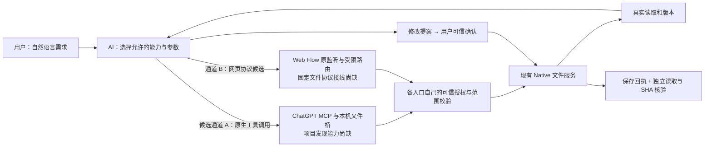
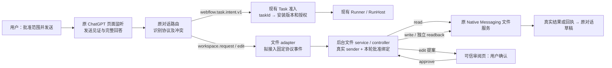
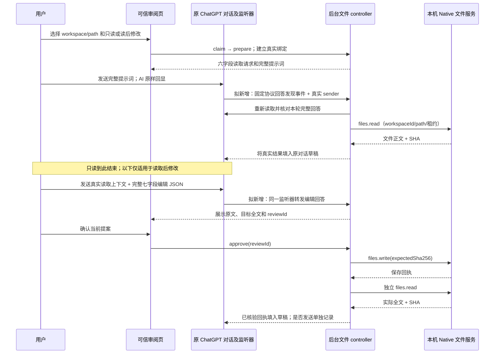

# Webflow 固定协议执行链与浏览器测试

更新日期：2026-11-07。本文保存固定协议的组件调用关系、文件读写的真实入口及手动测试条件。完整需求与项目进度仍以[产品合同](product-contract.zh-CN.md)、[执行计划](execution-plan.zh-CN.md)为准；文件历史证据见[本地文件说明](chatgpt-local-files.zh-CN.md)。

## 最新纠偏：自然语言是用户入口（设计候选，未通过评审）

用户可以说“检查项目中的登录问题并修复”，不必预先知道文件名。AI 根据可用、已授权的工具查找项目和文件、读取实际内容并提出修改；具体保存仍须可信确认、版本校验、保存回执和独立读回。模型提供参数与候选，不能授予权限，也不能提供任意本地执行代码。固定 JSON 回显保留为原 Web Flow 监听链的受控测试，不是普通用户主流程。



图中是目标关系，不表示两入口使用同一现有授权实现，也不表示任一通道已完成。通道 A 是应优先核验的候选：ChatGPT 自定义 MCP 可调用读写工具，但账号、工作区、Tunnel 和实际结果需单独验证；目前本机 MCP 仅允许先前精确批准的文件，尚无授权项目枚举及通用定位文件能力。通道 B 的任务协议可按 `taskId` 解析已安装版本并核对授权；未发现任意协议到任意脚本的通用注册表，文件固定协议尚未接入原监听器。网页路径现有结果回填与真正发送是两件事。

两位独立评审对本次自然语言候选分别为 **63/100、57/100，均未通过**，此前 67/73 的候选也不构成新设计通过。按完整需求、源码落地、授权身份、生命周期、验证五项，63 分架构评审分别为 21/30、16/25、13/20、8/15、5/10；57 分反例审查分别为 20/30、14/25、11/20、7/15、5/10。主要扣分是授权项目发现与内容出站的范围不明、具体提案缺少可信确认、跨入口并发和 UNKNOWN 恢复未证明、固定监听事件可能丢失及真实 MCP 连接未验证。设计仍须补齐并经独立复审，才可按原门槛实施；不得把图中箭头当作已连接的代码接口。

**审查发现的具体区别：**固定非 project 路径由可信审阅页对当前 `reviewId` 发出确认；现有自然语言 `project` 路径在项目写入授权及规则校验后直接在 controller 内调用 `approve`，不等待逐提案点击。现有 MCP 的精确文件 read-write grant 也不等于针对具体提案的本地确认。若采用本候选的逐提案确认规则，不能把上述项目 grant、MCP grant 或尚未验证的平台确认当成其实现。

**下一版设计必须具体回答：**（1）项目名和目录结构与正文各自如何授权出站，以及列举/搜索的数量、深度、时间和分页上限；（2）可信确认如何绑定项目、文件身份、路径、基准 SHA、目标 SHA、请求 ID、有效期及一次消费；（3）两个入口如何在同一权威写入边界处处理并发、撤权和已派发未知操作，不能以一次读回推断晚到写入已排空；（4）原监听发现之后消息丢失时如何恢复见证，避免旧 poll 冒充新的用户发送；（5）MCP 所需账号、Tunnel、工具调用和实际模型收到结果如何证明。当前还没有足以选定以上实现接口的证据，不以补充文字冒充工程设计完成。

## 2026-11-07 统一发现、分流与文件接线（缩小范围候选，评审未通过）

**结论先行：**复用原 ChatGPT 页面监听和当前文件 controller，把原来只接受自然语言的文件 adapter 扩展为也能转发本轮固定协议的发现事件；不以解决文件入口为由创建新 Registry、文件执行器或预设迁移共享账本。当前设计候选的独立评审为 67/100 和 73/100，均未达到各自总分至少 95 且无阻断的门槛；尚未实施。下方早期的 IDB 迁移草案是上轮未通过的备选，不作为本候选的必要前提。





**独立评审（本缩小范围候选）：未通过。** 架构可行性为 **67/100**（完整 21/30、落地 18/25、授权 14/20、生命周期 8/15、验证 6/10）；反例审查为 **73/100**（24/30、18/25、14/20、10/15、7/10）。两者均以总分分别至少 95 且无阻断为门槛。低分原因是候选尚未给出可以实施和验证的具体合同，而不是声称现有系统只有该分数。源码直接支持的共同阻断：原见证消费后转发消息丢失的处理，固定会话的持久恢复和可信重领，现有 ledger 的访问边界及损坏处理，read/write/草稿回填各阶段的提交与 unknown 处置，以及 stop/撤权与 Native 派发之间的异步窗口。上述问题没有新的独立运行证据，不能只靠补文字或反复评分宣布解决；历史 IDB 迁移仍非已证明的前置条件。两位评审未修改代码或实际运行浏览器。

**公共发现不等于公共执行权限。** Task 五字段中的 `taskId` 是查已安装 Task 的键，实际仍检查固定 revision、来源、目标和授权；其 Runner 与文件业务不同。本轮文件模型 JSON 仍严格六字段 read / 七字段 edit，不加入脚本名、项目名或额外 envelope；`workspaceId` 来自 Native 授权目录，显示名称由 Native workspace 元数据提供，不能单凭名称授权。文件 protocol 只匹配已编译的受限处理程序，不从 AI 选择任意 JS。

**拟议文件内部接口。** 原 discovery 只在当前可信点击/Enter 后见证本轮用户消息及完整助手回答；路由 `files` 后，文件 adapter 发 `{protocol:'opendesk.chatgpt.project.v1',action:'fixed-complete',userSha256,answerSha256}` 到现有文件 service。严格验证消息 schema、实际 sender 主文档 tab/window/document/URL；按 source 查唯一由可信页 `claim → prepare` 建立的未失效固定会话，不信任网页自报身份或权限。后台以受控 DOM reader 重读同一最新消息及完整回答，重算摘要并比对当前 requestId、turn/answer、固定六/七字段、已批准 workspace/path/operation；Task 混入、回答变化、来源或权限变化、重复候选均拒绝或暂停。摘要只是定位线索，不能单独授权。匹配后复用原 controller `inspect → answer → disk`；写入仍只能由原可信审阅页对具体 `reviewId` 的真实确认触发 `approve`，接着复用 `files.write(expectedSha256)`、真实回执及独立读回。

**关闭与防重的候选合同。** 扩展 controller 的单一串行队列负责 `fixed-complete`、旧 poll、alarm、claim、approve、stop；固定 poll 和 alarm 不自行创造发送见证，只能推进已接纳事件。将固定会话、已接纳事件身份和副作用阶段放入仅可信上下文可读的 `storage.session`；保存失败先暂停。审阅页关闭不自动删除固定会话，同来源可经原可信 gate 重新领取；来源导航、撤权、文档身份变化则暂停。Worker 恢复时复核 source、authority、完整回答、状态；`read-in-flight`、写入或草稿回填效果不明一律 unknown、不得自动重派。扩展重载/浏览器重启导致 session 丢失时不重放旧会话；使用原持久写入 ledger 查未知写入，草稿交由可信入口人工核对，不将空白当未发送。重复请求和跨 fixed/project 的未知写入沿用原 ledger 至少 `workspaceId + path` 屏障；不能忽略既有 ledger 的信任边界或扩大原有权限。源码中确认与 Native 派发之间存在异步权限检查窗口，须设计并验证必要的最小内部同步 guard，不能暴露动态 JS；若无法证明安全则继续阻断。

**待评审的关键问题：**固定会话的恢复、旧 ledger 的现有信任边界、草稿结果未知时重启后的恢复方式、原 discovery 消费 witness 与消息丢失时重试以及 stop 与 Native postMessage 竞态，是否能通过当前接口与最小变更安全落地。不得以“失败时停止”代替完整可执行的正常闭环；不能以当前文档设想替代运行证据。

**最小验证：**先对同一原监听入口写行为测试复现原 fixed JSON 被忽略、再验证接通；针对 sender/绑定、混合协议、重复事件、失权和已派发未知写入验证零越权／零重复 dispatch。设计双评审通过后，使用新身份真实运行：只读；真实读取后的完整 edit；确认前文件不变、确认后 saved 回执加独立全文/SHA；新身份再次发起；关联产物身份。最终草稿是否发送给 AI 单独记录。

## 2026-11-07 统一入口方案（评审草案，尚未实施）

> 历史说明：以下上轮候选含 IDB 迁移设想，未通过评审；本轮缩小范围候选以上方为准，不能将迁移视为既定要求。

**状态：第五轮独立评审未通过（83/84），方案仍受阻；尚未实施或完成本轮浏览器验证。** 用户的操作为：在原对话的可信文件页批准一次精确范围并准备完整 JSON → 发送 → 原监听器发现完整回复 → 固定 controller 执行读取或展示修改提案 → 用户在可信页确认写入 → Native 回执及独立读回 → 回填草稿并结束。最终草稿是否发送给 AI 单独记录。此方案不接管并行后台百度 Task，不执行 AI 给出的 JS。

| 步骤 | 输入、代码与执行位置；已有 / 拟新增 | 下一接口、拒绝与副作用 |
| --- | --- | --- |
| 1 准备 | 原 ChatGPT 顶层文档经 `chatgpt-file-intent-gate.js` 的 `open → claim` 建立 source 与可信审阅页 owner；用户在审阅页选当前 Native workspace、相对路径、只读或读后修改。`chatgpt-files-controller.js` 的 `prepare` 已生成新 request/binding 和六字段提示词。 | 保留现有审阅页 sender 校验、Native lease/会话检查；仅生成指令，不访问目标文件。拟将审阅后会话交给后台以原 source 为索引，不从网页接受授权字段。 |
| 2 原生发送与完整发现 | `chatgpt-bridge-page.js` 在 ChatGPT 隔离世界的 `onComposerSubmission` 见证可信点击或 Enter；`createChatGPTTaskDiscovery` 结合 DOM `MutationObserver` 和 5 秒补查只产生该次新用户消息对应的完整助手回复。已有。 | `chatGPTConversationRoute` 文件/Task 混合立即拒绝；文件路由调用 adapter `conversation(event)`。现有 adapter 仅自然语言任务，拟单独增加固定协议路径；原 Task 路径不变。 |
| 3 安全转发 | 拟由 `chatgpt-file-intent-page.js` 使用 `runtime.sendMessage` 发送 `opendesk.chatgpt.project.v1 / fixed-complete` 和用户、回答摘要，不发送授权、路径、正文或自报 sender；Chromium 提供 sender。 | `chatgpt-files-service.js` 限定精确 schema；controller 以真实 sender 通过 `pageSource` / 当前 tab、window、frame、documentId、URL 检查后寻找唯一已批准、未过期的 source 会话。不存在、文档变化、权限失效或停止则拒绝，不伪造审阅页 sender。后台重新读取当前 DOM，比较摘要；摘要不是授权。 |
| 4 定位同一回答与操作 | 拟由 controller 新增 `fixedComplete(message,sender)`，进入和审阅页 `handle(poll)`、alarm 相同的串行队列与同一会话；复用 `poll → inspect → answer` 与 `readChatGPTEdit`，只允许 poll 推进已接纳事件。 | `requireComplete`、原用户 echo、turnKey/answerKey、baseline、唯一文件块、同回复无 Task、身份及批准的 workspace/path/operation 必须匹配；不满足则等待或拒绝。`parseFileRequest` / `parseEditProposal` 严格校验字段，操作映射固定 `files.read` 或已有编辑提案处理；绝无动态脚本分派。旧 poll 和新事件不能并发绕过同一队列。 |
| 5 真实读取及结果 | `disk → authority → files.request('files.read')` 经 `src/native-agent/file-workspace-service.js` 的 `opendesk.local-files.v1 / files.request` Native Port 到 `/Users/shopme/Documents/workspace/opendesk/internal/browserbridge/files_service_unix.go` 的 `Handle → call`，Go 校验目录、路径及权限并读盘。已有。 | 校验正文 SHA、授权及同一回答后生成结果与 editProposal；`fillChatGPTComposer` 受原文档及草稿条件约束。回填 success 与已发送是不同状态；只读结果安全回填后结束，可准备新身份。 |
| 6 编辑审阅与保存 | AI 回显七字段后 `inspect` 只生成绑定 candidate、原文、SHA 和新 `reviewId` 的提案。拟允许审阅页关闭后重新从同一来源领取该会话；只允许真实可信审阅页显示和执行 `approve(reviewId)`。 | 再查 source、权限、完整回答和磁盘基线；原 `reserve` 在写入前持久保存同文件未知写入屏障；调用 `files.write(expectedSha256)`，由 Go 保存。任何不匹配、撤权、未确认或已消费均拒绝。 |
| 7 验证与完成 | controller 验证 Native 保存回执，再独立 `disk` 读回，比较完整正文和目标 SHA；复用 `verifyWorkspaceWriteReceipt` / `verifyWorkspaceWriteReadBack`。已有。 | 唯有回执 `saved=true` 且 `readBackVerified=true` 才算保存证实；回填草稿与 AI 已收到分开。超时或效果未知记 unknown，只允许只读对账，不重新写或换身份绕过。 |

### 2026-11-07 独立设计评审结论：未通过

两位非作者原生子 agent 分别独立只读复核；评分只评价设计，不是产品或浏览器结果。第五轮后仅修正下面的同文件屏障文案，没有新运行证据，也未再次请求评分。

| 固定评分维度 | 架构可行性评审 | 反例评审 | 主要扣分和依据 |
| --- | ---: | ---: | --- |
| 完整链路、需求覆盖 /30 | 26 | 27 | 旧 writer 的退出及未知历史所影响范围仍无可判定的证明；并行任务切换条件未闭合。 |
| 源码和执行位置可行性 /25 | 21 | 20 | [controller 的队列和 ledger](../trusted/chatgpt-files-controller.js) 与 [Native pending](../../../src/native-agent/file-workspace-service.js) 是实例内部状态；现有接口未提供旧 writer 和在途 Native 写入已退役的权威回执。 |
| 授权、身份、范围及防重 /20 | 16 | 16 | 旧 `storage.local` 快照和摘要无法证明历史条目未被删除；原草案三字段冲突谓词比现有 `workspaceId + path` 狭窄，本次已修正文案但未经重评。 |
| 生命周期、完成和未知 /15 | 12 | 13 | 未证明断连后 Native 副作用已终止；[开发重载](../../../src/development/worker.js) 是扩展级操作，不能假定并行任务和草稿安全。 |
| 验证和结果可判定性 /10 | 8 | 8 | 尚缺历史完整性与在途写入退役的独立证据、旧账本更改与新派发的共同屏障及并行资源空闲证据。 |
| **合计 /100** | **83** | **84** | **均低于 95；禁止进入产品实现。** |

**当前实际阻断：** 旧写入可能已派发但尚未收到结果；断连、等待或一次读回不能证明它以后不会落盘。旧账本若缺失或此前被更改，单次快照无法界定受影响文件，必须保守阻断无法排除的范围；如果无法枚举范围，就不能声称其他文件安全。现有扩展级重载涉及共享任务，只能在同一实际环境取得资源归属、空闲与安全切换证据后考虑。具体何种独立证据足以证明全部旧操作退役及账本历史完整，目前仍未知。不得为了继续实施而放宽该门禁。

### 第四轮后的切换合同（尚待独立评审）

- **共享账本切换是统一门禁，不只改固定分支。** 已核实 `LEDGER` 只有 `chatgpt-files-controller.js` 定义，读取、`reserve`、`settle`、`reconcile`、`startProject` 的同文件准入和固定 `approve` 都使用该账本；新 controller 的上述所有入口在迁移门禁未成功前一律拒绝新的文件副作用，保留只读检查。切换前在原实例通过现有停用及安全重载机制关闭新准入，排空可观察的本 controller 队列和 Native 请求；有已派发且回执缺失的条目仍是 unknown，不能当作已排空的成功写入。启动时必须证明旧版实例不再能够写旧账本；如果无法证明、检测到旧写入、发现迁移期间变化或发生回滚，保持停止并保留证据，不以延时或重启次数推断安全。当前尚无该实例排空和旧 writer 失效的真实运行证据，故此切换条件是实施和浏览器验证的前提，而非已达成的事实。
- **旧账本不是可信来源。** 只读抓取旧 local 快照及摘要、核验结构和身份，以固定 requestId 合并到 IDB；同 ID 内容冲突、损坏、无键但无法证明是首次安装、迁移中快照变化或事务失败均暂停，不视为空账本。`dispatching/unknown` 映射 unknown 并至少按现有 workspaceId + path 屏障阻断写入；sourceId 缺失、变化或无法比较不能缩小该屏障；历史 `confirmed`、`failed`、`readback-matched` 原样标为历史事实，不推断具有新的保存回执或交付证明；重复 requestId 不可再次 reserve。快照、映射、来源摘要和版本标记在同一 IDB 事务提交，保留原 local；后续仅使用 IDB，检测到旧 key 再发生变动即关闭写入并要求人工只读排查。若旧账本真实性或完整性不可证明，不能自动清除风险或宣称已解决；审阅页只能显示当前文件、原请求和只读结果，由用户明确核对后按现有对账合同处理，不能把单纯确认当作 Native 原回执或证明仍在途写入已消失。所有固定和 project 的 reserve、恢复、对账及 project 准入都将 `dispatching/unknown/confirmed-pending` 视作阻断状态；有不匹配的同文件身份或不完整回执则维持阻断。迁移期间和重启后不得静默恢复自然语言 project 的自动写入。
- **冷启动依赖注入。** `src/sw.js` 在 `importScripts('native-agent/transport.js')` 前安装仅内部可见的延迟 `getFoundationStorage` 闭包，闭包只在消息异步处理时 `await` 同一个 `foundation`，不可在同步注册阶段调用；通过 `transport.js → createNativeAgentService → installChatGPTFilesService → controller` 显式传递。transport、文件消息和 alarm 监听仍同步注册；首个事件进入异步门禁，等待单一 Foundation 及迁移完成。初始化失败、只读数据库或迁移失败仅暂停文件副作用并返回明确错误，不创建第二数据库或修改 schema；其他 Native 服务仍按原语义运行。须证明不跨初始化暂时死区调用闭包，并覆盖冷启动首消息和 Foundation 延迟、失败。平台接线及共享读取器/同步 guard 是拟议最小通用缺口，尚未实现或验证。
- **新增反例验证。** 测试相同用户/助手摘要但 reader epoch 或节点不同，以及旧读取事件进入编辑阶段后查询，均不得误认成功或重复执行；测试快照与 project 准入交错、迁移事务中断重启、旧 key 后续变化、同 requestId 冲突、`confirmed-pending` 跨两条入口防重及冷启动延迟/失败。每例同时断言 ledger 状态和 Native 各方法实际派发计数；对于 `beforeExecute` 用微任务安排 stop 落在 `beforeInsert` 返回与提交之间，确认无插入，提交之后只可 unknown。

### 生命周期和并发设计约束（待评审）

当前 `persist/restore/tick` 只覆盖 `s.project`，固定协议仅在审阅页 owner 内存；不能声称现有 alarm 已能恢复固定会话。评审后修订如下；本段取代上表中只传 `protocol/action` 的暂定描述。固定会话和自然语言 project 是不同类型，固定会话不得复用 `s.project` 的自动 approve 分支。原 `list` 保留现有行为，不在本轮扩大其权限或声称完成真实 list 实测；本轮读写主流程是 `read` 和经确认的 edit。

**发送见证与发现接线。** `submission(snapshot)` 增加固定协议分支，只有原 `witnessSubmission` 成功才保存本页内存中的 `{url, exactDraft}`；自然语言与固定分支互斥，固定优先且不调用 `conversationTask`。`conversation(event)` 仅在该固定见证仍在、event.user 的文本等于见证 draft、source URL 未变且 event 为原 discovery 产生的唯一完整新回答时，计算有界的用户文本和助手版本文本 SHA-256，然后发送 `{protocol:'opendesk.chatgpt.project.v1',action:'fixed-complete',userSha256,answerSha256}`。摘要仅是对照，非授权，也不携带路径、binding、文件正文或执行参数；正文无效、超限、摘要失败则可见暂停。双方字节规则必须一致，受 `executeScript` 序列化限制不能依赖模块词法闭包；具体实现和一致性验证见下。发送前重查 event 节点、文本与 URL；读取和编辑两次发送都经过同一见证逻辑。

service 为新动作严格只接受上述四个字段与 64 位小写摘要；`fixedComplete(message,sender)` 进入 controller 原 `enqueueOperation`，以 Chromium 提供的 sender 经 `pageSource`、真实 frame/tab/document/window/URL 与 enabled 校验，再以 source 唯一索引取得预批准固定会话。后台调用受控 `readChatGPTEdit` 读取同一最新用户及唯一完整回答，并独立按同一规则计算摘要、取 `turnKey/answerKey`，与消息一致、与 baseline 不同且无 Task 冲突才接纳；`answer()` 在派发前仍独立检查 requestId echo、精确协议及原答案没有变化。若 DOM 重生成、用户再次发消息、路由或摘要不同，拒绝且不退回自然语言/Task。可信内容脚本能发送事件不是文件授权：后台仍只匹配此前可信页授予的固定请求及 Native 权限。

原 discovery 在发事件前消费见证：消息尚未被后台接纳时若丢失，页面保留该次两个摘要的内存状态并显示“发现结果未确认”；允许原文档重复提交同一四字段 `fixed-complete`，不增加 nonce。查询严格使用 `{protocol:'opendesk.chatgpt.project.v1',action:'fixed-status',userSha256,answerSha256}`，真实 sender 和唯一固定会话复核后仅返回 `not-accepted/accepted/in-flight/completed/unknown` 及非敏感提示，不返回内容或授权。后台按会话、固定阶段和接纳时的 `source + readerEpoch + turnKey + answerKey + 两个摘要` 幂等；状态查询必须重新读取可验证的当前节点并匹配完整身份。相同摘要但节点/turn 不同、旧节点已消失或 reader epoch 已变时返回 `unknown` 并暂停，不能仅凭摘要命中旧事件或派发。页面卸载、原事件与确认状态均丢失或身份无法比对时明确暂停并要求新批准/新身份，不从历史 DOM 推测发送。后台接纳的线性化点是完整身份和 `accepted` 状态成功写入 `storage.session`；响应丢失时可查询，但不能推断副作用已完成。alarm 和旧审阅页 poll **不能为固定会话自行创造发现见证或从未见证历史发起读写**；它们只推进已经持久接纳的事件或可安全交付的已知结果。原监听和后台之间的消息失联不会授权 Task 回退。

**归属、关闭及重新领取。** 后台以随机 `fixedSessionId` 为主键，建立完整 `source=(tabId,windowId,documentId,url)` 唯一索引；同 source 同时至多一个非终结固定会话。`prepare` 在同一队列内对已有 active/unknown 会话拒绝覆盖；已成功 completed 且无未知草稿/写入才可新建。记录的不可由页面自报类型为 `fixed-v1`，只从经过 `owner(sender)` 的审阅页 prepare 创建。可信 gate 的一次性 `open → claim` 仍验证真实原 source 及新审阅页；controller 的 `claim` 拟在同一串行队列内检查该 source 的会话：若存在唯一未过期会话且原 owner 已关闭则附加新 owner `(tabId,documentId,generation+1)` 并持久化；若当前 owner 仍活动则拒绝第二次领取，不静默抢占；若无会话则沿现有方式创建待 prepare 空页。旧 owner 关闭只解绑 owner；原来源关闭、导航、document 替换则暂停并禁止重绑到新文档。可信 approve 入队后和任何 await 后再次核对 owner/generation、reviewId、source、开关及 Native authority；关闭/重领/停止使旧确认失效。`storage.session` 失败不显示成功领取。来源与审阅 tab 的 `drop` 必须分支，不能再统一删除固定会话。

**持久状态和副作用提交顺序。** 单个版本化固定会话记录保存 source、owner/generation、createdAt（30 分钟到期）、authority（含 Native session/lease/sourceId 和权限快照）、六字段 request、模式、baseline、阶段、被接纳的 turn/answer/摘要、已消费 ID、真实读取结果和编辑上下文、待审 reviewId/提案、result/packetId、回填状态及 unknown 标记。每条记录限制 512 KiB、最多 4 个未结束固定会话，存储不足/版本不明即 fail closed；只用受信扩展上下文可访问的 `storage.session`，不得向 content script 暴露记录；浏览器重启或扩展重载丢失该状态就要求重新批准，并先检查下述可信持久回填屏障和写入 ledger。文件内容仅保存本轮所需，完成、明确取消或过期时删除非必要正文；unknown 写入的 ledger 不删除。所有固定事件、旧 poll、alarm、claim、approve、stop 的状态变更串行进入现有 controller 队列；每次 `storage.session.set` 失败或结果不明均不得继续后续副作用，当前会话转为暂停/unknown；不能假定 session 与 local 的写入构成跨存储原子事务。

**跨存储与 UI 失效的补充不变量。** 下文原称 local 的持久屏障与文件写入 ledger，在实施方案中统一改为既有 Foundation `opendesk-browser` IndexedDB 的 `frameworkKV` 可信业务命名空间；`storage.local` 默认可供内容脚本访问，不能单凭名称称为可信，也不全局更改其访问级别（原页面 adapter 仍需读文件配置）。参考 `src/platform/storage/index.js` 的唯一 connection 和 `src/sw.js` 已有的 `(await foundation).storage` 注入模式，拟通过现有 Native transport 初始化注入同一 storage 的延迟只读取得函数，不再 open 第二个数据库或升级 schema；所有屏障/ledger 通过 `frameworkKV` 固定 namespace 的事务读写，绝不通过网页消息暴露存储操作。跨同源其他已审计特权页并非隔离边界，动态沙箱与 ChatGPT 内容脚本须验证不能直接读写该扩展源 IndexedDB。运行前显式将 `storage.session` 设为 `TRUSTED_CONTEXTS`，失败即拒绝新会话；先审查现有内容脚本 session 消费者并定向证明无退化。现有 `storage.local` 写入 ledger 的历史记录须在首次接入时只读迁移至可信存储，保留所有 dispatching/unknown、只允许更保守合并，迁移成功与版本标记在同一 IDB 事务提交；原记录保留，不静默删除。迁移前无法证明历史完整时，可信页要求用户核对当前文件未知效果，不能自动放开同文件写入。数据库/迁移/版本/数据不明时暂停；不把存储错误当空账本。此部分为拟议平台接线，现有可用性和跨消费者兼容仍须独立评审与实现验证，不能先称通过。

1. 提示词和结果两类 `fill` 均先在可信持久存储写非正文屏障 `{version,sourceUrl,packetId,kind,payloadSha256,state:'in-flight'}`，再写 session 的 `fill-in-flight`，两次成功前不能插入。插入与草稿读回成功后先写 session `filled`，再把可信持久屏障结清。重启丢失 session 时，通过 sourceUrl 在可信重新领取页发现未结清屏障；显示“可能已填入、发送或被修改”，只能由用户在该可信页查看原对话后明确确认已核对才解除，解除不认定发送成功也不重插。原草稿仍存在、为空、已发送或不可读取均不能由空白推断未插入；不可核验时继续阻止同源新回填。只保存哈希及身份，不持久保存草稿正文；状态版本/存储错误也阻止继续。`read-in-flight` 的暂停会话可经可信页明确放弃旧会话并以新身份重新批准读取；但不解除任何未知写入或回填屏障。
2. 写入 ledger 增加 `confirmed-pending`，属于同文件防重屏障：在收到真实保存回执并独立读回匹配后，将不含正文的真实回执、读回 SHA/验证事实及同一 requestId 写入此状态；然后持久化 session 的 result-ready，最后才将 ledger 结清为 confirmed。reserve、confirmed-pending、结果提交、confirmed 之间任一步中断均不自动重写；前两种状态仍阻止新 ID。恢复时 session 和 ledger 同请求匹配可完成结清；session 丢失但 ledger 的真实回执和读回事实完整时显示“保存已确认、交付状态未知”，由可信页核对并明确结清，不能把它称为未知写入或自动补发。无完整回执时是 unknown，只允许原有只读对账；禁止跨两个存储声称原子提交。
3. 审阅页关闭、source 导航和 stop 事件在排队前立即标记该 owner/source 的内存 ticket 失效，再排队持久化；恢复后同时按真实 tab、`runtime.getContexts` / documentId、generation、source、开关和 Native lease 复核。确认过程每次 await 后检查 ticket，最后一次复核在调用原 Native adapter 之前。现有 `file-workspace-service.js:request` 内部还会异步等待 `permissions.contains` 才 `port.postMessage`，仅在外层检查不能覆盖此间的关闭或撤权。若实现验证确认该窗口存在，唯一必要的平台改动是给原 `request` 增加仅可信调用方内部使用的可选同步 `beforeDispatch` guard：在权限 await、port/session/generation 最终检查之后、`postMessage` 之前同一同步片段检查失效 ticket；拒绝则 `NOT_DISPATCHED`，不能将回调或本地 JS 暴露给网页、模型、Native wire 或动态扩展。这是通用 Native 调用取消栅栏，适用其他需要派发前撤销的可信调用者；本轮只接入文件调用并测旧调用兼容。确认前关闭/停用已被观察则不得 dispatch；`postMessage` 后关闭不能撤回写入，只能继续核对真实回执或记 unknown。若不能证明通用缺口或该钩子不可安全实施，停止在设计门槛而不是声称已有保护。
4. 摘要统一为去除 reader 现有明确动作控件后的原文 UTF-8 字节 SHA-256，不作换行/空白/Unicode 规范化。用户节点用现有 `userContent.innerText ?? textContent`，先与可信发送时 draft 逐字匹配；助手用 discovery 的 clone 规则，reader 必须执行完全相同规则。拟在受控 DOM reader 的自包含 `executeScript` 函数内计算摘要并只返回摘要，不依赖现有 `userText` 的 32 KiB 投影；Chrome 只序列化函数体，故函数内部明确包含所需规范化逻辑，不以字符串 eval 或运行时动态注入代码跨界，内容脚本端采用同一字节合同并用成对 fixture 锁定一致性。必要时仅在原 `workspace-chatgpt.js` 扩展固定可序列化 reader（现有 32 KiB 投影不能满足合法编辑上下文，是已核实的共享读取能力缺口，不新建 reader 权限层）。用户正文最大 512 KiB UTF-8、回答保留原 `400*1024` UTF-16 代码单元上限，编辑正文仍 32 KiB、草稿插入仍受原 200 KiB 上限；真实内容超过现有回填上限时可见拒绝或保持未交付，绝不截断或称完成。测试短文本、非 ASCII、CR/LF、两种 DOM、接近 32 KiB 文件与 JSON 转义膨胀、各超限边界。`turnKey/answerKey` 依赖原文档 WeakMap；恢复时文档、节点重挂载导致身份不可比对则暂停，不能以相同摘要替代节点见证。
5. 为避免 WeakMap 及计数器重建后 `turn-1/answer-2` 碰撞，在隔离世界的 reader 本地实例初始化时生成随机 `readerEpoch`，仅固定文件事件另行记录和比较 epoch；旧 reader 消费者的 `turnKey/answerKey` 字符串格式保持不变。读取摘要、epoch、turn/answer 及 complete 标志来自同一次受控快照，异步摘要之后重新核对节点、文本和 epoch；任一变化拒绝。恢复时 epoch 缺失、不同或无法重查则暂停。
6. 两次事件严格为 `read-accepted → read-result-filled → result-sent → edit-accepted → review-ready`：每次保留自己的 epoch、turn、answer 及摘要；result-sent 仅在原用户消息实际包含 resultId 时成立。`fixed-status` 仅在原节点仍能重新核对完整事件身份时返回该次状态；切换到编辑阶段、节点移除或身份不可比对的旧读取事件返回 unknown 并暂停，不承诺查询旧状态，也不能据此授权重放。只有后台能证明当前事件从未被接纳时才返回 not-accepted。session 与 confirmed-pending 的自动结清须逐项匹配 requestId、workspaceId、sourceId/sourceUrl、path、targetSha256、真实回执和读回验证标志；缺字段、损坏或不一致维持屏障。最终 confirmed 后 session 丢失时，可信 ledger 保留这些非正文确认事实及交付状态，可信页显示“保存已确认，回执交付状态未知或未完成”，不自动回填或发送。
7. 同一个同步 `beforeDispatch` guard 除写入外也用于 `files.read`、`files.list` 及相关 `workspaces.list`：在 Chrome 权限 await 后、对应 `port.postMessage` 前检查 source/stop/撤权 ticket；事件已观察到时相应方法不得再派发。`fillChatGPTComposer` 保留现有供图片授权使用的异步 `beforeInsert`；新增单独内部同步 `beforeExecute`，在 `await beforeInsert()` 返回后立即、同一同步片段内复核 ticket 并调用 `executeScript`，不得将同步检查放在会再次让出微任务的 await 前；提交后无法保证脚本未插入，保持持久 fill 屏障并标 unknown，不承诺撤回。已观察停止前发生的合法列表/读取不算违规；写入派发后仍按真实回执或 unknown 处理。

| 已持久阶段 | 下一步及提交顺序 | Worker 中断、存储失败或恢复后唯一允许行为 |
| --- | --- | --- |
| `approved` | prepare 写入范围及 baseline 后才允许填入提示词；等待原网页真实发送见证及完整发现。 | 没有已接纳事件时只等待原网页发现；页面见证丢失则暂停重开新请求，alarm 不凭 DOM 执行。 |
| `accepted` | 比较 sender、完整回答、摘要、turn/answer 与本次请求；记录 accepted 再响应，重复事件只返回已知状态。 | 恢复后重新核验相同 source、回答、授权和已接纳身份，再进入下一步；任何一项不可证即暂停，不从新回答补证。 |
| `read-in-flight` | 先持久化读取 ID 的消费和 in-flight，再调用 `disk`；成功后记录数据、SHA、editProposal、result-ready。list 保留原固定分支，亦需 in-flight。 | 若中断或提交失败，暂停为读取结果未知，不再自动读取、不填草稿；用户重新批准新身份。 |
| `result-ready` / `fill-in-flight` | 回填前持久化 packetId 与 fill-in-flight；仅原文档、原 turn 和可用草稿允许插入；成功回读草稿后持久化 filled。 | 中断后 fill-in-flight 保持未知，仅只读检查草稿及人工处理；不重复插入或声称 AI 已收到；占用/用户改动时暂停保留结果。 |
| `filled` / `review-ready` | 只读结果填草稿后 completed；读后修改须真实发送该 result，再由原 discovery 见证编辑完整回复并接纳其身份，验证七字段后持久化 proposal/reviewId，等待真实可信页确认。 | 只填草稿不等于发送；`observe` 仅说明原用户消息包含 resultId，不证明 AI 已读取。页关闭保留提案并等待重新领取；无 owner、旧 owner 或旧 reviewId 均不能确认。 |
| `write-reserved` | 确认前后重查 owner、proposal、回答、磁盘基线和权限；先原 `reserve` 持久 ledger `dispatching`，再持久会话 write-reserved，任一失败均不调用 write；之后仅一次 `files.write(expectedSha256)`，验证回执及独立读回全文与 SHA，依次持久 `confirmed-pending`、session result-ready、ledger confirmed。 | 任何中断按上文跨存储规则处理；pending 仍阻止自动重写或换 ID。只读对账不冒充原回执；已确认保存与交付未知分别显示。 |
| `completed` / `paused` / `unknown` | 仅已证实只读结果成功回填，或保存回执+独立读回成功且回执成功回填，才 completed；失败/未知保留可见原因及安全处置。 | 新轮需要全新身份；未知写入必须先只读对账，未知草稿须先人工核对；授权撤销或 Native 会话/租约变化时暂停，不能跨身份恢复。 |

**验证矩阵补充。** 在 `chatgpt-file-intent.test.mjs` 的真实 bridge fixture 重现可信发送 → discovery → adapter 固定分支，确认修复前无固定事件、修复后记录原事件；service/controller 联合 fixture 断言记录、实际 `files.read/write` 模拟派发次数与草稿插入次数，而非单测 controller。覆盖不同有效 source 的唯一索引、双页领取/旧 owner 确认、旧 poll + wake + alarm、重复完成事件及不同答案、混合协议/回答重新生成、禁用/撤权/导航排队竞争。逐一在 accepted、read-in-flight 前后、result-ready、fill-in-flight 前后、review-ready、ledger reserve、Native write、receipt、读回和最终持久化边界注入中断或 storage 失败；检查恢复状态、派发与插入计数、无自动重放、owner 与可见提示。验证丢失事件时同事件重发幂等、页面丢失见证时暂停，不因 alarm/旧 poll 越过发现器。现有 list 的定向兼容测试不得回归；不能以本轮缺少真实 list 测试声称其 Native 通过。

再分别覆盖：提示词/结果持久 fill 屏障写入、实际插入后和 session 记录提交前清空 session，草稿残留/空/已发送/不可读取均须保守展示、无重复插入；`confirmed-pending → session result-ready → confirmed` 三个写入间及 confirmed 后逐点中断并清空 session，断言已确认与未知分别显示、未确认前同文件新写入为零。让 approve 在每个权限/磁盘/存储 await 暂停时关闭 owner、停止或撤权，按方法统计，断言被观察失效后 `files.write` 的 `postMessage` 为零；不能把已有合法 `files.read`/`workspaces.list` 算进写入次数。另对 read/list 的权限 await 中止断言该方法未派发，fill 的 executeScript 提交前停止与提交后 unknown 分开断言。对固定阅读器摘要覆盖两类 DOM、32 KiB 文件及转义放大、旧 epoch 丢失后相同字符串碰撞；对 guard 验证旧调用不变、权限 await 中失效不得发送以及 guard 无法由外部消息提供。验证内容脚本和动态沙箱对可信 IndexedDB 的读取、覆盖与删除被阻断，历史 ledger 迁移、损坏和不可用均 fail closed，并覆盖 session 访问级别调整对既有消费者的兼容性。

### 协议生成与最小验证

模型协议读取仅六字段 `protocol, requestId, bindingId, workspaceId, operation, path`，`protocol=opendesk.workspace.request.v1`；编辑仅七字段 `protocol, requestId, bindingId, workspaceId, path, baseSha256, content`，`protocol=opendesk.workspace.edit.v1`。真实 prepare 产生新读取身份；真实读结果提供完整 `editProposal` 与 SHA；测试脚本只从该结果复制身份和 SHA、使用明确给定的完整目标正文，用 `JSON.stringify` 转义换行后附加“只原样返回此代码块，不推理、不调用工具”。旧证据身份不可重放。内部调度协议是 `opendesk.chatgpt.project.v1` / `opendesk.chatgpt.files.v1`；Native wire 是 `opendesk.local-files.v1`，三者不是同一接口。

1. 首先对原 discovery → adapter → service 入口增加行为回归：发送见证后产生完整固定 JSON，修改前断言无文件派发（红灯），修改后同测试应进入 controller；不以 controller 单测替代入口。
2. 同入口模拟混合 Task/文件、重复观察、新旧 poll 竞争、伪造 sender、错误 document/绑定/路径、撤权、停止、回填与写入中断；观察实际固定 handler 调用及 durable 栅栏，任何错误派发或重复写入即失败。
3. 原 CFT、原扩展/Native 配对、获得本任务 UI 资源并核实加载产物后，以新身份发完整只读回显；禁用或关闭旧审阅页 poll，观察原发现事件到真实文件结果、回填与自然完成；未能定位入口来源即失败。
4. 新的读后修改轮次，以真实 editProposal 构造完整编辑 JSON；关闭旧 poll，确认前独立读取磁盘不变，可信页面确认后核对同请求保存回执、独立全文与 SHA；再用全新身份启动下一轮。缺回执、读回不一致、没有确认即写或下一轮无法开始均失败。
5. 记录新请求、绑定、操作、加载产物身份、原监听触发证据和回执；没有真实 Native 派发计数或 Task Run 账本时标 NOT_TESTED，不以点击次数推断恰好一次。回填和发送分别记录，最终回执不自动发送。

**核心要求：测试提示词直接包含完整 JSON，AI 原样返回；本地监听器解析后，调用已存在且已授权的处理程序。AI 不需要推理参数，也不直接访问磁盘。** 看见 JSON、解析成功、实际执行和结果交付是四个不同状态，必须分别验证。

## 两条实际链路

| 链路 | 回复发现与触发 | 实际执行者 | 当前边界 |
| --- | --- | --- | --- |
| 网页 Task | 原 ChatGPT 回复发现器 → Task 协议解析 → 后台准入 | 已安装的固定 Controller Task，经原 Authority / RunHost 执行 | 以真实安装、运行时身份及授权状态为准 |
| 固定文件协议 | 保持打开的可信文件审阅页定时 poll → 文件 controller → 共享回复读取器 | 原 Native 文件服务 | 已有普通文本文件的读取、审阅后修改及受限目录列表 |

文件 controller 是 `projects/webflow/trusted/` 的固定第一方可信业务，不是已安装 Task，也不是 Sidebar 沙箱脚本。更新 Webflow 工具 JSON 不会替换它。不能把“原监听器能识别文件轮次”写成“原监听器已自动调用文件 Task”；当前固定 JSON 文件测试依赖高级审阅页自己的轮询。

## 网页 Task 的逐步调用

1. **准备脚本。** 安装具有明确 `taskId`、参数 Schema 和目标范围的 Task。例：`baidu.search.top3` 对应 [baidu-search-top3.js](../../../examples/tasks/baidu-search-top3.js)，入口为 `async function main()`，读取词法变量 `params`，通过受控 `page` 操作网页。
2. **发送测试提示词。** 用户发送下方完整协议，要求 AI 原样返回一个 `opendesk-task` 代码块。每轮使用新 `candidateId`；示例身份不能反复重放。
3. **发现完整回复。** [chatgpt-bridge-page.js](../trusted/chatgpt-bridge-page.js) 的 `MutationObserver` 和 5 秒补查唤醒同一发现逻辑；[chatgpt-task-discovery.js](../../../src/native-agent/chatgpt-task-discovery.js) 关联真实发送与当前回复，排除历史候选和未完成片段。
4. **读取和解析。** [workspace-chatgpt.js](../../../src/native-agent/workspace-chatgpt.js) 在原 tab/document 的隔离世界读取完整回复；[chatgpt-task-request.js](../../../src/native-agent/chatgpt-task-request.js) 的 `validateWebFlowTaskIntent()` 校验五字段 JSON。此时只是候选，没有执行能力。
5. **匹配脚本和参数。** [chatgpt-background-adapter.js](../../../src/native-agent/chatgpt-background-adapter.js) 按 `taskId` 查真实安装，取得固定脚本 Revision，校验参数 Schema、目标、来源及批准范围。模型不能用文件名或代码字符串替代安装记录。
6. **交给原执行器。** [web-task-ingress.js](../../../src/page-events/web-task-ingress.js) 经原准入账本、后台 Runner、Authority 和 RunHost 提交固定脚本、`params` 和目标，最终执行 `main()`。缺少安装或授权即拒绝；未知执行不能重新派发。
7. **核实并交付。** 核对同一请求的持久 Run/Result，释放资源，再向原聊天回传。执行完成、持久化完成、交付完成和 AI 已收到要分别记录。

可复制的 Task 测试提示词（执行前确认真实 Task 可用及范围已批准）：

````text
这是 Webflow 固定协议测试。请只原样返回下面一个代码块，不解释、不改字段、不调用工具，不声称任务已执行。

```opendesk-task
{
  "protocol": "webflow.task.intent.v1",
  "candidateId": "webflow-test-20261106-001",
  "taskId": "baidu.search.top3",
  "targetUrl": "https://www.baidu.com/",
  "args": {"query": "OpenDesk Browser", "limit": 3}
}
```
````

## 文件读取与写入的逐步调用

1. **在原对话领取绑定。** 用现有可信入口选择 Native workspace、相对路径和模式，批准具体范围。[chatgpt-files-controller.js](../trusted/chatgpt-files-controller.js) 的 `prepare` 生成新请求身份；准备本身不读取文件。
2. **发送生成的完整提示词。** 提示词含 `opendesk-request` 代码块，字段恰为 `protocol、requestId、bindingId、workspaceId、operation、path`，协议为 `opendesk.workspace.request.v1`。复制产品实际生成的完整数据，不能拿旧例子的身份代替新授权。AI 只原样返回。
3. **自动监听。** [chatgpt-files-ui.js](../trusted/chatgpt-files-ui.js) 在自动处理期间约每 2.5 秒发送 `poll`；[chatgpt-files-service.js](../trusted/chatgpt-files-service.js) 验证可信入口后调用 controller。`poll → inspect → answer` 复用共享 DOM reader，读取原轮次完整回答，并拒绝混入网页 Task 的回答。测试期间审阅页必须保持打开，不点击“读取完整回答”来代替自动监听。
4. **解析并调用本地处理程序。** controller 核对协议、当前绑定、工作区、路径、操作与防重状态，调用 `files.request('files.read', …)` 或 `files.list`。这里由固定 `operation` 选择受限处理程序，不按 AI 文本寻找任意本地 JS，也不执行 AI 返回的代码。
5. **真正访问磁盘。** 原 [file-workspace-service.js](../../../src/native-agent/file-workspace-service.js) 封装 `kind:'files.request' / protocol:'opendesk.local-files.v1'` 并通过现有 Native Messaging 通道交给 Go 文件服务。实际磁盘实现位于独立仓库 `/Users/shopme/Documents/workspace/opendesk/internal/browserbridge/files_service_unix.go`。Native 再校验工作区和路径。只读结果回填原草稿后自然完成，未发送给 AI。
6. **修改使用真实读取上下文。** “读取后修改”会回填正文、SHA 及 `editProposal`。发送该真实上下文后，让 AI 只返回一个七字段 `opendesk-edit`：`protocol、requestId、bindingId、workspaceId、path、baseSha256、content`，协议为 `opendesk.workspace.edit.v1`。编辑请求 ID 必须来自实际 `editProposal`；只把 `content` 改成目标完整正文。
7. **审阅后保存。** 高级页展示修改前后全文；确认具体提案前不得写盘。确认后 controller 重查授权、回复和磁盘基线，调用 `files.write` 并传入 `expectedSha256`。Native 保存后返回真实回执。
8. **独立读回再完成。** controller 校验保存回执，再独立读取并比较全文和 SHA。只有 `saved=true` 且 `readBackVerified=true` 才表示保存已确认。最终回执回填草稿后自然 completed、停止轮询；草稿回填不等于已经发给 AI。

三层协议不能混用：模型返回 `opendesk.workspace.request/edit.v1`；扩展内部用 `opendesk.chatgpt.files.v1` 调度；Native 使用 `opendesk.local-files.v1`。原 Task Runner 不因此获得文件权限。

## 2026-11-06 历史实测发送的完整文件协议

以下为已执行的读取和编辑配对样例，**身份已消费，只供检查格式，不能直接重放**。手动复测时由产品生成全新身份，编辑身份和 SHA 取自该次真实读取结果。

读取提示词的协议部分如下；AI 只回显完整代码块：

````text
请只原样返回下面这一个完整代码块，所有字段和值保持不变，不添加解释、不调用工具，不声称已经读取。实际读取由本地扩展执行。

```opendesk-request
{"protocol":"opendesk.workspace.request.v1","requestId":"7347fe8a-475a-45f4-8ca8-cd111dfd37dc","bindingId":"84afce40-aa8b-41fa-9020-45d83a58cbf3","workspaceId":"workspace-fe28c0b5-041a-4b4f-b37a-a5565944eb0f","operation":"read","path":"demo.txt"}
```
````

取得真实读取结果后，保留产品回填的上下文，并附加下面的完整目标块一起发送。本轮确实预先写明了全部编辑数据，AI 无需推理或自行生成参数：

````text
这是固定协议回显测试，目标全文已明确，无需推理。请只原样返回下面这一个完整代码块，不增加说明、不改身份或参数，不声称已经保存。实际写入由扩展在可信页确认后执行。

```opendesk-edit
{"protocol":"opendesk.workspace.edit.v1","requestId":"83170f33-e583-424b-bb11-ef82c1f2ac8f","bindingId":"84afce40-aa8b-41fa-9020-45d83a58cbf3","workspaceId":"workspace-fe28c0b5-041a-4b4f-b37a-a5565944eb0f","path":"demo.txt","baseSha256":"aa6d37c4507adfcedac067b46ddf51a9beff1f0377d6de5de232645c259e3a6b","content":"OpenDesk local file test\nstatus=chain-verified-20261106-01a1afe0\n"}
```
````

编辑 ID 与读取 ID 不同；这里的 `content` 是完整新文件，两处 `\n` 均为 JSON 转义换行。解析后匹配的是固定文件操作和已批准绑定，不是按文字调用任意脚本。

## 2026-11-06 高级页手动测试操作（历史入口）

1. 在已有 Native 连接的测试浏览器打开原 ChatGPT 对话，从“通过 OpenDesk 处理本地文件”进入可信页，展开“高级：旧版文件协议访问与审阅”。入口未显示时，在“本机连接”的“ChatGPT 项目文件处理”设置中开启“显示诊断面板”。
2. 选择已有授权 workspace、测试文件相对路径和“读取文件（只读，回填后结束）”；勾选本轮范围，点击“批准本次读取并准备提示词”，再点“填入原对话草稿”。检查完整 JSON 后发送。保持可信页打开，等待自动读取、回填和完成；不点“读取完整回答并处理请求”。
3. 写入测试另起新轮次，选择“读取后提出修改（保存需确认）”。按同样步骤发送产品生成的读取提示词。真实结果回填后，保留上下文，使用其中 `editProposal` 的全部身份及 SHA，写明完整目标 `content`，附上要求原样回显的完整七字段块并发送。
4. 等待可信页自动显示修改前后全文；此时独立检查磁盘仍未改变。核对后点击一次“确认写入此文件”。必须同时看到 `saved=true`、`readBackVerified=true` 及自动完成，才算本轮保存通过。
5. 最终回执只填入草稿，不自动发送。读写测试结束后核对真实文件，清理自己未发送的测试草稿、关闭自有审阅页；需要时恢复诊断显示设置。未知写入先只读对账，不能重复确认或换 ID 重放。

## 2026-11-06 高级页浏览器测试与通过条件（历史）

测试复用原 CFT、原扩展 ID、`dist/development` 和 Native 配对，不启动第二 writer，不更换登录态。此专项需要真实扩展与 Native 能力；普通 ego 网页结果不能替代它。发送消息已获用户明确授权，只在本任务测试对话操作。

1. **只读。** 记录 `demo.txt` 当前内容和 SHA；生成新只读请求，发送完整提示词，等待 AI 原样回复。必须由自动轮询产生真实读取结果并自然完成，磁盘保持不变。
2. **读后修改。** 新绑定、新请求；真实读取后，发送由真实上下文构造的完整七字段编辑测试。确认前独立检查磁盘不变，确认后核对保存回执与独立读回，全文和 SHA 一致。
3. **协议冲突保护。** 独立新只读请求中混入网页 Task 候选，应拒绝，两种业务均不启动。没有实际派发计数时，只报告可观察到的拒绝状态，不声称已证明原生恰好一次。
4. **完成状态。** 自动完成应发生在关闭审阅页之前；回执保留“已填草稿 / 尚未发送”的真实状态。停止、来源变化、权限变化或未知效果不得自动重放。

### 实测结果（2026-11-06，22:58 收尾核验）

| 用户操作 | 本轮观察与结论 |
| --- | --- |
| 完整 JSON 触发只读 | AI 原样返回六字段请求，未点击手动处理；自动读取真实 65 字节正文并回填，页面报告本轮只读完成；独立核对磁盘未变。通过 |
| 完整 JSON 触发审阅和写入 | 新轮次读取后发送真实上下文及完整七字段编辑块；自动出现提案。确认前磁盘仍为原 SHA，点击一次确认后显示 `saved=true / readBackVerified=true`，回执自动回填并完成。通过 |
| 独立磁盘核验 | 最终全文为 `OpenDesk local file test\nstatus=chain-verified-20261106-01a1afe0\n`，65 字节、末尾 LF；SHA-256 为 `fad1a276d529db3eea85ed4cd0954226fe1792065ad3b2f622a92366f97f9a8a`，与保存及读回结果一致。通过 |
| 同一回答混入文件与 Task | AI 实际返回两个完整块；可信页自动显示 `E_CHAT_ROUTE：同一回答包含文件协议和网页 Task；两者均不得执行`，无文件结果、草稿为空，事后磁盘保持上述值。拒绝状态已验证；未读取实际派发计数或 Task Run 账本 |
| 收尾 | 自有审阅页和设置页已关闭，诊断恢复隐藏，原聊天草稿为空，UI 租约已释放；原浏览器及 Native 保留 |

本轮为原 CFT **149.0.7827.55**、扩展 **`ccfcjegpkdlgbclopjmadlcjedelidmf`**、原 `dist/development` 与原 Native 配对。检查时原 dev writer 已退出、43120 端口未监听，因此证据属于**已加载的静态 development 产物**，不能称为当前持续开发连接或 production 验收。本轮没有源码修改、构建或另起 watcher。

详见[本轮浏览器观察及磁盘证据](../evidence/protocol-chain-browser-20261106-01a1afe0.json)。这是工具观察记录，未保留原始 Native 报文或完整 UI 录像；未执行实际派发计数、未知写入故障、目录列表或 production 验收，也没有新的独立评分。混合块拒绝不等于本轮已运行正常网页 Task。

## 后续若统一入口需补什么

若产品要求“无需保持高级页打开，原监听器发现固定文件协议后也能直接推进”，需要单独修通：原回复发现事件 → 文件协议入口 → 当前可信绑定及批准范围 → 现有文件 controller。保留现有 Native 通道与互斥保护，不新建文件 Task 权限层或第二执行器。该统一入口目前不能写为已完成；历史高级页证据不替代本次原监听入口验证。
